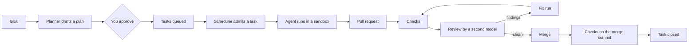
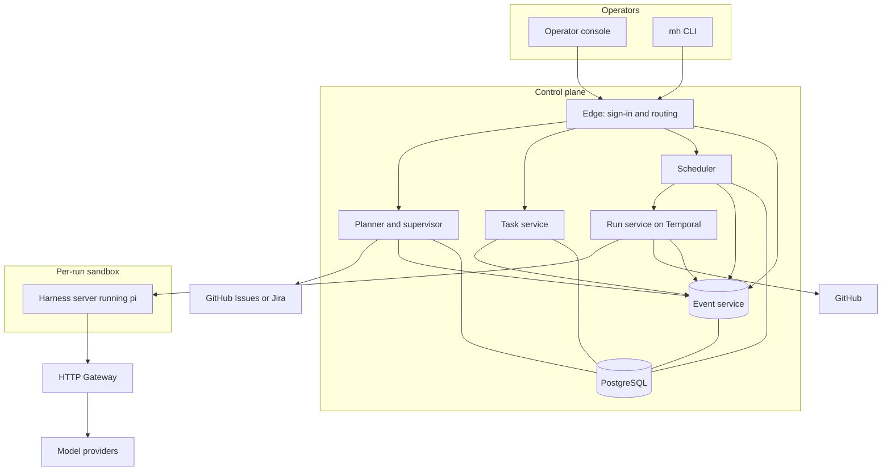

# Meta-Harness

**Set a goal. Get merged pull requests.**

[](https://github.com/davecthomas/meta-harness/actions/workflows/control-plane.yml)
[](https://github.com/davecthomas/meta-harness/actions/workflows/e2e.yml)
[](https://github.com/davecthomas/meta-harness/actions/workflows/deploy.yml)
[](https://github.com/davecthomas/meta-harness/releases/latest)


Meta-Harness is a control plane for AI coding agents at team scale. You give it
a goal and the repos it covers. It plans the work as tasks, runs each task in an
isolated sandbox on the model and agent harness that fit its difficulty, has a
second model review every pull request, fixes what the review finds, and merges
the result. You watch it in a web console and step in only when a decision is
yours.

It builds itself: Meta-Harness planned, wrote, reviewed and merged most changes
to this repository, from goals set in its own console.

---

## Contents

- [Why Meta-Harness](#why-meta-harness)
- [Features](#features)
- [How a goal becomes merged code](#how-a-goal-becomes-merged-code)
- [Architecture](#architecture)
- [Quick start](#quick-start)
- [Configuration](#configuration)
- [Command line](#command-line)
- [Development](#development)
- [Deployment](#deployment)
- [Security](#security)
- [Versioning and releases](#versioning-and-releases)
- [Contributing](#contributing)
- [License](#license)

## Why Meta-Harness

One coding agent in one terminal speeds up one developer. A team needs more:
dozens of tasks across many repos, running at once, without anyone babysitting a
session. Each needs the right model for its difficulty and a spend limit, and
someone must review every change before it merges.

Meta-Harness provides it. Agents run in parallel and in isolation, so
one task's failure or one provider's outage leaves the rest running. It
meters every model call and records every decision, and nothing reaches your
code host except through the control plane.

## Features

**Goals and planning**
- A goal names its repos, its tracker label or a plain description, a budget and a priority.
- The planner drafts a plan of tasks with their order and dependencies, and flags open questions.
  You approve it, edit it, or accept a fix the planner drafted for a gap it found.
- Issues come from GitHub Issues or Jira. An issue too large for one pull request is split, or run
  whole at your call.
- The planner writes short updates in plain language, in the tone and level of detail you choose. Anything
  it needs from you comes with the button that does it.

**Execution**
- Each task runs in its own sandbox container, behind an egress proxy, with no code-host credentials.
- Routing picks a harness profile, a model and a thinking level for each task's difficulty tier,
  with fallback candidates when one fails.
- Several attempts can run side by side on different candidates, for you to compare and pick.
- Tasks that touch the same files take turns, so parallel work doesn't collide.

**Review and merge**
- A different model reviews every pull request. Findings go to fix runs until the review comes back clean.
- Checks must pass on the pull request, and again on the merge commit, before a task closes.
- Merges happen automatically for goals that allow it, or on your approval for those that don't.

**Control and cost**
- Spend limits per run, per task and per goal are hard caps, enforced in the model gateway and the scheduler.
- A kill switch stops all work at once. Drain mode lets running work finish before a deploy.
- A supervisor checks every open task each minute, records who has it, and moves tasks that no one does.
- Model and cloud costs roll up by goal, task, repo, model and operator.

**Operator console**
- Live goal boards, task timelines, a streaming terminal, diffs with line comments, checks and reviews.
- Versioned configuration with validation on save and one-click rollback.
- A command palette and keyboard shortcuts throughout.

## How a goal becomes merged code



Every step is an event in the event service. The console shows each task's
path through these steps as it happens, with the time and money each one took.

## Architecture



| Component | Role | Code |
|---|---|---|
| Event service | The ordered audit record of every decision and step | `src/meta_harness/events/` |
| Task service | Accepts and tracks tasks; serves the Task API | `src/meta_harness/tasks/` |
| Planner | Plans goals, turns issues into tasks, writes updates, follows pull requests to their end | `src/meta_harness/planner/` |
| Supervisor | Finds stuck tasks and moves them | `src/meta_harness/supervisor/` |
| Scheduler | Admits tasks by priority, concurrency, file overlap, dependencies and budget; owns the kill switch | `src/meta_harness/scheduler/` |
| Run service | Runs each task as a Temporal workflow: route, run, publish, review, fix, merge | `src/meta_harness/run_service/` |
| Edge | Serves the console and the REST API behind sign-in, with role checks | `src/meta_harness/edge/` |
| Operator console | React and Mantine web app | `console/` |
| Harness image | The sandbox: a harness server running the pi coding agent, with every model call sent to the gateway | `images/harness-pi/` |
| Configuration | Models, harness profiles, routing tiers, task policy, repos and trackers, versioned | `config/`, `src/meta_harness/config/` |

The HTTP Gateway (from `ai-api-unified-http`) is the only model endpoint a sandbox can reach. It holds the
provider keys, pins each run's model, and enforces each run's spend limit.

## Quick start

Run the control plane and the console on your machine.

**Prerequisites:** Python 3.12 with [uv](https://docs.astral.sh/uv/), Docker, the
[Temporal CLI](https://docs.temporal.io/cli), and Node 22.19 or later.

```bash
git clone https://github.com/davecthomas/meta-harness.git
cd meta-harness
cp .env.example .env      # set your GitHub App, your sign-in identity and model keys
uv sync
make up                   # Postgres and the Temporal dev server
make serve                # migrations, the console build, and every service
```

Open http://127.0.0.1:8300. Locally, the console signs you in as
`MH_CONSOLE_DEV_IDENTITY` from `.env`. Create a goal from **New goal**, or from the
command line:

```bash
uv run mh goal create --help
```

`make stop` stops the services, and `make down` stops Postgres and Temporal. `make console-dev`
serves the console with hot reload at http://127.0.0.1:5173.

To run real tasks you also need a GitHub App installed on your repos (`MH_GITHUB_APPS`), an HTTP Gateway,
and the harness image built. The end-to-end check in `samples/temporal-run-task` builds the images and runs
whole tasks against a fake gateway at no cost (`make e2e` there).

## Configuration

Settings that change behavior live in versioned configuration, edited in the console's **Settings** and
checked when saved. A bad setting stops its service at startup, with an error that names it. The shipped defaults are in
`config/`:

| File | What it sets |
|---|---|
| `models.json` | Model providers and models, for the router and the gateway |
| `harness_profiles.json` | Agent harnesses: image, tools, loop limits |
| `task_policy.json` | Routing tiers and their candidates, spend limits, review rounds and reviewers |
| `planner.json` | Planning, sizing, update tone and detail, suggested fixes |
| `repos.json` | The repositories tasks may run on |
| `trackers.json` | Issue trackers and their sites |

Code never names a model or a harness profile: both come from configuration.

## Command line

`mh` drives every service and the APIs:

| Command | Does |
|---|---|
| `mh goal create`, `list`, `get`, `plan`, `updates`, `sweep`, `pause`, `resume`, `cancel` | Create and steer goals |
| `mh task create`, `list`, `get`, `cancel` | Submit and inspect tasks |
| `mh events` | Serve, append to, read and tail the event record |
| `mh planner`, `mh scheduler`, `mh tasks`, `mh run`, `mh edge` | Run each service |
| `mh migrate` | Apply every component's schema migrations |

`uv run mh <command> --help` describes each one.

## Development

```bash
uv sync
uv run ruff check . && uv run ruff format --check src tests
MH_DATABASE_URL=postgresql://mh:mh@127.0.0.1:5444/mh uv run pytest -q

cd console && npm ci && npm test && npm run typecheck && npm run build
cd images/harness-pi && npm ci && npm test && npm run typecheck
```

Tests marked `db` need Postgres from `make up` and skip without it. No test calls a model provider, the
real gateway, GitHub or Google Cloud.

CI runs on every pull request:

- **control plane**: lint, format and the full test suite against a real Postgres, plus the console's
  tests and build.
- **zero-cost end-to-end check**: builds the images and runs whole tasks through the RunTask workflow, the
  sandbox and the egress proxy, against a fake gateway.
- **sandbox runs this repo's checks**: this repo's own checks run inside the sandbox image, as an agent
  meets them.

A pull request that touches only the console's source or the docs skips the last two, since a change
there can't affect them.

## Deployment

Every merge to `main` deploys itself to Google Cloud through
[`.github/workflows/deploy.yml`](.github/workflows/deploy.yml), once `main`'s checks pass at that commit:

1. The **platform** Terraform stack (network, identities, secrets) applies when its plan changes, and a
   guard refuses any plan that would destroy what the deployment must keep.
2. The **release** stack updates the running VM to the commit in place. Services restart one at a time
   and running tasks drain first.
3. A smoke task runs through the deployed system. A failed boot rolls the VM back, and a failed deploy
   opens an issue for the team.

The deployment's coordinates live in a git-ignored settings file and a repository secret, never in the
repository. [`deploy/README.md`](deploy/README.md) covers setting up a new project, `make platform`,
`make deploy` and `make deploy-status`.

## Security

- **Only the control plane writes to the code host.** A sandbox gets a read-only clone token for its
  task's repo. Pushing, pull requests, reviews and merges go through the run service, so a prompt
  injection inside a run cannot reach GitHub.
- **Sandboxes hold no secrets.** Model calls go through the gateway on a per-run grant. Provider keys stay
  in the gateway, and outbound traffic passes an egress proxy.
- **Every decision is an audit record**, whether a service, a model or an operator made it.
- **Sign-in** is Google identity, checked against an operator list, with admin and operator roles.
- **Spend limits are hard caps**, never advisory.

Report a vulnerability privately through
[GitHub security advisories](https://github.com/davecthomas/meta-harness/security/advisories/new).

## Versioning and releases

Pull requests never set a version. The deploy works out each commit's version from `main`'s history:
a base in [`VERSION`](VERSION), with a minor bump for each feature and a patch bump for each fix since
([`versioning.py`](src/meta_harness/versioning.py)). A pull request says its kind in its title
(`feat/…`, `fix/…`, or `chore`, `docs`, `test`, `ci`). Each successful deploy publishes a
[release](https://github.com/davecthomas/meta-harness/releases) of the version it put into production.

## Contributing

Work arrives as goals and issues, and Meta-Harness does most of it itself. People and agents follow
the same rules, in [`AGENTS.md`](AGENTS.md):

- Branch, open a pull request, and keep to the paths the issue names.
- Retry transient failures before reporting them, and say how to resolve every error.
- Migrations only add, and event schemas never change once merged.
- Changes to a running workflow go behind a patch, with a recorded history the replay test checks.

## License

The repository has no license file yet, so it grants no license to use, copy or modify it.
