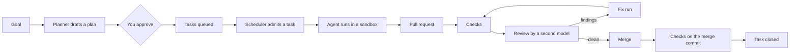
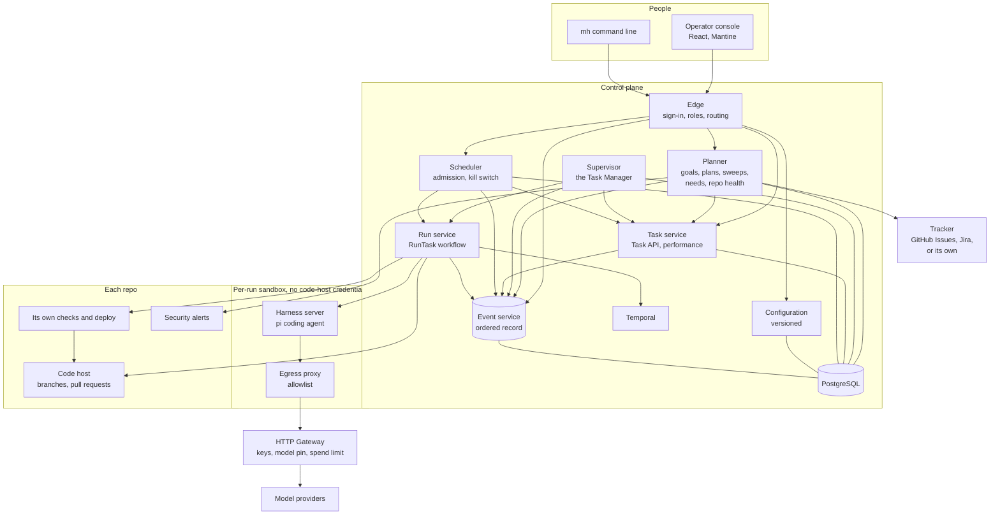
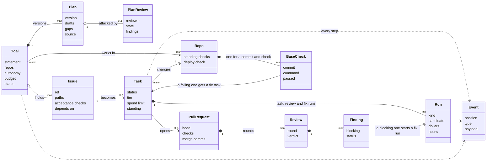

# Meta-Harness

**Agentic engineering that takes a goal to merged code.**

[](https://github.com/davecthomas/meta-harness/actions/workflows/control-plane.yml)
[](https://github.com/davecthomas/meta-harness/actions/workflows/e2e.yml)
[](https://github.com/davecthomas/meta-harness/actions/workflows/deploy.yml)
[](https://github.com/davecthomas/meta-harness/releases/latest)
[](LICENSE)


Meta-Harness is a control plane for coding agents. You state a goal. A planning
agent reads your repos and turns the goal into dependency-ordered tasks. A router
sends each task to the model and agent harness that fit its difficulty. Agents
work in parallel in isolated sandboxes. A second model reviews every pull
request, and fix runs address its findings before the pull request merges. You
step in only where a decision needs a person, such as approving a plan.

Meta-Harness is self-hosting. Problems found while running it become goals in
its own console, Muxxy, and it writes and merges most of the changes to this
repository itself.

---

## Contents

- [Five key innovations](#five-key-innovations)
- [First principles](#first-principles)
- [What makes it different](#what-makes-it-different)
- [Features](#features)
- [How a goal becomes merged code](#how-a-goal-becomes-merged-code)
- [Architecture](#architecture)
- [Domain model](#domain-model)
- [Quick start](#quick-start)
- [Configuration](#configuration)
- [Command line](#command-line)
- [Development](#development)
- [Deployment](#deployment)
- [Security](#security)
- [Versioning and releases](#versioning-and-releases)
- [Contributing](#contributing)
- [License](#license)

## Five key innovations

1. **A second model attacks each plan before you pay for it.** A planning agent reads your
   repos and drafts the work as sized, dependency-ordered tasks. A second
   model looks for what the plan gets wrong, and the planner fixes what
   it finds. You approve one plan, with its open questions and its spend
   limit beside the button.
2. **A merge test in place of a perfect review.** A pull request merges when
   main is better with it than without it. A reviewer on a different model
   from the author sorts each finding: one that fails that test goes to a fix
   run, and the planner files any other as a follow-up for a later pull request. Work
   reaches main in small layers, and no pull request waits on taste.
3. **A stopped task is a defect with an owner.** The Task Manager looks at
   every open task each minute and takes the first step that applies, in a
   fixed order: merge it, clear what blocks the merge, fix the findings, try a
   stronger model, then ask a person. It tries a step a bounded number of
   times, never passes a spend limit, and every ask comes with the button
   that does it.
4. **It works with each repo's own checks and deploy.** Meta-Harness reads what a
   repo's CI already says before it runs anything itself. A base branch the
   repo's checks passed is not checked again, and a failing one gets one task
   that fixes it. A fix run starts from the failed job's own log. A task ends
   when the repo's deploy says the change is live, and a repo's security
   alerts become issues. Each repo's health has a page.
5. **Its measure is dollar-hours per successful task.** Every attempt's
   dollars times its hours, failures included, over how far the tasks
   succeeded. A router sends each task to the model and harness that fit its
   difficulty, tiers are configuration you edit, and the Performance page
   ranks the result against measured harness and model pairs on that one
   figure.

## First principles

Most code changes spend much of their time waiting. A pull request conflicts
with main and sits. A review asks for one more fix, then another. Meta-Harness
resolves those waits itself where it can.

1. **The goal is merged work that makes main better.** A task that has stopped
   is a fault in the system, and each stop has an owner and a next step.
2. **A pull request merges when main is better with it than without it.**
   Quality comes from many pull requests built on each other.
3. **Progress stays done.** A review that passed a commit stands for that commit,
   and a retry starts where the last try stopped.
4. **It takes the clear next step without asking.** That includes resolving a
   conflict and rerunning a flaky check.
5. **It does not repeat a failing step without limit.** It sends a task back
   at most three times, and changes the step where it can.
6. **It asks you only for a decision or a permission that is yours to give.**
7. **It shows every decision,** with what it saw and the reason for it.
8. **You can always decide differently.** The recommended action is one of
   several you can take.
9. **A spend limit is never passed, and nothing spends without one.** Reaching
   one stops the work and asks you. A goal given no budget gets the task
   policy's cap.
10. **What it shows you helps you decide,** and costs as little reading as the
    decision allows.
11. **It works with each repo's own checks and deploy.** It reads what they
    already say before it runs anything itself, and repeats nothing they will
    run. A change is done when the repo's own process says it is live.

The **Goal Planner** and the **Task Manager** talk to you. The Goal Planner
decides what work a goal needs. The Task Manager gets each task merged, and acts
when a task stops. When it must ask you, it lists the actions you can take, best
first.

The rules in full are in the design's
[Goal seeking](docs/technical-design.md#goal-seeking) section.

## What makes it different

A coding agent in a terminal still needs a developer at the keyboard: to break
the work down, choose the model, prompt, watch, review the diff, and fix what it
missed. Meta-Harness does each of those steps itself.

### Agentic planning

- **A goal becomes a plan.** Write the goal in a sentence or point it at a tracker
  label. A planning agent runs in a sandbox on your repos and drafts the work as
  issues in dependency order. Each issue names the paths it changes.
  It also states the outcome a reviewer checks and the commands that prove it done.
- **The planner sizes every issue first.** One too large for a single pull request is split
  into parts that run in its place, and the original closes when they finish.
- **The planner checks its own plan.** It lists the gaps that need your call, and
  drafts a revised plan for the gaps it can settle itself, for you to accept in one
  click.
- **Replan a goal under way.** Plans can change without stopping the tasks
  already running.

### Model routing

- **Each task gets a difficulty tier.** A classifier model reads the task and picks
  a tier. The shipped tiers are `standard`, for a change inside one module, and
  `complex`, for cross-module changes, migrations, concurrency and security work.
  An issue's size sets the lowest tier it can get.
- **Each tier is an ordered list of candidates.** A candidate is a harness profile
  and a model, run at the tier's thinking level. For example, `standard` runs the
  lean pi profile on Claude Sonnet or GPT-5.6, and `complex` runs the careful
  profile on Claude Opus or GPT-6. A candidate that fails hands the task to the
  next, and a tier that runs out moves the task up a tier.
- **The reviewer is never the author.** Review runs on a different model from the
  one that wrote the change.
- **Attempts can run side by side.** Run a task on several candidates at once and
  pick the best result.
- **Cost per finished task.** Failed runs count toward it. You can compare models
  and profiles on what a merged change costs, and change the tiers to match.
  Tiers, with their profiles and models, are versioned configuration you edit in
  the console.

### Trust and limits

- **Review until clean.** Findings that would make main worse go to fix runs until
  the review comes back clean. Other findings go on the pull request as follow-ups. Checks must
  pass again on the merge commit before a task closes.
- **Hard spend limits.** Spend caps that you set stop work when spending reaches them.
  A kill switch stops everything at once.
- **Isolation.** Each run is a sandbox with no code-host credentials. Only the
  control plane can push or merge.
- **A full record.** Every decision is an event you can trace, whoever made it.

### What it asks of you

The planner reports in a few plain sentences, in the tone and detail you set. Each
thing it needs from you comes with the button that does it, such as approving
the plan or raising the budget.

## Features

- **Trackers:** issues come from GitHub Issues or Jira, and the planner writes progress and
  pull request links back to them.
- **Parallel work:** tasks that touch the same files take turns, and a task waits for the issues it
  depends on.
- **The Task Manager:** checks every open task each minute and moves the ones
  no one else is moving.
- **Merging:** goals that allow it merge on a clean review, and the rest wait for your approval.
- **Costs:** model and cloud costs roll up by goal, task, repo, model and outcome.
- **Operator console:** live goal boards, task timelines, a streaming terminal, diffs with line comments,
  checks, reviews, versioned configuration with rollback, a command palette and keyboard shortcuts.

## How a goal becomes merged code



Every step is an event in the event service. The console shows each task's
path through these steps as it happens, with the time and money each one took.

## Architecture

The components, and which calls which. An arrow reads "calls" or "writes to".



Only the run service writes to a code host, and nothing in a sandbox holds a
credential for one. A sandbox reaches the HTTP Gateway through the egress
proxy and nothing else.

| Component | Role | Code |
|---|---|---|
| Event service | The ordered audit record of every decision and step | `src/meta_harness/events/` |
| Task service | Accepts and tracks tasks; serves the Task API | `src/meta_harness/tasks/` |
| Planner | Plans goals, turns issues into tasks, writes updates, follows pull requests to their end | `src/meta_harness/planner/` |
| Supervisor (the Task Manager) | Finds stuck tasks and moves them | `src/meta_harness/supervisor/` |
| Scheduler | Admits tasks by priority, concurrency, file overlap, dependencies and budget; owns the kill switch | `src/meta_harness/scheduler/` |
| Run service | Runs each task as a Temporal workflow: route, run, publish, review, fix, merge | `src/meta_harness/run_service/` |
| Edge | Serves the console and the REST API behind sign-in, with role checks | `src/meta_harness/edge/` |
| Operator console | React and Mantine web app | `console/` |
| Harness image | The sandbox: a harness server running the pi coding agent, with every model call sent to the gateway | `images/harness-pi/` |
| Configuration | Models, harness profiles, routing tiers, task policy, repos and trackers, versioned | `config/`, `src/meta_harness/config/` |

The HTTP Gateway (from `ai-api-unified-http`) is the only model endpoint a sandbox can reach. It holds the
provider keys. It also pins each run's model and enforces each run's spend limit.

## Domain model

The records Meta-Harness keeps:



A goal's plan becomes issues when you approve it. Each issue becomes a task,
runs try a task, and a run that finishes opens a pull request. Each of its
reviews' findings starts a fix run or goes to a later pull request. Every step is
an event, which is what the console, the costs and the Task Manager read.

## Quick start

Run the control plane and the console on your machine.

**Prerequisites:** Python 3.12 with [uv](https://docs.astral.sh/uv/), Docker, the
[Temporal CLI](https://docs.temporal.io/cli), and Node 22.19 or later.

```bash
git clone https://github.com/davecthomas/meta-harness.git
cd meta-harness
cp .env.example .env      # set your GitHub App, your sign-in identity and model keys
uv sync
make up                   # Postgres and the Temporal dev server
make serve                # migrations, the console build, and every service
```

Open http://127.0.0.1:8300. Locally, the console signs you in as
`MH_CONSOLE_DEV_IDENTITY` from `.env`. Create a goal from **New goal**, or from the
command line:

```bash
uv run mh goal create --help
```

`make stop` stops the services, and `make down` stops Postgres and Temporal. `make console-dev`
serves the console with hot reload at http://127.0.0.1:5173.

To run real tasks you also need a GitHub App installed on your repos (`MH_GITHUB_APPS`), an HTTP Gateway,
and the harness image built. The end-to-end check in `samples/temporal-run-task` builds the images and runs
whole tasks against a fake gateway at no cost (`make e2e` there).

## Configuration

Settings that change behavior are versioned configuration. An admin edits them on
the console's **Configuration** page, which checks them when saved. A bad setting stops its service at startup, with an error that names it. The shipped defaults are in
`config/`:

| File | What it sets |
|---|---|
| `models.json` | Model providers and models, for the router and the gateway |
| `harness_profiles.json` | Agent harnesses: image, tools, loop limits |
| `task_policy.json` | Routing tiers and their candidates, spend limits, review rounds and reviewers |
| `planner.json` | Planning, sizing, update tone and detail, suggested fixes |
| `repos.json` | The repositories tasks may run on |
| `trackers.json` | Issue trackers and their sites |

Code never names a model or a harness profile: both come from configuration.

## Command line

`mh` runs every service and calls the APIs:

| Command | Does |
|---|---|
| `mh goal create`, `list`, `get`, `plan`, `updates`, `sweep`, `pause`, `resume`, `cancel` | Create and steer goals |
| `mh task create`, `list`, `get`, `cancel` | Submit and inspect tasks |
| `mh events` | Serve, append to, read and tail the event record |
| `mh planner`, `mh scheduler`, `mh tasks`, `mh run`, `mh edge` | Run each service |
| `mh migrate` | Apply every component's schema migrations |

`uv run mh <command> --help` describes each one.

## Development

```bash
uv sync
uv run ruff check . && uv run ruff format --check src tests
MH_DATABASE_URL=postgresql://mh:mh@127.0.0.1:5444/mh uv run pytest -q

cd console && npm ci && npm test && npm run typecheck && npm run build
cd images/harness-pi && npm ci && npm test && npm run typecheck
```

Tests marked `db` need Postgres from `make up` and skip without it. No test calls a model provider, the
real gateway, GitHub or Google Cloud.

CI runs on every pull request:

- **control plane**: the linters and the full test suite against a real Postgres, plus the console's
  tests and build.
- **zero-cost end-to-end check**: builds the images and runs whole tasks through the RunTask workflow, the
  sandbox and the egress proxy, against a fake gateway.
- **sandbox runs this repo's checks**: this repo's own checks run inside the sandbox image, as an agent
  meets them.

A pull request that touches only the console's source or the docs skips the last two, since a change
there can't affect them.

## Deployment

Every merge to `main` deploys itself to Google Cloud through
[`.github/workflows/deploy.yml`](.github/workflows/deploy.yml), once `main`'s checks pass at that commit:

1. The **platform** Terraform stack (network, identities, secrets) applies when its plan changes, and a
   guard refuses any plan that would destroy what the deployment must keep.
2. The **release** stack updates the running VM to the commit in place. Services restart one at a time
   and running tasks drain first.
3. A smoke task runs through the deployed system. A failed boot rolls the VM back, and a failed deploy
   opens an issue to fix it.

The deployment's own settings are in a git-ignored file and a repository secret, outside the
repository. [`deploy/README.md`](deploy/README.md) covers setting up a new project, `make platform`,
`make deploy` and `make deploy-status`.

## Security

- **Only the control plane writes to the code host.** A sandbox gets a read-only clone token for its
  task's repo. Pushing, pull requests, reviews and merges go through the run service, so a prompt
  injection inside a run cannot reach GitHub.
- **Sandboxes hold no secrets.** Model calls go through the gateway on a per-run grant. Provider keys stay
  in the gateway, and outbound traffic passes an egress proxy.
- **Every decision is an audit record**, whoever made it.
- **Sign-in** is Google identity, checked against an operator list, with admin and operator roles.
- **A spend limit, once set, is a hard cap.**

Report a vulnerability privately through
[GitHub security advisories](https://github.com/davecthomas/meta-harness/security/advisories/new).

## Versioning and releases

Pull requests never set a version. The deploy works out each commit's version from `main`'s history:
a base in [`VERSION`](VERSION), with a minor bump for each feature and a patch bump for each fix since
([`versioning.py`](src/meta_harness/versioning.py)). A pull request says its kind in its title
(`feat/…`, `fix/…`, or `chore`, `docs`, `test`, `ci`). Each successful deploy publishes a
[release](https://github.com/davecthomas/meta-harness/releases) of the version it put into production.

## Contributing

Work arrives as goals and issues, and Meta-Harness does most of it itself. People and agents follow
the same rules, in [`AGENTS.md`](AGENTS.md):

- Branch and open a pull request. Keep to the paths the issue names.
- Retry transient failures before reporting them, and say how to resolve every error.
- Migrations only add, and event schemas never change once merged.
- Changes to a running workflow go behind a patch, with a recorded history the replay test checks.

## License

Meta-Harness is licensed under the [Apache License 2.0](LICENSE). Copyright 2026 Dave Thomas; see
[`NOTICE`](NOTICE).
