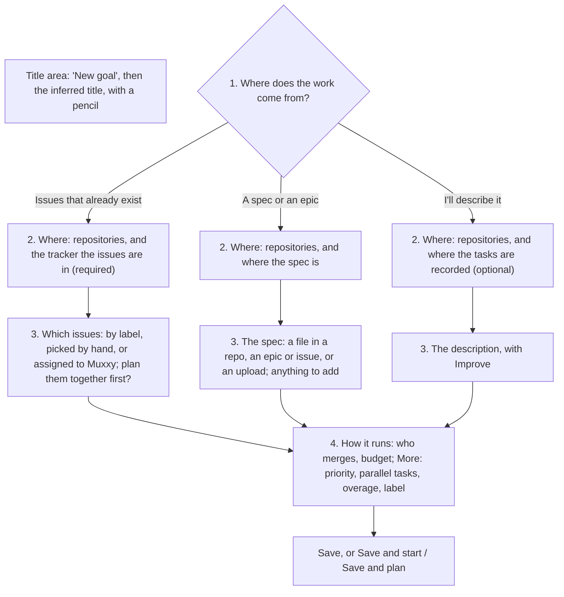

# New goal: one decision at a time

Status: approved by the owner on 2026-11-24 (VL-14527), with the decisions at the end.

## The problem

The New goal page shows every control at once: repositories, tracker and its settings, a start-from-label card,
a spec card, title, description, improve, where the issues come from, label, pick issues, budget, priority,
parallel tasks, overage and auto-merge. Most apply only after one or two earlier choices, so the page asks the
operator to read past controls that do not concern them.

## The flow

Four panels, revealed one after another. A panel opens when the one before it is answered. An answered panel
folds to one line that says the answer, with a pencil to open it again. The page's title is the goal's title:
"New goal" until one can be inferred, then the inferred title, with a pencil to change it.

### 1. Where does the work come from?

Three large choices, nothing else on the page yet:

| Choice | What it means | Planned? |
|---|---|---|
| Issues that already exist | GitHub or Jira issues, chosen by label, by hand, or by assignment to Muxxy | Runs them as they are. Optional: plan them together first |
| A spec or an epic | A document or an epic the planner splits into issues | Always planned, and approved before anything runs |
| I'll describe it | A description the planner splits into issues | Always planned, and approved before anything runs |

### 2. Where is the work?

| Control | Issues | Spec or epic | Describe it |
|---|---|---|---|
| Repositories | required | required | required |
| Tracker | required: where the issues are | required for an epic or issue; optional for a file or upload | optional: where the planned tasks are recorded. None keeps them in Muxxy |
| The tracker's required settings (a Jira project) | when the tracker asks | when the tracker asks | when the tracker asks |

With one repository registered, it is chosen and the panel folds at once. The tracker preselects the one used
last (the select-defaults rule).

### 3. What the goal is made of

**Issues that already exist**

- Which issues: a label (with the live count and list of its open issues), issues picked by hand, or both.
- When the tracker offers it: take issues assigned to Muxxy.
- A switch: "Plan them together first", so a planner proposes order, splits and gaps before anything runs.
- A description: optional, drafted from the issues (as the start-from-label card does today).

**A spec or an epic**

- Where the spec is: a file in a repository (path picked from the repo), an epic or issue (picked from the tracker),
  or an upload.
- For Jira, the epic the planned issues go under (`parent`), defaulting to the spec's epic.
- A description: optional, "anything to add to the spec".

**I'll describe it**

- The description: required, with Improve.

As soon as the panel has enough to go on (issues, a spec or a description), the title is inferred and appears in
the title area.

### 4. How it runs

Folded by default to one line of what it will do, such as "Standard: you merge each pull request · budget $40". Open:

| Setting | Shown | Default |
|---|---|---|
| How much is done without asking: ask, standard or full (full merges by itself) | always | standard |
| Budget | always | the planning setting's budget, never above the most one goal may spend |
| More: priority | under More | 0 |
| More: parallel tasks | under More | the system's |
| More: allowed overage | under More, once a budget is set | 10% |
| More: label for the issues it creates | under More, spec and describe only | one of its own |

Then the buttons: Save, and Save and start (issues run as they are) or Save and plan (anything planned), with a
sentence above them saying what happens next.

## Going back

- An answered panel folds to its answer with a pencil. Opening one keeps the panels after it open and filled.
- A change that makes a later answer wrong clears only that answer, and says so on the panel it cleared. Changing
  the source clears panel 3. Changing the repositories clears picked issues outside them. Panel 4 is never
  cleared.
- The browser's Back button steps back one panel (the open panel is in the address, `?step=`).
- Nothing is saved until a Save button is pressed. Leaving with answers given asks first, as the page does today.

## What goes away

- The start-from-label card and the spec card at the top: they become choices in panels 1 and 3.
- The Title field: the title is inferred and edited in the title area.
- The "Where its issues come from" control: it is panel 1.
- The More settings fold: its settings move to panel 4.

## Decided (2026-11-24)

1. The description is optional for the operator and always generated by the system: from the issues, the spec or
   what the operator wrote. One the operator writes is the starting point, never replaced without asking.
2. Issues assigned to Muxxy are a way of choosing issues in panel 3, not a source of their own.
3. Repositories come before the tracker: every source needs them. A Jira project that names its repositories
   preselects them.
4. Panel 4 offers the goal page's three autonomy levels, ask, standard and full, standard by default, so the
   choice reads the same on both pages. Full is the one that merges by itself.
