# Meta-Harness Technical Design

## Scope

The meta-harness runs AI coding tasks in parallel. A team sets goals, and each
goal queues tasks from GitHub issues across one or more repos. For each task
the meta-harness picks a harness profile and a model to fit the task's
difficulty, runs them in an isolated per-run sandbox, meters every model call,
and records the outcome, usually a merged pull request. Tasks run
independently, so one task's failure or one model provider's outage leaves
the others running.

### Components

This document is the design. Parts of it are built and parts are planned:
the State column below says which, and the build plan at the end orders the
rest. A section that describes a planned component says so.

| Component | What it does | State | Code |
|---|---|---|---|
| **Meta-harness control plane** | | | `src/meta_harness/` |
| Task service | Accepts and tracks tasks and serves the Task API. Code-host webhooks are planned. | built | `tasks/` |
| Planner | Turns a goal's labeled GitHub issues into tasks with their dependencies, by a periodic sweep, records what becomes of the pull requests of tasks that ended `ready` or `review_unresolved`, and drafts a goal from a label's issues. Planning tasks, the `feature` and `new-system` modalities, issue write-back and Jira and Linear adapters are planned. | partly built | `planner/` |
| Meta-harness scheduler | Admits queued tasks by priority, global concurrency, repo-area locks, closed dependencies and the goal's budget, and carries out cancels and the kill switch, which it owns. Caller quotas and daily caps are planned. | built | `scheduler/` |
| Meta-harness run service | Runs each task as a Temporal workflow, the RunTask workflow: routes it, runs its candidates, opens its pull request, runs the review loop on it and merges it. Takeover, operator review, exploration and an HTTP API of its own are planned. The only caller of the ai-api-unified router. | partly built | `run_service/` |
| Pool manager | Leases per-run sandboxes by run id, keeps a warm pool, and replaces unhealthy sandboxes. Until it exists, the run activity starts each sandbox itself. | planned | |
| Event service | Holds the ordered record of every meta-harness domain event. | built | `events/` |
| Metering service | Computes cost, time and success per attempt and per task. | planned | |
| Harness analyzer | Proposes changes to router tiers, harness profiles and task policy from metering evidence. | planned | |
| Operator console | The cloud web app operators run the meta-harness from, built on Mantine: goals, tasks, live runs, cancel, the kill switch, and configuration with versions and rollback. Its Inputs, Routing, Pool, Spend and Audit views are planned. | partly built | `console/`, `edge/` |
| Configuration | Versioned router tiers, harness profiles and repo registry, checked on save, served by the planner process | built | `config/` |
| **ai-api-unified library**, in the meta-harness run service process | | | the `ai-api-unified` repo |
| ai-api-unified router | Classifies a task, picks a tier, and returns the tier's ordered harness-profile-and-model candidates and thinking level, building none of them. | built | `AiRouteClassifier` |
| **Per-run sandbox**, one container per run | | built | `images/harness-pi/` |
| Harness server | Serves the harness server Run API and runs the harness in-process. | built | `server/` |
| pi | The default harness: pi's coding agent, third-party (pi.dev), used unmodified. | built | `@earendil-works/pi-coding-agent` |
| pi model client extension | Sends every pi model call to the HTTP Gateway, and holds the owned `submit_review`, `update_plan` and `create_issue` tools. The compaction handler and the owned `run_tests` tool are planned. | partly built | `extension/` |
| **HTTP Gateway** | The only model endpoint a per-run sandbox can reach. Holds the provider API keys, pins each run's model, and enforces each run's spend limit. Its guardrail checks ship off. | built | the `ai-api-unified-http` repo |
| **Outside the system** | | | |
| Code host | Repositories, pull requests, checks, reviews and webhooks. | | |
| Model providers | Cloud model APIs, or local models on vLLM. | | |
| Google Cloud | Infrastructure. Temporal runs on the deployment's VM today; Temporal Cloud is planned. | | |

Per-run code-host access is scoped in the run service itself: a read-only
clone token per run from the GitHub App, and the app's write token only for
Publish. Spend caps live in the HTTP Gateway's run grants and the
scheduler's goal budget.

## Principles

- Configuration, edited in the operator console, picks the harness profiles
  and models a task runs on. The router configuration maps each tier to its
  harness-profile-and-model candidates, and each harness profile defines a
  harness.
- Every AI call goes through ai-api-unified: the router's task classification,
  the planner's goal classification, and every model turn a harness makes,
  which reaches the HTTP Gateway on the run's grant key.
- The system decides by default, and an operator can override any decision
  at any time: a goal's modality, latitude and auto-merge, a plan, and any
  running task, which the operator can take over.
- Only the control plane writes to the code host. A per-run sandbox reads its
  task's repo; the meta-harness run service pushes, opens pull requests, posts
  reviews and merges, and the planner writes issues, so a prompt injection
  inside a run cannot reach the code host.
- A misconfiguration stops a service at startup, before any run: each service
  checks every harness profile and router tier candidate against the images
  and the ai-api-unified configuration, and names the bad setting.
- A task's cost includes every run it took, failed runs included, so the
  harness analyzer compares harness profiles and models on the full cost of a
  completed task.
- Every decision, whether a meta-harness component, ai-api-unified or an
  operator made it, is an audit record in the event service, where the
  operator console reads it.
- Operators and programs control the meta-harness through one REST API, and
  the operator console reaches the meta-harness only through it.

## Architecture

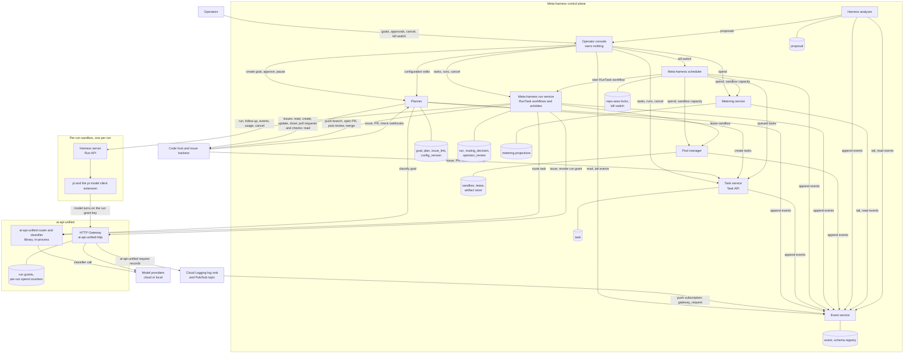

| Component | Owns |
|---|---|
| Planner | `goal`, `plan`, `issue_link` |
| Configuration, in the planner process | `config_version`, `active` |
| Task service | `task` |
| Meta-harness scheduler | Repo-area locks and the kill switch: Postgres rows today, Redis for the locks later |
| Meta-harness run service | `run`, `routing_decision`, `operator_review`, its Temporal namespace, code-host rate-limit buckets |
| Pool manager | `sandbox`, `lease`, the artifact store |
| Event service | `event`, the schema registry |
| Metering service | Its projection tables |
| Harness analyzer | `proposal` |
| Operator console | Nothing |
| HTTP Gateway | Run grants, per-run spend counters |
| Harness server | The run's pi session directory |

A component reads and writes only its own tables. What it needs from
another component it gets from that component's API or from the event
service, as the scheduler reads a goal's spend from `attempt_finished`
events: no query joins two components' schemas, though today they share one
Postgres.

Configuration is a set of versioned JSON documents, edited in the operator
console's Configuration view: every value a kind's view shows edits in place,
each edit is staged rather than saved, and the staged changes are reviewed
together as a diff against the active version, with a note, before they are
checked and stored as one version. The JSON stays as Advanced. The built kinds are `tiers` (the ai-api-unified
router's `router` section), `profiles` (the harness profiles) and `repos` (the
repo registry). The `config` component, `src/meta_harness/config/`, keeps
every version of each in its `config.config_version` table and the active one
in `config.active`. The planner process serves its API for every kind, until
the run service has an HTTP API of its own. A kind's first version is seeded
from the deployment's file on the first read.

A harness profile added in code reaches the deployment by itself. At startup
the planner compares the shipped `config/harness_profiles.json` with the
history of the `profiles` kind, and adds every profile whose name no version
ever had, as a new version with origin `shipped` and a `config_changed` event.
A profile an operator changed or removed is never touched, because its name is
in the history. An addition the check would refuse is skipped. Tiers are not
added this way: they are an ordered routing list, and an added tier would
change how tasks route.

A save is checked the way the service that reads the kind checks its
configuration at startup: the router must parse and name a default tier, every
tier candidate must be a harness pair naming a profile that exists, every
profile needs known tools and positive limits, and a profile a tier still
names cannot be removed. The task policy's `max_parallel` must be a positive
whole number no larger than the sandboxes the VM holds (`MH_MAX_SANDBOXES`),
and each reviewer pair must name a profile that exists. A refused save lists
every reason. A saved version
becomes active at once, is a `config_changed` event with the operator as
actor, and applies to the next task routed; a running task keeps what it
started with. Rolling back saves an earlier version's document again as a new
version, after the same check. With `MH_CONFIG_SOURCE=db`, as the cloud
deployment sets it, the worker, the planner and the scheduler read the active
versions; otherwise they read the files, as the zero-cost end-to-end check
does. The `modalities` and `access` kinds are planned, and an approved
harness analyzer proposal will apply as a new version the same way.

## The harness

A harness is the coding agent a run uses, set by its harness profile's image.
Any image that serves the harness server Run API and honors the run's pinned
model can be one. The default harness is pi's coding agent
(`@earendil-works/pi-coding-agent`). The meta-harness adds to pi:

- the pi model client extension, which registers the only model provider pi
  can see and sends every pi turn to the HTTP Gateway;
- the harness server, which exposes the harness server Run
  API and runs pi's `AgentSession` through pi's SDK.

### Model client

The pi model client extension registers one pi model provider with
`pi.registerProvider()` and its own `streamSimple`. The pi model client
extension needs its own stream function because the HTTP Gateway's
`/v1/conversations/turn` is not a protocol pi implements. The pi model
provider exposes a single pi model, "the run's model", which is whatever
model the HTTP Gateway run grant pins. The pi model has zero cost
metadata, because cost comes from the HTTP Gateway. It declares no
`promptCache` lifetime, so pi never warms the provider prompt cache.

On every pi turn the pi model client extension:

1. Takes pi's transcript context, reading the current system prompt and pi
   tools from pi's transcript helpers, and builds the HTTP Gateway's
   conversation request: system prompt, messages, pi tools, the thinking level
   the run started with, and the `prompt_cache` field set to
   `{"retention": "extended", "key": <harness_session_id>}`. Each earlier
   assistant turn goes back as its HTTP Gateway conversation token. Each pi
   tool result goes as `{"type": "tool_result", "tool_call_id", "result",
   "is_error"}`, the same for every model provider. The HTTP Gateway builds
   the answering model provider's own tool-result message from it
   (ai-api-unified-http 1.19.0), so the pi model client extension holds no
   per-provider message code.
2. Attaches per-call routing hints. pi agent turns carry no route hint, so the
   HTTP Gateway run grant's model policy decides: one pinned model, or a tier
   range, the router tiers from a `route_floor` to a `route_ceiling`. Calls the pi
   model client extension makes itself, for pi session compaction and for
   auxiliary text (commit message, pull request description), carry `route: trivial`.
3. Calls the HTTP Gateway's native conversation endpoint with the run grant
   key. As pi's custom-provider contract requires, the pi model client
   extension calls `options.onPayload` before sending and
   `options.onResponse` on the HTTP Gateway response, awaits
   `options.onProviderStreamEvent` for each pi provider stream event, and
   honors pi's abort signal.
4. Maps the HTTP Gateway turn result into pi's provider event sequence:
   `start`, balanced text and thinking events, tool-call events whose
   arguments the pi model client extension has parsed into input by `toolcall_end`, and exactly one `done` or
   `error`. A tool-use turn arrives from the HTTP Gateway as one response, so
   the pi model client extension emits text once per turn.
5. Finalizes pi's assistant message with the HTTP Gateway's numbers: input,
   output, cached input and cache-write model tokens, the per-turn cost, the
   stop reason, and the model the HTTP Gateway used. The pi model
   client extension adds `cached_input_tokens`, `cache_write_5m_tokens` and
   `cache_write_1h_tokens` from each HTTP Gateway turn's `usage` to the run's
   totals for the harness server Run API's `GET /usage`. The HTTP Gateway
   reports provider prompt cache writes by lifetime because they bill at
   different rates: 1.25 times the input rate for 5 minutes and 2 times for
   1 hour on Anthropic and Bedrock.

Every HTTP Gateway conversation turn sends the whole pi
session history, so provider prompt caching sets most of a turn's cost: a
cached prefix bills at about a tenth of the input rate on Anthropic.

- pi passes `cacheRetention` and `sessionId`
  to the pi model provider on every call. The harness profile image sets
  `PI_CACHE_RETENTION=long`, and the pi model client extension maps `long` to
  the `prompt_cache` retention `extended`: 1 hour on Anthropic and
  Bedrock, 24 hours on OpenAI. A run often waits more than 5 minutes between
  pi turns while tests or builds run, and the default provider prompt cache
  would expire in that gap. `harness_session_id` as the provider prompt cache
  key sends every turn of a pi session to the same OpenAI prompt cache.
- pi's `cacheWarming` setting is `off`, and the pi model
  client extension's pi model declares no `promptCache` lifetime. Otherwise pi
  would send billed provider prompt cache refresh calls through the HTTP
  Gateway.
- The pi model client extension keeps the system
  prompt and pi tool list byte-identical for the whole run: no timestamps, no
  run ids, and a fixed pi tool order. A pi session compaction rewrites the pi
  session history, so the pi turn after it writes a new provider prompt cache
  entry once.
- The HTTP Gateway accepts `prompt_cache` on the
  conversation turn and returns the cached-model-token fields in `usage`.

When an HTTP Gateway guardrail check blocks tool results, the HTTP Gateway
response names their tool-call ids. The pi model client extension replaces
those tool results with a short notice and resends the pi turn. The harness server
emits the `guardrail_blocked` harness server Run API event. When the HTTP
Gateway refuses a turn with `402 run_grant_spend_limit`, the pi model client
extension ends the pi turn with `error`, and the harness server ends the run
`ERROR` with end reason `spend_limit`.

### What pi loads

The harness server creates the pi session with `createAgentSession()` and
decides everything pi loads:

- A custom `ResourceLoader` supplies only the pi model client
  extension and the owned pi extension tools. Nothing loads from the cloned
  task repo's `.pi/` directory: no pi settings, pi extensions, pi skills or
  `SYSTEM.md`.
- pi SDK sessions leave out the pi CLI's built-in `codemode`, `tool_search`
  and MCP extensions, and the harness server keeps them out, because
  `codemode` can run classifier and image models with the session's
  credentials.
- A `ModelRuntime` with no built-in credentials leaves the pi model client
  extension's model as the only one pi can call. The harness
  server never calls `setModel`, so pi never switches models and the HTTP
  Gateway run grant decides the real model.
- pi's SDK `tools` option comes from the harness profile.
- pi loads `AGENTS.md` and `CLAUDE.md` from the pi working
  directory unless pi context loading is off, so the harness profile's
  `context_files` setting decides. The meta-harness run service dispatcher activity puts
  the task repo's `AGENTS.md` in the first pi prompt, so turning
  pi context files on sends it twice.
- `SettingsManager.inMemory(...)` holds these pi settings,
  and pi reads no settings file:

| Setting | Value | Reason |
|---|---|---|
| `compaction.reserveTokens`, `compaction.keepRecentTokens` | The harness profile's `loop.compaction` | Context windows differ by model, so each harness profile sizes its own compaction |
| `retry.enabled` | `false` | pi's default model-call retry (3 retries, backoff up to 60 seconds) would stack on the HTTP Gateway's ai-api-unified fallback chain. A failed pi turn fails the run, and the RunTask workflow's Decide step moves to the next tier candidate. pi's context-overflow recovery (compact, then retry) stays on. |
| `cacheWarming` | `off` | Warming calls would be billed provider prompt cache refreshes |

The HTTP Gateway run grant decides the model, so the harness server registers
no pi virtual models (`registerVirtualModel`).

### Tools

| Tool | Source | What the meta-harness adds |
|---|---|---|
| `read`, `ls`, `find`, `grep` | pi built-in tool | Nothing |
| `write`, `edit` | pi built-in tool | The pi model client extension's tool-call hook refuses protected paths from the task repo policy |
| `bash` | pi built-in tool | A timeout and output cap from the harness profile. The pi model client extension's tool-call hook refuses commands outside the harness profile's allowlist |
| `run_tests` | owned pi extension tool, planned | Runs the acceptance checks named in the task and emits `tests_run` harness server Run API events |
| `submit_review` | owned pi extension tool, meta-harness review harness profiles only | Ends the review run with verdict `clean` or `changes` and its findings, as a `review_submitted` harness server Run API event. The meta-harness run service posts them as a code-host pull request review |
| `update_plan` | owned pi extension tool, offered to every run whose profile has `write` | Records the agent's plan as a checklist (each step pending, in progress or done) in a `plan_updated` event, which the Task page shows as its plan. The task prompt asks for it on any task of more than a few steps |
| `create_issue` | owned pi extension tool, planning harness profiles only | Records one issue draft as an `issue_drafted` harness server Run API event: `draft_id` (the agent's own short name for it), `repo`, `title`, `body` (which states its acceptance checks), `labels` and `depends_on` (other drafts' ids, or existing issues as `owner/repo#number`). A second call with the same `draft_id` replaces the draft; a draft that depends on itself is refused. It writes nothing to the code host: the planner creates the issues once the plan is approved |

A harness profile's `tools` list chooses from these tools. Until `run_tests`
exists, a run runs its acceptance checks with `bash`. The protected-path
refusal on `write` and `edit` is planned too. Branch protection
blocks default branches. The pull request description holds the run's final
summary, which the harness prompt asks to list the assumptions the run made,
since no person answers questions during a run.

### Loop policy

The pi model client extension and the harness server enforce the harness
profile's `loop` settings. Of these, the turn and minute limits are built;
plan-first, `test_before_pr` and the compaction handler are planned, and
until the handler exists pi compacts with its own summary request, on the
run's model:

- The harness server counts pi turns from pi SDK
  events and sends `abort` to the pi session at `max_turns` or `max_minutes`.
- The first pi prompt requires a plan before edits; the pi
  model client extension's tool-call hook refuses writes until pi has emitted
  a plan.
- With `test_before_pr`, the Publish step runs only when
  the `run_tests` pi extension tool has passed in the run's pi session.
- pi starts pi session compaction when the pi
  context passes the model context window minus a reserve
  (`contextTokens > contextWindow - reserveTokens`) and keeps the most recent
  `keepRecentTokens` of pi session history as they are. The harness profile's
  `loop.compaction` sets both (pi's defaults are 16384 and 20000). The pi
  model client extension handles pi's `session_before_compact` pi SDK event:
  the pi model client extension makes the summary call to the HTTP Gateway
  itself, with purpose `compaction`, `route: trivial` and no `prompt_cache`,
  and returns `{compaction: {summary, firstKeptEntryId, tokensBefore, usage}}`.
  pi's own compaction summary request never runs. The compaction summary
  keeps the task spec and acceptance checks verbatim.

### pi sessions

A pi session is one conversation with pi, named by `harness_session_id`.
Today every run starts its own pi session, named after its `run_id`: a
candidate that follows a failed one starts from the task, not from another
model's transcript. With the review loop, the meta-harness run service keeps
the session of the run that opened a pull request, and every meta-harness fix
task on that pull request continues it in a follow-up run. A meta-harness
review run starts its own pi session, so the reviewing model never sees the
authoring model's conversation.

| When | Where the conversation is | Owner |
|---|---|---|
| During a run | pi's session directory in the per-run sandbox, set through pi's SDK `SessionManager` | The per-run sandbox (harness server) |
| Between runs | A copy of that pi session directory in the pool manager's Cloud Storage bucket, stored under `harness_session_id` when the run ends | Pool manager |
| Between runs, briefly | The finished per-run sandbox itself, kept for the pi session for up to `sticky_window` (default 10 minutes) | Pool manager |
| On each model turn | The request the pi model client extension sends to the HTTP Gateway, which forwards it and keeps no copy | Nobody |
| In the event service | Each turn's text and tool calls, as a meta-harness domain event record for the operator console and the metering service | Event service |

A follow-up runs in a per-run sandbox that holds the pi session. Before the
pool manager sandbox lease request returns, the pool manager either hands back
the per-run sandbox it kept for the pi session or copies the pi session
directory from its Cloud Storage bucket into a fresh per-run sandbox. The
harness server then switches pi to that pi session and
continues it, so the pi session conversation keeps its tool history on the
same model.

### Events

The harness server subscribes to the pi session with `session.subscribe()`
and maps pi SDK events (`message_update`, `tool_execution_*`, compaction,
`agent_end`, `agent_settled`) to the typed harness server Run API events, each
with run id, sequence number and timestamp: `turn_started`, `model_call`
(model, thinking, model tokens, cost, latency, as the pi model client
extension recorded them from the HTTP Gateway), `tool_call`, `tool_result`,
`file_changed`, `tests_run`, `guardrail_blocked`, `compacted`,
`review_submitted`, `plan_updated`, `issue_drafted`,
`turn_finished`, `heartbeat`, `run_finished`. The `agent_settled` pi SDK
event marks the end of a pi turn that will not continue on its own. The
harness server then finishes the run or, in a follow-up, waits for the next
input on the harness server Run API.

### Harness profiles

A harness profile sets a harness's image, tools, limits and resources, and is
the harness half of a router candidate. `config/harness_profiles.json` holds
them:

```json
{
  "version": "2026-11-07.1",
  "profiles": {
    "pi-lean":    {"image": null,
                   "tools": ["read", "write", "edit", "ls", "find", "grep", "bash"],
                   "max_turns": 80, "max_minutes": 45,
                   "resources": {"cpu": 2, "memory_gb": 6},
                   "bash_allow": ["cd", "ls", "cat", "grep", "git", "python", "uv", "poetry", "pytest", "ruff", "..."]},
    "pi-careful": {"image": null,
                   "tools": ["read", "write", "edit", "ls", "find", "grep", "bash"],
                   "max_turns": 200, "max_minutes": 120,
                   "resources": {"cpu": 2, "memory_gb": 6},
                   "bash_allow": ["..."]}
  }
}
```

- `image` names the harness profile image for the per-run sandbox. `null`
  uses the deployment's default, `harness-pi`, which carries Node, git,
  Python 3.12, uv and Poetry, so a run can install and test any of the three
  registered repos.
- `tools` lists the pi tools the run may use.
- `max_turns` and `max_minutes` bound the run. The harness server stops pi at
  either, and the run activity may take `max_minutes` plus 10 minutes before
  Temporal retries it.
- `resources` sets the per-run sandbox's CPU and memory.
- `bash_allow` names the programs pi's `bash` tool may run. The harness
  server loads it as an inline pi extension whose `tool_call` handler refuses
  any other program, and any command or process substitution, with a reason
  pi reads as the tool's result. It keeps a run to the tools its task needs;
  the per-run sandbox, not the list, is the security boundary.
- `services` names what the run gets beside its sandbox: `["postgres"]`, or
  `[]` for none. Left out, the machine's `MH_SANDBOX_SERVICES` decides, which
  the VM sets to `postgres`, so every profile gets it without an operator
  rewriting the profiles they keep. With `postgres`, the run service starts a
  Postgres container (`postgres:16-alpine`, or `MH_SANDBOX_POSTGRES_IMAGE`)
  on the run's own network before the sandbox, with its data in memory, one
  CPU and 512 MB, and no port on the host, and waits until it takes
  connections. The sandbox is given its URL as `DATABASE_URL` and
  `MH_DATABASE_URL` (or the names in `MH_SANDBOX_DATABASE_ENV`), and reaches
  it by name, not through the egress proxy. It is removed with the sandbox.
  So a task's tests that need a database run in its sandbox (#200): before,
  this repo's `db` tests could not, every review reported it, and one fix
  run spent 75 turns trying to start a Postgres in `/tmp`.
- The meta-harness run service checks every harness profile at startup: its
  tools, limits, resources, services and allowlist, and every tier
  candidate's profile name.

Planned profile fields, not built: `prompts`, a versioned harness prompt set;
`loop.plan_first` and `loop.test_before_pr`; `loop.compaction`, mapped to pi's
`compaction.reserveTokens` and `compaction.keepRecentTokens`; and
`context_files`. The review harness profile, `pi-review`, has no `write` or
`edit` tool and adds `submit_review`. The planning harness profile,
`pi-plan`, has no `write` or `edit` tool either, adds `create_issue`, and its
Bash allowlist names only programs that read (`ls`, `cat`, `grep`, `find`,
`git` and the like; the allowlist names programs, not subcommands). No run
pushes: only the control plane writes to the code host.

## Routing

Routing happens twice. Once per task, the ai-api-unified router in the
meta-harness run service picks a tier and returns its candidates, each a
harness profile and a model, and the RunTask workflow tries them in order. On
every model call inside a run, the HTTP Gateway routes the call.

When both `standard` candidates fail on infrastructure, the RunTask workflow
escalates to `complex`:

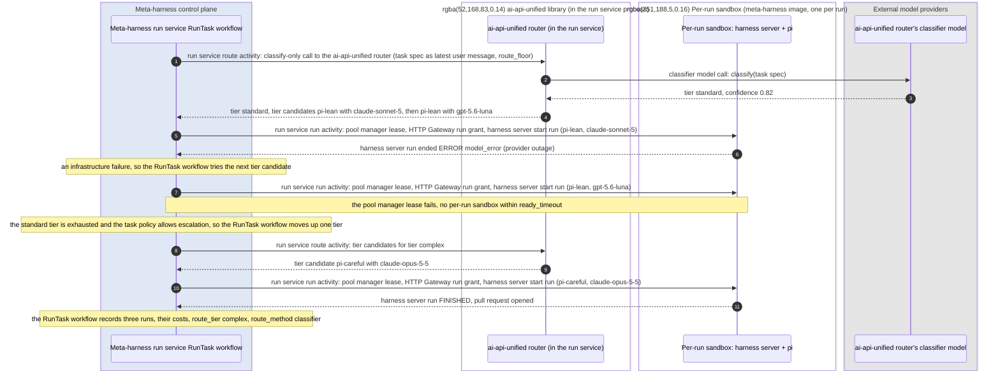

Inside a run, a compaction call goes to a cheap tier:


### Task routing

The meta-harness run service dispatcher activity renders the task spec
(title, description, acceptance checks, repo, file hints, size signals) into
one prompt. The meta-harness run service `route` activity sends that prompt through
`AiRouterCompletions` in classify-only mode. The ai-api-unified router in the
meta-harness run service classifies it, picks a tier, and returns the tier's
candidates, in order.

```json
"router": {
  "tiers": [
    {"name": "standard", "description": "A feature or fix inside one module, with clear acceptance checks, or anything smaller: config, copy, a one-file edit.",
     "models": ["harness:pi-lean/claude:claude-sonnet-5", "harness:pi-lean/openai-responses:gpt-5.6-luna"],
     "thinking": "medium"},
    {"name": "complex", "description": "Cross-module changes, migrations, concurrency, security-sensitive code, or vague requirements.",
     "models": ["harness:pi-careful/claude:claude-opus-5-5", "harness:pi-careful/openai-responses:gpt-6-sol"],
     "thinking": "high"}
  ],
  "classifier": {"engine": "openai-decisions", "min_confidence": 0.7},
  "default_tier": "standard",
  "on_exhausted": "escalate"
}
```

The shipped tiers are `standard` and `complex`. The `trivial` tier that the
task policy and the `route: trivial` calls name is planned, with the
compaction handler and the auxiliary calls that would use it. Until a tier
of that name exists, a `trivial` floor is no floor, and a `route: trivial`
call runs on the run's pinned model, as any unknown route does.

A tier candidate takes the form `harness:<harness profile>/<provider>:<model>`.
An OpenAI model is named with the `openai-responses` engine. Every harness
turn sends tools with a reasoning level, and the `openai` engine sends them
through Chat Completions, which OpenAI refuses for its reasoning models. A
save naming `openai` in a tier is refused, and at startup the planner moves
the active tiers' `openai` candidates to `openai-responses` as a new
version, origin `shipped`. A reviewer pair naming `openai` runs on
`openai-responses`. The review loop compares a reviewer with the pull
request's author by model, so one model reached through two engines never
reviews its own work.
The ai-api-unified router reads `harness` as its provider and returns the
string unchanged. In classify-only mode (`AiRouteClassifier`) the router never
builds or probes a candidate, so the meta-harness run service validates each
candidate itself at startup: its harness profile exists and names an image
the executor backend can run, and its `<provider>:<model>` is a model the
ai-api-unified library has configured.

The ai-api-unified router's classifier model reads the latest user message,
so the meta-harness run service dispatcher activity puts the task spec in
that message and keeps instructions in the system prompt.

The meta-harness run service `route` activity builds one ai-api-unified router client per
process and shares it across tasks; the library keeps per-call state in
context variables.

- The ai-api-unified router classifies the task with its classifier model,
  and below `min_confidence` it picks `default_tier`.
- The RunTask workflow tries the tier's candidates in order. A run that ends
  on infrastructure (no per-run sandbox within `ready_timeout`, a rate limit or
  exhausted quota at the model, a lost harness server, or `model_error` from a
  provider outage) moves to the next candidate. A run that ends on a limit
  (`max_turns`, `max_minutes`, `spend_limit`) ends the task.
- When a tier runs out and `on_exhausted` is `escalate`, the RunTask workflow
  calls the `route` activity again with `route_floor` one tier up, within the
  task policy's limits.
- A fix run, an exploration run and a task with a `pin` field
  skip routing and run one named pair, such as
  `harness:pi-careful/claude:claude-opus-5-5`, with no escalation. A fix run
  pins the pair that opened its pull request, so it continues that pull
  request's pi session on the same model. A review run tries the task
  policy's reviewer pairs in order. The meta-harness run service checks a
  pinned model against the ai-api-unified allow and deny lists before any
  lease, and the RunTask workflow records `route_method: model_pin`.
- Each router call sets its own `route_floor` and `route_ceiling`, because
  one router client serves many tasks at once.

Caller hints use the ai-api-unified router's per-call options:

- `complexity: high` on a task passes `route_floor: "complex"`.
- `max_tier: standard` passes `route_ceiling: "standard"`.
- A retry after a failed attempt passes `route_floor` one tier above the
  failed attempt.

The RunTask workflow learns routing only from
the meta-harness run service `route` activity's return value, and cost only from the meta-harness
run service run activity's Collect step, never from ai-api-unified library
events.

| Where | Fields |
|---|---|
| Meta-harness run service `route` activity result | From the ai-api-unified router: `route_tier`, `route_method`, `route_confidence`, `thinking`, the ordered tier candidates, and `classifier_usd` for the ai-api-unified router classifier model call |
| Meta-harness run service run activity Collect result | `run_id`, `sandbox_id`, the harness profile, `end_reason`, `turns`, `elapsed_ms`, the prompt cache hit rate, the run's model token totals (input, output, `cached_input_tokens`, `cache_write_5m_tokens` and `cache_write_1h_tokens`) from the harness server Run API `GET /usage`, and the dollars the HTTP Gateway counted against the run's HTTP Gateway run grant |
| The task's `max_usd` | The task's spend limit across all its runs, $10.00 when the task names none. Each run's grant gets what the task has left |

The RunTask workflow writes the meta-harness run service `route` activity result as the
meta-harness domain event `task_routed`, and each meta-harness run service run activity
Collect result as one `attempt_finished`. Each run's
`attempt_finished` holds its `run_id`, so it joins the pool manager's
lease record for that run.

### Task policy

The task policy holds the rules for task types, exploration, run budgets,
parallelism and review. It is the `task_policy` configuration kind, seeded
from `config/task_policy.json` and edited on the console's Configuration page.
Built today: `max_parallel`, which the scheduler reads each admission pass,
and `review.reviewers` and `review.max_rounds`, which the run service reads.
The other fields below are planned.

```json
{
  "version": "2026-11-03.1",
  "max_parallel": 8,
  "floors_by_task_type": {"security": "complex", "dependency": "trivial"},
  "exploration": {"share": 0.05, "eligible_tiers": ["trivial", "standard"],
                  "challengers": ["harness:pi-careful/openai-compatible:qwen3-coder-next"]},
  "review": {"reviewers": ["harness:pi-review/claude:claude-opus-5-5",
                           "harness:pi-review/openai-responses:gpt-5.6-luna"],
             "max_rounds": 3, "operator_alert_minutes": 240},
  "max_run_minutes": 240
}
```

- `max_parallel` is the most tasks that run at once across every goal. It
  can be no more than `MH_MAX_SANDBOXES`, the sandboxes the deployment's VM
  holds, and a saved change applies at the next admission pass.
- `floors_by_task_type` sets `route_floor` on the router call.
- The RunTask workflow pins a configured share of eligible
  tasks to a challenger harness-profile-and-model pair, so the harness analyzer keeps current data on every harness profile
  and model. Complex and security tasks never explore.
- A run's HTTP Gateway run grant spend limit is what the task has left of
  its `max_usd`, $10.00 when the task names none, after the runs before it.
  So a task's runs together never spend more than its limit. With the review
  loop, a task's `max_usd` also caps the total of its meta-harness review and
  fix runs. `preview_route()` cannot estimate a harness run, because a run's
  turn count is unknown before it starts.
- `reviewers` lists the review run's
  harness-profile-and-model pairs in order. The RunTask workflow skips any
  reviewer pair whose model wrote the pull request, so a different model
  always reviews. `max_rounds` caps the fix runs per pull
  request. `operator_alert_minutes` sets when a review round blocked on an
  operator raises an alert. Whether a clean pull request merges is the goal's
  `auto_merge` setting.

### The run loop

The RunTask workflow runs a task's tier candidates in order, one run each. It
checks the budget between candidates, because it holds the
task's remaining spend, its attempts so far and the task policy's limits.

| Step | What happens |
|---|---|
| Identify | `run_id` is the RunTask workflow id and the attempt number, `run-task-<task>:run-<N>`, the same on every retry of the run activity. Each candidate tried, in any tier, takes the next attempt number, so no two runs of a task share an id. A review or fix run takes its task's next attempt number, with tier `review` or `fix`. |
| Lease | Asks the pool manager for an existing pool manager lease on `run_id` first, so a retried run activity re-attaches to a run in progress. Otherwise requests `lease(run_id, image, harness_session_id, resources)` for the harness profile's image. The pool manager response holds the per-run sandbox address, the pool manager lease TTL and the `session_state`: `new`, `kept` or `restored`. In a deployment without the pool manager, the run activity starts one per-run sandbox per run itself, with the Docker executor backend. |
| Grant | Asks the HTTP Gateway for an HTTP Gateway run grant, which the HTTP Gateway issues and stores. The run grant holds the run id, tags, the tier candidate's inner model as a pin, the spend limit, and an expiry at `max_minutes` plus grace. Only the run grant key goes to the per-run sandbox. A retried run activity asks again with the same terms and gets a new run grant key for the live run grant. |
| Start | When `session_state` is `new`, `POST /run` on the per-run sandbox's harness server Run API with the prompt, acceptance checks, harness profile, limits, bash allowlist, the tier's thinking level and run grant key. The pi model client extension sends that thinking level on every turn; a pinned run sends none, so the HTTP Gateway's default applies. When it is `kept` or `restored`, `POST /followup` with the new input and its own run grant key. |
| Wait | Follows the harness server's event stream until `run_finished`, heartbeating the last harness server event id on every event. The run activity's heartbeat timeout catches a dead Temporal worker, and its start-to-close timeout, the harness profile's `max_minutes` plus 10 minutes, is the hard upper bound. A RunTask workflow cancel reaches the run activity through its heartbeat, and the run activity sends `POST /cancel` to the harness server. |
| Collect | Reads the harness server's `/usage`, and a finished run's changes from `GET /bundle`. Then revokes the HTTP Gateway run grant and releases the pool manager lease. Returns the terminal state: status, end reason, turns, the files changed, the run's final summary, elapsed time and model token totals. The terminal state also holds the dollars the HTTP Gateway counted against the run grant. The RunTask workflow records one cost line per run from that figure. |
| Decide | In the RunTask workflow. A run that ended `FINISHED` ends the candidate loop. A run that ended `ERROR` for an infrastructure reason (no per-run sandbox, a lost harness server, `model_error` from a provider outage) tries the next tier candidate. A run that ended on a limit (`max_turns`, `max_minutes`, `spend_limit`) is final. Another candidate would spend the budget again, so only the task policy's retry-up rule or an operator repeats a run that ended on a limit. When every candidate of every tier it may reach fails on infrastructure, as in an HTTP Gateway outage, the task fails with every run listed. Pausing such a task to resume later is not built. |
| Publish | A meta-harness run service activity, after Decide ends the loop on a finished run. Commits the run's changes to the branch `mh/<task>` and pushes it with the meta-harness run service's code-host app token. Opens the pull request, labeled `ai:meta-harness`, with `Closes <issue>` and the run's final summary. A retried Publish finds the branch and the pull request it made. A finished run that changed nothing fails the task. A fix run pushes to its pull request's branch. With the Docker executor backend, Publish commits and pushes from the workspace the host mounts. |

The RunTask workflow's Temporal history records every attempt, tier candidate
and decision. The operator console and the harness analyzer read each run's
`attempt_finished` from the event service.

### Model calls inside a run

The harness server's pi model client extension sends every pi model turn to
the HTTP Gateway's native conversation endpoint, with the run grant key as
its bearer credential. The HTTP Gateway:

1. Looks up the HTTP Gateway run grant by its run grant key: the run, harness
   profile, model policy and spend limit.
2. Sets the ai-api-unified observability context: `caller_id` is the
   meta-harness, tags are run, task, harness profile, harness and model.
3. Sends the turn through the ai-api-unified router inside the HTTP Gateway.
   With a pinned run grant model policy (the default) the HTTP Gateway
   wraps the call in the ai-api-unified library's model-pin scope for the
   tier candidate's inner model. The turn skips the classifier model call and
   runs on that model with the ai-api-unified fallback chain, cooldowns,
   guardrails and caching intact. With a tier-range run grant model policy
   the turn sets `route_floor` and `route_ceiling` instead, and the
   ai-api-unified router inside the HTTP Gateway may answer easy turns from a
   cheaper tier. Under either model policy the HTTP Gateway run grant decides
   the provider and model, and the HTTP Gateway ignores any provider or model
   the request body names.
4. Adds the turn's cost to the HTTP Gateway per-run spend counter in Redis,
   so the total is exact across HTTP Gateway replicas, and returns the turn's
   usage and the run's total in the response. Once the run has spent its
   limit, the HTTP Gateway refuses the next turn with
   `402 run_grant_spend_limit`. The pi model client extension reports the
   usage and total, and the harness server emits them in its `model_call`
   events.

A request body with `route`, such as the `route: trivial` on compaction and
auxiliary calls, runs that one call on the named tier, capped at the pinned
model's tier. An unknown route falls back to the pinned model, and pi agent
turns, which carry no `route`, stay pinned. Under a tier-range model policy
the router honors the hint within the tier range.

## Run lifecycle

A task's runs are its first attempt, fallbacks to other candidates and
retries a tier up, each in its own per-run sandbox. Once the task's pull
request is open, its RunTask workflow runs the review loop.

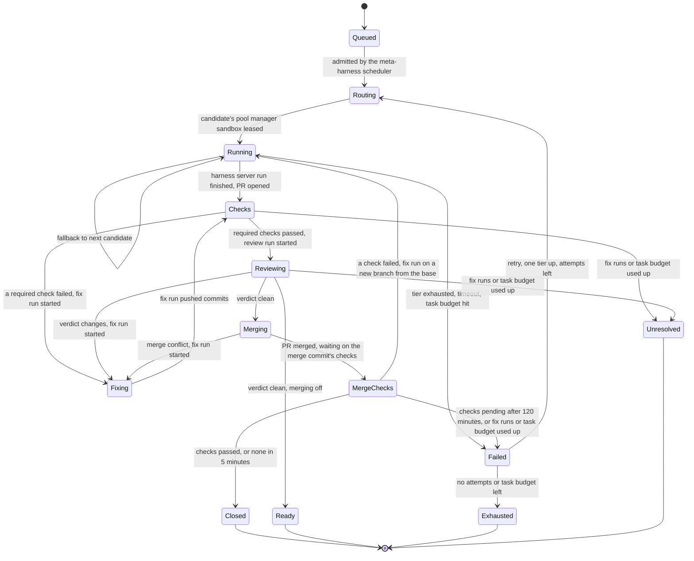

Each task has one RunTask workflow, whose Temporal workflow id is the task
id, and every run of the task happens inside it. A review or fix run is a
run of that task, inside the same RunTask workflow. `start` uses Temporal's Fail
conflict policy and Reject Duplicate reuse policy, so a task id starts at most
one RunTask workflow, even after it ends.

From admission to close:

1. The meta-harness scheduler grants a slot and calls
   the meta-harness run service's `start`.
2. The guardrails library resolves the target repo's repo policy
   and mints a read-only code-host access token scoped to the target repo, for
   the clone. The meta-harness run service dispatcher activity builds the harness prompt
   from a versioned prompt template: task spec, acceptance checks, the target
   repo's `AGENTS.md`, and the instruction to finish with a summary for the
   pull request.
3. The meta-harness run service `route` activity routes the task with its floors,
   ceilings and exploration pin. The RunTask workflow writes the
   `routing_decision` row, appends `task_routed`, and runs the candidates
   through the run loop, appending one `attempt_finished` per run.
4. The meta-harness run service run activity is the only consumer of its
   sandbox's harness server Run API event stream. It writes the `run` row,
   appends the run's harness server Run API events through the event service
   client library in batches, heartbeats the RunTask workflow, and marks the
   harness run stalled when the harness run misses a heartbeat window.
   Code-host webhooks for the run's pull request (checks completed, merged, closed)
   arrive at the task service, which signals the RunTask workflow.
5. The RunTask workflow runs review and fix runs on the pull request
   until a review comes back clean, then merges it.
6. When the pull request merges or closes, when the meta-harness review loop
   ends `ready` or `review_unresolved`, or when attempts and task budget are
   spent, the RunTask workflow appends the outcome meta-harness domain events
   and sets the task's terminal status through the task service.
7. The operator console sends a cancel to the task service, which records
   the request on the task, and the kill switch to the meta-harness
   scheduler. Each appends the audit meta-harness domain event with the
   operator as actor. On its next admission pass the scheduler cancels the
   RunTask workflow of each task with a cancel request, or of every running
   task while the kill switch is on, and admits none. The kill switch is
   global today; per-run and per-caller scopes are planned. The RunTask
   workflow cancels the meta-harness run service run activity, which calls the harness server Run
   API `POST /cancel` on the per-run sandbox directly, revokes the HTTP
   Gateway run grant, and releases the sandbox lease
   with the pool manager, which destroys the per-run sandbox.
8. Planned: an operator can take over any running task from the operator console. The
   meta-harness run service stops the active run with `POST /cancel`, revokes its run grant,
   and runs the Publish step on the work so far: the branch `mh/<task>` gets
   the run's changes and the pull request opens as a draft, or the existing pull
   request gets the commits. The task becomes `taken_over`, owned by that
   operator, and the RunTask workflow waits on a Temporal signal while the
   operator works the branch. No review, fix or merge runs on a taken-over
   task. The operator ends the takeover from the operator console with hand
   back or close. Hand back starts a follow-up run on the branch, with the operator's notes
   as its input, and the task continues through the review loop. Close ends
   the task with the operator's outcome. Both append audit events with the
   operator as actor.

Every terminal state releases the pool manager sandbox lease. The pool
manager then collects run artifacts into its artifact store and destroys the
per-run sandbox, or keeps it for the same pi session's next follow-up run.

Timeouts come from each harness profile (`max_minutes`), and the task policy
sets the hard ceiling.

### Parallel attempts

A task that has not started can be set to make 2 to 4 attempts at once
(`POST /v1/tasks/{id}/attempts`). Its RunTask workflow routes it, takes that
many of the tier's candidates, and runs one attempt on each in parallel, each
in its own per-run sandbox and workspace, with an equal share of the task's
spend limit. Each is an `attempt_finished`. When more than one finishes, the
task waits for an operator to compare them in the console and pick one; the
pick reaches the workflow as an `operator_message` signal with `when`
`choose`, recorded as `attempt_chosen`. The picked attempt's changes publish
as the pull request, which goes through the review loop as any other; the
others are never pushed. The path is behind the `parallel-attempts` patch.

### Review loop

The RunTask workflow of the task that opened a pull request owns it until it
merges or closes. Review and fix are runs of that task, inside its workflow,
recorded as its attempts with tier `review` or `fix`. The task keeps its
scheduler slot and its repo-area lock while they run, so separate review and
fix tasks would add signals between workflows without adding control. The
loop:

1. The RunTask workflow waits for the code host's checks on the pull
   request's head commit. A failed required check goes to step 3 with the
   check's output. Passing checks go to step 2.
2. A review run: the first reviewer pair in the task policy whose model did
   not write the pull request, in a new pi session on the review harness
   profile, which has no edit tools. The review run reads the pull request
   diff, the task's spec and acceptance checks. Its prompt names the code
   host's checks that passed at the reviewed commit, and tells it not to run
   them again: it runs a command only to confirm a finding, or for an
   acceptance check none of them covers (#199). With no checks on the code
   host, it runs the acceptance checks itself. A changed
   file outside the issue's `Paths:` with no reason in the summary is a
   finding. The repo's own versioning rule, in its AGENTS.md, decides about
   its version files whatever the paths say: a version change that rule asks
   for is never a finding, and one it forbids, or a missing one it requires,
   is. A
   review after the first is given the round before's findings and summary
   (prompt `review-v3`): it judges first whether each is fixed, then the fix,
   and raises a new finding only for a bug, a failing check or a part of the
   task left undone, so rounds converge. Its summary begins with how many of
   those findings are fixed, not fixed and new. Its
   `submit_review` tool ends the run with verdict `clean` or `changes` and
   its findings. The meta-harness run service posts them as a pull request
   review and records the verdict with the reviewed head SHA in a
   `pull_request_reviewed` event.
3. On `changes` or a failed check, a fix run: the pair that opened the pull
   request, with the findings or the check output as its input. It continues
   the pull request's pi session in a follow-up run (`POST /followup`), and
   its Publish step pushes to the pull request's branch. The loop returns to
   step 1.
4. On `clean`, the meta-harness run service merges the pull request through
   the code-host API at the reviewed head SHA, so a commit pushed after the
   review never merges unreviewed. A merge conflict with the base branch
   goes to a fix run. When the goal's `auto_merge` is off, or the repo's
   merge policy forbids merging, the RunTask workflow leaves the clean pull
   request open and ends the task `ready`, and the operator console lists it
   for an operator to merge.

The loop stops at the task policy's `max_rounds` fix runs per pull request,
or when the task's runs have spent its `max_usd`. The RunTask workflow then
leaves the pull request open, ends the task `review_unresolved`, and a
meta-harness alert rule fires. A pull request closed on the code host ends
the loop and the task.

An operator can dismiss a finding before its fix run starts (#207, behind
the `review-hold` patch): the first part of the operator review below. When
the task policy's `review.hold_minutes` is above 0, a review that asks for
changes waits that long before its fix run. The task stays `running`, marked
`waiting_on: review`, its status reason saying how many findings wait and
for how long. The operator dismisses any finding that is wrong, with why
(`POST /v1/tasks/{id}/reviews/{round}/findings/{n}/dismiss`, `n` from 1),
and may end the wait at once (`.../reviews/{round}/proceed`); each reaches
the workflow as an operator message. The fix run is asked only for the
findings not dismissed, and the next review is given those as the round
before's. With every finding dismissed, the round counts as clean and goes
on to the merge. The dismissals are posted as a comment on the pull request,
and recorded as `finding_dismissed`; the hold and the word to go on are
`review_hold` and `review_proceeded`. A review no one answers goes to its
fix run with every finding when the wait ends. With `hold_minutes` 0, as it
is unless an operator sets it, findings go straight to the fix run.

A task short of budget holds and asks before it ends (#188, behind the
`budget-hold` patch). Before every run, the first included, the workflow
works out what the run may spend: what the task has left of its `max_usd`,
or, when that is less, the task's share of what its goal has left (the goal's
blocking line, its `max_usd` plus its allowed overage, less what its tasks'
runs have spent, divided among its running tasks, so tasks running side by
side cannot together pass the line). A goal whose budget only warns
(`budget_mode: warn`) caps no run and holds none.
When that is under what the run needs, which is what the task's last run of
that kind spent, and at least $0.10, the task holds: it stays `running`, with
its repo-area lock and its place in the parallel limit, marked
`waiting_on: budget`, its status reason saying what the next run needs and
what is left. A run that stops at its spend limit holds the same way and,
once there is budget, runs again. The operator answers through
`POST /v1/tasks/{id}/budget`: `raise` with a new `max_usd` for the task, or
`end`, which ends the task as it would have ended. A task held for its
goal's budget looks again every five minutes, so raising the goal's budget
on its page lets its tasks go on by themselves, and a budget resume
(`POST /v1/goals/{id}/resume-budget`) tells them to look again at once. A task no one answers in 24
hours ends as if ended. The hold and the answer are recorded as `budget_hold`
and `budget_decision`.

Two parts are built differently (#85), each until what it waits on exists:

- A fix run starts a new pi session on a fresh clone of the pull request's
  branch, rather than continuing the session that wrote it, because a saved
  pi session cannot be restored into a new sandbox yet. The branch carries
  the earlier work.
- `wait_checks` polls the code host for the head commit's check runs and
  statuses until all complete, rather than waiting for a webhook. A repo with
  no checks five minutes after a push counts as passing.

The review is posted as a comment review, because GitHub refuses an approval
or a change request from the pull request's own author. A reviewer pair whose
harness profile is not active is skipped; with no reviewer left, the task
ends `ready` and unreviewed, with the reason, and never merges.

The merge (#86) reads the goal's `auto_merge` from the planner when it is
due, so a change made while the task runs applies. It squash-merges with
`sha` set to the reviewed head commit. A commit that landed after the review
goes back to the checks and a new review. Merges are one at a time per repo:
the run service's merge activity holds the repo's merge lock, a Postgres
advisory lock, from checking the branch to merging it. A branch that lacks the
base's newest commits, because another task's pull request merged while it
was reviewed, is not merged: GitHub merges the base into it (`update-branch`),
and the new head goes back to the checks. So no pull request merges against a
base it was not checked on. Whether it is also reviewed again depends on the
pull request's own diff against the base, which the merge activity compares
at the reviewed head and the new one (`same_diff` in its result). When the
diff is the same, as when the base's changes touch none of its files, the
clean review stands: the new head's checks run, and it merges with no new
review (behind the `same-diff-no-review` patch). When the diff changed, or
cannot be read whole (300 files or more, or a file with no patch), or the
new head's checks fail, it is reviewed again. A conflict with the base becomes a
fix run: the host merges the base into the fix run's clone, the run resolves
the conflict markers, and its publish commits the merge. Its prompt says
that a conflict in a version or lock file follows the repo's AGENTS.md
versioning rule: the base's version files as they are where a pull request
sets no version, or the base's version with this pull request's bump on top
where it does, and lock files regenerated by their tool. The merged head goes
back to the checks and a new review like any other. Branch protection or
any other refusal ends the task `ready` with GitHub's reason.

Nothing merges onto a broken base (#202). Before a merge, the workflow reads
the checks on the base branch's newest commit (`base_health`). While one has
failed, or one still runs, the pull request is not merged: the task waits,
its status reason saying which checks at which commit, and looks again every
minute. A check canceled because a later merge replaced its run is no
failure. When they pass, it merges. When they have not after the task
policy's `merge_wait_minutes` (60 when the policy does not say; 0 merges
without looking), the task ends `ready` with the reason, its pull request
open for an operator to merge once the base is repaired. A fix for a check
that failed after the task's own merge does not wait, since it is what
repairs the base. So merges follow one another at the pace of the base's
checks, its deploy included, and a failed deploy stops the line instead of
carrying every later merge. Behind the `merge-base-health` patch. The merge
commit's message carries a `Version:` line saying what kind of change the
task was, from its type: `feature` for a feature task, `none` for a docs or
test task, `fix` for any other.

In this repo no pull request sets the version (#201). Every pull request
used to bump it in five files, so with tasks in parallel every pair of open
pull requests conflicted there, each conflict was a fix run, and reviewers
had the bump reverted as a change outside the issue's paths. Now the
`VERSION` file holds a base, and the version of a commit is that base bumped
once for each commit on main's first-parent line since `VERSION` last
changed (`src/meta_harness/versioning.py`): a minor bump for a feature, a
patch bump for a fix, none for a change that ships nothing. A commit's kind
is its `Version:` line, else its subject's prefix (`feat/`, `fix/`, or
`chore`, `docs`, `test`, `ci` for none), else a fix. The deploy works the
version out, with the whole history checked out, and gives it to the edge
image as a build argument and to the VM's services in their environment, as
`MH_VERSION`; the version files hold the base and change only with
`VERSION`. CI fails a pull request that changes a version file. A merged pull
request's `Closes` line closes the issue. The task then waits, still `running`
and holding its repo-area lock, for every check on the merge commit,
deploys included, recorded as `merge_checks`, and its status reason says so
("merged as ...; waiting for the checks on the merge commit"). A check that
did not pass there, canceled because a later merge replaced its run or
failed, is judged by the same check on the base's newest commit that holds
the merge, when there is a newer one: that run covers this merge too, so a
deploy that failed for a reason outside the code (a refused login, a
provider's outage) and passed on the next commit is not this merge's
failure. A canceled check waits for the newer commit's run; a failed one
waits while that commit's checks still run, and stands as failed once they
finish without it. Passing checks, or none within five minutes, end the
task `closed`. A failed check that gave no output starts no fix run, since
a fix run can only change code and has nothing to go on: the task ends
`failed`, naming the check, for an operator. A failed check with output
becomes a fix run from the
base, with the checks' output as untrusted input; a fix run that changes
nothing looks at the merge commit's checks once more, and ends the task
`failed` only if they still fail. Its publish opens a new
pull request on `mh/<task>-merge-<n>` that names the merged one and closes
nothing, and that pull request goes through the review loop, the merge and
this wait again. The rounds count toward `max_rounds` and the runs toward
the task's `max_usd`; when either is used up, or the checks still run after
120 minutes, the task ends `failed` with the checks named. (Behind
`workflow.patched("merge-checks")`: a workflow started before it ends
`closed` at the merge. The status reasons, the no-output rule and the second
look are behind `workflow.patched("merge-checks-judged")`.) The deploy
workflow's update step first logs in to the VM with a command that does
nothing, up to six times, because its SSH key is new each run and the VM
refuses it until the key arrives; the update then starts once.

A task that ends `ready` or `review_unresolved` leaves its pull request open
with no workflow watching it, and its repo-area lock is released. The
planner's sweep watches it instead (#74). For each such task of a goal with a
pull request, the sweep reads the pull request from GitHub with an app token
that reads pull requests, checks and statuses: open, draft, merged or closed,
its head SHA, and its head commit's checks (pending, passed, or failed with
the failed check names). It records each change as an event on the task,
tagged with the goal: `pull_request_checks` once a new head commit's checks
settle, `pull_request_merged`, and `pull_request_closed` for a close without
merging. Each event's id is the one the RunTask workflow uses for the same
fact, so a repeated sweep, or a sweep after the workflow, records it once.
The sweep then reports the end to the task service: a merged pull request
moves the task to `closed`, and one closed unmerged moves it to `canceled`
with that reason. Pending checks are recorded when they settle; a head with
no checks at all is not recorded. The code-host webhook will make the sweep
immediate later.

### Operator review

Operator review is built (#236). An operator always knows when an agent is
reviewing a pull request, and can take the review over.

The notice (`console/src/features/tasks/reviewing.tsx`): a review run with a
`run_prompt` of kind `review` and no `attempt_finished` yet is in progress.
The Overview heads with each pull request being reviewed now, the task's
page shows a banner, and the header inbox lists it with a browser
notification. Each offers Take over this review, and Open the diff, where a
comment on the diff's lines posts to the pull request under the operator's
name.

The takeover:

- `POST /v1/tasks/{id}/review/claim` claims the review of a running task
  with a pull request, at any point of its review loop. The task service
  records the operator on the task (`review_claimed_by`), appends
  `operator_review_claimed` with the operator as actor, and queues the claim
  for the task's workflow. The first claim wins: another operator's is
  refused, naming who holds it.
- The agent's review still finishes and is posted, so the operator starts
  from its findings.
- The round then waits for the operator (behind the `operator-review`
  patch). The task stays `running`, marked `waiting_on: operator_review`,
  its status reason naming the operator, and keeps its repo-area lock. The
  wait is a Temporal condition on a signal, so it survives restarts.
  Nothing releases a claim but the operator.
- `POST /v1/tasks/{id}/review/verdict`, once the round waits: `clean`, or
  `changes` with the agent's findings the operator keeps (`keep`, numbered
  from 1) and their own (`findings`: `body`, with `path` and `line` when
  they have them). The operator's verdict decides the round: the fix run is
  asked for exactly the kept findings and theirs, so an operator can drop an
  agent's wrong finding and can ask for a change the agent did not; with
  none of either the round is clean and goes on to the merge. The workflow
  posts the verdict as a pull request comment that names the operator, and
  the task service appends `operator_review_submitted`.
- `POST /v1/tasks/{id}/review/release` gives the review back, and the round
  decides on the agent's verdict (`operator_review_released`).
- A claim is for one round: the next review is the agent's alone unless it
  is claimed again. A claimed round skips the timed hold of
  `review.hold_minutes`, since the operator's verdict already chooses the
  findings.
- The task's page shows the operator review panel while a review is held
  (`console/src/features/tasks/OperatorReview.tsx`): that the agent's review
  is still running, or the agent's findings to keep or drop, fields for the
  operator's own, Submit: changes needed, Submit: no change needed, and Give
  the review back to the agent. A task waiting for an operator's review
  heads the Overview's Needs you list.

The routes are the task service's, beside the review hold's, not the run
service's: the run service has no HTTP API. Not built: an alert when a
claimed round has waited longer than `review.operator_alert_minutes`, and a
`review_started` event (the `run_prompt` of kind `review` serves as it).

### Sequences

#### A task from admission to its pull request

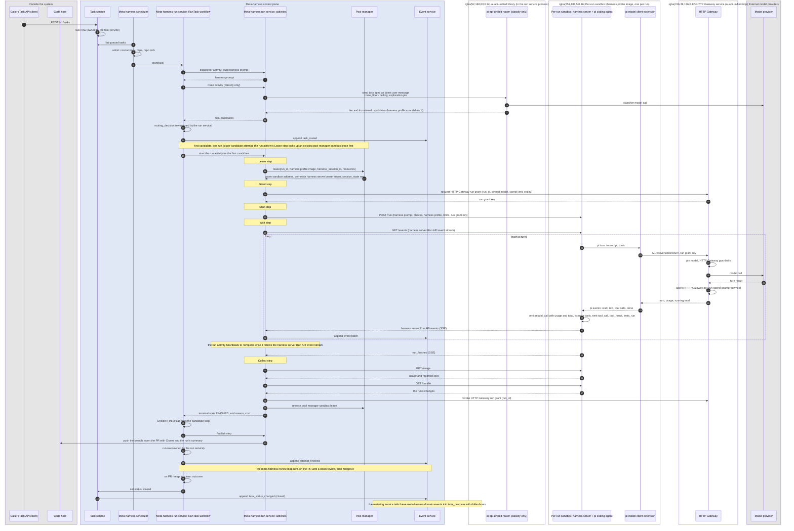

#### The operator console opening a run in progress

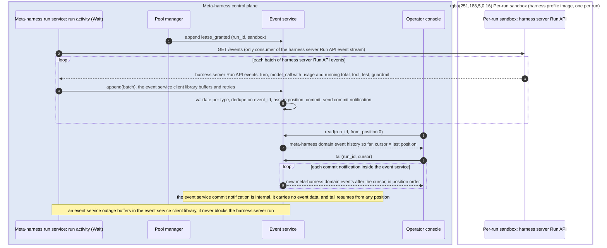

#### A compaction or auxiliary call inside a run

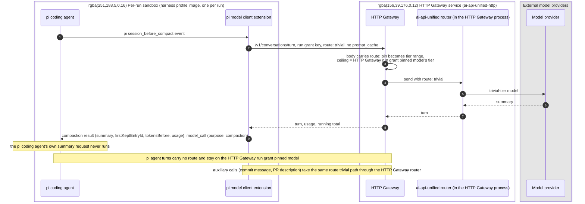

#### A run reaching its spend limit

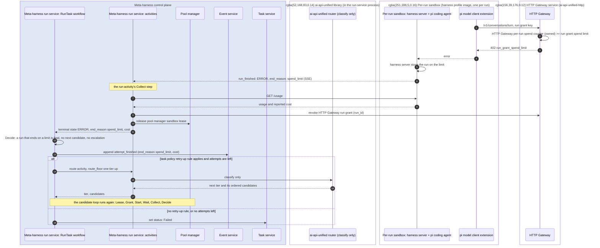

#### The review loop on an open pull request

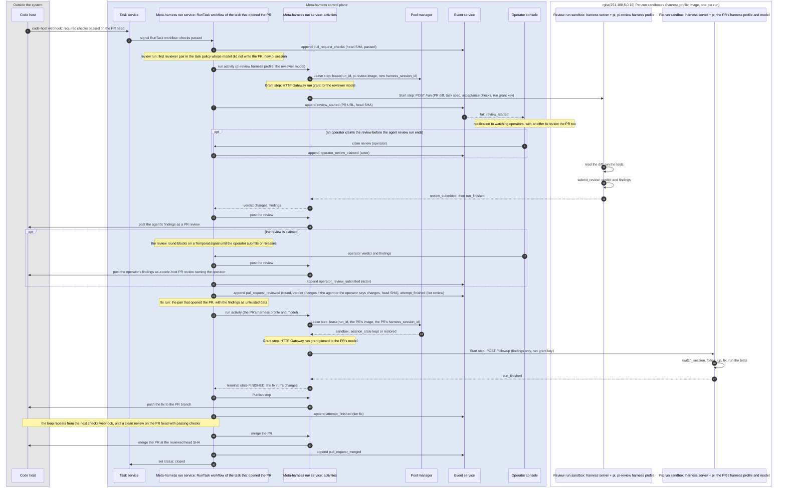

#### An operator cancel or kill switch

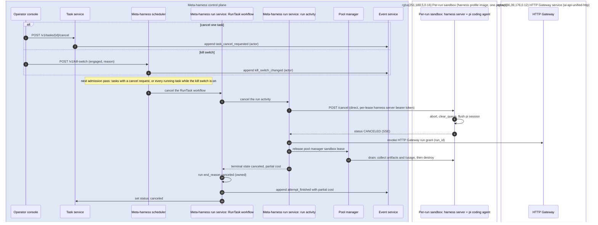

## Harness execution

### Sandbox

Each run gets one per-run sandbox: a pod with the gVisor runtime class in the
`sandbox` namespace.

- The pod runs the harness profile's image, built from a common base with git,
  language toolchains, Node, pi, the pi model client extension and the harness
  server. A harness profile names another image when it needs another
  toolchain or another coding agent.
- The per-run sandbox clones the task's repo at `/workspace` with the run's
  read-only code-host access token. Every per-run sandbox uses that path,
  because a restored pi session needs the working directory it recorded. The meta-harness run service's Publish
  step reads the run's changes through `GET /bundle` and pushes them. With the
  Docker executor backend, the meta-harness run service clones on the host into the mounted
  workspace and publishes from it. The clone's git directory sits beside the
  workspace, not inside it: the per-run sandbox mounts it read-only, and every
  host git command names the git directory and the work tree outright. So a
  hook, a rewritten `.git` file or a `core.fsmonitor` setting that pi writes
  in the workspace never runs on the host when the Publish step commits and
  pushes.
- The image sets the HTTP Gateway URL, and the run grant key arrives in
  the `POST /run` or `POST /followup` body.
- Egress reaches only the code host, package registries and the HTTP Gateway.
- CPU and memory come from the harness profile, 2 vCPU and 4 GB by default.
- The pool manager owns the per-run sandbox. It serves one run at a time, and when the
  run ends the pool manager destroys it, or keeps it for the same pi session's
  next follow-up run.

### Harness server

The harness server is a small TypeScript service in every per-run sandbox. It
serves the harness server Run API to the meta-harness run service run activity and runs pi
in-process through pi's SDK, using `AgentSessionRuntime` for `newSession()`,
`switchSession()` and `fork()`.

| Endpoint | Purpose | pi SDK calls |
|---|---|---|
| `GET /health` | Harness server readiness: pi model client extension registered, the workspace directory exists, HTTP Gateway reachable. A `warm` per-run sandbox passes it before it clones any task repo | pi model runtime state |
| `POST /run` | Start a new pi session for the run. The body holds the prompt, acceptance checks, harness profile, limits and the HTTP Gateway run grant key | `newSession()`, `prompt()` |
| `POST /followup` | Continue the pi session the per-run sandbox holds, kept or restored by the pool manager before the pool manager sandbox lease returned. The body holds the new input and the HTTP Gateway run grant key, and no pi session reference. | `switchSession()` for a restored pi session, then `prompt()` |
| `GET /events` | Harness server Run API events as server-sent events, resumable with `Last-Event-ID` | `session.subscribe()`: `message_update`, `tool_execution_*`, pi compaction events, `agent_end`, `agent_settled` |
| `GET /status` | `CREATING`, `RUNNING`, `FINISHED`, `ERROR`, `CANCELED`, `EXPIRED`, plus the last harness server heartbeat event | pi session state |
| `POST /messages` | An operator's message to the run in progress: `next_turn` steers pi, `after_stop` queues it as a follow-up. Records `operator_message_delivered` | `steer()`, `followUp()` |
| `POST /stop` | End the run after the turn in progress, `FINISHED` with end reason `stopped_by_operator`, so its work publishes | `abort()` at the turn's end |
| `POST /cancel` | Stop pi. The pi session file keeps every pi session entry written before the cancel, so a later follow-up run can continue the pi session. | `abort()`, which waits until the pi session is idle |
| `GET /usage` | Model token totals (input, output, `cached_input_tokens`, `cache_write_5m_tokens`, `cache_write_1h_tokens`), model call counts, and the HTTP Gateway's running total, as the pi model client extension recorded them. These totals serve reconciliation against the run's `model_call` meta-harness domain events | pi model client extension counters |
| `GET /metrics` | Harness server OpenTelemetry metrics: pi turns, pi tool calls, files changed, test runs, elapsed time | harness server counters |
| `GET /bundle` | The run's changes against the commit it cloned, as a git bundle, for the meta-harness run service's Publish step. The Docker executor backend reads the mounted workspace instead | none: git in the workspace |

The harness server waits with `waitForIdle()`, and sends `steer()` or
`followUp()` when input arrives while pi is working. The model comes from the
run grant and the thinking level from the `POST /run` body, so the harness
server calls no `setModel`.

### Executor backends

The pool manager reaches per-run sandboxes through an executor backend. The
run activity calls the harness server Run API directly, over mutual TLS, at
the address and with the bearer token in its lease. Every executor backend
provides these operations:

| Operation | Called by | Purpose |
|---|---|---|
| validate | Pool manager startup | Fail if any harness profile names a harness profile image this pool manager executor backend cannot run |
| provision | Pool manager | Create a per-run sandbox from a harness profile image; return when the harness server `/health` is green |
| destroy | Pool manager | Delete the per-run sandbox and release its resources |
| inventory | Pool manager | List the per-run sandboxes that exist, for pool manager reconciliation |
| address | Pool manager, when it grants a pool manager sandbox lease | The per-run sandbox's pod address and its per-lease harness server bearer token, returned in the pool manager sandbox lease |
| status, usage | Pool manager, on drain | The harness server status and usage endpoints |
| save session | Pool manager, when a meta-harness run ends | Copy the pi session directory to the pool manager's Cloud Storage artifact bucket under `harness_session_id` |
| restore session | Pool manager, before a `restored` pool manager sandbox lease returns | Copy a pi session directory from the pool manager's Cloud Storage artifact bucket into a fresh per-run sandbox, which has the task repo cloned at `/workspace` |
| artifacts | Pool manager, on drain | Harness server logs and the final pi session directory, copied to the pool manager's Cloud Storage artifact bucket |

The backends are Kubernetes pods on GKE, Docker for development and the deployment
without GKE, managed sandbox services, and a fake that replays recorded
Run API event streams for tests.

### Pool manager

The pool manager creates and destroys every per-run sandbox. It is one
leader-elected service that owns the `sandbox` and `lease` tables and the
artifact store, and it reconciles them against the executor backend's actual
sandboxes.

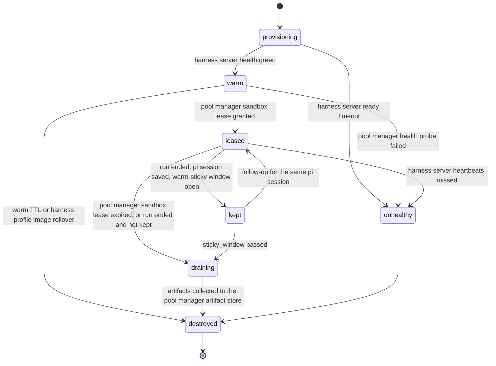

A `warm` sandbox has a healthy harness server and no repo, credentials or run.
At lease time the pool manager injects the run's read-only code-host access
token. The run grant key
arrives later, in the `POST /run` or `POST /followup` body. A `kept` sandbox
holds a finished run's repo and pi session for up to `sticky_window`, with its
run grant already revoked. A `draining` sandbox is having its pi session
directory, harness server logs and `/usage` collected. A `destroyed` sandbox
keeps its `sandbox` record for audit.

The run activity requests `lease(run_id, image, harness_session_id,
resources)`, idempotent on `run_id`. The response holds the per-run sandbox address,
the lease TTL and a `session_state`:

- `kept`: the per-run sandbox kept for that pi session is still within its
  `sticky_window`, and the pool manager hands it back.
- `restored`: the artifact store holds a pi session directory for that
  `harness_session_id`. The pool manager copies it into a warm per-run sandbox of that
  image, which clones the repo at `/workspace`, the working directory the pi
  session recorded.
- `new`: the pool manager hands out a warm per-run sandbox of that image, or
  provisions one.

A lease's TTL is the harness profile's `max_minutes` plus a grace period, and
the pool manager destroys the per-run sandbox when it expires, whether or not the run
activity released the lease, so a crashed run activity leaks nothing. The
lease is the only way to a per-run sandbox's address, and the harness server Run API
accepts only that lease's bearer token. When a run ends, the pool manager
saves its pi session directory to the artifact store under
`harness_session_id` before it keeps or drains the per-run sandbox. A follow-up for
the same pi session within `sticky_window` (default 10 minutes) gets the kept
sandbox back and skips the restore.

The pool manager keeps a warm target per image (`warm: 4`), adjusted from the
meta-harness scheduler's queue depth per image. The pool manager replaces a warm per-run sandbox older than `warm_ttl` (default 2
hours), and per-image and global maximums cap the total. The GKE node
autoscaler follows the pool manager's demand.

The pool manager replaces a per-run sandbox whose harness server is not healthy within
`ready_timeout`, and the lease goes to the next warm per-run sandbox. During a run, two
missed harness server heartbeat windows mark the per-run sandbox `unhealthy`; the pool
manager destroys it, and the RunTask workflow's Decide step decides whether
another candidate runs. The pool manager also probes idle warm per-run sandboxes on an
interval. Every 30 seconds it reconciles: it destroys
sandboxes with no record or an expired lease, marks records whose pod has
vanished, and provisions back to each image's warm target.

A per-run sandbox serves one pi session: one run, and the follow-ups `sticky_window`
hands back to it. A fresh per-run sandbox per pi session is the security boundary
between pi sessions, so recycling is drain, destroy and provision a
replacement. When a harness profile changes its image version, the pool
manager stops leasing the old image, replaces its warm per-run sandboxes, and lets
leased per-run sandboxes on it finish. On a node drain, warm per-run sandboxes go at once and
leased ones run until their lease TTL.

The pool manager's metrics: sandboxes by state and image, provisioning time,
time to lease, warm hit rate, health failures by cause, lease TTL expiries,
orphans destroyed by reconciliation, and artifact collection failures.

## Metering

The metering service measures each completed task in dollar-hours:

```
dollar-hours per successfully completed task = Σi (Di × Hi) / Σi Ci
```

| Term | Source |
|---|---|
| Di, dollars for attempt i | The run's `model_call` events, each with the HTTP Gateway's token usage, cost and the run's running total, plus the `route` activity's `classifier_usd` |
| Hi, hours for attempt i | The run's time from `RUNNING` to a terminal state |
| Ci, success for the task | The share of the task's checks that passed: CI checks on its pull request, its acceptance checks, and the merge |

A task's attempts include its review and fix runs, and the metering service
reports the review loop's share apart, from each attempt's tier. Each run's `attempt_finished` event, with the dollars the HTTP
Gateway counted against its run grant, and the harness server's `GET /usage`
cross-check Di, and the metering service flags a gap over 5%. Spend on failed
runs, including every run of a task whose candidates all failed, counts as
the task's wasted spend.

The metering service tails the event service into its own tables:
`model_call`, `attempt_usage`, `check_result`, `task_outcome`, and `spend`
per caller and period.

It also reports the prompt cache hit rate, cached input tokens over input
tokens, per run, harness profile and model. It keeps 5-minute and 1-hour
cache writes apart because they bill at different rates. A low hit rate means
the prompt prefix changes between turns, which multiplies the cost of every
later turn, and the metering service raises an alert.

### Spend controls

- The HTTP Gateway refuses a turn once the run has spent its run grant's
  limit, and the harness server then ends the run `ERROR` with `spend_limit`.
- The harness server ends a run `EXPIRED` at `max_minutes`, and the lease TTL
  destroys the per-run sandbox if the harness server does not.
- The meta-harness scheduler stops admitting a caller's tasks at the caller's daily spend
  cap, and warns at 80%. When the metering service lags, the meta-harness
  scheduler treats spend older than its staleness limit as at cap.
- A hard daily global spend cap and a kill switch stop everything.

## Scheduling

### Admission

The meta-harness scheduler runs an admission pass every few seconds and on
every task event:

1. It orders tasks by priority, then age.
2. It admits a task when global run concurrency is under its limit, the caller
   is under its concurrency quota and daily spend cap, the pool manager has
   sandbox capacity, and no other run holds the task's repo area.
3. A repo-area lock covers the repo plus the top-level directories the task
   names. A task that names none takes no area and runs beside the others:
   each run has its own clone and branch, and the merge step turns a conflict
   into a fix run. Locks live in Redis
   with a TTL, so a meta-harness scheduler leader that dies holding them
   cannot strand a repo.
4. It admits a goal's task once every issue the task depends on is closed,
   while the goal is active, has spent less than its blocking line (its
   `max_usd` plus its allowed overage; a goal whose budget only warns is
   never held for budget), and runs fewer of its tasks than its
   `max_parallel`.

Every queued task a pass does not start has a reason, and the scheduler
stores it (`scheduler.task_hold`, `scheduler/holds.py`): one row per held
task with the reason, its kind, what it names, when the task began waiting
for it and when a pass last looked. The row goes when the task starts or is
queued no longer. The rows survive a restart, so `task_held` is recorded
only when a task's reason is new or has changed, not again at every deploy.
A task past the system's parallel limit, and every queued task while the
kill switch is on or the scheduler drains, has a hold too. The Task API
serves a queued task's hold as `held`.

As built, the global limit is the task policy's `max_parallel`, 8 as shipped, which the scheduler reads
each pass and checks at startup against `MH_MAX_SANDBOXES`; the locks are expiring
Postgres rows the scheduler renews while a task is `queued`, `running` or
`taken_over`, which covers the task's review loop. An area is a path from
the issue's `Paths:` lines, and two areas conflict when they are the same
path or one is a directory above the other: `console/src/features/goals` and
`console/src/features/tasks` run together, while `console` excludes both. A
task whose issue has no `Paths:` line takes no area, so a repo's tasks run
side by side; its lock row only counts it as running.
A goal's `max_parallel`, when set, holds the goal to that many running
tasks; null inherits the task policy's, and the planner refuses one above
it. The planner, not the scheduler, holds a task `blocked` until its
dependencies close. Caller quotas, spend caps, sandbox capacity and the
modality's default parallelism are planned.

Parallel tasks merge one at a time per repo, each on a head that holds the
current base (Review loop, the merge). The repo's AGENTS.md asks each task to
keep to its paths and to add new files rather than logic to a central list,
and every run's prompt names the paths.

### Throughput

| Resource | Scales by | Notes |
|---|---|---|
| Per-run sandboxes | Warm targets and maximums per image | The GKE node autoscaler follows the pool manager's demand; a managed sandbox service can add a second pool |
| HTTP Gateway | Replicas | All model traffic goes through it, so it has its own SLO and canary deploy |
| Model providers | ai-api-unified fallback chains per model | Fallback and cooldowns spread load across providers |
| Control plane | Stateless replicas and Temporal workers | One run activity per active run |
| Code host API | The GitHub App's installation and webhooks | Conditional requests, no polling |

Per run, the control plane's own load is one router classification, about two
short completions, and the run's event stream. A harness's model turns go straight
from the per-run sandbox to the HTTP Gateway.

## REST API

Every REST API path starts with `/v1` and enters through the external HTTPS
load balancer, which routes it to the service that owns it.

In the deployment that exists, the edge does this work. It signs operators
in with Google, admits the identities on the access list
(`MH_CONSOLE_OPERATORS`, the platform stack's `operators` variable), and
holds the session in a signed cookie. It forwards each `/v1` request to the
service that owns the path's prefix, from its `ROUTES` table, with the
service key and the operator's identity in `X-MH-Actor`, so a new path
prefix needs a `ROUTES` entry. Every operator may read every path. The
admins, `MH_CONSOLE_ADMINS` (the platform stack's `admins`, a subset of the
operators), alone may write configuration, use the kill switch and open the
`/v1/admin` paths, which the edge serves itself; while the list is empty,
every operator is an admin. An admin who is not an operator stops the edge
at startup.

Those two lists are only the first access list. The users are records the
planner keeps (`planner.console_user`, `planner/users.py`), and an admin
changes them on the console's Users page: invite an email as an admin or a
regular user, set a role, deprovision. The edge reads the users every ten
seconds and decides each request by them (`edge/directory.py`), so a
deprovisioned user's session ends at their next request and a new role
applies at once. The first time the edge finds no users, it hands the
planner its first access list (every operator an admin when
`MH_CONSOLE_ADMINS` is empty), and from then on the users decide. A planner
the edge cannot reach changes nothing: the users last read go on deciding.
An invited user becomes active at their first sign-in. The console sends no
email: an invitation is text the admin copies and sends. The rest of this
section is the design for the GKE deployment.

Identity-Aware Proxy authenticates every `/v1` path except the webhooks.
Operators sign in through Identity Platform, and programs present
a Google service account's token. Each service accepts traffic only from the
load balancer and checks the IAP signed header on every request. The access list, a configuration document,
maps each verified identity to a role: an operator may call every path, and a
caller may submit tasks and read its own tasks and runs. It also gives each
caller its concurrency quota and daily spend cap. Every write
records an audit event with that identity as actor. Locally, with no IAP,
each service takes bearer keys from its environment instead.

Each webhook path skips IAP, and its owning service checks the code host's or
tracker's signature on every delivery. Services call one another with a
Google-signed ID token for the target service, and each service accepts only
the service accounts listed for it. A per-run sandbox holds no REST API
credential.

| Method | Path | Owner | Purpose | State |
|---|---|---|---|---|
| POST | `/v1/tasks` | Task service | Submit a task, idempotent on `external_ref`. Returns the task id | built |
| GET | `/v1/tasks` | Task service | Tasks by status, goal or `external_ref`; a caller sees its own | built |
| GET | `/v1/tasks/{id}` | Task service | State, current run, routing decision, pull request URL and outcome. `held` says why the scheduler holds a queued task: `{reason, kind, since, last_checked, detail}`, null for a queued task it does not hold and for a task in any other status. `kind` is one of `goal_budget`, `goal_status`, `goal_parallel`, `system_parallel`, `repo_area`, `kill_switch`, `draining` or `start_failed`, so a page need not read the reason's words, and `detail` names what the reason is about (`goal_id`, the tasks holding the places as `holders`, the shared `paths`). The list (`GET /v1/tasks`) carries `held` on each queued task too. The task service reads it from the scheduler's record with scheduler code (`scheduler/holds.py`) | built |
| POST | `/v1/tasks/{id}/cancel` | Task service | Cancel a task that has not started, or ask for its active run to stop, which the scheduler carries out | built |
| GET | `/v1/pulls/{task_id}/diff` | Meta-harness run service, served from the planner process | The files the task's pull request changes, with their added and removed counts and patches, and its head commit. The Task page's Changes tab | built |
| POST | `/v1/pulls/{task_id}/comments` | Meta-harness run service, served from the planner process | A review comment on lines of the pull request's head commit, posted as the GitHub App with the operator named in its text, and recorded as `pull_request_commented` with the operator as actor | built |
| POST | `/v1/tasks/{id}/attempts` | Task service | Run a task that has not started as 2 to 4 attempts at once | built |
| GET | `/v1/pulls/{task_id}/attempts` | Meta-harness run service, served from the planner process | A task's attempts side by side: candidate, how each ended, cost, and the changes in each one's workspace, and whether the task waits for a pick | built |
| POST | `/v1/tasks/{id}/messages` | Task service | An operator's message to a running task (`when`: `next_turn`, `after_stop`), or `stop` after the current turn, recorded as `operator_message`. The scheduler hands each to the task's RunTask workflow as an `operator_message` signal, and the workflow's `deliver_message` activity gives it to the harness server of the run in progress (behind the `operator-messages` patch) | built |
| GET | `/v1/tasks/{id}/reviews` | Task service | The task's review rounds, oldest first: verdict, reviewer, reviewed commit, summary, findings (each numbered from 1, with who dismissed it and why when an operator did) and review URL, from the `review_submitted`, `pull_request_reviewed` and `finding_dismissed` events, each with what came next, read from the events before the next round: its own fix run, the merge, another review when the head changed before it could merge, waiting, or the loop's end. The Task page's Reviews tab | built |
| POST | `/v1/tasks/{id}/reviews/{round}/findings/{n}/dismiss`, `/v1/tasks/{id}/reviews/{round}/proceed` | Task service | An operator's word on a review its task holds for them (`waiting_on: review`): dismiss finding `n` (from 1) with a `reason`, or end the wait now. 409 unless the task holds a review. The scheduler hands each to the task's workflow | built |
| POST | `/v1/tasks/{id}/budget` | Task service | An operator's answer to a running task held for budget (`waiting_on: budget`): `{"action": "raise", "max_usd": ...}` saves the task's new spend limit (above the old one; left out, the task only looks at its budget again) and `{"action": "end"}` ends it. The scheduler hands the answer to the task's workflow. `GET /v1/tasks?waiting=true` lists the tasks waiting on an operator | built |
| GET | `/v1/tasks/{id}/spend` | Task service | Where the task's money went: each of its runs, oldest first, with its kind (the task's own run, review or fix), candidate, turns, model calls, input, cached-input and output tokens, cost, and how it ended, from its `attempt_finished` and `run_finished` events, and their totals in all and by kind against the task's `max_usd`. The Task page's Spend tab | built |
| GET | `/v1/goals/{id}/spend` | Planner | Where the goal's money went: each of its tasks with what its runs spent in all and by kind of run, and its runs and turns, dearest first, and the goal's total and its split by kind against its budget. Opened from the Goal page's spend line | built |
| POST | `/v1/tasks/{id}/retry` | Task service | Send a `review_unresolved`, `failed` or `canceled` task back to `queued`, with `max_usd` as its new spend limit when given; its `retries` counts up and `task_retried` is recorded. The scheduler starts a new RunTask workflow for it (the one case a task id runs a second workflow, after the first has ended). With an open pull request the workflow resumes at the review loop, on the pull request's head, with fix rounds and spend counted from nothing and its runs numbered after the earlier ones; a pull request that has merged ends the task `closed`; with none, or one closed unmerged, it makes a new first run | built |
| POST | `/v1/tasks/{id}/merge` | Task service | Ask for a `ready` or `review_unresolved` task's pull request to be merged: back to `queued` with `resume: merge`, and its new workflow merges through the merge queue whatever the goal's `auto_merge` says, then waits for the merge commit's checks. A head that moved, or a conflict, goes through checks, review and fixes first | built |
| POST | `/v1/tasks/{id}/clear` | Task service | Take a `ready` or `review_unresolved` task off the list: `closed` when its pull request's merge is recorded, else `canceled`, with the reason naming the pull request and who cleared it. The pull request stays on GitHub | built |
| POST | `/v1/tasks/{id}/status` | Task service | Set a task's status. Services only: the RunTask workflow and the planner | built |
| POST | `/v1/tasks/{id}/take-over` | Meta-harness run service | Stop the active run, publish its work so far, and hand the task to the calling operator | planned |
| POST | `/v1/tasks/{id}/hand-back`, `/close` | Meta-harness run service | End a takeover: a follow-up run continues on the branch, or the task closes with the operator's outcome | planned |
| GET | `/v1/runs/{id}` | Meta-harness run service | Run state, candidate, token usage and cost so far | planned |
| GET | `/v1/routing` | Meta-harness run service | Routing decisions and the candidate each task finished on, by modality, tier and time | planned |
| GET, POST | `/v1/kill-switch` | Meta-harness scheduler | Read the kill switch, or turn it on or off with a reason. While it is on, the scheduler stops every running task and admits none. `mode` sets it instead: `stop` is on, `drain` admits nothing new and lets running tasks finish (a deploy that replaces the VM drains), and `off` ends both. `kill_switch_changed` carries the mode. Scopes smaller than everything (a run, a caller) are planned | built |
| POST | `/v1/tasks/{id}/review/claim`, `/verdict`, `/release` | Task service | An operator review: take the review of a running task's pull request over, give the verdict the round then waits for (`clean`, or `changes` with the agent's findings kept and the operator's own), or give the review back. 409 for a task with no review to take, a review another operator holds, or a verdict before the agent's review has finished | built |
| GET, POST | `/v1/goals` | Planner | List goals, or create one from `statement`, `repos` and `label`; the planner sets the rest. `start` (default `true`) creates it `active` and sweeps it at once; `start: false` saves it `paused`, not started (`started_at` null), and takes in no issue until its first `/resume` | built |
| GET, PATCH | `/v1/goals/{id}` | Planner | The goal with its issues, plan or phases, criteria and spend, or change its modality, latitude, `auto_merge`, priority or budget. Built: the goal with its issues, and changes to its title, statement, `label`, `repos`, `auto_merge`, priority, budget (`max_usd`, null for none), `budget_mode`, `budget_overage_percent` and `max_parallel` (null to inherit), each sent alone by the Goal page's in-place edits and recorded as `goal_changed` with the fields changed. A repo must be registered; `label` may be null only when the goal holds issues an operator picked by ref (`picked` on its issues; ones its label swept in do not count) in its repos, else 409. Tasks the goal already made keep their issues, and its next sweep takes in issues by the new label and repos; an issue it holds with no task yet in a repo it no longer names is let go, recorded as `issue_dropped`, and never becomes a task there | partly built |
| GET | `/v1/repos` | Planner | The repo registry: the repos a goal may name | built |
| GET | `/v1/repos/available` | Planner | The repos the deployment's GitHub Apps are installed on that the registry does not list yet, and each app's page for installing it on more. The console's Repositories page adds from it | built |
| GET | `/v1/labels` | Planner | Every label on the registered repos' open issues (or one repo's, with `repo`), with its open-issue count in total and per repo, and how many of those issues open goals hold (`held`, `held_by`). The New goal form's Label field suggests from it | built |
| GET | `/v1/repos/{owner}/{name}/issues` | Planner | A registered repo's open issues, newest first, with a `label` and text `q` in the title when given, a page at a time from `cursor`, each with the open goal that holds it, if any | built |
| POST | `/v1/goals/draft` | Planner | A goal a model drafts from a label's open issues (or the `refs` chosen): title, statement, theme and modality, through the HTTP Gateway with `config/planner.json`'s `goal_drafting`. Saves nothing | built |
| POST | `/v1/goals/{id}/pause`, `/resume`, `/cancel` | Planner | Pause, resume or cancel the goal. Resuming a goal not started starts it: it sets `started_at` and sweeps the goal at once | built |
| POST | `/v1/goals/{id}/resume-budget` | Planner | Raise the budget of a goal that is over it or stopped by it, so it can go on: by `add_usd`, or with no body by a worked-out amount (what it has spent, plus what its issues not yet done are likely to cost, rounded up to a whole dollar). Makes a `budget_exhausted` goal `active` and tells its running tasks held for the goal's budget to look again at once. Answers `{goal, from, to, spent_usd, how, tasks_told}`. 409 for a goal with no budget, one that only warns, one within its budget, or an `add_usd` that leaves it stopped | built |
| POST | `/v1/goals/{id}/sweep` | Planner | Sweep an active goal's label now, rather than at the next interval; a goal stopped by its budget may be swept too | built |
| POST | `/v1/goals/{id}/complete`, `/reopen` | Planner | Set an `active`, `paused` or `stalled` goal `met` by hand, or move a `met` or `canceled` goal back to `active`, which sweeps its label at once | built |
| GET | `/v1/goals/{id}/issues` | Planner | Each of the goal's issues with its `title` (as its last sweep read it; null before one has), its task's status, what the task waits on (`task_waiting_on`), pull request URL, pull request state (`open`, `merged` or `closed`) and checks: the newest recorded head commit's `passed` or `failed` with the failed check names, or `pending` while an open pull request has none recorded. The task's facts come from the Task API and the `pull_request_*` events on it | built |
| GET, PUT | `/v1/goals/{id}/plan` | Planner | GET: the goal's newest plan version (`version`, `drafts`, `invalid` reasons, `source` planned or edited, `created`: the issue each draft became), the planning task still drafting if one is (`planning_task_id`), and the label its issues carry. PUT: an operator's edited `drafts`, saved as the next version, valid or not. Only for a goal in `planning` with no planning task in flight | built |
| POST | `/v1/goals/{id}/approve`, `/replan` | Planner | Approve: create the newest plan's issues on the code host, in dependency order, with the goal's label, hold them for the goal, and make it `active`. An invalid plan is refused (409) with its reasons; a refusal by GitHub (502, with GitHub's reason) leaves the goal in `planning`, and approving again carries on from the next draft, making none twice. Replan, with an optional `note`: start a new planning task, given the note and the plan it replaces. Approving a phase is planned | built |
| POST, DELETE | `/v1/goals/{id}/issues`, `/v1/goals/{id}/issues/{ref}` | Planner | Add issues to the goal by ref, or drop one that has no task yet. A ref another goal holds is refused, naming that goal | built |
| GET | `/v1/activity` | Planner | Every pull request the meta-harness opened in the last `days`, grouped by goal, repo or label: each one's state (in review, waiting, blocked, merged, closed), cost, fix rounds and latest run, the tasks that spent without opening one, and the cost scale. From the Task API, the planner's goals and the tasks' events | built |
| GET | `/v1/inputs` | Planner | Queued issues across every registered repo, by repo and by goal, with each one's state | planned |
| GET | `/v1/config` | Configuration, in the planner process | Every kind with its active version | built |
| GET | `/v1/config/models` | Configuration, in the planner process | The models a tier candidate can name, as `<engine>:<model>`: every priced completions model in ai-api-unified's model registry, OpenAI's through `openai-responses`. A tier candidate's model select offers them | built |
| GET | `/v1/config/{kind}` | Configuration, in the planner process | The active version of `tiers`, `profiles`, `repos` or `task_policy`; `modalities` and `access` are planned | built |
| GET | `/v1/config/{kind}/versions` | Configuration, in the planner process | The document's version history | built |
| PUT | `/v1/config/{kind}` | Configuration, in the planner process | Save a new version, checked as at startup; 422 lists every reason a bad one is refused. A `repos` version that drops a repo an open goal names is refused, naming the goal | built |
| POST | `/v1/config/{kind}/rollback` | Configuration, in the planner process | Make an earlier version's document active again, as a new version | built |
| GET | `/v1/proposals` | Harness analyzer | Pending and decided proposals with their evidence | planned |
| POST | `/v1/proposals/{id}/approve`, `/reject` | Harness analyzer | Decide a proposal; an approved one applies as a new configuration version | planned |
| GET, POST | `/v1/events` | Event service | Events by run, task, type or source after a position, paged; services append with POST | built |
| GET | `/v1/events/tail` | Event service | The same filter as server-sent events, resumable from any position | built |
| GET | `/v1/spend` | Metering service | Spend and dollar-hours grouped by goal, modality, repo, model, harness profile or tier, over a time range | planned |
| GET | `/v1/pool` | Pool manager | Per-run sandboxes by image and state, warm targets and lease latency | planned |
| POST | `/v1/webhooks/code-host`, `/v1/webhooks/{tracker}` | Task service, planner | Code-host and issue-tracker webhooks, each checked by its signature | planned |
| GET | `/v1/limits` | Planner | The task policy's `max_parallel`, which a goal inherits and may lower, and `max_sandboxes`, the VM's ceiling on it | built |
| GET | `/v1/search` | Planner | Goals whose title, statement, label or id hold `q`, and tasks whose title, id or issue ref do, through the Task API's `q`. The console's command palette | built |
| GET, PUT | `/v1/me/settings` | Planner | The signed-in user's own settings: planner defaults for New goal (repos, modality, latitude, budget, auto-merge), appearance and browser notifications. A user reads and writes only their own row, keyed by the identity the edge names | built |
| GET | `/v1/version` | Edge | The version and the deployed commit (`MH_COMMIT`, which the release stack sets), shown in the console's header | built |
| GET | `/v1/me` | Edge | The signed-in operator's identity and roles (`operator`, and `admin` for an admin) | built |
| GET | `/v1/admin/logs` | Edge | The VM's services' and the edge's log entries from Cloud Logging, newest first, at most 500, by unit, lowest severity, time and text. Every entry has a message: a service's line is its text; a request Cloud Run served, which has none, reads as its method, path, status and time (and counts as an error at 500 or above); an audit entry as its method and status; any other structured entry as its fields. An empty line a service printed is left out. The VM's Ops Agent ships the journal as `mh_journald`; the edge reads with its own service account's `roles/logging.viewer`. Admins only | built |
| GET | `/v1/admin/deploys` | Edge | What is deployed: the version, the commit the VM and the edge run, and the edge's revision. Admins only | built |
| GET, POST | `/v1/admin/users` | Planner, through the edge | The console's users: list them, or invite an email with a role (`admin` or `user`). `PATCH /v1/admin/users/{email}` sets the role and `DELETE` deprovisions. The last admin can be neither deprovisioned nor made a regular user (409). Each change is recorded (`user_invited`, `user_role_changed`, `user_deprovisioned`) with the admin as actor and shows on the Audit page. Admins only | built |
| GET | `/v1/costs` | Cost service, in the planner's process | Costs over time: `from`, `to`, `bucket` (`day`, `week`, `month`), `group_by` (`source`, `kind`, `goal`, `task`, `repo`, `model`, `engine`, `operator`) and a comma-separated filter on each. Answers the buckets, one series per value dearest first (the eighth and later folded into `other`), each bucket's total, the total, the daily average, the change against the same span before, the least-squares `trend` through the totals, a month projected at the trend, the ten costliest tasks, and what each source is. An admin sees every source and goal; anyone else, only the model cost of their own work (`scope: own`). `POST /v1/costs/harvest` reads every source now (admins) | built |
| GET | `/health` | Every service | Liveness and configuration identity | built |

The run service has no HTTP API yet. Until it has one, a path it owns that
needs the GitHub App, such as a pull request's diff, is served from the
planner process, as the configuration API is, by run service code.

| Task field | Required | Meaning |
|---|---|---|
| `external_ref` | yes | The caller's own id, unique per caller |
| `repo` | yes | The repository URL |
| `task_type` | yes | `bug`, `feature`, `refactor`, `dependency`, `test`, `security`, `docs`, or `plan` for a planning task. `review` and `fix` are reserved: no caller may submit them, and review and fix are runs of their task |
| `parent_task_id` | no | Reserved. No task has a parent today |
| `priority` | yes | Higher runs first |
| `title`, `description` | yes | The task text, treated as untrusted |
| `acceptance_checks` | yes | Commands or check names that define success. At least one, except for a `plan` or `smoke` task, which may send an empty list: a planning task's result is its issue drafts, and a smoke task passes by ending closed |
| `paths` | no | The paths the task touches, which scope its repo-area lock |
| `complexity` | no | `low`, `medium` or `high`, which becomes `route_floor` |
| `max_tier` | no | A tier name, which becomes `route_ceiling` |
| `max_usd` | no | The task's spend cap, which caps each run's grant |
| `pin` | no | One candidate, such as `harness:pi-careful/claude:claude-opus-5-5`, run with no routing or escalation |
| `goal_id` | no | The task's goal. The planner sets it |
| `depends_on` | no | The `external_ref`s this task waits for |

A unique index on `(caller,
external_ref)` deduplicates submissions and serves the `external_ref` lookup.

### Goals

A goal holds the work toward one outcome: its tasks come from GitHub issues
across one or more registered repos. Goals run side by side and compete for run
capacity by priority.

| Field | Meaning |
|---|---|
| `title` | The goal's name in every list and header, at most 80 characters. The operator writes it, a goal drafted from a label takes the drafted one, and otherwise the planner's goal drafting model writes it from the statement after the goal is created (`goal_titled`), and at startup for any goal without one. Until then, the console shows the statement's start |
| `statement` | What the goal is, in prose; the console calls it the goal's description. The planning task reads it |
| `repos` | The registered repos the goal may change |
| `label` | The GitHub issue label that queues an issue for this goal, in any of its repos. Optional: a goal also holds the issues an operator picks by ref (`POST /v1/goals/{id}/issues`, or `refs` when it is created), and its sweep takes those in beside its label's. A goal needs a label or picked issues |
| `modality` | `fix`, `feature` or `new-system`, which picks the goal's rules. The planner classifies it when it is unset |
| `latitude` | 0 to 1: how far the planner may go beyond what the goal names. The modality's default when unset |
| `success_criteria` | Checks the planner evaluates to decide the goal is met: commands against a repo, an issue query such as "no open issues with the label", or a check name. A goal that names none is met when every issue it holds is closed and none of its tasks is queued, blocked or running |
| `auto_merge` | Whether a pull request whose review comes back clean merges without an operator. The modality's default when unset |
| `max_usd`, `priority` | One budget and one priority for all the goal's tasks, review and fix runs included |
| `budget_mode` | What the budget does when the goal's runs have spent it: `block` (the default) stops the goal at its blocking line, and `warn` lets it keep going, with the budget reached recorded and shown and nothing held or refused. It has no effect on a goal with no budget |
| `budget_overage_percent` | How far past its budget a `block` goal may go before it stops: a whole number, 0 or more, 10 by default. The goal blocks at `max_usd × (1 + overage / 100)`, and between the budget and that line it runs on, over budget. 0 blocks at the budget exactly. Ignored in `warn` mode |
| `max_parallel` | The most of the goal's tasks that run at once. Null inherits the task policy's `max_parallel`; a goal may set it lower, never higher. The New goal form sets it, and the Goal page shows the value in use, marked inherited or set, and edits it in place. A change applies at the next admission pass |
| `status` | `planning`, `active`, `paused`, `met`, `stalled`, `budget_exhausted` or `canceled` |

A `feature` or `new-system` goal starts in `planning`. For every active goal the planner runs a loop:

1. Each open issue with the goal's label in one of its repos becomes a task,
   with `external_ref` `github:<owner>/<repo>#<number>`. The planner refuses
   an issue in another repo and comments why.
2. The RunTask workflow routes and runs each task within the modality's
   routing floor and ceiling.
3. The review loop reviews each pull request to the modality's bar, merges it
   and so closes its issue.
4. When the goal's issues are closed, or a phase ends, the planner evaluates
   the success criteria.
5. If they pass, the goal is `met`. If work is still queued, the loop goes on.
   If nothing is queued and the criteria fail, a `fix` goal waits for
   issues, and a `feature` or `new-system` goal gets a planning task for its
   next step.

A goal's statuses move this way. `planning` becomes `active` when its plan
is approved. `active` becomes `paused` and back by an operator, `met` when
its criteria pass or an operator completes it (a `paused` or `stalled` goal
can be completed too), `stalled` when every open
issue is blocked by a failed issue or waits on an operator, and
`budget_exhausted` when a `block` goal's spend reaches its blocking line
(never for a `warn` goal). `stalled` and
`budget_exhausted` return to `active` once an operator unblocks the goal or
raises its budget: the next sweep finds the line above what is spent, and a
budget resume does it at once. Any open goal can be canceled. A `met` or `canceled`
goal takes no more issues until an operator reopens it, which makes it
`active` again, so a `fix` goal over a label that keeps receiving issues is
reopened, or given a criterion that never passes. A goal can also be saved
without starting (`start: false`): it is created `paused` with `started_at`
null, which tells it from a goal paused after running, and takes no issue
until its first resume. That resume sets `started_at`, records
`goal_changed` with the status change, and runs the goal's first sweep at
once, as creating an active goal does. `goal_created` records `start`.

As built, every goal is a `fix` goal with a label and is created `active`,
or `paused` and not started when it is saved without starting.
With no success criteria yet, a goal is met by the rule for one that names
none: on each sweep, which is also when the planner sees that a task's merge
closed an issue, an `active` goal that has held at least one issue, whose
issues are all closed, whose label has no open issue it could take in, and
none of whose tasks is queued, blocked, running, taken over, ready or
unresolved, becomes `met`, and the planner emits `goal_met`. A goal that never
held an issue waits for its first one, and a paused goal, including one saved
without starting, is not checked. An operator completes a goal with Complete
goal and reopens a `met` or `canceled` one with Reopen goal; a reopened goal
whose label has no open issue is met again on its next sweep. Every move is a
`goal_changed` event, the goal's history. Nothing sets `stalled` yet.
`success_criteria`, the modality classifier and latitude are planned.

The planner classifies a goal statement's modality with the ai-api-unified classifier's `classify_choice`,
the call the router uses to pick a tier, reading each modality's
`description`. At or above `classifier.min_confidence` it sets the modality;
below it, or on a refusal, it sets `feature` and lists the goal as "modality
uncertain" in the operator console, where an operator confirms or changes it without
holding the goal up. The classifier also sets an unset latitude, starting from
the modality's default and moving it up for a statement that asks for
open-ended improvement and down for one that names an exact change. The planner
records each classification as `goal_classified` with its confidence, so the
harness analyzer can measure how often operators override it. An operator can
change the modality or the latitude at any time; a new modality applies from
the next planning task.

#### Modalities

| | `fix` | `feature` | `new-system` |
|---|---|---|---|
| Work comes from | A standing queue: issues with the label, taken as they arrive | One spec in the goal statement, which a planning task breaks into dependency-ordered issues across the goal's repos | The goal statement. The planning task writes one phase of issues at a time, and replans after each phase from the repos as they are |
| First work | The issue itself | The plan | A design document and a skeleton that runs end to end, which every later issue must keep working |
| Parallelism | High: independent issues, one per repo area | The dependency graph | Low until the skeleton exists, higher after |
| Routing | `route_ceiling: standard`; escalation on failure | Floor `standard` | Floor `complex` for the design and skeleton issues, `standard` after |
| Bar to merge | A regression test that fails before and passes after, a small diff, no public API change | Each issue's acceptance checks, and a goal-level acceptance check once the last issue merges. Docs and a version bump per the repo's rules | Conformance to the goal's design document, the end-to-end check green, and each phase ending runnable |
| Operator checkpoints | None | Approve the plan before the first task runs | Approve each phase's plan |
| Measured by | Queue size, time to merge, cost per merged fix | Criteria met, spend against budget | Phase criteria met, then goal criteria met |

The planner reads these rules from the modalities document:

```json
{
  "version": "2026-11-07.1",
  "classifier": {"min_confidence": 0.7},
  "modalities": {
    "fix":        {"description": "Fix defects that already have an issue each. Small, bounded changes to code that exists.",
                   "intake": "queue", "plan": false, "approve": [], "latitude": 0, "auto_merge": true,
                   "route_ceiling": "standard", "parallel": 8,
                   "merge_bar": ["regression_test", "small_diff", "no_api_change"]},
    "feature":    {"description": "Add one capability to a system that exists, from a spec. Several issues across the repos it touches.",
                   "intake": "plan", "plan": true, "approve": ["plan"], "latitude": 0.25, "auto_merge": true,
                   "route_floor": "standard", "parallel": "graph",
                   "merge_bar": ["acceptance_checks", "docs", "version_bump"],
                   "goal_check": "acceptance"},
    "new-system": {"description": "Build something that does not exist yet, from a goal statement, in phases that each end runnable.",
                   "intake": "phases", "plan": true, "approve": ["phase"], "latitude": 0.5, "auto_merge": true,
                   "route_floor": {"design": "complex", "skeleton": "complex", "default": "standard"},
                   "parallel": {"skeleton": 1, "default": "graph"},
                   "merge_bar": ["design_conformance", "e2e_green", "phase_runnable"]}
  }
}
```

The planner fills a task's fields from its issue:

| Task field | From the issue |
|---|---|
| `external_ref`, `repo` | `github:<owner>/<repo>#<number>` and its repo |
| `title`, `description` | The issue's title and body, treated as untrusted |
| `acceptance_checks` | The body's `## Acceptance checks` list, else the registry's checks for the repo |
| `task_type`, `complexity`, `max_tier` | The labels `type:<task type>`, `complexity:<low, medium or high>` and `max-tier:<tier>`, within the modality's floor and ceiling |
| `depends_on` | `Depends on: <issue>` lines in the body, plus the tracker's blocked-by links |
| `paths` | `Paths: <path>, <path>` lines in the body: the areas the task locks, and the paths its run, review and fix prompts tell it to keep to |
| `goal_id` | The goal |

The repo registry lists the repos the meta-harness may
change, with each one's default branch, default acceptance checks and merge
policy. For this project they are `davecthomas/ai-api-unified`,
`davecthomas/ai-api-unified-http` and `davecthomas/meta-harness`.

A task waits in `blocked` until every issue it depends on is closed. Tasks
with no open dependency run in parallel, within the modality's parallelism and
the repo-area locks. The planner refuses a dependency cycle and shows its
issues. A task that waited on another repo's change uses that repo's merged
commit.

The sweep, the dependency order and the `blocked` state are built. The
`type:` label is read; the `complexity:` and `max-tier:` labels, the
cycle check, operator issues and the `meta-harness:failed` label are
planned.

Operators publish releases and deploy. An issue labeled `meta-harness:operator`
belongs to its goal, but the meta-harness never runs it: the operator console lists it
as needing an operator, and closing it unblocks the issues that depend on it.
A goal can therefore hold "publish ai-api-unified 3.31.0" between a library
change and the ai-api-unified-http change that pins the new version:

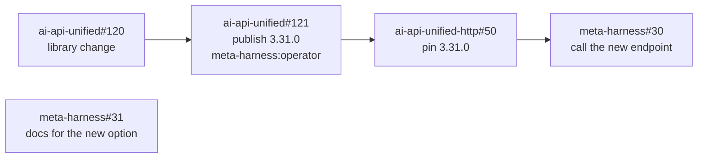

Here ai-api-unified#120 and meta-harness#31 run at once. ai-api-unified-http#50
waits for an operator to close the release issue, and meta-harness#30 waits for
ai-api-unified-http#50 to merge.

Each pull request says `Closes <issue>`, so its merge closes the issue. A task
that ends without a merge leaves its issue open, labeled `meta-harness:failed`
with a comment holding the outcome, and the issues that depend on it stay
blocked. An issue labeled while the goal is active joins it, including the
issues a planning task writes.

An issue closed some other way than by its task's pull request (another pull
request, or by hand) has no work left. Each sweep cancels such a task when
it has opened no pull request of its own: queued, blocked, or running with
none. So a goal never pays to redo finished work, and the task frees its
repo area for the ones behind it. A task with a pull request is left to its
workflow, since its own merge is what closes its issue.

A goal is `met` when its success criteria pass, and `stalled` when every open
issue is blocked by a failed issue or waits on an operator issue, which raises
an alert. Its `max_usd` covers every task it queued. What happens once it is
spent is the goal's `budget_mode`. A `block` goal runs on, over budget, to its
blocking line, `max_usd` plus `budget_overage_percent` of it; from there the
meta-harness scheduler admits no more of its tasks and the goal becomes
`budget_exhausted`. Its running tasks share what it has left before that
line, run by run, and hold for an operator when that is too little (see the
review loop's budget hold), so a goal's tasks started together no longer
spend several times its budget. A `warn` goal keeps going: nothing is held
or refused for its budget. Each task's own spend limit is unchanged either
way.

Above every goal and task is the deployment's budget policy, the task
policy's `budget_policy`, which the Task policy page sets with a switch.
`block`, the default, leaves each goal's budget and each task's spend limit
to stop work as it says. Under `track` nothing is held, refused or ended for
either, and spend is still recorded and shown against them: every goal
behaves as `warn` whatever its own mode (the planner serves it no blocking
line, a `budget_exhausted` goal becomes `active` at its next sweep, and
there is nothing to resume), and a task that starts gets a spend limit no
run reaches, so its turn and minute limits are what bound a run. A task
already running keeps the limit it started with. Services read a saved
policy within five seconds, and one that cannot be read counts as `block`.

Each sweep of a goal with a budget adds up what its tasks' runs have spent
and saves it on the goal (`planner/budget_api.py`). The first time the spend
reaches the budget the planner records `goal_budget_reached`, with the
spend, the budget, the mode and the blocking line; once per budget, so
raising the budget lets it be recorded again. A `budget_exhausted` goal is
swept like an active one, so its pull requests are still watched. The goal
the planner serves carries `budget_block_at` (the blocking line in dollars,
null in `warn` mode or with no budget), which admission and the budget hold
read so the line is worked out in one place, `budget_state` (`ok`, `over`
for past the budget and still running, or `blocked`) and, for a goal that
is over or blocked, `budget_resume_to`, the budget a resume would set.

A goal stopped by its budget resumes in one step:
`POST /v1/goals/{id}/resume-budget` raises its `max_usd`, makes a
`budget_exhausted` goal `active`, and answers each of its running tasks held
for the goal's budget with `raise`, so they look again at once; its queued
tasks start at the scheduler's next pass. With `add_usd` the budget rises by
that much, refused when the goal would still be stopped. Without it the new
budget is worked out (`planner/budget.py`): what the goal has spent, plus
the average cost of its finished tasks times its issues not yet done (the
default task spend limit for each when none has finished), rounded up to a
whole dollar. The answer says the old budget, the new one and how it was
worked out, and the change is recorded as `goal_changed` with
`resumed: true`. A `warn` goal has nothing to resume. A budget changed by
hand (`PATCH /v1/goals/{id}` with `max_usd`, `budget_mode` or
`budget_overage_percent`) takes effect at once too: the planner looks at the
goal's spend as a sweep would before it answers, so the goal's status,
`budget_state` and `budget_resume_to` are the new budget's, and its tasks
held for the budget are told to look again.

#### Latitude

A goal's `latitude`, from 0 to 1, sets how much scope the planner may add on
its own. It governs the planning task's prompt, the drafts the planner
accepts, and the loop's decision step.

| Latitude | The planner may | Example |
|---|---|---|
| 0 | Only the issues the goal names or people labeled. It drafts none, and it refuses a draft outside them. A `fix` goal at 0 is a pure queue | "Fix these twelve issues" |
| 0.25 | Draft the issues the statement needs and nothing beyond them. A draft must trace to a sentence in the statement | "Add the `route_ceiling` option" |
| 0.5 | Draft what the statement needs, plus the work it finds necessary on the way: tests the change needs, a doc the change makes wrong, a refactor the change needs to land | "Build the review loop" |
| 0.75 | Also draft improvements it finds in the goal's repos that serve the statement, as separate issues the operator sees in Inputs before they run | "Make the sample's end-to-end check faster and more thorough" |
| 1 | Keep going on its own: when the criteria are met it proposes the next goal from what it learned, and continues under the same budget until the budget or the operator stops it | "Improve the meta-harness" |

Above 0.5 every draft has a `latitude_reason`, one line on how it serves
the statement, shown beside the issue in the operator console. Latitude changes only
what the planner may propose; the merge bar, the budget, the repo list and the
control plane's sole write access to the code host stay fixed. The defaults are
`fix` 0, `feature` 0.25 and `new-system` 0.5, and an operator can change
latitude on the Goal view while the goal runs.

#### Planner

The planner owns the goal loop, the `goal`, `plan` and `issue_link` tables and
the issue dependency graph. It is the only component that talks to an issue
tracker, through one adapter interface:

| Adapter operation | Purpose |
|---|---|
| `list_open(repo, label)` | The open issues with the goal's label in one repo |
| `read(ref)` | One issue: title, body, labels, state, and the issues that block it |
| `create(repo, draft)` | Create an issue from a planning run's draft: title, body, labels, dependencies. Returns its `ref` |
| `comment(ref, text)` | Record a refusal, an outcome or a plan on the issue |
| `label(ref, add, remove)` | `meta-harness:failed`, `meta-harness:operator`, the goal label |
| `close(ref)` | Close an issue whose pull request merged without `Closes`, or an operator issue the operator console closed |
| `update(ref, state)` | Write a task's state back to the issue, as labels or the tracker's status field, with the pull request link |
| `webhook(payload)` | Turn a tracker's webhook into `issue_opened`, `issue_edited`, `issue_labeled`, `issue_closed` events, so the Inputs view and the goal loop never poll |
| `sweep(repo, label, since)` | Issues changed since a time, for the reconciliation that catches a missed webhook |

As built, the GitHub adapter has `list_open` and `read`, with an app token
that only reads issues, and a sweep every `MH_PLANNER_SWEEP_SECONDS` stands
in for the webhook. The writing operations and the Jira and Linear
adapters are planned. The sweep also reads the pull requests of `ready` and
`review_unresolved` tasks and their checks (Review loop), through the run
service's code-host functions, with a token that has `pull_requests: read`,
`checks: read` and `statuses: read`.

The adapter syncs both ways. The planner pulls in work people write: an issue
labeled in GitHub, Jira or Linear joins its goal, and an edit to its body,
labels or dependencies updates the task before it runs. It writes back what it
generated and what happened: the issues a plan drafted, each task's state as a
label or status (`meta-harness:running`, `meta-harness:pr-open`,
`meta-harness:failed`), the pull request link, the outcome, and the close on
merge. One `issue_link` row per issue holds the tracker's state beside the
meta-harness's, and the planner reconciles them on every webhook and on a
periodic sweep. The tracker owns what the work is, and the meta-harness owns
what happened to it. An issue closed by hand while its task runs cancels the
task, with the reason recorded.

A `ref` names its tracker: `github:<owner>/<repo>#<number>`, `jira:<key>` or
`linear:<identifier>`. Each repo in the repo registry names its tracker, and
for Jira or Linear the project or team and the field or label that names an
issue's repo. The GitHub adapter works through the GitHub App, and the Jira and
Linear adapters plug into the same interface.

A `feature` or `new-system` goal's issues come from a planning task,
`task_type: plan`, which the planner creates with the goal statement, the
modality and, for a later phase, what earlier phases built. The planning run
reads the goal's repos and drafts issues with its `create_issue` tool, each
in the repo it changes, with acceptance checks and what it depends on. A
`fix` goal never plans.

Built for `feature` (#72, #73): a `feature` goal starts in `planning`; one
created without a label gets its own, `meta-harness:goal-<the first 8
characters of its id>`. The planner starts one task with `task_type: plan`,
pinned to the candidate `config/planner.json`'s `planning` names, with that
file's spend limit. Its prompt (`plan-v1`) is the goal's title and
statement, its repos, and the rules for drafts: one issue is one pull
request, each body states its `## Acceptance checks` and its `Paths:`, and
`depends_on` names drafts and existing issues. The scheduler holds every
other task of a goal that is not `active`, and admits the plan task of a
goal in `planning`. The run changes no file, so the RunTask workflow ends a
plan task `closed` after its run, with no publish, no pull request and no
review loop (behind the `plan-task` patch). When the task ends, the planner
reads its `issue_drafted` events: the last call for each `draft_id` is the
draft, and together they are the goal's plan, version 1 (`plan_saved`). A
plan is invalid, with each reason recorded, when it has no drafts, two
drafts share an id, a draft has no title or no acceptance checks, names a
repo outside the goal or a dependency that is no draft and no issue, or the
drafts' dependencies make a cycle; a planning task that failed leaves an
empty plan that says why. The goal waits in `planning` until an operator
approves: they may edit the drafts (each save a new version), or ask for a
new plan with a note, which starts another planning task. On approval the
planner makes sure the label exists, creates the issues in dependency
order, each body ending with a `Depends on:` line naming the issues its
dependencies became, records each issue against the plan as soon as it
exists, holds it for the goal, and makes the goal `active`, whose sweep
then takes the issues in as it takes any labeled issue. Creating issues
needs the GitHub App's `issues: write`. Not built: the modality's rules on
a plan, and plans for a `new-system` phase. When a `new-system` phase ends with its
criteria unmet, or a failed task leaves dependents blocked, the planner
creates a planning task with the failure as input, and that plan goes through
the same approval.

## Data model

| Owner | Entity | Fields |
|---|---|---|
| Task service | task | id, caller, external_ref, repo, task_type, parent_task_id, goal_id, depends_on, pr_url, head_sha, priority, spec, acceptance_checks, created_at, status (including `blocked`, `taken_over`, `ready` and `review_unresolved`), owner (the operator, while taken over) |
| Meta-harness scheduler | task_hold | task_id, kind, reason, detail (what the reason names), since, last_checked. One row per queued task the scheduler holds |
| Planner | goal | id, created_by, title, modality, modality_source (classifier, operator), modality_confidence, repos, label, statement, success_criteria, latitude, auto_merge, max_usd, max_parallel (null: the system's), budget_mode, budget_overage_percent, spent_usd (at the last sweep), priority, status (planning, active, paused, met, stalled, budget_exhausted, canceled), phase, created_at, started_at (null until the goal first becomes active), closed_at |
| Cost service | daily_cost, harvest | One row per day, source (`model`, `cloud`), item (the kind of run, or the billed service) and the dimensions the source has (goal, task, repo, model, engine, operator), with its dollars; and how far each source has been read |
| Planner | console_user | email, role (admin, user), status (invited, active, deprovisioned), invited_by, invited_at, last_sign_in_at. Who may use the console, and as what |
| Planner | user_settings | identity, settings (jsonb), updated_at |
| Planner | plan | goal_id, version, drafts (each `draft_id`, `repo`, `title`, `body`, `labels`, `depends_on`), invalid (why it cannot be approved; empty when it can), source (`planned` by a planning task, or `edited` by an operator), task_id, note, created (the issue each draft became), created_by, created_at. Planned: phase |
| Planner | issue_link | ref (tracker-qualified), goal_id, task_id, repo, state, depends_on, last_webhook_at |
| Meta-harness run service | run | id, task_id, attempt_no, kind (initial, fallback, followup, retry), candidate, harness_profile, profile_version, model, model_policy, image, sandbox_id, state, started_at, running_at, ended_at, end_reason, fallback_reason |
| Meta-harness run service | routing_decision | id, task_id, attempt_no, request_id, route_tier, route_method, route_confidence, model_pin, candidates (the tier's candidates, in order), thinking, config_id, config_version, classifier_usd, route_floor, route_ceiling, explored, created_at |
| Meta-harness run service | operator_review | task_id, round, operator, claimed_at, verdict, findings, submitted_at, released_at |
| Configuration | config_version | kind (tiers, profiles, repos, task_policy; modalities and access planned), version, document, edited_by, note, origin (seed, edit, rollback), rolled_back_from, created_at |
| Configuration | active | kind, version, changed_at |
| Pool manager | sandbox | id, image, executor, executor_ref, state (provisioning, warm, leased, kept, draining, unhealthy, destroyed), created_at, destroyed_at, destroy_reason |
| Pool manager | lease | run_id, sandbox_id, harness_session_id, session_state (new, kept, restored), granted_at, expires_at, released_at, release_reason |
| Meta-harness event service | event | event_id (UUID, unique), position (assigned on insert, monotonic), event_type, schema_version, time_utc, source (task, meta-harness scheduler, dispatcher, route, run, workflow, pool, analyzer, gateway), actor, run_id, task_id, session_id, request_id, seq, trace_id, config_id, config_version, tags (jsonb), payload (jsonb) |
| Meta-harness event service | event_type | name, schema_version, json_schema, retention_class |
| Metering service | model_call | run_id, seq, turn, purpose (turn, compaction, auxiliary), tier, method, engine, model, thinking, input_tokens, cached_input_tokens, cache_write_5m_tokens, cache_write_1h_tokens, output_tokens, usd, latency_ms |
| Metering service | attempt_usage | run_id, usd_total, calls, input_tokens, cached_input_tokens, cache_write_5m_tokens, cache_write_1h_tokens, output_tokens, cache_hit_rate, active_hours |
| Metering service | check_result | task_id, check_name, kind (ci, acceptance, merge), passed, observed_at |
| Metering service | task_outcome | task_id, goal_id, ci_share, merged, review_rounds, review_loop_usd, total_usd, wasted_usd, active_hours, dollar_hours, closed_at |
| Metering service | spend | caller, period, cap_usd, spent_usd |
| Harness analyzer | proposal | id, kind (tier, profile, task_policy), evidence, proposed_change, status (open, approved, rejected), decided_by, decided_at, config_version |

The `run` row records the candidate a run started on, and `model_call` records
which model answered each turn, which the harness analyzer reads. The event service
indexes the `event` table on `(run_id, position)`, `(run_id, time_utc)` and
`(event_type, time_utc)`. The metering tables are projections of it, and the metering service rebuilds them by replaying it.

Stores outside Postgres have one owner each: the meta-harness scheduler's repo-area locks,
the meta-harness run service's Temporal namespace and code-host rate-limit buckets, the
pool manager's artifact store, and the HTTP Gateway's run grants and per-run
spend counters.

## Observability

Meta-harness domain events go to the event service, and logs, traces and
metrics go to OpenTelemetry. Every domain event has its trace id, so the
two join.

### Event service

The event service is the record of what happened in every task and run. It
owns the `event` table, the per-type schema registry, position assignment,
partitions, retention and the commit notification, and it calls no other
component.

| Operation | Contract |
|---|---|
| `append(events)` | Idempotent on `event_id`. The event service validates each meta-harness domain event against its event type's registered schema in the schema registry. The event service rejects an unknown event type or invalid payload back to the producing meta-harness service as a bug. The event service client library never retries a rejected append. |
| `read(run_id, from_position)` | A meta-harness run's meta-harness domain events in `position` order, paged |
| `tail(filter, from_position)` | A live stream of meta-harness domain events matching a filter (run, task, type, source), in `position` order, resumable from any position |

Meta-harness services append through the event service client library:

| Producer | Events |
|---|---|
| Task service | `task_created`, `task_status_changed`, `task_cancel_requested`, received code-host pull request webhooks |
| Planner | Built: `goal_created`, `goal_changed` for every change to a goal's title, settings or status (with `resumed: true` for a budget resume), `goal_budget_reached` the first time a goal's spend reaches its budget (the spend, the budget, the mode and the blocking line), `goal_drafted`, `goal_titled` with the model and its cost, `issue_added` and `issue_dropped` for issues picked by ref (and `issue_added` for each issue an approved plan created), `plan_requested` when a planning task starts (with the operator's note on a replan), `plan_saved` for each plan version (its source, how many drafts, and why it is invalid if it is) and `plan_approved` with the issues created, `issue_joined`, `issue_refused`, `issue_closed`, `task_unblocked` and `goal_met` when a goal is met, on its own or by an operator. For a `ready` or `review_unresolved` task's pull request, which no workflow watches: `pull_request_checks` for a new head commit's settled checks, `pull_request_merged` and `pull_request_closed`, on the task and tagged with the goal, with the workflow's event id for the same fact. Planned: `goal_classified`, `plan_drafted`, `plan_approved`, `issues_created`, `criteria_evaluated`, `planning_task_created`, and the tracker webhooks it received |
| Meta-harness scheduler | Admission decisions: `task_admitted`, and `task_held` with the reason and the kind of hold, recorded when a task's reason is new or has changed. `kill_switch_changed` with the operator as actor |
| Meta-harness run service: RunTask workflow, `route` and run activities | `task_routed` from the meta-harness run service `route` activity result. One `run_prompt` per run, recorded on the task with the run's `run_id` before the run starts by the `record_prompt` activity (behind the `run-prompt` patch), which appends it at once rather than through the client outbox, with a stable event id, so it is stored, ahead of the run's own events, before `run_harness` starts: the run's `kind` (`task`, `review` or `fix`), its `template` (`repo-task-v1`, `review-v3`, `fix-v1`, or `inline` for the caller's own text) and the filled-in `prompt` sent to the harness server. One `attempt_finished` per run from the meta-harness run service run activity Collect result, joined to its pool manager sandbox lease by `run_id` |
| Meta-harness run service: run activity (Wait step) | The per-run sandbox's harness server Run API event stream: `turn_started`, `model_call` (with the HTTP Gateway's model-token usage and running total), `tool_call`, `tool_result`, `file_changed`, `tests_run`, `guardrail_blocked`, `review_submitted`, `plan_updated`, `issue_drafted` (one draft from a planning run's `create_issue`), `compacted`, `turn_finished`, `run_finished`. The meta-harness run service run activity stays the only consumer of each per-run sandbox's harness server Run API stream. Harness server Run API heartbeats are not stored. |
| Meta-harness run service: RunTask Temporal workflow | Built: `pull_request_opened`, `pull_request_checks` for each head commit's checks, `pull_request_reviewed` for each review round (round, verdict, reviewer, reviewed head SHA, review URL) `pull_request_merged`, and `merge_checks` for the merge commit's checks (merge SHA, state, failed check names, fix round). The task service records `budget_hold` (the reason) when a running task starts waiting on an operator for budget, and `budget_decision` (`raise` with the new limit, or `end`) for the answer. A review run's findings are in its `review_submitted` harness event. Planned: `pull_request_closed` while the workflow watches the pull request, `review_started`, `task_taken_over`, `task_handed_back` and `takeover_closed` with the operator as actor, and `operator_review_claimed`, `operator_review_submitted` and `operator_review_released` with the operator as actor |
| Pool manager | `lease_granted` (with `session_state`), `lease_released`, `session_saved`, `session_restored`, `sticky_handoff`, `sandbox_recycled`. The pool manager lease record names the per-run sandbox for each run. |
| Harness analyzer | `proposal_opened`, and operator approvals and rejections of harness analyzer proposals as audit events with the actor |
| Configuration, in the planner process | `config_changed` for every configuration version an operator saves, approves or rolls back, with the actor |

ai-api-unified records its own decisions in one `ai_api_request_cost` record
per request. The record lists every provider call the request made, failed
attempts and fallbacks included with their `fallback_reason`, and holds the
model that served the answer, `wasted_usd`, the router tier and method,
guardrail flags and cache hits, tagged with the caller id and the caller's
tags. In the meta-harness run service and the planner the library runs
in-process, and the calling service copies the record into its own event,
`task_routed` or `goal_classified`.

The HTTP Gateway writes each record to stdout, and Cloud Logging stores it. A
Cloud Logging log sink selects the HTTP Gateway records whose caller id is the
meta-harness and publishes them to a Pub/Sub topic. The event service receives
them on a Pub/Sub push subscription and appends each one as a
`gateway_request` event, joined to its run by the `run_id` tag the HTTP
Gateway sets from the run grant. Pub/Sub delivers at least once, so the event
service ignores a `request_id` it has already stored. The HTTP Gateway refuses
to start when its cost records would be lost, so every model turn of a run
reaches the event service.

| Decision | Made by | Event |
|---|---|---|
| A task's tier and candidates | The ai-api-unified router in the meta-harness run service | `task_routed` |
| The next candidate, an escalation, or the end of the loop | The RunTask workflow's Decide step | `attempt_finished` |
| Admitting or holding a task | The meta-harness scheduler | Admission decisions |
| A goal's modality and latitude | The planner, through the ai-api-unified classifier | `goal_classified` |
| Which drafted issues a plan keeps | The planner | `plan_drafted` |
| A turn's model, its fallbacks, guardrail blocks and cache hits | ai-api-unified in the HTTP Gateway | `gateway_request` |
| A review verdict | A meta-harness review run, or an operator | `pull_request_reviewed`, `operator_review_submitted` |
| A merge | The meta-harness run service, or an operator on the code host, which the planner's sweep records | `pull_request_merged` |
| Approvals, takeovers, cancels and configuration changes | An operator | Audit events with the operator as actor, `config_changed` |

The client library buffers events in its own outbox and retries, which is safe
because `append` is idempotent on `event_id`, so an event service outage never
blocks a run.

After an event service append commits, the event service
sends a commit notification, Postgres `NOTIFY`, with the run id and the new
highest `position`. The commit notification contains no meta-harness domain
event data and is internal to the event service: its listeners are the event
service's own `tail` handlers, which fetch the new event rows and stream them
to their callers. A missed commit notification only delays delivery, because
the next `tail` handler fetch catches up. `NOTIFY` fires only on commit; Redis
can replace it if the volume outgrows Postgres.

Each meta-harness producer service sets `seq` within its own
event stream. The event service assigns `position` on insert. Concurrent
Postgres transactions can commit out of `position` order, so the event service
`tail` handler re-reads a short window behind each caller's cursor and
suppresses repeats of meta-harness domain events it has sent. Delivery is at least
once, and a consuming service can drop a repeat meta-harness domain event by
`event_id`.

Consumers call:

| Consumer | Calls |
|---|---|
| Operator console | `read` for a meta-harness run's event history, then `tail` from the last position |
| Metering service | `tail` with one cursor per metering projection, into `model_call`, `attempt_usage`, `check_result`, `task_outcome` and `spend` |
| Harness analyzer | `read` for routing, attempt and run meta-harness domain events over time |
| Meta-harness alert rules | `tail` for stalled runs, failed meta-harness tasks with every routing tier exhausted, runs ended on `spend_limit`, and usage reconciliation gaps |
| Audit and export jobs | `read` for operator and configuration meta-harness domain events, and bulk export by time range |

The event service partitions its `event` table by time and by
each event type's retention class from the schema registry. Short-lived event
types (per-turn text, tool output) expire by dropping whole partitions rather
than deleting rows. The event service keeps run, routing, attempt,
`gateway_request` and audit meta-harness domain events long.

### Signals

| Signal | Source | Carried by |
|---|---|---|
| Meta-harness domain events | Every meta-harness service | Meta-harness event service |
| OpenTelemetry traces | One OpenTelemetry trace per meta-harness task, spanning routing, scheduling, each meta-harness run, each harness server Run API call and each HTTP Gateway call | OpenTelemetry; `task_id` and `run_id` on every span, and the trace id on every meta-harness domain event |
| OpenTelemetry metrics | Task queue depth, meta-harness scheduler admission decisions, per-run sandboxes by state, pool manager lease latency, run durations and turns per run. Model calls by routing tier, spend by Task API caller, HTTP Gateway latency and error rate | OpenTelemetry metrics |
| Operational logs | Operational text, structured, with `task_id`, `run_id` and trace id on every line; prompt and response content only when configured | Existing log pipeline |

### Console

Operators run and configure the meta-harness from the operator console, a
cloud web app. Operators sign in with Google at the edge, and the access
list names who may (see REST API). The operator console owns no store and calls only the REST API, as the signed-in
operator.

Every view drills down to the next, and every list filters by goal, modality,
repo, time, harness profile, model, routing tier, task type and state.
Built today: the Overview, Goals and New goal, the Goal page, Tasks with
its terminal tiles, the Task page with its live run, and Configuration.
The Performance page (`console/src/features/performance`) is what the
meta-harness costs over time. Four figures head it for the chosen range: the
total, the daily average, the change against the span before, and a month
at the current trend. Under them, cost per day, week or month as stacked
columns, one segment per value of the chosen breakdown (cost source, kind
of work, goal, repository, model, operator), with the trend line through
the totals and a tooltip listing every series of the hovered bucket. Beside
it, where the money went as a ranked list with each share, and the ten
costliest tasks, linked. The range (7, 30 or 90 days, or two dates), the
bucket, the breakdown and the filters (source, kind of work, goal,
repository, model) live in the URL. A series keeps its color whatever is
filtered. An admin sees every source and is told what each is and when it
was last read; a regular user sees the model cost of their own work, and
the page says so.

Costs are gathered into one place by the cost service
(`src/meta_harness/costs`), whose routes and harvest loop run in the
planner's process for now, as the configuration API does. Every
`MH_COSTS_HARVEST_SECONDS` (300; 0 turns it off; checked at startup) it
reads each source into `costs.daily_cost`. Model cost comes from the event
service: each run's `attempt_finished`, and the planner's own model calls,
read from the position the last harvest reached and saved with the new
position in one transaction, so an event is counted once. Cloud cost comes
from the Google Cloud billing export in BigQuery, by billed service, when
`MH_BILLING_EXPORT_TABLE` names the table; the last 35 days are read again
each time, since a bill is restated. Until the export is turned on for the
billing account and the setting names it, the page says cloud cost is not
connected. Temporal runs on the VM, so its cost is inside Compute Engine's.
A source is a module with a `harvest` function. The edge names the caller's
role to the services (`X-MH-Role`), and the cost API decides by it who sees
what.

The header's inbox lists what waits on the operator: a pull request ready to
merge, a review that ended unresolved, a recent failed task, a goal over its
budget or stopped by it, a stalled goal, and the kill switch. It refreshes every 30 seconds and,
when the operator turned notifications on in Settings, raises a browser
notification for each new item.

A value the operator may change is edited where it is shown, one way
everywhere (`console/src/components/InlineField.tsx`): hovering a value shows
a pencil, and clicking the value or the pencil turns it into its input (text,
number, a select, a switch, checkboxes, a tag list or a multi-line text area).
Enter or leaving the field commits it, Escape cancels, a multi-line field
commits with Ctrl/Cmd+Enter, and a switch or checkbox commits on change. A
refused value keeps the input open with the reason under it. Ids, dates,
versions, events, computed facts such as spend, and anything the API cannot
change stay read-only.

- Goal page: the title, description, budget, priority, parallel tasks and
  auto-merge (while the goal is open) edit in place, and each commit sends a
  PATCH of that field alone, one `goal_changed` record. There is no Edit goal
  dialog.

- Configuration: every value in a kind's view edits in place. Router tiers:
  each tier's name (a rename carries the default tier with it, as one
  change), description, thinking and candidates (added, removed and
  reordered), the classifier, the default tier and what happens when a tier
  is used up. Harness profiles: each profile's tools, max turns, max minutes,
  vCPU and memory, Bash allowlist and image, and a profile is added or
  removed from the table. Repo registry: each repo's tracker and default
  acceptance checks. Task policy: max parallel (with the VM's ceiling), fix
  rounds and the reviewer pairs. An edit is staged, not saved, because a
  version is checked as a whole and recorded with a note: a changed value is
  marked, and a bar above the view says "N changes to version V" with Discard
  and Review and save, which opens the diff and note and saves version V+1.
  A refused save shows each reason beside the value it is about (a profile's
  memory, a repo's checks, a tier's thinking or candidate; a reason about no
  one value shows above the view) and keeps the changes staged, and leaving
  the page with staged changes asks first, as does making another version
  active from the history: the staged changes are saved or discarded before
  the rollback. Save there opens the same diff and note review, and the
  leave or rollback goes ahead only once that reviewed save succeeds.
  Advanced: JSON opens the active document with the staged changes, and
  applying it stages what it holds, once its shape is one the view can show
  (a kind's lists are lists and its named entries objects); otherwise it says
  what is wrong and stages nothing.
- Repositories: each repo's default acceptance checks edit in place as a tag
  list, and each commit saves a new registry version with the note
  `changed <repo>`. Add repository and Remove stay. Saves run one at a time,
  each built on the registry the one before saved, so quick edits to
  different repos all persist.
- Settings: each field saves when it is committed and shows "Saved" beside
  it for a moment; there is no Save button. Saves run one at a time, each
  built on the settings the one before stored, so quick commits all persist.

The Task page's tab is in its URL (`?tab=`), so a link can name one and Back
returns to the one before; a link that names only a run (`?run=<run id>`)
opens the Terminal on that run alone, with Show every run to bring the rest
back. Each review round on the Reviews tab links to its own review run (Show
review run) and, when it sent findings to a fix run, to that fix run.
The Task page shows a run as a timeline by default: each turn's message, its
model calls (model, tokens, cost), its tool calls opening to their arguments
and output, and the files it changed, live; the terminal is a second tab.
Each run opens with the prompt it was given, from its `run_prompt` event: a
Prompt item on the timeline and one collapsed `prompt (<template>)` line in
the terminal, each opening to the full text. A run started before prompts
were recorded shows none. The page reads every `run_prompt` on the task as
it opens, besides its newest events, so an older run's prompt, or the one a
`?run=` link opens on, is on the timeline before older events load.
While a task holds its newest review for an operator, the Reviews tab says
so above the rounds, each finding of that round has a Dismiss button that
asks why, and Send to fix now ends the wait. A dismissed finding shows
struck through, with who dismissed it and why, on any round. Such tasks are
in the Overview's Needs you list, marked "review waits". The Task policy tab
has the wait as "Wait before a fix run".
The Task page's Spend tab (#198) lists each run with its kind, model, turns,
tokens in, the share of them read from the cache, tokens out and cost, marks
the dearest run, links each to its output, and heads them with the total
against the task's limit and its split between the task's own runs, reviews
and fixes. On the Goal page, "where it went" beside the spend opens the
goal's: the split between own runs, reviews and fixes, and each task with
its runs, turns and cost, dearest first, linked to its Spend tab.
An ended task's page offers what can be done with it, each button saying in
its tooltip what it does to the task and to the pull request: Retry (from
`review_unresolved`, `failed` or `canceled`, with a spend limit for the
retry), Merge (from `ready` or `review_unresolved` with an unmerged pull
request), and Mark done when its pull request merged or Cancel task when it
did not (both `POST /v1/tasks/{id}/clear`). There is no Clear task button.
A running task held for budget shows an alert at the top of its page with
what the next run needs and what is left, a field for a new spend limit
with Raise the limit and carry on, and End the task; one held for its goal's
budget has a field for the goal's new budget instead, holding the budget a
resume would set, with Raise the goal's budget and carry on, a link to the
goal, and Look again now. Money reads as dollars and cents everywhere: the
services round the amounts in the reasons they write
(`src/meta_harness/money.py`), and the console formats every amount it
shows and rounds the amounts in a reason recorded before that
(`console/src/money.ts`). Held tasks head the
Overview's Needs you list, and show under Needs attention on their goal's
board and in its alert.
A queued or blocked task says why it has not started in a Waiting to start
notice at the top of its page (`console/src/features/tasks/WaitingToStart.tsx`):
the scheduler's reason and when it last looked, with the action that fits
the hold's kind. A goal over budget offers the goal's Resume and a link to
its budget; a goal that is paused, planning or closed shows its status and
links to it; a parallel limit links the tasks holding the places; a repo
area names the task holding it and the paths they share; the kill switch or
a drain links to the Overview. A blocked task lists each issue it waits on
with its state. A queued task nothing holds says it starts at the
scheduler's next pass. The Timeline shows `task_held` and `task_admitted`
as items, the Tasks page's Queued and blocked list has a Why it waits
column, and a goal's board shows the reason on a queued task's card.
A task that ended `failed` or `review_unresolved` says so in an alert at
the top of its page: its reason, each run that did not finish (linked to
that run), and a link to its warnings and errors on the Logs page. Its
goal's page shows an alert above the board listing each failed or
unresolved task with its reason, linked to the task, and each issue the
planner refused.
New goal chooses a goal's issues in one place: its Label field and Pick
issues. A label, typed or set by a draft, selects every open issue with it in
the goal's repos that no other goal holds: the form lists them under the
field, and Pick issues shows them checked and locked, marked "via label",
since the label takes them whatever is unchecked; to leave one out, the
operator clears the label and picks by hand. Issues picked by hand are sent
as the goal's `refs`; the label's are not. The picker's Label filter suggests
the labels of the repos it shows, with their open-issue counts, as the Label
field does. Above the form, "Draft from a label (optional)", closed until
asked for, lists a label's open issues read-only and has a model draft the
title and description from those no other goal holds; it fills the form and
saves nothing.
New goal asks where the goal's issues come from: issues that exist (a `fix`
goal, by label and by picking), or planned from the description (a `feature`
goal, whose label is optional). On a goal in `planning`, the Goal page shows
its plan (#75): while the planning task drafts, a notice with a link to its
run, reread every 5 seconds; then each draft as a card, in the order the
work can be done, with its repo, title, body and what it waits on, its
acceptance checks set apart, and above them the order of work as a small
graph of which draft follows which. The page says which version is shown and
who made it, and links to the planning task's run. A draft is edited, added
or removed in a dialog; edits are held on the page until Save as version
N+1, and leaving with unsaved edits asks first. An invalid plan lists its
reasons and cannot be approved. Approve the plan says how many issues it
will create and with which label, then creates them and starts the goal.
Replan takes a note and starts a new planning task. The body shows as text,
not rendered Markdown.
The Goal page keeps itself current while it is open and the goal is not
closed: it rereads the goal and its issues every 5 seconds (not while the
browser tab is hidden, and at once when it shows again), besides listening
to the live stream of the tasks it knows, whose list each reread renews. An
issue with no task yet has nothing to listen to, so without the reread a
started goal's cards stayed in Queued. Each of its buttons rereads the board
at once, and the section's header says when it last refreshed, or why a
reread failed, without clearing what it shows. A card with no task yet shows
its issue's title, which the planner stores on the issue link when it takes
the issue in and refreshes on each sweep.
The Goal page shows an active goal's issues as a board, columns Queued,
Running, In review, Done and Needs attention (a failed task, failing
checks, a refused issue, or a failed dependency), each card with its task's
status and cost and its pull request with its checks. A Graph view lays the
same issues out by dependency, colored by column, and a Table view lists
them. Issues done and spend against budget head the section, and the page
reloads them as the goal's tasks record events. Past the budget the spend
line says where the goal stands ("$10.40 spent of $10.00: over budget, stops
at $11.00", or "over budget, and it keeps going" for a goal that only warns)
and its bar turns orange; stopped, red. A goal over its budget or stopped by
it shows an alert at the top of its page, is marked in the Goals list, and
heads the Overview's Needs you list. For a goal that stops, the alert, the
page's actions, its Needs you row, and the page and Needs you row of a task
held for its budget offer Resume: "Raise the budget from $10.00 to $45.00",
the amount editable before confirming (`console/src/features/goals/budget.tsx`).
Each field the operator set on a goal edits in place on the Goal page, with
no dialog: the title (the page heading), the description under it, and in
its facts the label (with New goal's suggestions, cleared only when the goal
holds picked issues), the repos (checkboxes of the registered repos, at
least one), the budget (cleared to None), which shares its row with, for
a goal with one, what happens when it is reached (Stop, or Warn and keep
going) and for Stop the allowed overage in percent, the priority, the parallel tasks
(empty for the system setting, no more than it) and auto-merge, a switch.
A click on a field, or on its pencil icon on hover, turns it into its input,
with New goal's limits; Enter or leaving it saves, Escape cancels, and the
description saves with Ctrl/Cmd+Enter. A save sends only that field
(`PATCH /v1/goals/{id}`), shows that it is saving and then the saved value;
a refused save keeps the input open with the API's reason under it. The
modality, the goal's id, Created, Started and Ended are read-only, and a met
or canceled goal shows every field read-only until it is reopened. The rest
of the table is planned.

| View | Shows | Actions |
|---|---|---|
| Overview | Every active goal with its modality, progress against its success criteria, spend against budget and tasks in flight. A "needs you" list: plans and phases to approve, operator issues (releases, deploys) only an operator can close, unresolved reviews, alerts. Run capacity, HTTP Gateway health and the kill switch | Create goal, kill switch |
| Inputs | The queued GitHub issues across every registered repo, by repo and by goal: each one's state (queued, blocked and on what, running, pull request open, in review, merged, failed), issues no goal has picked up, and which repos each goal is working in now | Add an issue to a goal, drop one |
| Goal | The goal's statement, its modality (with the classifier's confidence, or "set by operator") and latitude dial, its issue dependency graph across repos, the plan or the phase timeline with each phase's criteria, every success criterion's live state, spend over time, and its tasks. Each planner-drafted issue shows its `latitude_reason`. A goal saved without starting shows Not started, with its label's open issues read but not yet taken in | Start a saved goal, approve plan or phase, set latitude, edit its title, description, label, repos, budget, priority, parallel tasks and auto-merge in place, pause, resume, cancel |
| Tasks | One task: its issue, every ai-api-unified router routing decision, every run including fallbacks, every check result, the diff, the pull request, each review round's verdict and findings and the fix run it led to, the merge, and cost per run | Take over, hand back, cancel |
| Run | Live timeline of the run's events: each turn's model call (model, thinking, tokens, cost, latency) and its ai-api-unified decisions (the model that served it, fallbacks, guardrail blocks, cache hits), tool calls, file changes, test runs, compactions and guardrail blocks, the OpenTelemetry trace, and the per-run sandbox | Take over, cancel |
| Live runs | Every run in flight across every goal: task, repo, model, turn, spend as it accrues, time since its last event | Take over, cancel |
| Activity | A heat map of pull requests, one cell each, oldest first, in a row per goal, repo or label: colored by state (blocked and waiting strongest) or by cost on a gradient between the 5th and 95th percentile, with the tasks that spent without a pull request hatched. The Overview shows one row of them all | Open a cell's latest run (`/tasks/{id}?run=`) |
| Routing | Tier picked versus the candidate whose run finished, classifier confidence, floors and ceilings by modality, moves between candidates and escalations | |
| Pool | Per-run sandboxes by image and state, warm targets versus actual, lease latency, health failures | |
| Spend and performance | Cost by goal, modality, repo, model, harness profile and routing tier. Cost per merged pull request and time to merge, by modality. Dollar-hours per completed task over time. Cache hit rate | |
| Configuration | The active routing tiers, harness profiles, modalities, task policy and repo registry, their version history, and the harness analyzer's pending proposals | Edit any value in place, staged and saved as one reviewed version; roll back a version, approve or reject a proposal |
| Audit | Every recorded decision, by a meta-harness component, ai-api-unified or an operator, filtered by who made it | Export a time range |

A task's runs, fallbacks and retries included, run one after another, and the
Tasks view lists them in order with the task's review and fix runs under
them.

The operator console reads runs from the event service: `read` for a run's history,
then `tail` from the last position, so a run in progress opens at any point
with no gap, and a slow operator console falls behind without slowing a producer. Tool calls, tool results, file changes, test runs,
guardrail blocks, compactions, model tokens and spend are live as they
happen, from the `model_call` events recorded off the harness server Run API.
Model text arrives once per turn, and token by token once the HTTP Gateway
streams.

Event payloads contain repository content. The operator console
scrubs secrets from the events it reads. The HTTP Gateway's per-turn
redaction applies to what the model receives.

### Alerts

Meta-harness alert rules tail the event service and read OpenTelemetry metrics.
They fire on: a meta-harness run stalled past its harness server heartbeat
window, pool manager lease TTL expiries, warm sandbox pool below target for
longer than the per-run sandbox provisioning time, HTTP Gateway error rate or latency
past its SLO, a meta-harness task failing with every routing tier exhausted,
a meta-harness task ending `review_unresolved`, a goal `stalled`, a claimed review round
waiting on an operator past `review.operator_alert_minutes`, spend past 80%
of any cap, usage reconciliation gaps over 5%, and a harness
profile and model whose cache hit rate falls below its configured floor.

## Security

- An operator installs the meta-harness GitHub App on each registered repo. A
  per-run sandbox gets a
  read-only, repo-scoped access token for its clone, minted per run and
  expiring within an hour. The meta-harness run service writes to the code host with the
  app's own token: it pushes branches, opens pull requests, posts reviews and
  merges, and the planner creates and updates issues.
- The Publish step runs git on the host against a workspace pi could write
  to. The clone's git directory is outside the sandbox mount and read-only
  inside it, and host git names that directory outright, so pi cannot make
  the host run a hook or a configured command with the control plane's
  credentials.
- Secret Manager mounts each secret only into its owner service's
  pods. The HTTP Gateway holds the model provider API keys for every model call
  a run makes. The meta-harness run service and the planner hold one more: a classifier
  provider API key for the ai-api-unified classifier model only. A provider project limited to that model issues it, with its own spend
  limit, so a leaked classifier provider API key exposes classification and
  nothing else.
  A per-run sandbox holds only a run-scoped run grant key and a read-only
  access token, both short-lived. Prompts, task specs and logs carry no
  secret.
- Task descriptions, meta-harness review findings, CI logs and
  every tool result pass ai-api-unified's prompt-injection and tool-result
  guardrail checks at the HTTP Gateway, and
  the meta-harness task prompt template places them in a delimited data
  section.
- Each per-run sandbox runs under gVisor with a default-deny NetworkPolicy and
  the Secure Web Proxy allowlist, and holds no model provider key, cluster
  credential or Google Cloud permission. The harness server is
  the only process in the per-run sandbox that talks to the meta-harness
  control plane, over mutual TLS.
- Every meta-harness task launch, review or fix run, operator
  review claim and verdict, takeover, merge, cancel and configuration change is a meta-harness domain event in the event service,
  recorded by the meta-harness service that received it, with its actor.

## Deployment

The meta-harness runs on Google Cloud, one project per environment. Workload
Identity gives each managed service one owning component. The ai-api-unified
library runs in-process in the meta-harness run service, planner and HTTP
Gateway pods.

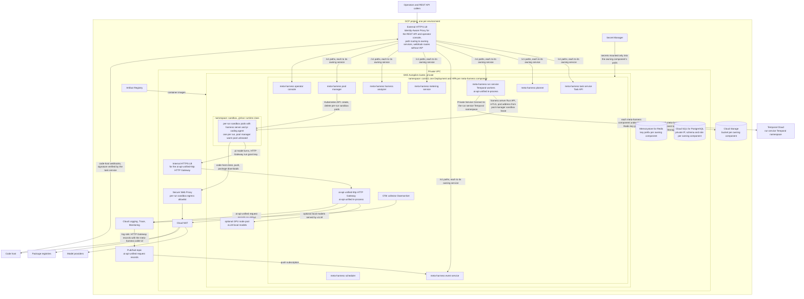

### Deployment without GKE

The deployment that exists runs the whole control plane on one Compute
Engine VM and the console's edge on Cloud Run. GKE and the pool manager
replace the VM behind the same meta-harness components when runs outgrow one
machine. The cloud is declared in Terraform, under `deploy/terraform`, as two
stacks with state in a Cloud Storage bucket.

| Component | Runs on | Notes |
|---|---|---|
| Edge: the console web app and `/v1` routing | Cloud Run, behind Firebase Hosting at `https://meta-harness.web.app` | `deploy/edge.Dockerfile`. The edge signs operators in with Google itself (see REST API), checks the access list, then reaches the VM's private address over Direct VPC egress |
| Task service, planner, event service, meta-harness scheduler | The VM, as systemd units under the `mh` user | `deploy/vm/units`. Each listens on a private port that only the edge's subnet reaches |
| Postgres | The VM, in a Docker container, its data on the data disk (`/var/lib/meta-harness/postgres`) | `mh-postgres.service`. One copy on one disk; Cloud SQL replaces it |
| Temporal | The VM, the Temporal dev server with its history in one file | `mh-temporal.service`. A development server, one process, no replication. Temporal Cloud replaces it before runs that matter |
| Redis | The VM, the distribution package | The HTTP Gateway's run grants and per-run spend counters. The scheduler's locks and kill switch are Postgres rows |
| HTTP Gateway | The VM, from a checkout of ai-api-unified-http, reading its own `config/models.json`. Its guardrails are off, as that file ships | `mh-gateway.service`. Bound to every interface so the egress proxy container reaches it; no firewall rule admits its port from outside the VM. The meta-harness `models.json`, whose router names `harness` candidates, reaches the worker alone: the gateway's completions factory refuses a `harness` engine |
| Meta-harness run service worker, egress proxy, per-run sandboxes | The VM, with the Docker executor backend | `mh-worker.service`, `mh-egress.service`. Per-run sandboxes are containers on the VM, and `MH_MAX_SANDBOXES` caps them at 8, the ceiling on the task policy's `max_parallel`: the VM, an `e2-standard-16` (16 vCPU, 64 GB), holds eight sandboxes at their profiles' 6 GB cap and 16 GB for everything else. Each run's workspace and git directory live under `/var/lib/meta-harness/runs` |
| Logs | The systemd journal, every `mh-*` unit's output, shipped to Cloud Logging as `mh_journald` by the Google Cloud Ops Agent (major version 2, `deploy/vm/ops-agent.yaml`), which the boot installs. A failed install leaves the logs in the journal and stops nothing. Every service logs through `meta_harness/logs.py`, which under systemd starts each line with its journal priority (`<4>` warning, `<3>` error), so a record's level becomes its Cloud Logging severity; without the prefix every line arrives as INFO. Failures are logged at WARNING or ERROR, each line naming `task <id> run <run id>`: the RunTask workflow logs a run that did not finish, a review run with no verdict, a merge GitHub refused or a conflict, and failed checks on a merge commit as warnings, a task that ends `review_unresolved` or unreviewed as a warning, and one that ends `failed` as an error; the task service logs every move to `failed` (error), `review_unresolved` or `canceled` (warnings), whoever set it | The console's Admin menu reads them through `GET /v1/admin/logs`. The Logs page opens on warnings and above, and takes its search and range from its link (`?q=<task id>&minutes=1440`) |
| Secrets | Secret Manager, read at boot into `/etc/meta-harness/env` | Provider keys, the service key, the gateway key, the repo registry and each GitHub App's private key. 

The **platform** stack is what changes rarely: the network, Cloud NAT, the
firewall rules, the VM's fixed address and its data disk, the service
accounts and every role they hold, the GitHub sign-in, the secrets'
containers, Artifact Registry and the console's access list. The
**release** stack is a commit: the VM at that commit, and the edge on Cloud
Run from the image built from it.

Every merge to main deploys itself, infrastructure included, so a task's
merged pull request is all it takes to change either stack.
`.github/workflows/deploy.yml` waits for main's five checks to pass at the
merged commit, then:

1. It plans the platform stack. No change applies nothing. A change is
   applied, unless `deploy/platform_guard.py` refuses the plan.
2. It builds the edge image and pushes it to Artifact Registry tagged with
   the commit.
3. It applies the release stack with the commit and the image. The release
   stack reads the platform stack's outputs, which is why the platform goes
   first: a pull request can add a platform output and use it in the release
   stack at once.
4. Once the VM reports the commit, it runs a smoke task through the deployed
   system (#204, `src/meta_harness/smoke.py`): one small task, submitted
   through the Task API on the VM as a caller would, that writes a one-line
   file in a scratch repo on the VM, pinned to the first candidate of the
   router's first tier, with a $0.25 spend limit. The scheduler admits it
   whatever is running, the RunTask workflow runs it in a per-run sandbox,
   with its database, against the real HTTP Gateway, and it ends `closed`.
   Its type is `smoke`: only a service creates one, it opens no pull request,
   gets no review, never holds for budget, and the console's lists leave it
   out (`GET /v1/tasks?smoke=true` lists them). A task that does not end
   `closed` in ten minutes is tried once more, since one model call can fail
   by chance; two failures fail the deploy, and its failure issue quotes
   what the smoke task said. While the kill switch is on or the scheduler
   drains, no task may start, and the smoke task is skipped. Tests and the
   zero-cost end-to-end check use fakes for the model, the code host and
   the VM; only this shows whether a task runs on the deployment.

The guard refuses a plan that deletes or replaces what the deployment cannot
lose: the data disk, the network, a service account, the sign-in from
GitHub Actions, a secret, the image repository, the console's site, an
enabled API, or the deploy account's own way in (its sign-in and its access
to the Terraform state). New resources, changes in place, and removed
grants and firewall rules apply. A refused plan fails the deploy before
anything changes, and its issue names the resources.

The workflow signs in as `mh-deploy-sa` through workload identity
federation, whose provider accepts only this repository's main branch, so
GitHub holds no Google Cloud key and a pull request's code never runs with
cloud access. Applying the platform stack takes roles that let the account
change IAM, secrets and the network, so the account can grant itself
anything in the project. What guards it is the path to main: the checks, the
review loop's review on another model, and the guard on the plan. No pull
request sees its plan before it merges, because planning needs cloud access
that a pull request must not have.

Three things stay outside a deploy. A secret's value is added by hand
(`gcloud secrets versions add`), since Terraform never sees one; a secret
the system can generate itself, as it does the session key, belongs in the
stack. A new project is set up once by hand (`make platform`), which is also
how a plan the guard refuses is applied. And a failed platform apply has no
rollback: the fix is the next merge.

A deploy updates the running VM in place. The release apply changes only
the VM's metadata (the commit, the startup script), so the VM keeps running.
The workflow then runs the startup script on it over IAP SSH, as the deploy
account through OS Login, inside a `systemd-run` unit so a dropped connection
can't stop it. The script checks the commit out and runs
`deploy/vm/boot.sh` in update mode:

- Postgres and Temporal keep running, and migrations apply beside the
  running services: the script runs `mh migrate` itself and never restarts
  the `mh-migrate` unit, which every API service requires, so restarting it
  would stop them all at once.
- The sandbox images are rebuilt only when their sources changed.
- The egress proxy and the HTTP Gateway restart only when they changed,
  because a restart drops a running sandbox's model calls.
- The control-plane services restart one at a time, each answering
  `/health` before the next. A service gives its open requests five seconds
  on a stop, and systemd ends it after fifteen (`TimeoutStopSec`), so a
  connection a client keeps open, such as the console's live event stream,
  cannot hold a restart.

Running sandboxes are Docker containers that outlive the restart, and
Temporal hands the interrupted run activity to the restarted worker, which
re-attaches to the same container, so no running task is lost. The edge
retries a request whose connection is refused for up to 20 seconds, so a
service's few seconds down don't reach the console. Old and new code run
side by side for those seconds, so migrations only add, and anything removed
goes in a later pull request.

The restarted worker also replays every running RunTask workflow's history
against the new workflow code. A change to which activities, timers or
signals a workflow runs, or their order, no longer matches a history
recorded before it, and Temporal retries that workflow task without end:
the task neither finishes nor fails. So a change like that goes behind
`workflow.patched("<change-id>")`, and a later pull request removes the old
branch with `workflow.deprecate_patch` once no workflow started before the
change is still running. `tests/run_service/test_replay.py` replays recorded
RunTask histories (`tests/run_service/histories`, Task API tasks through the
review loop) against the current code on every pull request, so a change
that would break running workflows fails before it merges.

A failed update rolls back. When any step of an update fails (a service that
does not answer `/health` within 60 seconds, a migration, a dependency
install), `rollback` in `deploy/vm/services.sh` checks out the commit the
update replaced, reinstalls its dependencies and units, and restarts every
service the update had restarted, one at a time with the same health checks.
The services after the failed one never ran the new commit. Because
migrations only add, the previous code runs against the new schema. The
guest attribute reads `failed <commit>: rolled back to <previous>`, or
`failed <commit>: rollback failed, a service is down` when the previous
commit doesn't come back healthy either. The deploy fails, and opens an issue
labeled `meta-harness:operations` that names the commit, so a goal can fix
the change. CI checks a change before it merges; the rollback covers what
only shows on the VM, such as a migration against production data, a
setting checked at startup, or a missing secret. Without it, a merge that
broke the worker would leave nothing to run the fix.

A deploy whose commit failed one of main's checks never starts. It opens an
issue titled "blocked: a check failed on main" that names each failed check
and links its run, and nothing on Google Cloud changes.
A deploy is a check run on the merge commit, so the task whose pull request
merged waits for it (Review loop, the merge): a failed deploy also becomes
that task's fix run, besides the issue it opens.

Terraform replaces the VM only when its definition changes (boot image,
disks), and stops, resizes and starts it for a new machine type. Either
way the VM boots: its startup script mounts the data disk, which carries Postgres data, Temporal's history and run workspaces, checks the
commit out and runs `deploy/vm/boot.sh`, which starts everything. Both paths
report `ok <commit>` or `failed <commit>` in a guest attribute, and the
workflow waits for it. `make deploy` runs the workflow by hand, and
`make deploy-status` reads the attribute. The VM has no public address; an
operator reaches it through IAP-tunneled SSH, only to read logs.

What this shape lacks against the design above: the Temporal dev server and
the Postgres container are single copies on one disk; the sandbox host is the
control-plane host; the VM's size bounds concurrent runs; and a deploy that
replaces or restarts the VM (a change to its definition or machine type)
takes the control plane down while the new VM boots. It drains first: over
IAP SSH, `deploy/vm/drain.sh on` sets the scheduler draining, so no new task
starts, and the deploy waits until no task is `running`, up to the longest
harness profile's `max_minutes` plus ten. Past that it applies anyway and
names the tasks it interrupted in the run's summary. The new VM's boot ends
the drain. After a
rollback, the VM's metadata still names the failed commit, so a reboot before
the fix deploys boots that commit, with no rollback. Cloud SQL and Temporal Cloud
are their own pull request after the point of entry, as Terraform resources
replacing the two containers.

### Compute

- One private, regional GKE Autopilot cluster.
- One Deployment per meta-harness component: the
  meta-harness task service, the planner, the meta-harness scheduler, the meta-harness run
  service Temporal workers, the pool manager, the event service, the metering
  service, the harness analyzer, the operator console and the
  ai-api-unified-http HTTP Gateway, each with a horizontal pod autoscaler. The
  meta-harness scheduler and the pool manager each run two replicas with
  leader election.
- One per-run sandbox pod per run, with the gVisor
  runtime class (GKE Sandbox). The pool manager creates and deletes these
  per-run sandbox pods through the Kubernetes API, and the pool manager's warm
  pool is pre-created, unleased per-run sandbox pods. A default-deny
  NetworkPolicy on the `sandbox` namespace allows ingress only from the
  meta-harness run service and the pool manager on the harness server Run API
  port. It allows egress only to the HTTP Gateway's internal load balancer and
  the Secure Web Proxy.
- The meta-harness run service and the
  pool manager reach a per-run sandbox's harness server at the pod address in
  the pool manager's sandbox lease record, over mutual TLS. No load balancer
  sits in front of the per-run sandboxes, because each run talks to exactly
  one per-run sandbox pod.
- A GPU node pool runs vLLM behind the HTTP Gateway,
  as an `openai-compatible` ai-api-unified completions engine in the
  ai-api-unified `models.json` configuration.

### Managed services

| Service | Owner and use | Fails how |
|---|---|---|
| Cloud SQL for PostgreSQL | One regional high-availability Cloud SQL instance on a private IP. One schema and database role per owning meta-harness component, with IAM database authentication per component. The Cloud SQL instance has the capacity for the meta-harness event service, the heaviest writer. | Failover to the Cloud SQL standby takes about a minute. Meta-harness services retry, and event service producer clients buffer. Per-run sandboxes never touch Cloud SQL, so runs in progress keep working. New task admissions by the meta-harness scheduler and new sandbox leases from the pool manager wait. |
| Temporal Cloud | The meta-harness run service's Temporal namespace, reached over Private Service Connect. RunTask workflow history, timers and signals. | RunTask workflows stop advancing, but per-run sandboxes keep running and finish their work. When Temporal Cloud returns, meta-harness run service activities retry and re-attach to the harness server by `run_id` and `Last-Event-ID`. A run whose pool manager sandbox lease TTL expires during the outage is lost, and the meta-harness run service retries it as a new attempt. |
| Memorystore for Redis | Standard tier with a replica. One key prefix per owning component. The HTTP Gateway keeps HTTP Gateway run grants and HTTP Gateway per-run spend counters. The meta-harness scheduler keeps repo-area locks. The meta-harness run service keeps code-host API rate-limit token buckets. The event service keeps a commit notification fallback, unused while Postgres `NOTIFY` suffices. | Memorystore failover keeps the data. If Memorystore loses the HTTP Gateway's spend counters or run grants, the HTTP Gateway fails closed. The HTTP Gateway then rejects model turns for any run it cannot verify or meter. Those runs end, and the meta-harness run service retries them as new attempts. If Memorystore loses the meta-harness scheduler's repo-area locks, the meta-harness scheduler stops admitting tasks until it rebuilds the locks from the meta-harness run service's active runs. |
| Cloud Storage | One bucket per owning component. The pool manager's Cloud Storage artifact bucket holds pi session directories under `harness_session_id` and per-run sandbox logs. The meta-harness run service's bucket holds run artifacts, and the event service's bucket holds event exports. | The pool manager's sandbox drain step retries artifact collection. A per-run sandbox stays in `draining` until the pool manager saves the per-run sandbox's artifacts to the pool manager's bucket or a limit passes. Follow-up tasks that need a saved pi session wait. |
| Artifact Registry | Every container image: the per-run sandbox harness image and one image per meta-harness control-plane component. | Pods cannot pull uncached images. Running meta-harness services and warm per-run sandboxes keep running, and image rollover pauses. |
| Secret Manager | Secret Manager mounts each secret only into its owning component's pods. Model provider API keys go to the HTTP Gateway, except the ai-api-unified router classifier's provider API key. The classifier's provider API key goes to the meta-harness run service and the planner. The meta-harness run service also receives an HTTP Gateway API key. The meta-harness run service run activity uses that HTTP Gateway API key to request and revoke HTTP Gateway run grants. | Secrets load into pods at pod start, so a Secret Manager outage blocks new pods only. |
| Cloud Logging log sink and Pub/Sub | The log sink publishes the HTTP Gateway's meta-harness request records to one Pub/Sub topic, and a push subscription delivers them to the event service. | Pub/Sub keeps an undelivered message for 7 days and retries the push, so an event service outage delays `gateway_request` events and loses none. |
| Cloud NAT and Secure Web Proxy | All egress from the GKE cluster. The Secure Web Proxy enforces the per-run sandbox egress allowlist. | Fails closed: per-run sandbox egress stops, runs fail on code-host clone or push, and the meta-harness run service retries them. No bypass route exists. |

### Network

- The GKE cluster is private in its own VPC, with Cloud NAT for
  egress.
- The Secure Web Proxy allows the HTTP Gateway's
  internal load balancer address, the code host and package registries, and
  nothing else. The `sandbox` namespace's default-deny NetworkPolicy enforces
  the same limit inside the GKE cluster.
- An internal HTTPS load balancer fronts the
  ai-api-unified-http HTTP Gateway.
- An external HTTPS load balancer with Identity-Aware Proxy fronts the
  operator console and the REST API. Its URL map sends the webhook paths to a
  backend without IAP, and Cloud Armor rate-limits each client.
- Each meta-harness component has one Kubernetes
  service account bound to one Google service account. IAM grants follow
  component ownership: a component's Google service account reaches only its
  own Cloud SQL database role, Cloud Storage buckets and Secret Manager
  secrets. Only the pool manager's service account can create or delete pods
  in the `sandbox` namespace. Per-run sandbox pods run under a service account
  with no Google Cloud permissions.
- Memorystore has no per-prefix IAM, so each owning
  component's Redis client wrapper enforces that component's key prefix.
- A run grant key is an application credential of the HTTP Gateway, with no
  Google Cloud permissions. The HTTP Gateway API key that the meta-harness run service run
  activity uses to request and revoke run grants reaches only the meta-harness
  run service pods, through Secret Manager.

### Observability

An OpenTelemetry collector DaemonSet sends traces to Cloud Trace and logs to
Cloud Logging. Cloud Monitoring holds the metrics that drive the horizontal pod
autoscalers and the alerts.

### Local development

Docker Compose runs Postgres, Redis, the Temporal dev server and every
meta-harness service. Per-run sandboxes use the Docker executor backend behind
the same pool manager executor interface, from the same images, and a local
egress proxy enforces the same per-run sandbox egress allowlist. Each local
per-run sandbox is on its own internal Docker network, which has no route
out, and Docker attaches the local egress proxy to each one. Docker publishes no
port from an internal network, so the meta-harness run service reaches each harness server
through the local egress proxy's control listener.

## Build plan

| Step | State | Where |
|---|---|---|
| pi model client extension: pi's model calls through the HTTP Gateway | built | `images/harness-pi/extension` |
| Harness server and the harness server Run API | built | `images/harness-pi/server` |
| Each run as a meta-harness run service Temporal workflow (the RunTask workflow), with re-attach to the harness server on retry and cancel | built | `samples/temporal-run-task` |
| HTTP Gateway run grants: model pin and spend limit per run | built | ai-api-unified-http 1.18.0, `samples/temporal-run-task` |
| Per-run sandbox: the harness server in a Docker container per run, which the meta-harness run service run activity starts and removes with the Docker executor backend | built for local development | `images/harness-pi/Dockerfile`, `samples/temporal-run-task` |
| Per-run sandbox egress allowlist: each per-run sandbox on its own internal Docker network, with a local egress proxy that lets it reach only the HTTP Gateway, the code host and package registries | built for local development | `samples/temporal-run-task/egress-proxy`, `make egress-check` |
| A zero-cost end-to-end check: the RunTask workflow against a fake HTTP Gateway that makes no model calls, on every pull request | built | `samples/temporal-run-task/e2e.sh`, `make e2e`, `.github/workflows/e2e.yml` |
| The sandbox runs this repo's checks (#203): on every pull request, `make image-checks` has pi's bash tool run the checks a task on this repo runs (`uv sync`, ruff, the whole Python suite, and the console's install, typecheck and tests) in the built per-run sandbox image, on a clone of the checkout under test, behind the egress proxy, with the run's database beside it, against the fake HTTP Gateway. It fails when the image or the sandbox cannot run them, and the deploy waits for it. On its first runs it found the sandbox started under the wrong name once it had a database, a database host name too long for a long task ref, and every workflow test skipped in a sandbox because `temporal.download`, where Temporal's test server comes from, was not on the egress allowlist | built | `samples/temporal-run-task/stack.sh` (`checks`), `src/meta_harness/run_service/fake_gateway.py` |
| Provider-neutral tool results: one tool-result shape the HTTP Gateway converts for each model provider | built | ai-api-unified-http 1.19.0, `images/harness-pi/extension` |
| The RunTask workflow's run loop over the ai-api-unified router's candidates, with a meta-harness run service `route` activity, escalation, pins and a task-wide spend limit | built | ai-api-unified 3.30.0 (`AiRouteClassifier`), `samples/temporal-run-task`, `make fallback-demo` |
| Repo work in a run: each run starts from a fresh clone of the task's repo, pi's `bash` tool runs the acceptance checks, and the meta-harness run service's Publish step commits pi's changes, pushes the branch and opens the pull request with `Closes <issue>`. The per-run sandbox holds no code-host credential | built for local development | `samples/temporal-run-task`, `make repo-demo`, `make run TICKET=owner/name#N` |
| `submit_review`, the review run's owned pi tool | built | `images/harness-pi/extension` |
| The clone's git directory outside the per-run sandbox mount, read-only inside it, so nothing pi writes runs on the host at Publish | built | `src/meta_harness/run_service/code_host.py`, `sandbox.py`, `tests/run_service` |
| Runs sized for real work: Python 3.12, uv and Poetry in the sandbox image; profile limits, resources and bash allowlist; the run activity's timeout from the profile; tier models and thinking levels | built | `images/harness-pi`, `config/`, `tests/run_service/test_workflow.py` |
| The operator console on Mantine: a sidebar shell, data tables, a Goals page, and a Configuration view of router tiers, harness profiles and the repo registry, with versions, checked saves and rollback | built | `console/`, `src/meta_harness/config`, `tests/config` |

### Bootstrap pull requests

The bootstrap ends at the point of entry: an operator signs in to the console
web app in the cloud, creates a goal, and the meta-harness turns the goal's
labeled issues into pull requests, with no process running on the operator's
machine. Nothing self-improving starts before that. The meta-harness pull
requests merge one at a time, in this order. Each check joins the zero-cost
end-to-end check, so it runs on every later pull request without model calls.

1. `feat/control-plane-skeleton`, `feat/event-service`, `feat/task-service`,
   `feat/run-service` (merged). Then `make e2e` submits a task through the
   Task API, and the task ends with a pull request on a test repo and every
   event in the event service.
2. `feat/github-app` (merged). Then a run clones a real repo that the GitHub
   App alone can reach, and opens its pull request as the app.
3. `feat/planner-goals`, `feat/admission`. Then a labeled issue in a test repo
   becomes a task and runs to a pull request, with no command naming the task.
4. `feat/console-web-app-goals`, `feat/console-web-app-runs`. Then an operator
   creates a goal in the browser and watches its runs live.
5. `feat/deploy-cloud` (merged). Then the cloud deployment exists: the edge
   behind IAP and the VM with every service.
6. `feat/real-runs` and `docs/agents-md` in ai-api-unified-http and
   meta-harness. Then a run on any of the three repos installs it, runs its
   tests and works within limits sized for the task, and each repo tells the
   run its own rules. After the deploy check, the point of entry works: a goal
   created in the cloud console runs its issues to pull requests.

With `auto_merge` off, each pull request waits for an operator to merge it,
so the point of entry needs no review loop. After it, `feat/review-loop`
(#85) and `feat/merge` (#86) merged, built by the meta-harness. Still to
come: `feat/code-host-webhooks`, `feat/takeover`, `feat/planner-sync` and
`feat/console-web-app-inputs`.

| Pull request | Builds | Check |
|---|---|---|
| `feat/control-plane-skeleton` | `src/meta_harness/`, the `mh` command line, Docker Compose with Postgres and the Temporal dev server, migrations per owning component | `make up && make migrate` on a clean checkout |
| `feat/event-service` | The `event` table, the schema registry, `append`, `read` and `tail`, and the client library with its outbox | `mh events tail` keeps printing in position order across an event service restart |
| `feat/task-service` | The `task` table and the Task API: create, read, look up by `external_ref`, cancel | Two `POST /v1/tasks` with one `external_ref` return one task |
| `feat/run-service` | The RunTask workflow, moved from `samples/temporal-run-task`, started from a task id and writing its rows and events | `make e2e` through the Task API |
| `feat/github-app` | A read-only installation token per run for the clone, and the app token for every code-host write | `make run REPO=owner/name` on a repo the GitHub App alone can reach |
| `feat/planner-goals` | The `goal` table, the Goals API, the `fix` modality, the GitHub adapter's `list_open`, `read` and `sweep`, and issues to tasks with `depends_on` | A labeled test issue becomes a task within one sweep |
| `feat/admission` | A loop that starts queued tasks' RunTask workflows: global concurrency, repo-area locks as expiring rows until the meta-harness scheduler moves them to Redis, closed dependencies, the goal's budget | `make e2e-admission`: two tasks on one repo area run in turn |
| `feat/console-web-app-goals` | The first console web app: goal creation, the Overview and the Goal page, calling only the REST API, with an identity outside the access list refused (merged as server-rendered pages, then replaced by the React app) | An operator creates a goal in the browser, and an account outside the access list gets 403 |
| `feat/console-web-app-runs` | The console web app in React and TypeScript (`console/`), and the local edge that serves it and routes `/v1` as the signed-in operator. Lists read ahead as you scroll; the Tasks page shows running tasks as a list or as terminal tiles 4, 16 or 32 up, where only the tiles on screen stream, over one server-sent-event stream; the Task page shows the live run and loads older events as you scroll up; cancel and the kill switch, which the meta-harness scheduler carries out | The tiles of running tasks stream their events as they happen, and scrolling moves the stream to the tiles in view |
| `feat/deploy-cloud` | One VM running every control-plane service, Postgres, the Temporal dev server, Redis, the HTTP Gateway on its own configuration, the worker and its per-run sandboxes, as systemd units booted from Secret Manager; the edge on Cloud Run behind Identity-Aware Proxy with the IAP header check; the clone's git directory outside the sandbox mount (see Deployment without GKE) | `deploy/gcp.sh infra && deploy/gcp.sh edge`, then a goal created in the cloud console runs a labeled issue to a pull request, and a request without IAP credentials gets 401 |
| `feat/real-runs` | Python 3.12, uv and Poetry in the per-run sandbox image; harness profiles sized for these repos, with resources and a bash allowlist; the run activity's timeout from the profile; router tiers on Sonnet 5 and Opus 5.5, with each tier's thinking level sent on every turn; a $10.00 default task limit; an e2-standard-8 VM | `uv run pytest -q`, `npm test` in `images/harness-pi`, and `make e2e` in CI |
| `feat/terraform-deploy` | The cloud in Terraform: a platform stack and a release stack, which CI applies on every merge to main through workload identity federation; the VM replaced per commit with its state on a data disk; `make platform`, `make deploy`, `make deploy-status` | A merge to main deploys, and `make deploy-status` names the merged commit as what the VM booted |
| `feat/deploy-managed` | Cloud SQL for the control plane's tables, and Temporal Cloud for the run service namespace | `make deploy`, then the same goal check |
| `feat/code-host-webhooks` | The webhook endpoint: signature check, and check, merge and close deliveries as RunTask workflow signals | `make webhook-replay` |
| `feat/review-loop` | The review run with `submit_review`, the posted review, the fix run, and the round and budget limits (merged, #85) | `make e2e-review`: `changes`, a fix, then `clean` |
| `feat/merge` | The merge at the reviewed head SHA, `auto_merge`, the `ready` and `review_unresolved` ends, and merge conflicts as fix runs (merged, #86) | `make e2e-review` ends merged |
| `feat/takeover` | Take over, hand back and close, as audit events | `mh task take-over`, then `mh task hand-back` |
| `feat/planner-sync` | Issue webhooks, state labels and comments, blocked tasks, refused issues, the goal's status | A test issue gets `meta-harness:running`, then `meta-harness:pr-open` |
| `feat/console-web-app-inputs` | The Inputs page: queued issues by repo and by goal, with their states | A test issue moves from queued to merged in Inputs |
| `docs/agents-md` in ai-api-unified-http and meta-harness | `AGENTS.md` with the repo's test, lint and versioning rules | None |

An operator sets up what the meta-harness cannot:

- a Google Cloud project with billing, and, with `feat/deploy-managed`, a
  Temporal Cloud account;
- the GitHub App, installed on ai-api-unified, ai-api-unified-http and
  meta-harness, with its private key in Secret Manager;
- branch protection with required checks on the three repos;
- a spend limit on each model provider key the HTTP Gateway holds.

### Built by the meta-harness

Since `feat/deploy-cloud` merged, the rest of this design is filed as GitHub
issues, and `fix` goals turn them into pull requests. A goal takes one
label, so each issue carries exactly one theme label, and a theme's issues
make sense as one goal:

| Label | Theme |
|---|---|
| `meta-harness:parallel` | A repo's tasks run side by side: the parallel limit, the merge queue, `Paths:` in issues, and code laid out so tasks edit different files |
| `meta-harness:operations` | Running the deployment: deploys, workflow changes under running tasks, recovery. A failed deploy files its issue here |
| `meta-harness:console` | The console's admin and user menus: roles, the configuration editors, repositories, logs, user settings |
| `meta-harness:goal-lifecycle` | A goal from saved to met: save and start, picking issues, each task's pull request, the goal's board, completing and reopening |
| `meta-harness:goal-planning` | A `feature` goal plans its own issues: the planning profile, the plan, and its approval |
| `meta-harness:console-ux` | The console as the place to follow and steer a task: the run timeline, diffs, reviews, steering, attempts, cost, the inbox |

An issue that two goals' labels match joins the first goal that sweeps it
and stays there, which is why an issue has one theme label. A `Depends on:`
line may name an issue under another label; the task then waits `blocked`
until that issue closes, so a goal on its label never finishes before the
other theme's goal has run. Such lines are kept few, and the themes run in
the order above. `meta-harness:merge` holds the closed issues of the review
loop and the merge, and `meta-harness:planner-check` and
`meta-harness:deploy-check` hold the issues the checks run.

Each issue states its `## Acceptance checks`, the commands its run and its
review run, and names the design sections its change makes untrue, which its
pull request updates.

Design work no issue covers yet:

| Issue | Repo |
|---|---|
| The `new-system` modality with its phases, goal success criteria as commands and checks, the modality classifier and latitude. The `feature` modality's planning task and plan approval are built (#72, #73); the console's plan review is built (#75) | meta-harness |
| The `modalities` and `access` configuration kinds, beside the built tiers, profiles, repo registry and task policy | meta-harness |
| ai-api-unified decisions in the operator console: the Cloud Logging log sink, the Pub/Sub topic and push subscription, and `gateway_request` events | meta-harness |
| The metering service and the Spend view | meta-harness |
| The harness analyzer, its proposals, and the Routing view | meta-harness |
| Operator review and takeover | meta-harness |
| Code-host and tracker webhooks, and the planner's write-back to issues: state labels, comments, `meta-harness:failed`, operator issues | meta-harness |
| The pool manager, GKE, and the meta-harness scheduler as its own service | meta-harness |
| The owned `run_tests` tool, plan-first and `test_before_pr`, the pi compaction handler with a `trivial` tier, and `guardrail_blocked` events | meta-harness |
| `route` in the conversation request body, so on a run grant that pins a model one call can run on a tier range capped at the pinned model's tier | ai-api-unified-http |
| Streaming: a `send_conversation` form that yields typed events and commits to one model at its first delta, and a server-sent-events form of the HTTP Gateway conversation endpoint | ai-api-unified, ai-api-unified-http |

Once the planning task exists, the meta-harness drafts its own next issues,
and later goals use the `feature` and `new-system` modalities.
