# Meta-Harness Technical Design

## Scope

The meta-harness runs AI coding tasks in parallel. A team sets goals, and each
goal queues tasks from GitHub issues across one or more repos. For each task
the meta-harness picks a harness profile and a model to fit the task's
difficulty, runs them in an isolated per-run sandbox, meters every model call,
and records the outcome, usually a merged pull request. Tasks run
independently, so one task's failure or one model provider's outage leaves
the others running.

### Components

| Component | What it does | Code |
|---|---|---|
| **Meta-harness control plane** | | `src/meta_harness/` |
| Task service | Accepts and tracks tasks, serves the Task API, and receives code-host webhooks. | `task_service/` |
| Planner | Turns a goal into issues and issues into tasks, runs the goal loop, and syncs issues both ways with the issue trackers through one adapter interface: GitHub Issues first, then Jira and Linear. | `planner/` |
| Meta-harness scheduler | Picks the next task to run, by goal priority, modality, quotas, spend caps, repo-area locks and dependencies. | `scheduler/` |
| Meta-harness run service | Runs each task as a Temporal workflow, the RunTask workflow: routes it, runs its candidates, reviews and merges its pull request. The only caller of the ai-api-unified router. | `run_service/` |
| Pool manager | Leases per-run sandboxes by run id, keeps a warm pool, and replaces unhealthy sandboxes. | `pool/` |
| Event service | Holds the ordered record of every meta-harness domain event. | `events/` |
| Metering service | Computes cost, time and success per attempt and per task. | `metering/` |
| Harness analyzer | Proposes changes to router tiers, harness profiles and task policy from metering evidence. | `analyzer/` |
| Operator console | The cloud web app operators steer the meta-harness from. | `console/` |
| **ai-api-unified library**, in the meta-harness run service process | | the `ai-api-unified` repo |
| ai-api-unified router | Classifies a task, picks a tier, and returns the tier's ordered harness-profile-and-model candidates. | `AiRouterCompletions` |
| **Per-run sandbox**, one container per run | | `images/harness-pi/` |
| Harness server | Serves the harness server Run API and runs pi through pi's SDK. | `server/` |
| pi | The coding agent, third-party (pi.dev), used unmodified. | `@earendil-works/pi-coding-agent` |
| pi model client extension | Sends every pi model call to the HTTP Gateway. | `extension/` |
| **HTTP Gateway** | The only model endpoint a per-run sandbox can reach. Holds the provider API keys, pins each run's model, runs guardrail checks and enforces each run's spend limit. | the `ai-api-unified-http` repo |
| **Outside the system** | | |
| Code host | Repositories, pull requests, checks, reviews and webhooks. | |
| Model providers | Cloud model APIs, or local models on vLLM. | |
| Temporal Cloud, Google Cloud | Workflow engine and infrastructure. | |

The guardrails library runs inside its callers. The meta-harness run service
and the pool manager use it to scope repo access and credentials per run and
to enforce spend caps.

## Principles

- `models.json` maps each ai-api-unified router tier to its
  harness-profile-and-model candidates, and `harness_profiles.json` defines
  each harness profile's image, prompt set, pi tools and loop policy. Code
  reads both, and a new harness profile is a configuration change the harness
  analyzer measures like any other candidate.
- The meta-harness run service calls the ai-api-unified router in-process to
  route each task, and the planner calls the ai-api-unified classifier to
  classify each goal. pi's model calls reach the HTTP Gateway through the pi
  model client extension on the run's grant key, and the HTTP Gateway holds
  the provider API keys.
- The meta-harness run service starts pi, follows up, reads its events,
  cancels it and reads its usage through the harness server Run API.
- At startup each service checks every harness profile and router tier
  candidate against the harness profile images and the ai-api-unified
  configuration, and stops with the setting's name when a model, profile or
  image is missing.
- The metering service charges every run, failed runs included, to its task's
  cost and time.
- A run lasts minutes to hours. When a meta-harness process dies, the RunTask
  workflow resumes each run from its last recorded step.
- Each datastore has one owner component, and other components reach its data
  through that owner's interface. ai-api-unified owns no store.
- A per-run sandbox can read its task's repo and write nothing on the code
  host. After a run, the meta-harness run service pushes the branch, opens the
  pull request, posts reviews and creates the planning task's issues from what
  the run produced, so a prompt injection inside a run cannot reach the code
  host.

## Architecture

Arrows are calls on the target's interface. Only a datastore's owner reads or
writes it.

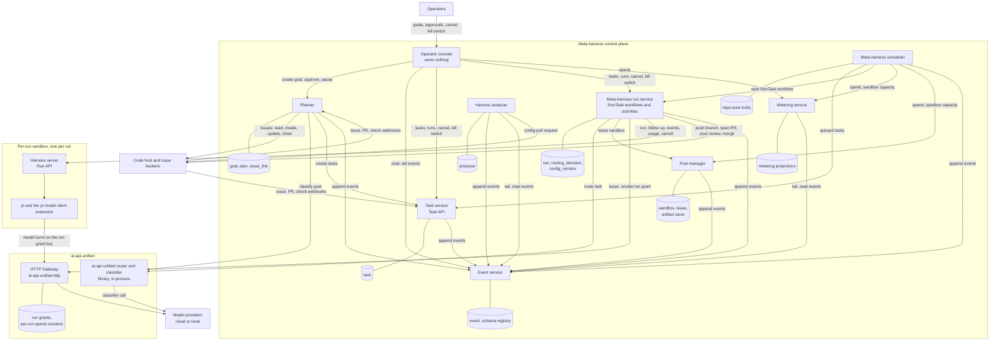

| Component | Owns | When it fails |
|---|---|---|
| Planner | `goal`, `plan`, `issue_link` | Goals stop taking new issues and planning. Tasks already queued run. A missed tracker webhook is caught by the planner's periodic sweep on recovery. |
| Task service | `task` | No new tasks or status reads. Running tasks continue, and the code host retries its webhooks. |
| Meta-harness scheduler | Repo-area locks in Redis | No new admissions. Running tasks continue, and a dead leader's locks expire by TTL. |
| Meta-harness run service | `run`, `routing_decision`, `config_version`, its Temporal namespace, code-host rate-limit buckets | RunTask workflows resume from their last step. A retried run activity re-attaches to its sandbox lease, its run grant and its event stream by `run_id`. |
| Pool manager | `sandbox`, `lease`, the artifact store | New runs wait for a lease. Running sandboxes continue, and lease TTLs apply on recovery. |
| Event service | `event`, the schema registry | Producers buffer and retry, so runs continue. Consumers catch up from their cursors. |
| Metering service | Its projection tables | Projections lag. The HTTP Gateway still enforces each run's spend limit, and the scheduler treats stale spend as at cap. |
| Harness analyzer | `proposal` | No new proposals. Runs are unaffected. |
| Operator console | Nothing | Operators lose sight of the system. Runs continue. |
| HTTP Gateway | Run grants, per-run spend counters | Model turns fail and the run fails. The run loop moves to the next candidate, and when every candidate fails this way the RunTask workflow pauses the task. |
| Harness server | The run's pi session directory | The run ends `ERROR`, and the run loop tries the next candidate. |

The meta-harness run service loads `models.json`,
`harness_profiles.json` and `task_policy.json`, and the planner loads
`modalities.json` and `repos.json`. Each keeps its files' version history.
Configuration changes only through a pull request against `config/`, including
an approved harness analyzer proposal.

Each owner has its own Postgres schema and role and its own
Redis keyspace, and no role has grants on another owner's schema.

## The harness

The meta-harness harness is pi's coding agent (`@earendil-works/pi-coding-agent`),
which the harness server runs in-process through pi's SDK. The meta-harness
adds two pieces to pi:

- the **pi model client extension**, a pi extension loaded through pi's own
  extension mechanism. The pi model client extension registers the only model
  provider pi can see in the harness profile image and sends every pi turn to
  the HTTP Gateway;
- the **harness server**, which exposes the harness server Run
  API and runs pi's `AgentSession` through pi's SDK.

Any image that serves the harness server Run API and honors the run's pinned
model can be a harness profile image, so ai-api-unified never needs to know
which agent runs.

### Model client

The pi model client extension registers one complete pi model provider with
`pi.registerProvider()` and its own `streamSimple`. The pi model client
extension needs its own stream function because the HTTP Gateway's
`/v1/conversations/turn` is not a protocol pi implements. The pi model
provider exposes a single pi model, "the run's model", which is whatever
model the HTTP Gateway run grant pins. The pi model has zero cost
metadata, because cost comes from the HTTP Gateway. It declares no
`promptCache` lifetime, so pi never warms the provider prompt cache.

On every pi turn the pi model client extension:

1. Takes pi's transcript context, reading the current system prompt and pi
   tools from pi's transcript helpers, and builds the HTTP Gateway's
   conversation request: system prompt, messages, pi tools, the thinking level
   the run started with, and the `prompt_cache` field set to
   `{"retention": "extended", "key": <harness_session_id>}`. Each earlier
   assistant turn goes back as its HTTP Gateway conversation token. Each pi
   tool result goes as `{"type": "tool_result", "tool_call_id", "result",
   "is_error"}`, the same for every model provider. The HTTP Gateway builds
   the answering model provider's own tool-result message from it
   (ai-api-unified-http 1.19.0), so the pi model client extension holds no
   per-provider message code.
2. Attaches per-call routing hints. pi agent turns carry no route hint, so the
   HTTP Gateway run grant's model pin or model band decides. Calls the pi
   model client extension makes itself, for pi session compaction and for
   auxiliary text (commit message, PR description), carry `route: trivial`.
3. Calls the HTTP Gateway's native conversation endpoint with the run grant
   key. As pi's custom-provider contract requires, the pi model client
   extension calls `options.onPayload` before sending and
   `options.onResponse` on the HTTP Gateway response, awaits
   `options.onProviderStreamEvent` for each pi provider stream event, and
   honors pi's abort signal.
4. Maps the HTTP Gateway turn result into pi's provider event sequence:
   `start`, balanced text and thinking events, tool-call events whose
   arguments the pi model client extension has parsed into input by `toolcall_end`, and exactly one `done` or
   `error`. A tool-use turn arrives from the HTTP Gateway as one response, so
   the pi model client extension emits text once per turn.
5. Finalizes pi's assistant message with the HTTP Gateway's numbers: input,
   output, cached input and cache-write model tokens, the per-turn cost, the
   stop reason, and the model the HTTP Gateway used. The pi model
   client extension adds `cached_input_tokens`, `cache_write_5m_tokens` and
   `cache_write_1h_tokens` from each HTTP Gateway turn's `usage` to the run's
   totals for the harness server Run API's `GET /usage`. The HTTP Gateway
   reports provider prompt cache writes by lifetime because they bill at
   different rates: 1.25 times the input rate for 5 minutes and 2 times for
   1 hour on Anthropic and Bedrock.

Every HTTP Gateway conversation turn sends the whole pi
session history, so provider prompt caching sets most of a turn's cost: a
cached prefix bills at about a tenth of the input rate on Anthropic.

- pi passes `cacheRetention` and `sessionId`
  to the pi model provider on every call. The harness profile image sets
  `PI_CACHE_RETENTION=long`, and the pi model client extension maps `long` to
  the `prompt_cache` retention `extended` above: 1 hour on Anthropic and
  Bedrock, 24 hours on OpenAI. A run often waits more than 5 minutes between
  pi turns while tests or builds run, and the default provider prompt cache
  would expire in that gap. `harness_session_id` as the provider prompt cache
  key sends every turn of a pi session to the same OpenAI prompt cache.
- pi's `cacheWarming` setting is `off`, and the pi model
  client extension's pi model declares no `promptCache` lifetime. Otherwise pi
  would send billed provider prompt cache refresh calls through the HTTP
  Gateway.
- The pi model client extension keeps the system
  prompt and pi tool list byte-identical for the whole run: no timestamps, no
  run ids, and a fixed pi tool order. A pi session compaction rewrites the pi
  session history, so the pi turn after it writes a new provider prompt cache
  entry once.
- The HTTP Gateway accepts `prompt_cache` on the
  conversation turn and returns the cached-model-token fields in `usage`.

When an HTTP Gateway guardrail check blocks tool results, the HTTP Gateway
response names their tool-call ids. The pi model client extension replaces
those tool results with a short notice and resends the pi turn. The harness server
emits the `guardrail_blocked` harness server Run API event. When the HTTP
Gateway refuses a turn with `402 run_grant_spend_limit`, the pi model client
extension ends the pi turn with `error`, and the harness server ends the run
`ERROR` with end reason `spend_limit`.

### What pi loads

The harness server creates the pi session with `createAgentSession()` and
decides everything pi loads:

- A custom `ResourceLoader` supplies only the pi model client
  extension and the owned pi extension tools. Nothing loads from the cloned
  task repo's `.pi/` directory: no pi settings, pi extensions, pi skills or
  `SYSTEM.md`.
- pi SDK sessions do not load the pi CLI's
  built-in `codemode`, `tool_search` and MCP pi extensions, and the harness
  server never adds them. `codemode` can run classifier and image models with
  the pi session's credentials.
- A `ModelRuntime` with no built-in credentials, so the pi
  model client extension's pi model is the only one pi can call. The harness
  server never calls `setModel`, so pi never switches models and the HTTP
  Gateway run grant decides the real model.
- pi's SDK `tools` option comes from the harness profile.
- pi loads `AGENTS.md` and `CLAUDE.md` from the pi working
  directory unless pi context loading is off, so the harness profile's
  `context_files` setting decides. The run service dispatcher activity puts
  the task repo's `AGENTS.md` in the first pi prompt, so turning
  pi context files on sends it twice.
- `SettingsManager.inMemory(...)` holds these pi settings,
  and pi reads no settings file:

| Setting | Value | Reason |
|---|---|---|
| `compaction.reserveTokens`, `compaction.keepRecentTokens` | The harness profile's `loop.compaction` | Compaction size is a harness profile setting |
| `retry.enabled` | `false` | pi's default model-call retry (3 retries, backoff up to 60 seconds) would stack on the HTTP Gateway's ai-api-unified fallback chain. A failed pi turn fails the run, and the RunTask workflow's Decide step moves to the next tier candidate. pi's context-overflow recovery (compact, then retry) stays on. |
| `cacheWarming` | `off` | Warming calls would be billed provider prompt cache refreshes |

The HTTP Gateway run grant decides the model, so the harness server registers
no pi virtual models (`registerVirtualModel`).

### Tools

| Tool | Source | Limits |
|---|---|---|
| `read`, `ls`, `find`, `grep` | pi built-in tool | Output capped by bytes; binary files refused |
| `write`, `edit` | pi built-in tool | The pi model client extension's tool-call hook refuses protected paths from the task repo policy |
| `bash` | pi built-in tool | Timeout and output cap per harness profile. The pi model client extension's tool-call hook refuses commands outside the harness profile's allowlist. No network beyond the per-run sandbox egress allowlist |
| `run_tests` | owned pi extension tool | Runs the acceptance checks named in the task; results emitted as `tests_run` harness server Run API events |
| `submit_review` | owned pi extension tool, meta-harness review harness profiles only | Ends the review run with verdict `clean` or `changes` and its findings, as a `review_submitted` harness server Run API event. The meta-harness run service posts them as a code-host PR review |
| `create_ticket` | owned pi extension tool, planning harness profiles only | Records one ticket draft (repo, title, body, labels, `Depends on:` lines) as a `ticket_drafted` harness server Run API event. The meta-harness run service creates the issues after the run |

When a run finishes, the run service's Publish step commits pi's changes to the task's branch, pushes it and opens
one PR per task, or pushes to the PR branch in a meta-harness fix task.
Code-host branch protection blocks default branches. The PR description
holds the run's final summary, which the harness prompt asks to list the
assumptions the run made, because no person answers questions.

A harness profile's `tools` list chooses from these tools.

### Loop policy

The pi model client extension and the harness server enforce the harness
profile's `loop` settings:

- The harness server counts pi turns from pi SDK
  events and sends `abort` to the pi session at `max_turns` or `max_minutes`.
- The first pi prompt requires a plan before edits; the pi
  model client extension's tool-call hook refuses writes until pi has emitted
  a plan.
- With `test_before_pr`, the Publish step runs only when
  the `run_tests` pi extension tool has passed in the run's pi session.
- pi starts pi session compaction when the pi
  context passes the model context window minus a reserve
  (`contextTokens > contextWindow - reserveTokens`) and keeps the most recent
  `keepRecentTokens` of pi session history as they are. The harness profile's
  `loop.compaction` sets both (pi's defaults are 16384 and 20000). The pi
  model client extension handles pi's `session_before_compact` pi SDK event:
  the pi model client extension makes the summary call to the HTTP Gateway
  itself, with purpose `compaction`, `route: trivial` and no `prompt_cache`,
  and returns `{compaction: {summary, firstKeptEntryId, tokensBefore, usage}}`.
  pi's own compaction summary request never runs. The compaction summary
  keeps the task spec and acceptance checks verbatim.

### pi sessions

A pi session is one conversation with pi, named by `harness_session_id`. The
meta-harness run service picks the `harness_session_id`, one per pull request,
when the task that opens the pull request starts. Every meta-harness fix task
on that pull request continues the same pi session in a follow-up run. A meta-harness review task
starts its own pi session, so the reviewing model never sees the authoring
model's conversation.

| When | Where the conversation is | Owner |
|---|---|---|
| During a run | pi's session directory in the per-run sandbox, set through pi's SDK `SessionManager`. pi creates the pi session file once the pi session conversation has its first message, then appends each entry. | The per-run sandbox (harness server) |
| Between runs | A copy of that pi session directory in the pool manager's Cloud Storage bucket, stored under `harness_session_id` when the run ends | Pool manager |
| Between runs, briefly | The finished per-run sandbox itself, kept for the pi session for up to `sticky_window` (default 10 minutes) | Pool manager |
| On each model turn | The request the pi model client extension sends to the HTTP Gateway, which forwards it and keeps no copy | Nobody |
| In ai-api-unified | Nothing. The run service `route` activity sends the ai-api-unified router only the task prompt, and meta-harness review and fix tasks do not call the ai-api-unified router | None |
| In the event service | Each turn's text and tool calls, as a meta-harness domain event record for the operator console and the metering service. A run never resumes from it. | Event service |

A follow-up runs in a per-run sandbox that holds the pi session. Before the
pool manager sandbox lease request returns, the pool manager either hands back
the per-run sandbox it kept for the pi session or copies the pi session
directory from its Cloud Storage bucket into a fresh per-run sandbox. The
harness server then switches pi to that pi session and
continues it, so the pi session conversation keeps its tool history on the
same model.

A pi session records its working directory and never changes it, and outside
pi's interactive mode pi exits with an error when that working directory is
missing. Every per-run sandbox therefore clones the task repo at the same
path, `/workspace`, so a restored pi session finds its working directory.

### Events

The harness server subscribes to the pi session with `session.subscribe()`
and maps pi SDK events (`message_update`, `tool_execution_*`, compaction,
`agent_end`, `agent_settled`) to the typed harness server Run API events, each
with run id, sequence number and timestamp: `turn_started`, `model_call`
(model, thinking, model tokens, cost, latency, as the pi model client
extension recorded them from the HTTP Gateway), `tool_call`, `tool_result`,
`file_changed`, `tests_run`, `guardrail_blocked`, `compacted`,
`turn_finished`, `heartbeat`, `run_finished`. The `agent_settled` pi SDK
event marks the end of a pi turn that will not continue on its own. The
harness server then finishes the run or, in a follow-up, waits for the next
input on the harness server Run API.

### Harness profiles

A harness profile is the meta-harness harness's configuration and the
"harness" half of an ai-api-unified router candidate.

```json
{
  "version": "2026-11-03.1",
  "profiles": {
    "pi-lean":    {"image": "harness-pi:1.0", "prompts": "lean/v3",
                   "tools": ["read", "ls", "find", "grep", "edit", "bash", "run_tests"],
                   "loop": {"max_turns": 60, "plan_first": false,
                            "compaction": {"reserve_tokens": 16384, "keep_recent_tokens": 20000}},
                   "context_files": false,
                   "max_minutes": 20, "budget_multiplier": 3,
                   "resources": {"cpu": 2, "memory_gb": 4}},
    "pi-careful": {"image": "harness-pi:1.0", "prompts": "careful/v2",
                   "tools": "*",
                   "loop": {"max_turns": 200, "plan_first": true, "test_before_pr": true,
                            "compaction": {"reserve_tokens": 32768, "keep_recent_tokens": 40000}},
                   "context_files": false,
                   "max_minutes": 120, "budget_multiplier": 6,
                   "resources": {"cpu": 4, "memory_gb": 8}},
    "pi-review":  {"image": "harness-pi:1.0", "prompts": "review/v1",
                   "tools": ["read", "ls", "find", "grep", "bash", "run_tests", "submit_review"],
                   "loop": {"max_turns": 80, "plan_first": false,
                            "compaction": {"reserve_tokens": 16384, "keep_recent_tokens": 20000}},
                   "context_files": false,
                   "max_minutes": 30, "budget_multiplier": 2,
                   "resources": {"cpu": 2, "memory_gb": 4}}
  }
}
```

- `image` names the harness profile image for the per-run sandbox; a
  different agent is a different harness profile image.
- `prompts` names a versioned harness prompt set: system prompt, task
  template, pi session compaction template, PR template.
- `loop` sets the harness loop policy: pi turn limit, whether the first pi
  turn must produce a plan, whether tests must pass before the Publish step,
  and `compaction`, which maps to pi's
  `compaction.reserveTokens` and `compaction.keepRecentTokens`.
- `context_files` decides whether pi loads `AGENTS.md` and `CLAUDE.md` from
  the task repo.
- `max_minutes` and `budget_multiplier` bound the run. The task policy's
  `review` rules bound the meta-harness review loop.
- A review harness profile such as `pi-review` has read-only tools, and the
  run service publishes nothing from a review run.
- The meta-harness run service validates every harness profile at startup:
  the harness profile image exists, the harness prompt set exists, and every
  pi tool name is known.

## Routing

Routing happens twice. Once per task, the ai-api-unified router in the
meta-harness run service picks a tier and returns its candidates, each a
harness profile and a model, and the RunTask workflow tries them in order. On
every model call inside a run, the HTTP Gateway routes the call.

In the diagram, both `standard` candidates fail on infrastructure, so the
RunTask workflow escalates to `complex`.


Inside a run, the HTTP Gateway run grant pins the candidate's model, and pi
agent turns stay on it. The pi model client extension's compaction call sets
`route: trivial`, so the HTTP Gateway runs the compaction summary on a cheap
tier.

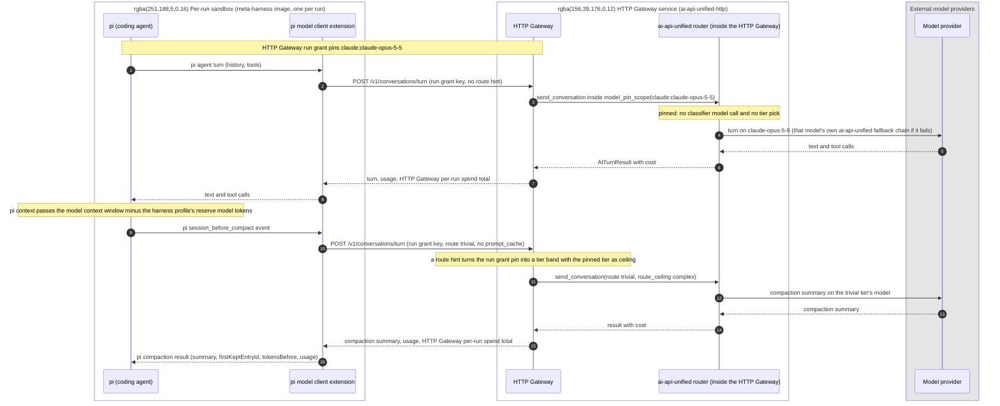

### Task routing

The meta-harness run service dispatcher activity renders the task spec
(title, description, acceptance checks, repo, file hints, size signals) into
one prompt. The run service `route` activity sends that prompt through
`AiRouterCompletions` in classify-only mode. The ai-api-unified router in the
run service classifies it, picks a tier, and returns the tier's ordered tier
candidates. Each tier candidate names a harness profile and the model pi uses
in the per-run sandbox. The RunTask workflow runs them.

```json
"router": {
  "tiers": [
    {"name": "trivial", "description": "Config, copy, dependency bumps, one-file mechanical edits with existing tests.",
     "models": ["harness:pi-lean/openai-compatible:qwen3-coder-next", "harness:pi-lean/google-gemini:gemini-3.5-flash-lite"],
     "thinking": "off"},
    {"name": "standard", "description": "A feature or fix inside one module, with clear acceptance checks.",
     "models": ["harness:pi-lean/claude:claude-sonnet-5", "harness:pi-careful/openai:gpt-5.6-luna"],
     "thinking": "low"},
    {"name": "complex", "description": "Cross-module changes, migrations, concurrency, security-sensitive code, or vague requirements.",
     "models": ["harness:pi-careful/claude:claude-opus-5-5", "harness:pi-careful/openai:gpt-6-sol"],
     "thinking": "high"}
  ],
  "classifier": {"engine": "openai-decisions", "model": "gpt-6-luna", "min_confidence": 0.7},
  "default_tier": "standard",
  "on_exhausted": "escalate"
}
```

A tier candidate takes the form `harness:<harness profile>/<provider>:<model>`.
The ai-api-unified router reads `harness` as its provider and returns the
string unchanged. In classify-only mode (`AiRouteClassifier`) the router never
builds or probes a candidate, so the meta-harness run service validates each
candidate itself at startup: its harness profile exists and names an image
the executor backend can run, and its `<provider>:<model>` is a model the
ai-api-unified library has configured.

The ai-api-unified router's classifier model reads the latest user message,
so the meta-harness run service dispatcher activity puts the task spec in
that message and keeps instructions in the system prompt.

The run service `route` activity builds one ai-api-unified router client per
process and shares it across tasks; the library keeps per-call state in
context variables. The meta-harness's own configuration files load the same
way: validated at startup, held in memory, and reloaded on a change, with the
new version recorded in `config_version`.

- The ai-api-unified router classifies the task with its classifier model,
  and below `min_confidence` it picks `default_tier`.
- The RunTask workflow tries the tier's candidates in order. A run that ends
  on infrastructure (no per-run sandbox within `ready_timeout`, a rate limit or
  exhausted quota at the model, a lost harness server, or `model_error` from a
  provider outage) moves to the next candidate. A run that ends on a limit
  (`max_turns`, `max_minutes`, `spend_limit`) ends the task.
- When a tier runs out and `on_exhausted` is `escalate`, the RunTask workflow
  calls the `route` activity again with `route_floor` one tier up, within the
  task policy's limits. A task the classifier judged hard stays on hard tiers.
- A meta-harness fix task, an exploration run and a task with a `pin` field
  skip routing and run one named pair, such as
  `harness:pi-careful/claude:claude-opus-5-5`, with no escalation. A fix task
  pins the pair that opened its pull request, so it continues that pull
  request's pi session on the same model. A review task tries the task
  policy's reviewer pairs in order. The meta-harness run service checks a
  pinned model against the ai-api-unified allow and deny lists before any
  lease, and the RunTask workflow records `route_method: model_pin`.
- Each router call carries its own `route_floor` and `route_ceiling`, because
  one router client serves many tasks at once.
- The RunTask workflow records every run's cost, failed runs included.

Caller hints use the ai-api-unified router's per-call options:

- `complexity: high` on a task passes `route_floor: "complex"`.
- `max_tier: standard` passes `route_ceiling: "standard"`.
- A retry after a failed attempt passes `route_floor` one tier above the
  failed attempt.

The RunTask workflow learns routing only from
the run service `route` activity's return value, and cost only from the run
service run activity's Collect step, never from ai-api-unified library
events.

| Where | Fields |
|---|---|
| Run service `route` activity result | From the ai-api-unified router: `route_tier`, `route_method`, `route_confidence`, `thinking`, the ordered tier candidates, and `classifier_usd` for the ai-api-unified router classifier model call |
| Run service run activity Collect result | `run_id`, `sandbox_id`, the harness profile, `end_reason`, `turns`, `pr_url`, `elapsed_ms`, the prompt cache hit rate, the run's model token totals (input, output, `cached_input_tokens`, `cache_write_5m_tokens` and `cache_write_1h_tokens`) from the harness server Run API `GET /usage`, and the dollars the HTTP Gateway counted against the run's HTTP Gateway run grant |
| `preview_route()` | Before a run: tier, confidence and `usd_max`, used for the run's HTTP Gateway run grant spend limit |

The RunTask workflow writes the run service `route` activity result as the
meta-harness domain event `task_routed`, and each run service run activity
Collect result as one `attempt_finished`. Each run's
`attempt_finished` holds its `run_id`, so it joins the pool manager's
lease record for that run.

### Task policy

`config/task_policy.json` holds the rules for task types, exploration, run
budgets and review.

```json
{
  "version": "2026-11-03.1",
  "floors_by_task_type": {"security": "complex", "dependency": "trivial"},
  "exploration": {"share": 0.05, "eligible_tiers": ["trivial", "standard"],
                  "challengers": ["harness:pi-careful/openai-compatible:qwen3-coder-next"]},
  "review": {"reviewers": ["harness:pi-review/claude:claude-opus-5-5",
                           "harness:pi-review/openai:gpt-5.6-luna"],
             "max_rounds": 3, "merge": true, "operator_alert_minutes": 240},
  "max_run_minutes": 240
}
```

- `floors_by_task_type` sets `route_floor` on the router call.
- The RunTask workflow pins a configured share of eligible
  tasks to a challenger harness-profile-and-model pair, so the harness analyzer keeps current data on every harness profile
  and model. Complex and security tasks never explore.
- A run's HTTP Gateway run grant spend limit is
  `preview_route()`'s `usd_max` for the tier times the harness profile's
  `budget_multiplier`, capped by the task's `max_usd`. A task's `max_usd`
  also caps the total of its meta-harness review and fix tasks.
- `reviewers` lists the meta-harness review task's
  harness-profile-and-model pairs in order. The RunTask workflow skips any
  reviewer pair whose model wrote the pull request, so a different model
  always reviews. `max_rounds` caps the meta-harness fix tasks per pull
  request. `operator_alert_minutes` sets when a review round blocked on an
  operator raises an alert. `merge: false` leaves a clean pull request open,
  and a repo's policy can set it per repo.

### The run loop

The RunTask workflow runs a task's tier candidates, one run each. The run
service `route` activity sends the task prompt to the ai-api-unified router in
classify-only mode and returns the tier, `route_method`, `route_confidence`
and the tier's ordered candidates. For each candidate the RunTask workflow
runs one run activity, which takes the steps Identify through Collect below.
The RunTask workflow then takes the Decide step: next candidate, escalation
or end. It checks the budget between candidates, because it holds the task's
remaining spend, its attempts so far and the task policy's limits.

| Step | What happens |
|---|---|
| Identify | `run_id` is the RunTask workflow id, the attempt number and the tier candidate index, the same on every retry of the run activity. A meta-harness review or fix task has its own RunTask workflow id, so its runs get their own `run_id`s. |
| Lease | Asks the pool manager for an existing pool manager lease on `run_id` first, so a retried run activity re-attaches to a run in progress. Otherwise requests `lease(run_id, image, harness_session_id, resources)` for the harness profile's image. The pool manager response holds the per-run sandbox address, the pool manager lease TTL and the `session_state`: `new`, `kept` or `restored`. In a deployment without the pool manager, the run activity starts one per-run sandbox per run itself, with the Docker executor backend. |
| Grant | Asks the HTTP Gateway for an HTTP Gateway run grant, which the HTTP Gateway issues and stores. The run grant holds the run id, tags, the tier candidate's inner model as a pin, the spend limit, and an expiry at `max_minutes` plus grace. Only the run grant key goes to the per-run sandbox. A retried run activity asks again with the same terms and gets a new run grant key for the live run grant. |
| Start | When `session_state` is `new`, `POST /run` on the per-run sandbox's harness server Run API with the prompt, acceptance checks, harness profile, limits and run grant key. When it is `kept` or `restored`, `POST /followup` with the new input and its own run grant key. |
| Wait | Follows the harness server's event stream until `run_finished`, heartbeating the last harness server event id on every event. The run activity's heartbeat timeout catches a dead Temporal worker, and its start-to-close timeout, the pool manager lease TTL, is the hard upper bound. A RunTask workflow cancel reaches the run activity through its heartbeat, and the run activity sends `POST /cancel` to the harness server. |
| Collect | Reads the harness server's `/usage`, and a finished run's changes from `GET /bundle`. Then revokes the HTTP Gateway run grant and releases the pool manager lease. Returns the terminal state: status, end reason, turns, the files changed, the run's final summary, elapsed time and model token totals. The terminal state also holds the dollars the HTTP Gateway counted against the run grant. The RunTask workflow records one cost line per run from that figure. |
| Decide | In the RunTask workflow. A run that ended `FINISHED` ends the candidate loop. A run that ended `ERROR` for an infrastructure reason (no per-run sandbox, a lost harness server, `model_error` from a provider outage) tries the next tier candidate. A run that ended on a limit (`max_turns`, `max_minutes`, `spend_limit`) is final. Another candidate would spend the budget again, so only the task policy's retry-up rule or an operator repeats a run that ended on a limit. |
| Publish | A run service activity, after Decide ends the loop on a finished run. Commits the run's changes to the branch `mh/<task>` and pushes it with the run service's code-host app token. Opens the pull request, labeled `ai:meta-harness`, with `Closes <ticket>` and the run's final summary. A retried Publish finds the branch and the pull request it made. A finished run that changed nothing fails the task. A fix task pushes to its pull request's branch. With the Docker executor backend, Publish commits and pushes from the workspace the host mounts. |

Each tier candidate is one run and one per-run sandbox. The RunTask
workflow's Temporal history records every attempt, tier candidate and
decision. The RunTask workflow also writes each run's `attempt_finished`
meta-harness domain event, which the operator console and the harness
analyzer read from the event service.

The RunTask workflow calls no model. The classifier call happens in the run
service `route` activity, through the ai-api-unified library.

### Model calls inside a run

The harness server's pi model client extension sends every pi model turn to
the HTTP Gateway's native conversation endpoint, with the run grant key as
its bearer credential. The HTTP Gateway:

1. Looks up the HTTP Gateway run grant by its run grant key: the run, harness
   profile, model policy and spend limit.
2. Sets the ai-api-unified observability context: `caller_id` is the
   meta-harness, tags are run, task, harness profile, harness and model.
3. Sends the turn through the ai-api-unified router inside the HTTP Gateway.
   With a **pinned** run grant model policy (the default) the HTTP Gateway
   wraps the call in the ai-api-unified library's model-pin scope for the
   tier candidate's inner model. The turn skips the classifier model call and
   runs on that model with the ai-api-unified fallback chain, cooldowns,
   guardrails and caching intact. With a **banded** run grant model policy
   the turn sets `route_floor` and `route_ceiling` instead, and the
   ai-api-unified router inside the HTTP Gateway may answer easy turns from a
   cheaper tier. Under either model policy the HTTP Gateway run grant decides
   the provider and model, and the HTTP Gateway ignores any provider or model
   the request body names.
4. Adds the turn's cost to the HTTP Gateway per-run spend counter in Redis,
   so the total is exact across HTTP Gateway replicas, and returns the turn's
   usage and the run's total in the response. Once the run has spent its
   limit, the HTTP Gateway refuses the next turn with
   `402 run_grant_spend_limit`. The pi model client extension reports the
   usage and total, and the harness server emits them in its `model_call`
   events. The meta-harness reads no HTTP Gateway event output.

A request body with `route`, such as the `route: trivial` on compaction and
auxiliary calls, runs that one call on the named tier, capped at the pinned
model's tier. An unknown route falls back to the pinned model, and pi agent
turns, which carry no `route`, stay pinned. Under a banded policy the router
honors the hint within the band.

## Run lifecycle

One meta-harness task can produce several harness runs: the first attempt,
fallbacks to another candidate from the tier's candidate list that the
ai-api-unified router returns, and retries on a higher tier. One harness run
is one per-run sandbox. Once the task's PR is open, the task's RunTask
workflow runs the meta-harness review loop below, which tickets meta-harness
review and fix tasks, each with its own runs.

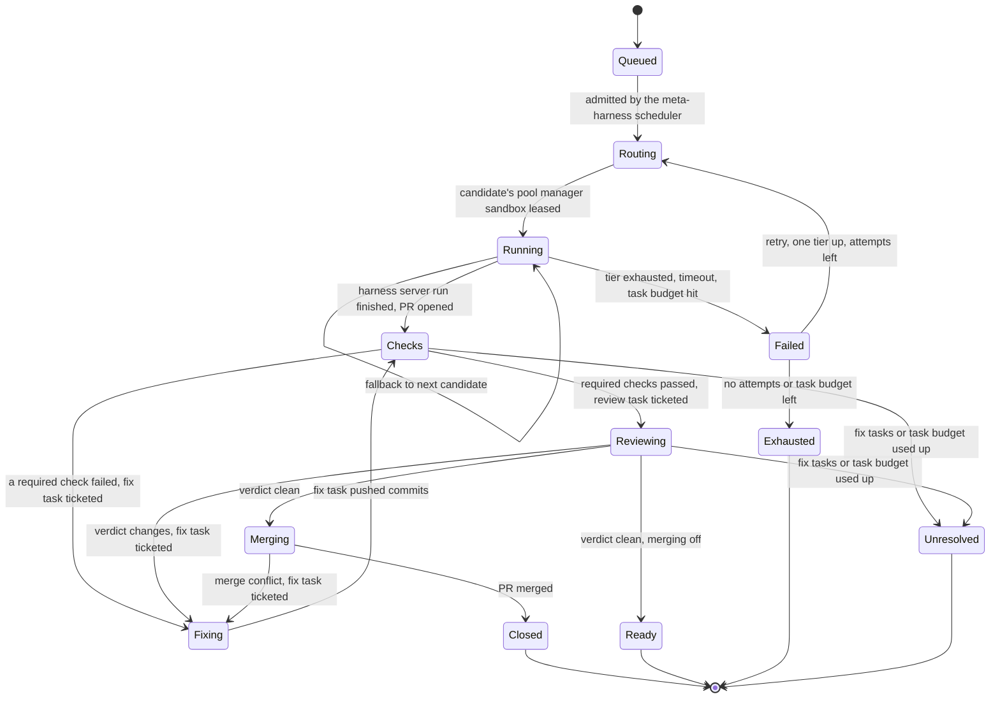

Each meta-harness task has one meta-harness run service Temporal workflow
(RunTask), and its Temporal workflow id is the task id. Every harness run of
the task happens inside that RunTask workflow: the first attempt, fallbacks
and retries one tier up. A meta-harness review or fix task is a task of its
own, with its own RunTask workflow. Temporal allows only one open
execution per Temporal workflow id. `start` keeps the default conflict policy,
Fail, so a second `start` for a running task fails with `Workflow execution
already started` and never creates a duplicate RunTask workflow run. `start`
also sets the reuse policy to Reject Duplicate, so a closed task's id never
starts again. The Temporal web UI and `temporal workflow show --workflow-id
<task id>` find any task's RunTask workflow from the task id that the task
service Task API `POST /v1/tasks` returned.

The RunTask workflow runs these steps:

1. The meta-harness scheduler grants a slot and calls
   the meta-harness run service's `start`.
2. The guardrails library resolves the target repo's repo policy
   and mints a read-only code-host access token scoped to the target repo, for
   the clone. The run service dispatcher activity builds the harness prompt
   from a versioned prompt template: task spec, acceptance checks, the target
   repo's `AGENTS.md`, and the instruction to finish with a summary for the
   pull request, which the Publish step opens with the label `ai:meta-harness`.
3. The run service `route` activity sends the task through
   the ai-api-unified router (in the run service process) with the task's
   floors, ceilings and exploration pin, and returns the tier and its
   candidates. The RunTask workflow writes the `routing_decision` row, which
   the meta-harness run service owns, and appends `task_routed` through the
   event service client library. For each candidate the
   RunTask workflow runs the run service run activity, which
   leases a pool manager sandbox, requests an HTTP Gateway run grant, sends
   `POST /run` to the harness server Run API, follows the harness server Run
   API event stream to `run_finished`, and collects the result. The RunTask
   workflow then decides. Each harness run appends one
   `attempt_finished` meta-harness domain event. A retried run service
   activity uses the same `run_id`, so it re-attaches to the pool manager
   sandbox lease, the HTTP Gateway run grant and the harness server run in
   progress.
4. The run service run activity is the only consumer of its
   sandbox's harness server Run API event stream. It writes the `run` row,
   appends the run's harness server Run API events through the event service
   client library in batches, heartbeats the RunTask workflow, and marks the
   harness run stalled when the harness run misses a heartbeat window.
   Code-host webhooks for the run's PR (checks completed, merged, closed)
   arrive at the task service, which signals the RunTask workflow.
5. The RunTask workflow tickets meta-harness review and fix
   tasks on the PR until a review comes back clean, then merges the PR (see
   Review loop below).
6. When the PR merges or closes, when the meta-harness review loop
   ends `ready` or `review_unresolved`, or when attempts and task budget are
   spent, the RunTask workflow appends the outcome meta-harness domain events
   and sets the task's terminal status through the task service, which
   reports it.
7. The operator console sends cancel or kill switch (per run, per
   caller, global) to the meta-harness run service, which appends the audit
   meta-harness domain event with the operator as actor. The RunTask workflow
   cancels the run service run activity, which calls the harness server Run
   API `POST /cancel` on the per-run sandbox directly, revokes the HTTP
   Gateway run grant, and releases the sandbox lease
   with the pool manager, which destroys the per-run sandbox.

Every terminal state releases the pool manager sandbox lease. The pool
manager then collects run artifacts into its artifact store and destroys the
per-run sandbox, or keeps it for the same pi session's next follow-up run
.

Timeouts come from each harness profile (`max_minutes`), and the task policy
sets the hard ceiling.

### Review loop

No person has to review a meta-harness PR. The RunTask workflow of the task
that opened the PR owns the PR until it merges or closes, and runs this loop:

1. The RunTask workflow waits for the code-host checks webhook on
   the PR's head commit. A failed required check goes to step 3 with the
   check's output. Passing checks go to step 2.
2. The RunTask workflow tickets a meta-harness review task through
   the task service, with `parent_task_id`, the PR URL and the head commit
   SHA. The review task pins the first reviewer pair in the task policy whose
   model did not write the PR, and starts a new pi session on a
   meta-harness review harness profile with no edit tools. The review run
   reads the PR diff, the parent task's spec and acceptance checks, and runs
   the tests. Its `submit_review` pi extension tool posts the findings as a
   code-host PR review and ends the run with verdict `clean` or `changes`,
   recorded with the reviewed head SHA in a `review_submitted` meta-harness
   domain event.
3. On `changes` or a failed check, the RunTask workflow tickets a
   meta-harness fix task through the task service, with `parent_task_id`,
   the PR branch, and the findings or check output as the task description.
   The fix task pins the pair that opened the PR and continues the PR's pi
   session in a follow-up run (`POST /followup`), which pushes commits to the
   PR branch. The loop returns to step 1.
4. On `clean`, the meta-harness run service merges the PR through
   the code-host API at the reviewed head SHA, so a commit pushed after the
   review never merges unreviewed. A merge conflict with the base branch
   tickets a fix task to rebase. With `merge: false` in the task policy or
   the repo policy, the RunTask workflow leaves the clean PR open and ends the
   task `ready`.

Each meta-harness review and fix task is a task of its own: the task service
stores it, the meta-harness scheduler admits it under the parent task's
repo-area lock, and its own RunTask workflow runs it, records its runs and
cost, and reports its result to the task service. The task service then
signals the parent task's RunTask workflow. The parent task holds its
repo-area lock until the PR merges or closes.

The loop stops at the task policy's `max_rounds` meta-harness fix tasks per PR
or when the review and fix tasks have spent the parent task's `max_usd`. The
RunTask workflow then leaves the PR open, ends the task `review_unresolved`,
and a meta-harness alert rule fires. A PR closed on the code host
ends the loop and the task.

### Operator review

When a meta-harness review run starts, the meta-harness run service appends a
`review_started` meta-harness domain event. The operator console shows it as a
notification to every operator watching, with the PR link and an offer to
review the PR too. The offer needs no answer:

- The offer closes when the agent review run ends, and the
  review round decides on the agent's verdict alone.
- An operator who takes the offer sends a review claim from the
  operator console to the meta-harness run service. The run service records
  the claim in its `operator_review` table and appends
  `operator_review_claimed` with the operator as actor. The first claim wins,
  and the operator console tells later operators who holds it. The agent
  review run still finishes, and the operator console shows its findings to
  the operator.
- A claimed review round waits for the operator. The review task's
  RunTask workflow waits on a Temporal signal, so the wait survives restarts.
  The agent review run's per-run sandbox is released when that run ends, and
  Hi counts run time only, so the wait adds no dollar-hours. The
  parent task keeps its repo-area lock while it waits.
- The operator reads the PR on the code host and submits a
  verdict, `clean` or `changes`, with findings, from the operator console. The
  meta-harness run service posts the operator's findings as a code-host PR
  review that names the operator, and appends `operator_review_submitted`.
  The round's verdict is `changes` when the agent or the operator says
  `changes`, and the fix task gets both sets of findings.
- The operator can release the claim from the operator console,
  and the round then decides on the agent's verdict. A meta-harness alert
  fires when a claimed round has waited longer than the task policy's
  `review.operator_alert_minutes`. Nothing releases a claim on its own.

### Sequences

In each diagram below, the meta-harness run service RunTask workflow runs the
run service run activity, whose steps lease the pool manager sandbox, request
the HTTP Gateway run grant, start and follow the harness server run, and
collect. The RunTask workflow then decides. The ai-api-unified router
in the run service process only classifies the task in the classify-only
`route` activity and returns the tier's candidates.

**1. Happy path**

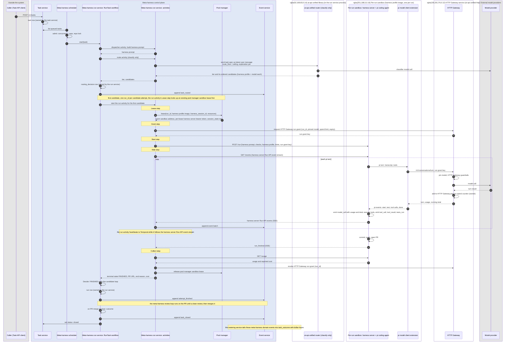

**2. Console attaches to a run in progress**

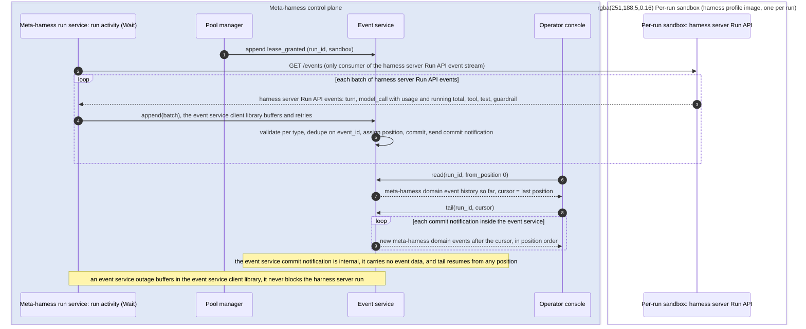

**3. Compaction or auxiliary call inside a run**


**4. Spend cap hit**

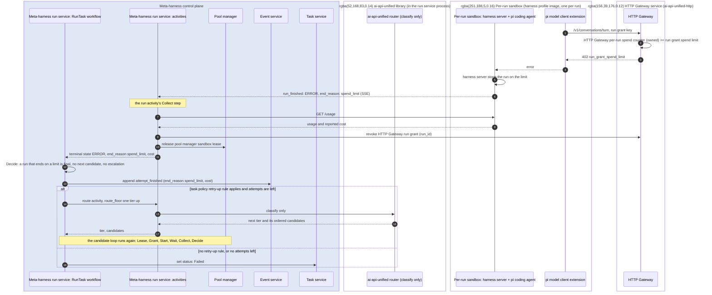

**5. Review loop on an open PR**

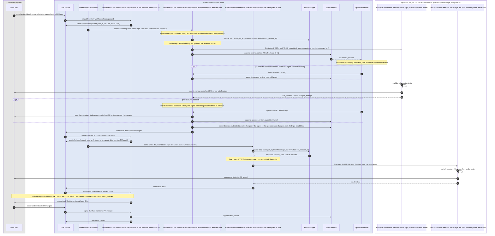

**6. Operator cancel or kill switch**

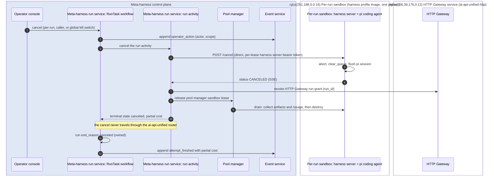

## Harness execution

### Sandbox

One per-run sandbox per meta-harness run, as a pod with the gVisor runtime
class in the `sandbox` namespace.

- **One image**, the harness profile image, built from a common base: git,
  language toolchains, Node, pi, the pi model client extension and the
  **harness server**. Harness profiles select prompts, pi tools
  and limits on that harness profile image. A harness profile may name a
  different harness profile image when a toolchain or a different coding
  agent needs it.
- **Repo**: the task's code-host repository, cloned with the run's read-only
  code-host access token at `/workspace`, the same path in every per-run
  sandbox. The per-run sandbox never pushes: the run service's
  Publish step reads the run's changes through the harness server Run API
  `GET /bundle` and pushes them. In the Docker executor backend the run
  service clones on the host into the mounted workspace and publishes from
  it, so no code-host token enters the container at all.
- **Model endpoint**: the HTTP Gateway URL, set in the harness profile image,
  and the HTTP Gateway run grant key, which arrives in the `POST /run` or
  `POST /followup` body. No model provider key exists in the per-run sandbox.
- **Egress** from the per-run sandbox limited to the code host, package
  registries and the HTTP Gateway.
- **Resources** from the harness profile; 2 vCPU and 4 GB by default.
- **Lifecycle**: owned by the pool manager. A per-run sandbox
  serves exactly one meta-harness run at a time. When the meta-harness run
  ends, the pool manager destroys the per-run sandbox, or keeps it for the
  same pi session's next follow-up run (`kept`, Pool manager).

### Harness server and the Run API

The harness server is a small TypeScript service inside every per-run
sandbox. It exposes one authenticated HTTP API, the harness server Run API, to
the meta-harness run service run activity, and runs pi in-process through
pi's SDK (`@earendil-works/pi-coding-agent`). The harness server creates the
pi session with `createAgentSession()` and the pi session setup in The harness,
and uses `AgentSessionRuntime` for `newSession()`, `switchSession()` and
`fork()`. pi reports every pi session state change as a typed pi SDK event
through `session.subscribe()`, so the harness server parses nothing from
terminal output.

| Endpoint | Purpose | pi SDK calls |
|---|---|---|
| `GET /health` | Harness server readiness: pi model client extension registered, the workspace directory exists, HTTP Gateway reachable. A `warm` per-run sandbox passes it before it clones any task repo | pi model runtime state |
| `POST /run` | Start a new pi session for the task service task. The body holds the prompt, acceptance checks, harness profile, limits and the HTTP Gateway run grant key | `newSession()`, `prompt()` |
| `POST /followup` | Continue the pi session the per-run sandbox holds, kept or restored by the pool manager before the pool manager sandbox lease returned. The body holds the new input and the HTTP Gateway run grant key, and no pi session reference. | `switchSession()` for a restored pi session, then `prompt()` |
| `GET /events` | Harness server Run API events as server-sent events, resumable with `Last-Event-ID` | `session.subscribe()`: `message_update`, `tool_execution_*`, pi compaction events, `agent_end`, `agent_settled` |
| `GET /status` | `CREATING`, `RUNNING`, `FINISHED`, `ERROR`, `CANCELED`, `EXPIRED`, plus the last harness server heartbeat event | pi session state |
| `POST /cancel` | Stop pi. The pi session file keeps every pi session entry written before the cancel, so a later follow-up run can continue the pi session. | `abort()`, which waits until the pi session is idle |
| `GET /usage` | Model token totals (input, output, `cached_input_tokens`, `cache_write_5m_tokens`, `cache_write_1h_tokens`), model call counts, and the HTTP Gateway's running total, as the pi model client extension recorded them. These totals serve reconciliation against the run's `model_call` meta-harness domain events | pi model client extension counters |
| `GET /metrics` | Harness server OpenTelemetry metrics: pi turns, pi tool calls, files changed, test runs, elapsed time | harness server counters |
| `GET /bundle` | The run's changes against the commit it cloned, as a git bundle, for the run service's Publish step. Planned for the pool manager's executor backends; the Docker executor backend reads the mounted workspace | none: git in the workspace |

The harness server waits with `waitForIdle()` and sends `steer()` or
`followUp()` when input arrives while pi is still working. The harness server
never calls `setModel`: the model comes from the run's HTTP Gateway run grant,
and the thinking level from the `POST /run` body. The pi coding agent gets
shell access only through pi's `bash` tool, under the harness profile's
limits.

### Executor interface in the control plane

The pool manager executor interface is the pool manager's interface to
wherever per-run sandboxes run. The meta-harness run service run activity
does not go through it: the run activity calls the harness server Run API
(`POST /run`, `POST /followup`, `GET /events`, `GET /usage`, `POST /cancel`)
directly, over mutual TLS, at the pod address in its pool manager sandbox
lease, with that lease's per-lease harness server bearer token. Every pool
manager executor backend provides these operations:

| Operation | Called by | Purpose |
|---|---|---|
| validate | Pool manager startup | Fail if any harness profile names a harness profile image this pool manager executor backend cannot run |
| provision | Pool manager | Create a per-run sandbox from a harness profile image; return when the harness server `/health` is green |
| destroy | Pool manager | Delete the per-run sandbox and release its resources |
| inventory | Pool manager | List the per-run sandboxes that exist, for pool manager reconciliation |
| address | Pool manager, when it grants a pool manager sandbox lease | The per-run sandbox's pod address and its per-lease harness server bearer token, returned in the pool manager sandbox lease |
| status, usage | Pool manager, on drain | The harness server status and usage endpoints |
| save session | Pool manager, when a meta-harness run ends | Copy the pi session directory to the pool manager's Cloud Storage artifact bucket under `harness_session_id` |
| restore session | Pool manager, before a `restored` pool manager sandbox lease returns | Copy a pi session directory from the pool manager's Cloud Storage artifact bucket into a fresh per-run sandbox, which has the task repo cloned at `/workspace` |
| artifacts | Pool manager, on drain | Harness server logs and the final pi session directory, copied to the pool manager's Cloud Storage artifact bucket |

Pool manager executor backend implementations: Kubernetes pods on GKE, Docker
(development), managed sandbox services, and a fake pool manager executor
backend that replays recorded harness server Run API event streams for tests.

### Pool manager

The pool manager is the only meta-harness service that creates and destroys
per-run sandboxes. It is a single leader-elected service that owns the
`sandbox` and `lease` tables and the pool manager artifact store, with a
pool manager reconciliation loop against the pool manager executor backend's
actual inventory. Other meta-harness services reach pool manager sandbox
leases only through the pool manager interface.

**Sandbox states**

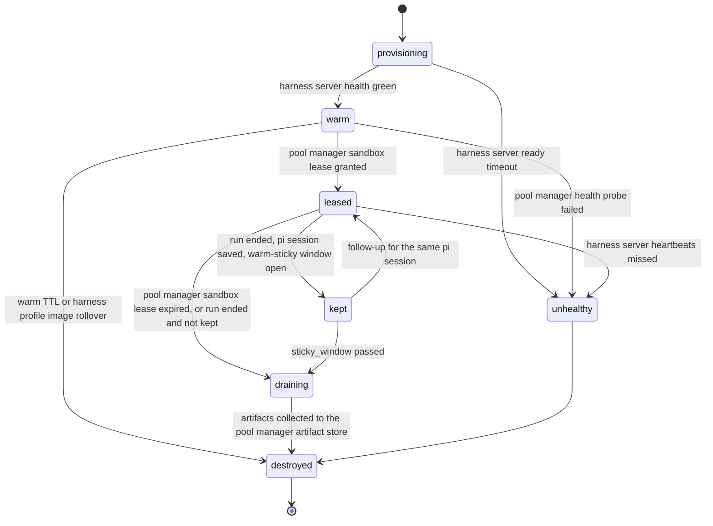

- `provisioning`: pod created, harness profile image pulling, harness server
  starting.
- `warm`: harness server `/health` green, no task repo, no credentials, no
  meta-harness run. Idle, ready for a pool manager sandbox lease.
- `leased`: bound to one meta-harness run. The pool manager injects the run's
  read-only code-host access token at pool manager sandbox lease time, and
  the per-run sandbox clones the task repo then, always at `/workspace`. The HTTP Gateway
  run grant key arrives later, in the `POST /run` or `POST /followup` body.
- `kept`: the meta-harness run has ended and the per-run sandbox waits for the
  same pi session's next follow-up, for up to `sticky_window`. The pool
  manager has saved the pi session directory, and the meta-harness run service
  run activity revoked the HTTP Gateway run grant when the meta-harness run
  ended. The task repo and pi session directory stay in place.
- `draining`: the meta-harness run has ended. The pool manager is collecting
  artifacts (pi session directory, harness server logs, harness server
  `/usage`).
- `destroyed`: pod deleted, pool manager `sandbox` record kept for audit.

**Leases**

- The meta-harness run service run activity requests `lease(run_id, image,
  harness_session_id, resources)`. The pool manager sandbox lease request is
  idempotent on `run_id`. The pool manager response holds the per-run sandbox
  address, the pool manager sandbox lease TTL and a `session_state`:
  - `kept`: the per-run sandbox kept for that pi session is still inside its
    warm-sticky window, so the pool manager hands it back.
  - `restored`: the pool manager's Cloud Storage artifact bucket holds a pi
    session directory for that `harness_session_id`, so the pool manager takes
    a warm per-run sandbox of that harness profile image (or provisions one)
    and copies the pi session directory in before returning. The per-run
    sandbox clones the task repo at `/workspace`, the working directory the
    pi session recorded, because pi exits with an error when that directory
    is missing.
  - `new`: neither exists, so the pool manager hands out a warm per-run
    sandbox of that harness profile image, or provisions one.
- A pool manager sandbox lease has a TTL of the harness profile's
  `max_minutes` plus a grace period. When the pool manager sandbox lease TTL
  expires, the pool manager destroys the per-run sandbox whether or not the
  meta-harness run service run activity released the pool manager sandbox lease. A meta-harness run service run
  activity that crashes therefore cannot leak a per-run sandbox.
- The pool manager sandbox lease is the only path to a per-run sandbox's
  address and credentials. The harness server Run API accepts a per-lease
  harness server bearer token, so a per-run sandbox cannot be addressed
  outside its pool manager sandbox lease.
- When a meta-harness run ends, the pool manager copies
  its pi session directory to the pool manager's Cloud Storage artifact bucket
  under `harness_session_id` before it keeps or drains the per-run sandbox. A
  kept per-run sandbox that fails loses nothing.
- When a meta-harness run finishes, the pool manager may keep
  its per-run sandbox (`kept`) for a warm-sticky window (`sticky_window`,
  default 10 minutes) keyed by `harness_session_id`. A follow-up for the same
  pi session inside the warm-sticky window gets that per-run sandbox back and
  skips the restore. Otherwise the pool manager drains the per-run sandbox and
  the follow-up restores from the pi session directory in a fresh per-run
  sandbox. The warm-sticky window never extends a pool manager sandbox lease
  TTL, and a sticky per-run sandbox is still single-pi-session: it is never
  leased to another meta-harness run.

**Warm pool**

- A target count of warm per-run sandboxes per harness profile image, set in
  the pool manager pool configuration (`warm: 4`) and adjusted by the pool
  manager from meta-harness scheduler queue depth: the number of admitted
  tasks waiting per harness profile image over the last few minutes.
- Warm per-run sandboxes hold no task repo and no secrets, so they are safe
  to keep idle.
- The pool manager destroys and replaces a warm per-run sandbox older than
  `warm_ttl` (default 2 hours), so no per-run sandbox outlives a routine
  harness profile image or node change.
- Per-harness-profile-image and global maximums cap total per-run sandboxes.
  The GKE node autoscaler follows the pool manager's demand.

**Health**

- Before a pool manager sandbox lease: the harness server `/health` must be
  green within `ready_timeout`, else the pool manager marks the per-run sandbox
  `unhealthy` and replaces it. The pool manager sandbox lease request moves to
  the next warm per-run sandbox.
- During a meta-harness run: the meta-harness run service run activity
  forwards missed harness server heartbeat events to the pool manager. Two
  missed harness server heartbeat windows mark the per-run sandbox
  `unhealthy`. The pool manager destroys it, and the RunTask workflow's Decide
  step decides whether another tier candidate runs. The pool
  manager never repairs a per-run sandbox in place.
- The pool manager probes idle warm per-run sandboxes on an interval and
  destroys any that fail.
- The pool manager reconciliation loop runs every 30 seconds: it lists the
  pool manager executor backend's actual per-run sandboxes, destroys any with
  no pool manager `sandbox` record or whose pool manager sandbox lease has
  expired, marks pool manager `sandbox` records whose pod has vanished, and
  provisions per-run sandboxes until each harness profile image is back at its
  warm target.

**Recycling**

- A per-run sandbox serves exactly one pi session: one meta-harness run, or
  that run and the follow-ups a warm-sticky window hands back to it. The task
  repo, the read-only code-host access token
  and HTTP Gateway run grant key, the pi session and any files the pi coding
  agent created are specific to that pi session, and a fresh per-run sandbox
  per pi session is the security boundary between pi sessions.
- Recycling therefore means: drain (collect artifacts to the pool manager
  artifact store, read harness server `/usage` for reconciliation), destroy
  the pod, and provision a fresh replacement per-run sandbox to meet the
  warm-pool target.
- When a harness profile changes its harness profile image
  version, the pool manager stops leasing the old harness profile image,
  destroys its warm per-run sandboxes, provisions the new harness profile
  image to the warm target, and lets leased per-run sandboxes on the old
  harness profile image finish their meta-harness runs.
- The pool manager honors the Kubernetes orchestrator's
  drain signals: it destroys warm per-run sandboxes on a draining node at
  once. Leased per-run sandboxes get until their pool manager sandbox lease
  TTL, after which the GKE node autoscaler releases the node.

**Metrics** (pool manager OpenTelemetry metrics, alertable): per-run sandboxes
by state and harness profile image, provisioning time, time-to-lease, warm hit
rate, harness server health failures by cause, pool manager sandbox lease TTL
expiries, orphaned per-run sandboxes destroyed by pool manager reconciliation,
and artifact collection failures.

## Metering

```
dollar-hours per successfully completed task = Σi (Di × Hi) / Σi Ci
```

| Term | Source |
|---|---|
| Di, dollars for attempt i | The harness server Run API `model_call` events, which the metering service tails from the meta-harness event service. They hold the HTTP Gateway per-turn model token usage and cost (cached input model tokens included). They also hold the HTTP Gateway per-run spend counter's running total for the meta-harness run. Add `classifier_usd` from the run service `route` activity result and the meta-harness control plane services' own model calls for the meta-harness run |
| Hi, hours for attempt i | Active meta-harness run execution time from `RUNNING` to a terminal state, from the harness server Run API run status |
| Ci, success for the task | Unweighted share of the meta-harness task's checks that passed. The checks are code-host CI checks on the code-host PR, acceptance checks named in the Task API task, and code-host PR merge. Read from the meta-harness run service's `check_completed` and `task_closed` meta-harness domain events |

Because each harness server Run API `model_call` event holds the HTTP
Gateway's numbers, metering service cost attribution needs no log parsing and
no HTTP Gateway event output.

Each run's `attempt_finished` meta-harness domain event, which holds the
dollars the HTTP Gateway counted against the run's HTTP Gateway run grant,
and the harness server Run API `/usage` endpoint are cross-checks for Di.
Each `attempt_finished` holds the meta-harness run id, so the metering
service joins it to that meta-harness run's other meta-harness domain events
and pool manager lease record, counts nothing twice, and flags any gap over
5%. The metering service records the cost of every run, including each run of
a meta-harness task whose every tier candidate failed, because the RunTask
workflow writes one `attempt_finished` per run. The metering service keeps
the spend on failed runs per meta-harness task as that task's wasted spend.

A task's attempts include the runs of its meta-harness review and fix tasks.
The metering service rolls each review and fix task's dollars and hours up to
its parent task by `parent_task_id`, so dollar-hours per completed task counts
the whole review loop, and reports the review loop's share separately.

The metering service tails the meta-harness event service and owns its metering
projection tables: one `model_call` row per harness server Run API `model_call`
event, one `attempt_usage` row per meta-harness run, a `check_result` row per
task check, a `task_outcome` row when the meta-harness task closes, and `spend`
per Task API caller and period. Other meta-harness services query these through
the metering service interface, never the metering projection tables.

The metering service reports the model provider
prompt cache hit rate, cached input model tokens divided by input model tokens,
per meta-harness run, harness profile and model, from each harness server Run
API `model_call` event's `cached_input_tokens` and `input_tokens`. The prompt
cache hit rate and model token totals in the run service run activity's
Collect result are the cross-check. The metering service keeps
`cache_write_5m_tokens` and `cache_write_1h_tokens` separate, because the two
model provider prompt cache write kinds bill at different rates. Keeping them
separate lets the metering service price prompt cache writes and check them
against each pi coding agent turn's HTTP Gateway cost. A low prompt cache hit
rate means something in the pi coding agent prompt prefix changes between pi
coding agent turns, which multiplies the cost of every later turn. The
metering service raises an alert for it.

### Spend controls

- **Per turn:** the HTTP Gateway rejects a pi coding agent turn once the
  HTTP Gateway run grant spend limit for the meta-harness run is spent.
- **Per run:** the harness server ends the meta-harness run `ERROR` with
  `spend_limit` when the HTTP Gateway refuses a turn with
  `402 run_grant_spend_limit`, and ends it `EXPIRED` at `max_minutes`. The
  pool manager lease TTL destroys the per-run sandbox if the harness server
  does not end the meta-harness run.
- **Per caller:** a configurable caller daily spend cap; the meta-harness
  scheduler reads the Task API caller's spend from the metering service, stops
  admitting that Task API caller's new meta-harness tasks at the caller daily
  spend cap and warns at 80%.
- **Global:** a hard daily global spend cap and a meta-harness kill switch.

## Scheduling and scale

### Admission

The meta-harness scheduler runs its admission pass every few seconds and on
every task-related meta-harness domain event:

1. Order meta-harness tasks by task priority, then task age.
2. Admit a meta-harness task only if all hold: global meta-harness run
   concurrency below the global concurrency limit, the Task API caller below
   its caller concurrency quota and caller daily spend cap, pool manager
   per-run sandbox capacity available, and the target repo area not locked by
   another meta-harness run.
3. The meta-harness scheduler repo-area lock key is the
   repo plus the top-level directories the meta-harness task names. Unscoped
   meta-harness tasks lock the whole repo.
4. A goal's task is admitted only when every issue it depends on
   is closed, while the goal is active and its `max_usd` has money left, and
   within its modality's parallelism.

### Throughput

Each of these resources scales independently:

| Resource | Unit of scale | Limit |
|---|---|---|
| Per-run sandboxes | Warm-pool targets and maximums per harness profile image, set by the pool manager | Node autoscaler follows the pool manager's demand; a second sandbox pool on a managed sandbox service |
| HTTP Gateway | HTTP Gateway replicas | Stateless and autoscaling; the single path for all pi coding agent model token traffic, so the HTTP Gateway has its own SLO and canary deploy |
| Model providers | ai-api-unified fallback chains per model, inside the HTTP Gateway | ai-api-unified fallback and provider cooldowns across model providers |
| Meta-harness control plane | Stateless meta-harness service replicas and Temporal workers | Each meta-harness service holds its own state behind its service interface; one meta-harness run service run activity per active meta-harness run |
| Code host API | Meta-harness code-host app installation with code-host webhooks | No code-host polling; conditional code-host API requests |

Per meta-harness run, the meta-harness control plane's own load is one
ai-api-unified router classification, about two short ai-api-unified
completions, and the harness server Run API event stream. The harness server's
pi coding agent turns go directly from the per-run sandbox to the HTTP Gateway.

## Task API

| Method | Path | Purpose |
|---|---|---|
| POST | `/v1/tasks` | Submit a meta-harness task. Returns the meta-harness task id. Idempotent on `external_ref`. |
| GET | `/v1/tasks?external_ref={ref}` | The Task API caller's meta-harness task with that `external_ref`. Lets a Task API caller find a meta-harness task by the Task API caller's own id |
| GET | `/v1/tasks/{id}` | Meta-harness task state, current meta-harness run, meta-harness routing decision, code-host PR URL, task outcome |
| GET | `/v1/tasks/{id}/events` | Server-sent meta-harness domain events for the meta-harness task's runs |
| POST | `/v1/tasks/{id}/cancel` | Cancel the active meta-harness run and close the meta-harness task |
| GET | `/v1/runs/{id}` | Meta-harness run state, meta-harness candidate, model token usage, cost so far |
| POST | `/v1/webhooks/code-host` | Code-host PR, check and review webhook events for code-host PRs that meta-harness runs opened |
| GET | `/v1/profiles` | The active harness profiles, routing tier candidates and meta-harness task policy with their config versions |
| GET | `/health` | Task service liveness and configuration identity |

Task fields:

| Field | Required | Meaning |
|---|---|---|
| `external_ref` | yes | The Task API caller's own id; the task service deduplication key |
| `repo` | yes | Code-host repository URL |
| `task_type` | yes | `bug`, `feature`, `refactor`, `dependency`, `test`, `security`, `docs`, or `plan` for a planning task (Goals and modalities below). The meta-harness itself tickets `review` and `fix` tasks; Task API callers cannot submit them |
| `parent_task_id` | no | Set only on meta-harness review and fix tasks: the task whose PR they review or fix |
| `priority` | yes | Integer; higher-priority meta-harness tasks run first |
| `title`, `description` | yes | The meta-harness task text; treated as untrusted |
| `acceptance_checks` | yes | Commands or code-host check names that define meta-harness task success |
| `paths` | no | Repository paths the meta-harness task touches; scopes the meta-harness scheduler repo-area lock |
| `complexity` | no | `low`, `medium`, `high`; becomes a `route_floor` routing hint |
| `max_tier` | no | A routing tier name; becomes `route_ceiling` |
| `max_usd` | no | A per-task spend cap; it caps each run's HTTP Gateway run grant spend limit |
| `pin` | no | A meta-harness candidate such as `harness:pi-careful/claude:claude-opus-5-5`; the meta-harness task runs on exactly that harness profile and model with no ai-api-unified router classification or meta-harness escalation |
| `goal_id` | no | The goal the task belongs to. The task service sets it on the tasks it makes from a goal's issues |
| `depends_on` | no | `external_ref`s of tasks this one waits for; the meta-harness scheduler admits it once they are all closed |

Task API callers authenticate to the task service with a per-caller Task API
caller key. The Task API caller key sets the caller concurrency quota and the
caller daily spend cap for that Task API caller.

`external_ref` is unique per Task API caller. The task service's task table has
a unique index on `(caller, external_ref)`, and both the task service
deduplication and the `external_ref` lookup use it. One meta-harness task per
Task API request: to fix three bugs, a Task API caller submits three
meta-harness tasks and gets three meta-harness task ids.

### Goals and modalities

A goal is what the meta-harness works toward, and what the operator console
tracks. Its tasks come from GitHub issues across one or more registered
repos. Several goals run side by side, joint or independent, and compete for
run capacity by priority. A goal has:

| Field | Meaning |
|---|---|
| `modality` | `fix`, `feature` or `new-system`. Picks the goal's rules below. Left unset, the planner classifies it from the statement, and an operator can override it |
| `repos` | The registered repos the goal may change (`config/repos.json`) |
| `label` | The GitHub issue label that queues an issue for this goal, in any of its repos |
| `statement` | What the goal is, in prose. The planning task reads it |
| `success_criteria` | Checks the planner evaluates to decide whether the goal is met: commands against a repo, an issue query such as "no open issues with the label", or a code-host check name |
| `latitude` | 0 to 1: how far the planner may go beyond what the goal names. Left unset, the modality's default |
| `max_usd`, `priority` | One budget and one priority for every task the goal queues, review and fix tasks included |
| `status` | `active`, `paused`, `met`, `stalled`, `budget_exhausted`, `canceled` |

| Method | Path | Purpose |
|---|---|---|
| POST | `/v1/goals` | Create a goal. Only `statement`, `repos` and `label` are required: the planner decides the rest. A `feature` or `new-system` goal starts in `planning` and waits for approval |
| GET | `/v1/goals/{id}` | The goal, its issues across repos with each one's state and dependencies, its plan or phases, its criteria's live state, and its spend |
| POST | `/v1/goals/{id}/approve` | Approve the pending plan or phase |
| POST | `/v1/goals/{id}/pause`, `/resume`, `/cancel` | Steer the goal |

For every active goal the planner runs this loop, and the
modality decides each step:

1. Open issues with the goal's label in the goal's repos become
   tasks, one issue each, `external_ref` `github:<owner>/<repo>#<number>`.
   The planner refuses an issue in a repo the goal does not list and says why
   in a comment on the issue.
2. The RunTask workflow routes and runs each task,
   under the modality's routing floor and ceiling.
3. The review loop reviews each pull request
   to the modality's bar and merges it, closing its issue.
4. When the goal's issues are all closed, or a phase ends, the
   planner evaluates the success criteria.
5. Criteria met: the goal is `met`. Not met and work remains: the
   loop continues. Not met and nothing is queued: a `fix` goal waits for
   issues, and a `feature` or `new-system` goal tickets a planning task to
   plan the next step.

The system decides everything a goal leaves unset,
and an operator overrides what they want to. A goal needs only its statement,
repos and label. The planner then classifies the statement's modality with the
ai-api-unified classifier, the same `classify_choice` call the ai-api-unified
router uses to pick a tier, with the three modalities as the
choices and each modality's `description` from `config/modalities.json` as
what the classifier reads. The classification has a confidence. At or
above `modalities.classifier.min_confidence` the planner sets the modality and
goes on. Below it, or when the classifier refuses, the planner sets the
modality to `feature`, the middle one, and lists the goal in the console's
"needs you" list as "modality uncertain". The operator confirms or changes it
with one click, and the goal does not wait for that. The classifier
also sets the latitude when the goal leaves it unset: the modality's default,
moved up when the statement asks for open-ended improvement ("keep
improving", "find what else needs doing") and down when it names an exact
change. The planner records every classification as `goal_classified`, with
its confidence and the statement, so the harness analyzer can measure how
often operators overrode it. An operator sets or changes the modality and the
latitude on the Goal view at any time; a change of modality on an active goal
takes effect at the next planning task, and the current tasks finish under
the rules they started with.

Each is a configuration profile in
`config/modalities.json`.

| | `fix` | `feature` | `new-system` |
|---|---|---|---|
| Work comes from | A standing queue: issues with the label, taken as they arrive | One spec in the goal statement, which a planning task breaks into dependency-ordered issues across the goal's repos | The goal statement. The planning task writes one phase of issues at a time, and replans after each phase from the repos as they are |
| First work | The issue itself | The plan | A design document and a skeleton that runs end to end, which every later issue must keep working |
| Parallelism | High: independent issues, one per repo area | The dependency graph | Low while the skeleton is built, higher once it exists |
| Routing | `route_ceiling: standard`; escalation on failure | Floor `standard` | Floor `complex` for the design and skeleton issues, `standard` after |
| Bar to merge | A regression test that fails before and passes after, a small diff, no public API change | Each issue's acceptance checks, and a goal-level acceptance check once the last issue merges. Docs and a version bump per the repo's rules | Conformance to the goal's design document, the end-to-end check green, and each phase ending runnable |
| Operator checkpoints | None | Approve the plan before the first task runs | Approve each phase's plan |
| Measured by | Queue size, time to merge, cost per merged fix | Criteria met, spend against budget | Phase criteria met, then goal criteria met |

```json
{
  "version": "2026-11-07.1",
  "classifier": {"min_confidence": 0.7},
  "modalities": {
    "fix":        {"description": "Fix defects that already have an issue each. Small, bounded changes to code that exists.",
                   "intake": "queue", "plan": false, "approve": [], "latitude": 0,
                   "route_ceiling": "standard", "parallel": 8,
                   "merge_bar": ["regression_test", "small_diff", "no_api_change"]},
    "feature":    {"description": "Add one capability to a system that exists, from a spec. Several issues across the repos it touches.",
                   "intake": "plan", "plan": true, "approve": ["plan"], "latitude": 0.25,
                   "route_floor": "standard", "parallel": "graph",
                   "merge_bar": ["acceptance_checks", "docs", "version_bump"],
                   "goal_check": "acceptance"},
    "new-system": {"description": "Build something that does not exist yet, from a goal statement, in phases that each end runnable.",
                   "intake": "phases", "plan": true, "approve": ["phase"], "latitude": 0.5,
                   "route_floor": {"design": "complex", "skeleton": "complex", "default": "standard"},
                   "parallel": {"skeleton": 1, "default": "graph"},
                   "merge_bar": ["design_conformance", "e2e_green", "phase_runnable"]}
  }
}
```


| Task field | From the issue |
|---|---|
| `external_ref`, `repo` | `github:<owner>/<repo>#<number>` and its repo |
| `title`, `description` | The issue's title and body, treated as untrusted |
| `acceptance_checks` | The body's `## Acceptance checks` list, else the registry's checks for the repo |
| `task_type`, `complexity`, `max_tier` | The labels `type:<task type>`, `complexity:<low, medium or high>` and `max-tier:<tier>`, within the modality's floor and ceiling |
| `depends_on` | `Depends on: <issue>` lines in the body, plus the tracker's blocked-by links |
| `goal_id` | The goal |

The repo registry, `config/repos.json`, lists the repos the meta-harness may
change, each with its default branch, default acceptance checks and merge
policy. For this project it holds `davecthomas/ai-api-unified`,
`davecthomas/ai-api-unified-http` and `davecthomas/meta-harness`. The console
shows which of them each goal is working in now.

A goal's task waits in `blocked` until every issue it depends on is
closed. Tasks with no open dependency run in parallel under the modality's
parallelism and the usual repo-area locks. The planner refuses a
dependency cycle and shows the issues in it. A task that waited on
another repo's change uses that repo's merged commit.

Publishing a release and deploying stay with operators. An issue labeled `meta-harness:operator`
belongs to the goal, and the meta-harness never runs it. The console lists it
under "needs you", and an operator closes it after doing the work, which
unblocks the issues that depend on it. So a goal can hold "publish
ai-api-unified 3.31.0" between the library change and the ai-api-unified-http
change that pins the new version:

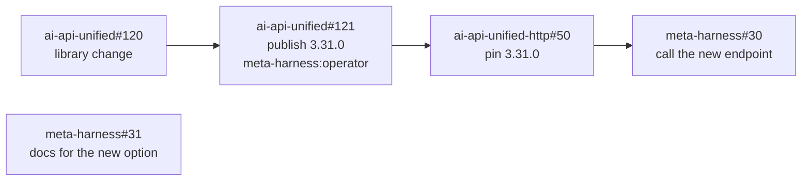

In this example the meta-harness runs ai-api-unified#120 and meta-harness#31
at once, because they depend on nothing open. ai-api-unified-http#50 waits
for an operator to close the release issue, and meta-harness#30 waits for
ai-api-unified-http#50 to merge.

Each task's pull request says `Closes <issue>`, so the merge
closes the issue. A task that ends without a merge (`exhausted` or
`review_unresolved`) leaves its issue open, with a comment holding the outcome
and the label `meta-harness:failed`, and the issues that depend on it stay
blocked.

While a goal is active, the planner watches the goal's
repos for its label through the code-host app's issue webhooks. An issue
labeled after the goal started joins it, such as one the planning task wrote.

A goal is `met` when its success criteria pass. It is
`stalled` when every open issue is blocked by a failed issue or waits on an
operator issue, and a meta-harness alert rule fires. Its `max_usd` covers
every task it queued, review and fix tasks included; once spent, the
meta-harness scheduler admits no more of the goal's tasks and the goal ends
`budget_exhausted`.

A goal's `latitude` is a number from 0 to 1 that sets how much
scope the planner may add on its own, the way a sampling temperature sets how
far a model may stray from the likeliest token. It applies wherever the
planner decides what to do next: the planning task's prompt, the drafts the
planner accepts, and the Decide step.

| Latitude | The planner may | Example |
|---|---|---|
| 0 | Only the issues the goal names or people labeled. It drafts none, and it refuses a draft outside them. A `fix` goal at 0 is a pure queue | "Fix these twelve issues" |
| 0.25 | Draft the issues the statement needs and nothing beyond them. A draft must trace to a sentence in the statement | "Add the `route_ceiling` option" |
| 0.5 | Draft what the statement needs, plus the work it finds necessary on the way: tests the change needs, a doc the change makes wrong, a refactor the change needs to land | "Build the review loop" |
| 0.75 | Also draft improvements it finds in the goal's repos that serve the statement, as separate issues the operator sees in Inputs before they run | "Make the sample's end-to-end check faster and more thorough" |
| 1 | Keep going on its own: when the criteria are met it proposes the next goal from what it learned, and continues under the same budget until the budget or the operator stops it | "Improve the meta-harness" |

Above 0.5 every draft has a `latitude_reason`, one line on why it serves
the statement, which the console shows beside the issue. Latitude widens only
what the planner may propose. The merge bar, the budget, the repo list and the
run service's sole write access to the code host stay as they are. The modality sets the default:
`fix` 0, `feature` 0.25, `new-system` 0.5. The console shows the dial on the
Goal view, and an operator changes it while the goal runs.

The planner is the component that turns a goal into tasks and
decides when a goal needs more of them. It owns the goal loop above, the
`goal`, `plan` and `issue_link` tables, and the issue dependency graph. It is
the only meta-harness component that talks to an issue tracker, and it does so
through one interface, the issue tracker adapter:

| Adapter operation | Purpose |
|---|---|
| `list_open(repo, label)` | The open issues with the goal's label in one repo |
| `read(ref)` | One issue: title, body, labels, state, and the issues that block it |
| `create(repo, draft)` | Create an issue from a planning run's draft: title, body, labels, dependencies. Returns its `ref` |
| `comment(ref, text)` | Record a refusal, an outcome or a plan on the issue |
| `label(ref, add, remove)` | `meta-harness:failed`, `meta-harness:operator`, the goal label |
| `close(ref)` | Close an issue whose pull request merged without `Closes`, or an operator issue the console closed |
| `update(ref, state)` | Write a task's state back to the issue, as labels or the tracker's status field, with the pull request link |
| `webhook(payload)` | Turn a tracker's webhook into `issue_opened`, `issue_edited`, `issue_labeled`, `issue_closed` events, so the Inputs view and the goal loop never poll |
| `sweep(repo, label, since)` | Issues changed since a time, for the reconciliation that catches a missed webhook |

Issues flow both ways through the adapter. Inward, the
planner pulls work people wrote in the trackers: an issue someone labels in
GitHub, Jira or Linear joins its goal, and an edit to its body, labels or
dependencies updates the task before it runs. Outward, the planner writes what
it generated and what happened: the issues a plan drafted, each task's state
as a label or status (`meta-harness:running`, `meta-harness:pr-open`,
`meta-harness:failed`), the pull request link and the outcome as a comment,
and the close on merge. The `issue_link` row is the join: one row per issue,
holding the tracker's state and the meta-harness's, and the planner reconciles
the two on every webhook and on a periodic sweep that catches a missed one.
The tracker is the source of truth for what the work is; the meta-harness is
the source of truth for what happened to it. A conflict, such as an issue
closed by hand while its task runs, cancels the task and records why.

A `ref` is tracker-qualified: `github:<owner>/<repo>#<number>`,
`jira:<key>`, `linear:<identifier>`. Each registered repo in
`config/repos.json` names its tracker, and for Jira or Linear the project or
team and the field or label that names the repo an issue changes. The GitHub
adapter is first, over the code-host app. The Jira and Linear adapters follow
behind the same interface, and the planner, the console and the goal loop
change nothing for them.

A `feature` or `new-system` goal's issues come from a
planning task, `task_type: plan`, which the planner tickets with the goal
statement, the modality and, for a later phase, what the earlier phases built.
The planning run reads the goal's repos and drafts issues with its
`create_ticket` pi extension tool: each in the repo it changes, labeled with
the goal's label, with acceptance checks and `Depends on:` lines. The run
writes nothing on any tracker. After the run, the planner checks
each draft against the goal's repos and the modality's rules, refuses the
rest with the reason, and writes the plan to the `plan` table. The goal then
waits in `planning` until an operator approves the plan in the console, which
is the modality's checkpoint. On approval the planner creates the issues
through the adapter, which queues them. A `fix` goal never plans.

The planner also replans. A `new-system` goal's phase that ends with its
criteria unmet, or a task that fails and leaves dependents blocked, tickets a
planning task with the failure as input, and the plan it drafts goes through
the same approval.

The task service exposes the Task API over HTTP. The task service serves Task
API task routes from its own task table and answers Task API run, profile and
event routes by calling the meta-harness run service and the meta-harness event
service.

## Data model

Each meta-harness table belongs to one owning meta-harness service (principle
8). The owning meta-harness service keeps it in its own Postgres schema under
its own Postgres role. No other Postgres role has a Postgres grant on it.

| Owner | Entity | Fields |
|---|---|---|
| Task service | task | id, caller, external_ref, repo, task_type, parent_task_id, goal_id, depends_on, pr_url, head_sha, priority, spec, acceptance_checks, created_at, status (including `blocked`, `ready` and `review_unresolved`) |
| Planner | goal | id, caller, modality, modality_source (classifier, operator), modality_confidence, repos, label, statement, success_criteria, latitude, max_usd, priority, status (planning, active, paused, met, stalled, budget_exhausted, canceled), phase, created_at, closed_at |
| Planner | plan | goal_id, phase, drafted_issues, refused_drafts, approved_by, approved_at, created_refs |
| Planner | issue_link | ref (tracker-qualified), goal_id, task_id, repo, state, depends_on, last_webhook_at |
| Meta-harness run service | run | id, task_id, attempt_no, kind (initial, fallback, followup, retry), candidate, harness_profile, profile_version, model, model_policy, image, sandbox_id, state, started_at, running_at, ended_at, end_reason, fallback_reason |
| Meta-harness run service | routing_decision | id, task_id, attempt_no, request_id, route_tier, route_method, route_confidence, model_pin, candidates (the tier's ordered tier candidates), thinking, config_id, config_version, classifier_usd, route_floor, route_ceiling, explored, est_usd_max (from `preview_route()`'s `usd_max`), created_at |
| Meta-harness run service | operator_review | review_task_id, operator, claimed_at, verdict, findings, submitted_at, released_at |
| Meta-harness run service | config_version | kind (tiers, profiles, task_policy), version, document, effective_at |
| Pool manager | sandbox | id, image, executor, executor_ref, state (provisioning, warm, leased, kept, draining, unhealthy, destroyed), created_at, destroyed_at, destroy_reason |
| Pool manager | lease | run_id, sandbox_id, harness_session_id, session_state (new, kept, restored), granted_at, expires_at, released_at, release_reason |
| Meta-harness event service | event | event_id (UUID, unique), position (assigned on insert, monotonic), event_type, schema_version, time_utc, source (task, scheduler, dispatcher, route, run, workflow, pool, analyzer), actor, run_id, task_id, session_id, request_id, seq, trace_id, config_id, config_version, tags (jsonb), payload (jsonb) |
| Meta-harness event service | event_type | name, schema_version, json_schema, retention_class |
| Metering service | model_call | run_id, seq, turn, purpose (turn, compaction, auxiliary), tier, method, engine, model, thinking, input_tokens, cached_input_tokens, cache_write_5m_tokens, cache_write_1h_tokens, output_tokens, usd, latency_ms |
| Metering service | attempt_usage | run_id, usd_total, calls, input_tokens, cached_input_tokens, cache_write_5m_tokens, cache_write_1h_tokens, output_tokens, cache_hit_rate, active_hours |
| Metering service | check_result | task_id, check_name, kind (ci, acceptance, merge), passed, observed_at |
| Metering service | task_outcome | task_id, goal_id, ci_share, merged, review_rounds, review_loop_usd, total_usd, wasted_usd, active_hours, dollar_hours, closed_at |
| Metering service | spend | caller, period, cap_usd, spent_usd |
| Harness analyzer | proposal | id, kind (tier, profile, task_policy), evidence, proposed_change, status (open, approved, rejected), decided_by, decided_at, config_pr_url |

The metering service `model_call` table holds one row per model call inside a
meta-harness run, so the harness analyzer can see which model answered each pi
coding agent turn; the meta-harness run service's run row records only the
meta-harness candidate the meta-harness run started on.

The meta-harness event service indexes its `event` table on `(run_id, position)`,
`(run_id, time_utc)` and `(event_type, time_utc)`, and partitions the `event` table by time and
retention class. The metering service projection tables are projections of the
`event` table, built from a metering service cursor, and can be rebuilt by
replaying the `event` table.

Meta-harness stores outside Postgres follow the same single-owner rule: the
meta-harness scheduler owns its repo-area locks, the meta-harness run service
owns its Temporal namespace and code-host API rate-limit buckets, the pool
manager owns the pool manager artifact store, and the HTTP Gateway owns the
HTTP Gateway run grants and HTTP Gateway per-run spend counters. Each Redis
keyspace has one owning service.

## Observability

Meta-harness domain events go to one meta-harness event service. Every
meta-harness producer service appends to the event service and every consumer
reads from the event service. The operator console is one of those readers.
Operational logs, OpenTelemetry traces and OpenTelemetry metrics go to
OpenTelemetry. Every meta-harness domain event includes the OpenTelemetry trace
id, so meta-harness domain events and OpenTelemetry traces join on it. No one
has to log into a machine to observe the system.

### Event service

The meta-harness event service is the system of record for what happened in
every meta-harness task and every meta-harness run. The event service owns the
`event` table, the per-type schema registry, position assignment, partitions,
retention and the commit notification. The event service calls no
other meta-harness component. It holds the meta-harness's own domain events
only. The ai-api-unified library keeps its own library events, cost ledger and
logs.

| Operation | Contract |
|---|---|
| `append(events)` | Idempotent on `event_id`. The event service validates each meta-harness domain event against its event type's registered schema in the schema registry. The event service rejects an unknown event type or invalid payload back to the producing meta-harness service as a bug. The event service client library never retries a rejected append. |
| `read(run_id, from_position)` | A meta-harness run's meta-harness domain events in `position` order, paged |
| `tail(filter, from_position)` | A live stream of meta-harness domain events matching a filter (run, task, type, source), in `position` order, resumable from any position |

Only meta-harness services append, through the event service
client library.

| Producer | Events |
|---|---|
| Task service | `task_created`, meta-harness task status changes, received code-host PR webhooks |
| Planner | `goal_created`, `goal_classified`, `modality_changed`, `latitude_changed`, `plan_drafted`, `plan_approved`, `issues_created`, `issue_joined`, `task_blocked`, `task_unblocked`, `criteria_evaluated`, `replan_ticketed` and `goal_closed`, and the tracker webhooks it received |
| Meta-harness scheduler | Admission decisions, with the reason the meta-harness scheduler holds a meta-harness task |
| Meta-harness run service: RunTask workflow, `route` and run activities | `task_routed` from the run service `route` activity result. One `attempt_finished` per run from the run service run activity Collect result, joined to its pool manager sandbox lease by `run_id` |
| Meta-harness run service: run activity (Wait step) | The per-run sandbox's harness server Run API event stream: `turn_started`, `model_call` (with the HTTP Gateway's model-token usage and running total), `tool_call`, `tool_result`, `file_changed`, `tests_run`, `guardrail_blocked`, `compacted`, `turn_finished`, `run_finished`. The run service run activity stays the only consumer of each per-run sandbox's harness server Run API stream. Harness server Run API heartbeats are not stored. |
| Meta-harness run service: RunTask Temporal workflow | Run state transitions, `check_completed` from the PR signals the RunTask workflow receives, `review_submitted` from each meta-harness review task's run (verdict, findings, reviewed head SHA), `review_started`, `operator_review_claimed`, `operator_review_submitted` and `operator_review_released` with the operator as actor, `review_ticketed` and `fix_ticketed`, `pr_merged`, and `task_closed`. Operator actions the RunTask workflow receives (cancel, kill switch), as audit events with the actor |
| Pool manager | `lease_granted` (with `session_state`), `lease_released`, `session_saved`, `session_restored`, `sticky_handoff`, `sandbox_recycled`. The pool manager lease record names the per-run sandbox for each run. |
| Harness analyzer | `proposal_opened`, and operator approvals and rejections of harness analyzer proposals as audit events with the actor |

The operator console produces no meta-harness domain events.

The event service client library buffers meta-harness domain
events locally and retries. The outbox lives in the event service client
library, not in each meta-harness producer service's tables. Retries are safe
because `append` is idempotent on `event_id`. An event service outage never
blocks a meta-harness run.

After an event service append commits, the event service
sends a commit notification, Postgres `NOTIFY`, with the run id and the new
highest `position`. The commit notification contains no meta-harness domain
event data and is internal to the event service: its listeners are the event
service's own `tail` handlers, which fetch the new event rows and stream them
to their callers. A missed commit notification costs latency, not data, because
the next `tail` handler fetch catches up. The design uses `NOTIFY` because it
fires only on commit. If commit notification volume exceeds what the event
service's Postgres database can handle, Redis can send the commit notification
instead.

Each meta-harness producer service sets `seq` within its own
event stream. The event service assigns `position` on insert. Concurrent
Postgres transactions can commit out of `position` order, so the event service
`tail` handler re-reads a short window behind each caller's cursor and
suppresses repeats of meta-harness domain events it has sent. Delivery is at least
once, and a consuming service can drop a repeat meta-harness domain event by
`event_id`.


| Consumer | Calls |
|---|---|
| Operator console | `read` for a meta-harness run's event history, then `tail` from the last position |
| Metering service | `tail` with one cursor per metering projection, into `model_call`, `attempt_usage`, `check_result`, `task_outcome` and `spend` |
| Harness analyzer | `read` for routing, attempt and run meta-harness domain events over time |
| Meta-harness alert rules | `tail` for stalled runs, failed meta-harness tasks with every routing tier exhausted, runs ended on `spend_limit`, and usage reconciliation gaps |
| Audit and export jobs | `read` for operator and configuration meta-harness domain events, and bulk export by time range |

The event service partitions its `event` table by time and by
each event type's retention class from the schema registry. Short-lived event
types (per-turn text, tool output) expire by dropping whole partitions rather
than deleting rows. The event service keeps run, routing, attempt and audit
meta-harness domain events long.

### Signals

| Signal | Source | Carried by |
|---|---|---|
| Meta-harness domain events | The meta-harness producer services above | Meta-harness event service |
| OpenTelemetry traces | One OpenTelemetry trace per meta-harness task, spanning routing, scheduling, each meta-harness run, each harness server Run API call and each HTTP Gateway call | OpenTelemetry; `task_id` and `run_id` on every span, and the trace id on every meta-harness domain event |
| OpenTelemetry metrics | Task queue depth, meta-harness scheduler admission decisions, per-run sandboxes by state, pool manager lease latency, run durations and turns per run. Model calls by routing tier, spend by Task API caller, HTTP Gateway latency and error rate | OpenTelemetry metrics |
| Operational logs | Operational text, structured, with `task_id`, `run_id` and trace id on every line; prompt and response content only when configured | Existing log pipeline |

### Console

The operator console is a cloud web app, the control point of the
meta-harness. Operators sign in with GitHub; the first deployment allows one
account, and a team allowlist comes later. The console owns no store and holds
no database connection: it reads from the task service, the planner, the
meta-harness run service, the event service, the metering service and the pool manager through
their interfaces, and sends commands to the owning service, which records
each as an audit event with the operator as actor. The console never writes a
table.

The console serves many parallel tasks pursuing several goals at once.
Every view drills down to the next, and every list filters by goal, modality,
repo, time, harness profile, model, routing tier, task type and state.

| View | Shows | Actions |
|---|---|---|
| Overview | Every active goal with its modality, progress against its success criteria, spend against budget and tasks in flight. A "needs you" list: plans and phases to approve, operator issues (releases, deploys) only an operator can close, unresolved reviews, alerts. Run capacity, HTTP Gateway health and the kill switch | Create goal, kill switch |
| Inputs | The queued GitHub issues across every registered repo, by repo and by goal: each one's state (queued, blocked and on what, running, PR open, in review, merged, failed), issues no goal has picked up, and which repos each goal is working in now | Add an issue to a goal, drop one |
| Goal | The goal's statement, its modality (with the classifier's confidence, or "set by operator") and latitude dial, its issue dependency graph across repos, the plan or the phase timeline with each phase's criteria, every success criterion's live state, spend over time, and its tasks. Each planner-drafted issue shows its `latitude_reason` | Approve plan or phase, set latitude, pause, resume, cancel |
| Tasks | One task: its issue, every ai-api-unified router routing decision, every run including fallbacks, every check result, the diff, the pull request, each review round's verdict and findings and the fix task it ticketed, the merge, and cost per run | Cancel |
| Run | Live timeline of the run's events: each turn's model call (model, thinking, tokens, cost, latency), tool calls, file changes, test runs, compactions and guardrail blocks, the OpenTelemetry trace, and the per-run sandbox | Cancel |
| Live runs | Every run in flight across every goal: task, repo, model, turn, spend as it accrues, time since its last event | Cancel |
| Routing | Tier picked versus the candidate whose run finished, classifier confidence, floors and ceilings by modality, moves between candidates and escalations | |
| Pool | Per-run sandboxes by image and state, warm targets versus actual, lease latency, health failures | |
| Spend and performance | Cost by goal, modality, repo, model, harness profile and routing tier. Cost per merged pull request and time to merge, by modality. Dollar-hours per completed task over time. Cache hit rate | |
| Configuration | The active routing tiers, harness profiles, modalities, task policy and repo registry, their version history, and the harness analyzer's pending proposals | Approve or reject a proposal |
| Audit | Every operator action and configuration change | |

Tasks running at the same time differ by task id and
goal. A task's own runs never overlap: fallback runs and retry runs run one
after another. The Tasks view lists them by run id in order, with the task's
review and fix tasks under it.

The console never connects to a per-run sandbox or to a
producer service. To open a run, it calls the event service `read` for the
run's history and then `tail` from the last position, so a run in progress
opens at any point with no gap, and a slow console falls behind without
slowing a producer. Tool calls, tool results, file changes, test runs,
guardrail blocks, compactions, model tokens and spend are live as they
happen, from the `model_call` events recorded off the harness server Run API.
Model text arrives once per turn, and token by token once the HTTP Gateway
streams.

Event payloads contain repository content. The console
scrubs secrets from the events it reads. The HTTP Gateway's per-turn
redaction applies to what the model receives.

The first console serves the Overview,
Inputs, Goal, Tasks, Run, Live runs and Spend views over the task service,
the planner and the event service on Cloud SQL, with goals of the `fix` modality. The Routing,
Pool and Configuration views, review joining and proposals follow the
services they read from.

### Alerts

Meta-harness alert rules tail the event service and read OpenTelemetry metrics.
They fire on: a meta-harness run stalled past its harness server heartbeat
window, pool manager lease TTL expiries, warm sandbox pool below target for
longer than the sandbox provisioning time, HTTP Gateway error rate or latency
past its SLO, a meta-harness task failing with every routing tier exhausted,
a meta-harness task ending `review_unresolved`, a claimed review round
waiting on an operator past `review.operator_alert_minutes`, spend past 80%
of any cap, usage reconciliation gaps over 5%, and a harness
profile and model whose cache hit rate falls below its configured floor.

## Security

- A code-host app installed on each repo in the repo registry.
  A per-run sandbox gets a read-only, repo-scoped code-host access token for
  its clone, minted per meta-harness run and expiring within an hour. Only
  the meta-harness run service writes to the code host, with its own
  code-host app token, never from a per-run sandbox: it pushes
  branches, opens pull requests, posts reviews, creates tickets and merges.
- Secret Manager mounts each secret only into its owner service's
  pods. The HTTP Gateway holds the model provider API keys for every model call
  a meta-harness run makes. The meta-harness run service holds one more: a
  classifier provider API key for the ai-api-unified router classifier model
  only. A provider project limited to that model issues it, with its own spend
  limit, so a leaked classifier provider API key exposes classification and
  nothing else.
  Per-run sandboxes hold a run-scoped HTTP Gateway run grant key and a
  read-only code-host access token, both short-lived. No secret appears in prompts, meta-harness
  task specs or logs.
- Task descriptions, meta-harness review findings, CI logs and
  every tool result pass ai-api-unified's prompt-injection and tool-result
  guardrail checks at the HTTP Gateway, and
  the meta-harness task prompt template places them in a delimited data
  section.
- Each per-run sandbox has gVisor, a default-deny
  NetworkPolicy, the Secure Web Proxy allowlist, no model provider API keys, no
  cluster credentials and no Google Cloud permissions. The harness server is
  the only process in the per-run sandbox that talks to the meta-harness
  control plane, over mutual TLS.
- Every meta-harness task launch, review and fix ticket, operator
  review claim and verdict, merge, cancel and configuration change is a meta-harness domain event in the event service,
  recorded by the meta-harness service that received it, with its actor.

## Deployment

The meta-harness runs on Google Cloud, one GCP project per environment. Every
managed service has one owning meta-harness component, and
Workload Identity enforces the same rule at the infrastructure layer. The
ai-api-unified library runs in-process in the meta-harness run service pods
and the ai-api-unified-http HTTP Gateway pods.

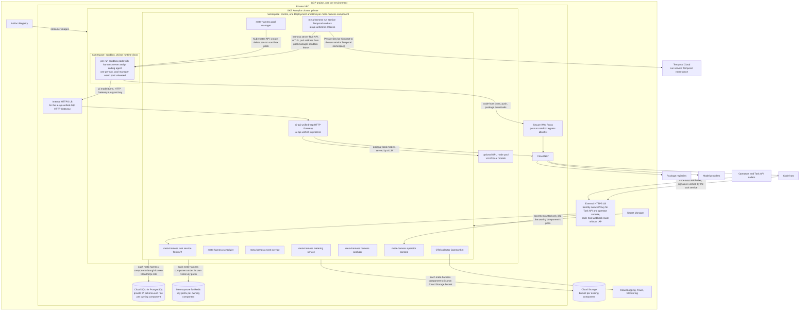

### First cloud deployment

The full deployment above is the target. The first deployment, which gets the
meta-harness running on its own with the console as its control point, uses
managed services where they exist and one VM where the design's pool manager
is not built yet:

| Component | Runs on | Notes |
|---|---|---|
| Operator console | Cloud Run | GitHub sign-in, one allowed account to start |
| Task service, planner, event service | Cloud Run, Cloud SQL for PostgreSQL | The Task API, the goal loop and the GitHub issue tracker adapter, code-host webhooks, the event table |
| HTTP Gateway | Cloud Run | ai-api-unified-http, already deployed |
| Temporal | Temporal Cloud | The run service namespace |
| Run service worker, egress proxy, per-run sandboxes | One Compute Engine VM with Docker | The Docker executor backend from `samples/temporal-run-task`, as a systemd service that restarts on failure and on reboot |
| Code host | A GitHub App on the registered repos | Issue and pull request webhooks keep the Inputs view live without polling; read-only clone tokens per run; the run service's app token for every code-host write |

The VM is the one piece GKE and the pool manager replace later, behind the
same run service interfaces. Everything an operator does goes through the
console; nothing requires a terminal or a coding-agent session.

### Compute

- **One GKE Autopilot cluster**, private and regional.
- One Deployment per meta-harness component: the
  meta-harness task service, the meta-harness scheduler, the meta-harness run
  service Temporal workers, the pool manager, the event service, the metering
  service, the harness analyzer, the operator console and the
  ai-api-unified-http HTTP Gateway, each with a horizontal pod autoscaler. The
  meta-harness scheduler and the pool manager each run two replicas with
  leader election.
- One per-run sandbox pod per run, with the gVisor
  runtime class (GKE Sandbox). The pool manager creates and deletes these
  per-run sandbox pods through the Kubernetes API, and the pool manager's warm
  pool is pre-created, unleased per-run sandbox pods. A default-deny
  NetworkPolicy on the `sandbox` namespace allows ingress only from the
  meta-harness run service and the pool manager on the harness server Run API
  port. It allows egress only to the HTTP Gateway's internal load balancer and
  the Secure Web Proxy.
- The meta-harness run service and the
  pool manager reach a per-run sandbox's harness server at the pod address in
  the pool manager's sandbox lease record, over mutual TLS. No load balancer
  sits in front of the per-run sandboxes, because each run talks to exactly
  one per-run sandbox pod.
- Per-run sandboxes need GKE (Technology). The
  ai-api-unified-http HTTP Gateway is the one component that could move to
  Cloud Run later.
- A GPU node pool runs vLLM behind the HTTP Gateway,
  as an `openai-compatible` ai-api-unified completions engine in the
  ai-api-unified `models.json` configuration.

### Managed services

| Service | Owner and use | Fails how |
|---|---|---|
| Cloud SQL for PostgreSQL | One regional high-availability Cloud SQL instance on a private IP. One schema and database role per owning meta-harness component, with IAM database authentication per component. The Cloud SQL instance has the capacity for the meta-harness event service, the heaviest writer. | Failover to the Cloud SQL standby takes about a minute. Meta-harness services retry, and event service producer clients buffer. Per-run sandboxes never touch Cloud SQL, so runs in progress keep working. New task admissions by the meta-harness scheduler and new sandbox leases from the pool manager wait. |
| Temporal Cloud | The meta-harness run service's Temporal namespace, reached over Private Service Connect. RunTask workflow history, timers and signals. | RunTask workflows stop advancing, but per-run sandboxes keep running and finish their work. When Temporal Cloud returns, run service activities retry and re-attach to the harness server by `run_id` and `Last-Event-ID`. A run whose pool manager sandbox lease TTL expires during the outage is lost, and the meta-harness run service retries it as a new attempt. |
| Memorystore for Redis | Standard tier with a replica. One key prefix per owning component. The HTTP Gateway keeps HTTP Gateway run grants and HTTP Gateway per-run spend counters. The meta-harness scheduler keeps repo-area locks. The meta-harness run service keeps code-host API rate-limit token buckets. The event service keeps a commit notification fallback, unused while Postgres `NOTIFY` suffices. | Memorystore failover keeps the data. If Memorystore loses the HTTP Gateway's spend counters or run grants, the HTTP Gateway fails closed. The HTTP Gateway then rejects model turns for any run it cannot verify or meter. Those runs end, and the meta-harness run service retries them as new attempts. If Memorystore loses the meta-harness scheduler's repo-area locks, the meta-harness scheduler stops admitting tasks until it rebuilds the locks from the run service's active runs. |
| Cloud Storage | One bucket per owning component. The pool manager's Cloud Storage artifact bucket holds pi session directories under `harness_session_id` and per-run sandbox logs. The meta-harness run service's bucket holds run artifacts, and the event service's bucket holds event exports. | The pool manager's sandbox drain step retries artifact collection. A per-run sandbox stays in `draining` until the pool manager saves the per-run sandbox's artifacts to the pool manager's bucket or a limit passes. Follow-up tasks that need a saved pi session wait. |
| Artifact Registry | Every container image: the per-run sandbox harness image and one image per meta-harness control-plane component. | Pods cannot pull uncached images. Running meta-harness services and warm per-run sandboxes keep running, and image rollover pauses. |
| Secret Manager | Secret Manager mounts each secret only into its owning component's pods. Model provider API keys go to the HTTP Gateway, except the ai-api-unified router classifier's provider API key. The ai-api-unified router classifier's provider API key goes to the meta-harness run service. The meta-harness run service also receives an HTTP Gateway API key. The run service run activity uses that HTTP Gateway API key to request and revoke HTTP Gateway run grants. | Secrets load into pods at pod start, so a Secret Manager outage blocks new pods only. |
| Cloud NAT and Secure Web Proxy | All egress from the GKE cluster. The Secure Web Proxy enforces the per-run sandbox egress allowlist. | Fails closed: per-run sandbox egress stops, runs fail on code-host clone or push, and the meta-harness run service retries them. No bypass route exists. |

### Network and identity

- The GKE cluster is private in its own VPC, with Cloud NAT for
  egress.
- The Secure Web Proxy allows the HTTP Gateway's
  internal load balancer address, the code host and package registries, and
  nothing else. A per-run sandbox never reaches a model provider. The
  `sandbox` namespace's default-deny NetworkPolicy enforces the same limit
  inside the GKE cluster.
- An internal HTTPS load balancer fronts the
  ai-api-unified-http HTTP Gateway.
- An external HTTPS load balancer with
  Identity-Aware Proxy fronts both the operator console and the task service
  Task API. Programmatic Task API callers present a Google service account
  identity to IAP and their per-caller Task API caller key to the Task API.
  Code-host webhooks cannot present IAP credentials, so the code-host webhook
  route uses its own load balancer backend without IAP, and the task service
  verifies the code host's webhook signature on every delivery.
- Each meta-harness component has one Kubernetes
  service account bound to one Google service account. IAM grants follow
  component ownership: a component's Google service account reaches only its
  own Cloud SQL database role, Cloud Storage buckets and Secret Manager
  secrets. Only the pool manager's service account can create or delete pods
  in the `sandbox` namespace. Per-run sandbox pods run under a service account
  with no Google Cloud permissions.
- Memorystore has no per-prefix IAM, so each owning
  component's Redis client wrapper enforces that component's key prefix.
- **HTTP Gateway run grants** are application-level: a run grant key is not
  a Google Cloud credential. The HTTP Gateway API key that the run service run
  activity uses to request and revoke run grants reaches only the meta-harness
  run service pods, through Secret Manager.

### Observability

An OpenTelemetry collector DaemonSet sends traces to Cloud Trace and logs to
Cloud Logging. Cloud Monitoring holds the metrics that drive the horizontal pod
autoscalers and the alerts. The meta-harness event service
remains the record of meta-harness domain events, and domain events join to
OpenTelemetry traces by trace id.

### Local development

Docker Compose runs Postgres, Redis, the Temporal dev server and every
meta-harness service. Per-run sandboxes use the Docker executor backend behind
the same pool manager executor interface, from the same images, and a local
egress proxy enforces the same per-run sandbox egress allowlist. Each local
per-run sandbox is on its own internal Docker network, which has no route
out, and the local egress proxy is attached to each one. Docker publishes no
port from an internal network, so the run service reaches each harness server
through the local egress proxy's control listener.

## Build plan

Steps after **next** are plans, and they change as the build goes.

| Step | State | Where |
|---|---|---|
| pi model client extension: pi's model calls through the HTTP Gateway | built | `images/harness-pi/extension` |
| Harness server and the harness server Run API | built | `images/harness-pi/server` |
| Each run as a meta-harness run service Temporal workflow (the RunTask workflow), with re-attach to the harness server on retry and cancel | built | `samples/temporal-run-task` |
| HTTP Gateway run grants: model pin and spend limit per run | built | ai-api-unified-http 1.18.0, `samples/temporal-run-task` |
| Per-run sandbox: the harness server in a Docker container per run, which the run service run activity starts and removes with the Docker executor backend | built for local development | `images/harness-pi/Dockerfile`, `samples/temporal-run-task` |
| Per-run sandbox egress allowlist: each per-run sandbox on its own internal Docker network, with a local egress proxy that lets it reach only the HTTP Gateway, the code host and package registries | built for local development | `samples/temporal-run-task/egress-proxy`, `make egress-check` |
| A zero-cost end-to-end check: the RunTask workflow against a fake HTTP Gateway that makes no model calls, on every pull request | built | `samples/temporal-run-task/e2e.sh`, `make e2e`, `.github/workflows/e2e.yml` |
| Provider-neutral tool results: one tool-result shape the HTTP Gateway converts for each model provider | built | ai-api-unified-http 1.19.0, `images/harness-pi/extension` |
| The RunTask workflow's run loop over the ai-api-unified router's candidates, with a run service `route` activity, escalation, pins and a task-wide spend limit | built | ai-api-unified 3.30.0 (`AiRouteClassifier`), `samples/temporal-run-task`, `make fallback-demo` |
| Repo work in a run: each run starts from a fresh clone of the task's repo, pi's `bash` tool runs the acceptance checks, and the run service's Publish step commits pi's changes, pushes the branch and opens the pull request with `Closes <ticket>`. The per-run sandbox holds no code-host credential | built for local development | `samples/temporal-run-task`, `make repo-demo`, `make run TICKET=owner/name#N` |
| Operator console, first form: a cloud web app you sign in to with GitHub, over the task service, the planner with its GitHub issue tracker adapter, and the event service on Cloud SQL. Goals, the Inputs view of queued GitHub issues across the registered repos, tasks, live runs, spend, and the actions start, pause, cancel and kill switch | **next** | |
| Standing cloud deployment: console, task service, planner and event service on Cloud Run, Temporal Cloud, and one Compute Engine VM running the run service worker, the egress proxy and the per-run sandboxes with the Docker executor backend. The meta-harness runs with no Claude Code session and no terminal | planned | |
| Meta-harness review loop and merge: a review task on another model, fix tasks, and the merge at the reviewed head SHA, each round visible in the console | in progress | `samples/temporal-run-task` branch `feat/review-loop`; `submit_review` built in `images/harness-pi/extension` |
| Goals with the `fix` modality: a label across the registered repos feeds a standing queue, and the console shows each issue's state | planned | |
| Goals with the `feature` and `new-system` modalities: the planning task, plan and phase approval in the console, and goal success criteria | planned | |
| Self-hosting: a `new-system` goal whose repos are ai-api-unified, ai-api-unified-http and meta-harness, steered from the console | milestone | |
| Pool manager, kept and restored pi sessions | later | |
| Meta-harness owned pi tools, the `bash` command allowlist, pi compaction handler, `guardrail_blocked` harness server Run API events | later | |
| Operator review | sketch | |
| HTTP Gateway: `route` in the conversation request body, so on a run grant that pins a model one call can run on a tier band capped at the pinned model's tier. pi agent turns without `route` stay pinned | later | ai-api-unified-http |
| Streaming: a `send_conversation` form in ai-api-unified that yields typed events and commits to one model at its first delta, and a server-sent-events form of the HTTP Gateway conversation endpoint, so the console shows model text token by token | optional | ai-api-unified, ai-api-unified-http |
| Pool manager on GKE, metering service, harness analyzer, meta-harness scheduler as its own service | sketch | |

The zero-cost end-to-end check runs on every pull request, so each later build
step is proven end to end before it spends money on model calls.

The steps up to the self-hosting milestone come first, in this order. After
them, the meta-harness builds the rest of itself while the operator watches
from the console. The console comes before the review loop is finished, so the
operator sees every review round from the first. Once pull requests merge
without a person, a goal's issues run in order across repos, and the planner
writes each next phase. Self-hosting needs stronger models than the sample's
Haiku 4.5 and gpt-4o-mini, which cost more, so each goal has its own spend cap.
