# Meta-Harness Technical Design

## State of the build

The design below describes the whole system. This table says how much of it
exists. Each PR that lands a step updates its row. Everything past the
current step is a sketch, open to change when building it teaches something.

| Step | State | Where |
|---|---|---|
| Model client: pi's model calls through the HTTP Gateway | built | `images/harness-pi/extension` |
| Harness server and the Run API (section 8.2) | built, runs as a local process | `images/harness-pi/server`, PR #8 |
| Run as a Temporal workflow, with re-attach on retry and cancel (section 7) | built | `samples/temporal-run-task`, PRs #6 and #8 |
| Run grants: model pin and spend limit per run (section 6.4) | built | ai-api-unified-http 1.18.0, PR #9 |
| Sandbox: the harness server in a container per run (section 8.1) | **next** | |
| A free end-to-end check: the workflow against a fake gateway, on every PR | next | |
| Engine-neutral tool results in the HTTP Gateway | after that | |
| The run loop over candidates, with a `route` activity (section 6.3) | after that | |
| Pool manager, kept and restored sessions (section 8.4) | later | |
| Owned tools, compaction handler, guardrail events (section 4) | later | |
| Task API, data model, event service, console, metering, scheduling (sections 9 to 13) | sketch | |

The order puts the sandbox first because, until it exists, pi's tools act on
the machine that runs `make run`. The free check comes second so each later
step is proven end to end before it spends on a model.

## 1. Scope

The meta-harness runs AI coding tasks in parallel, each on its own harness and
model. A team submits coding tasks through an API. For each task the
meta-harness picks the harness-and-model combination that fits its difficulty,
runs it in its own isolated sandbox through the harness's Run API, meters every
model call, and records the outcome, usually a pull request.

Tasks run independently, on different harness profiles and on models from
different providers, so one task's failure or one provider's outage does not
stop the others. A developer driving one agent session works through one task
at a time. The meta-harness runs dozens of tasks at once, as many as sandbox
capacity, caller quotas and spend caps allow (section 10). Adding sandboxes and
HTTP Gateway replicas raises that limit with no change in design.

### Who uses it

- **Teams and their tools** submit tasks through the Task API: a person, a CI
  job, or an issue-tracker integration. Each caller has a key that sets its
  concurrency quota, its daily spend cap and the repos it may change.
- **Reviewers** review the pull requests on the code host as they review any
  other. Review comments and failed checks come back as code-host webhooks and
  start follow-up runs on the same branch.
- **Operators** watch tasks, runs and model calls, with their cost, in the
  console, and can cancel a run or stop all runs with the kill switch.
- **Configuration owners** approve or reject the harness analyzer's proposals.
  An approved proposal becomes a pull request against `config/`.

### Tasks in, pull requests out

Each task names a repo, a task type, a priority, a title and description, and the
acceptance checks that define success. It may also name the paths it touches,
a complexity hint, a highest tier, a dollar cap, or a pin to one harness and
model (section 11). Tasks beyond the current limit wait in priority order until
a slot opens (section 10).

For each task the meta-harness opens one pull request, labeled
`ai:meta-harness`, and records the outcome: the routing decision, every attempt
with its harness, model, thinking level, time and cost, and whether the pull
request merged. Follow-up runs add commits to the same pull request until it
merges or closes, or until the task uses its profile's last follow-up.

### Components

The table groups the components the way the sequence diagrams box them. Each
component owns its data (principle 8).

| Component | What it does | Code |
|---|---|---|
| **Meta-harness control plane** | | `src/meta_harness/` in this repo |
| Task service | Accepts, de-duplicates and tracks tasks. Serves the Task API and receives code-host webhooks. | `task_service/` |
| Scheduler | Decides which task runs next: priority, caller quotas, spend caps, repo-area locks. | `scheduler/` |
| Run service | Runs each task from admission to outcome as a durable workflow. It calls the `ai-api-unified` router, watches the sandbox, starts follow-ups and closes the task. It is the only caller of the router. | `run_service/` |
| Pool manager | Supplies sandboxes: leases them by run id, keeps a warm pool, checks health, recycles them. | `pool/` |
| Event service | Keeps the ordered record of every meta-harness event. Every other component appends and reads through it. | `events/` |
| Metering | Computes cost, time and success for each attempt and task, including dollar-hours per completed task by harness profile, model, thinking level and task type. | `metering/` |
| Harness analyzer | Turns metering evidence into proposed changes to tiers, profiles and task policy. | `analyzer/` |
| Console | Shows operators tasks, runs, events, spend and sandbox state. Its only actions are cancel, the kill switch and proposal approval, each sent to the owning service. | `console/` |
| **ai-api-unified library**, in the run service process | | the `ai-api-unified` repo |
| Router | Classifies a task with a direct classifier-model call, picks a tier, and returns the tier's ordered harness-and-model candidates. The run service's workflow tries them (section 6.3). | `AiRouterCompletions` |
| **Sandbox**, one per run | | `images/harness-pi/` in this repo |
| Harness server | Exposes the Run API and runs pi in-process through pi's SDK. | `server/` |
| pi | The coding agent: agent loop, tools, context, session. Third-party (pi.dev), used unmodified through its SDK. | `@earendil-works/pi-coding-agent` |
| Model client | A pi extension that sends every model call pi makes to the HTTP Gateway. | `extension/` |
| **HTTP Gateway** | The only model endpoint a sandbox can reach. Holds the provider keys for agent model calls and the run grants, pins each run's model, applies guardrails, and enforces each run's spend cap. | the `ai-api-unified-http` repo |
| **Outside the system** | Used by the meta-harness and built elsewhere. | |
| Code host | Repositories, pull requests, checks, reviews and webhooks. | |
| Model providers | Cloud model APIs, or local models served by vLLM. | |
| Temporal Cloud, Google Cloud | The workflow engine and the infrastructure (section 15). | |

Guardrails is a library, not a component. The run service, the pool manager
and the HTTP Gateway call it to scope repository access and credentials per
run, screen untrusted text, and enforce spend caps.

`ai-api-unified` is the router at both levels. At the task level, a tier's
candidates are harness-and-model combinations, the prompt is the coding task,
and the router's classifier, fallback, escalation, cooldowns and metering apply
to whole runs. At the model-call level, the harness makes every call through
`ai-api-unified` as well, through the HTTP Gateway, so routing, guardrails and
spend caps apply to every token the agent spends. The meta-harness configures
and consumes those features and reimplements none of them.

### Non-responsibilities

- **Choosing models.** Difficulty classification, candidate selection,
  fallback, cooldowns and per-call pricing belong to `ai-api-unified`.
- **The agent loop.** pi runs it. The meta-harness configures pi through
  harness profiles and the model client.
- **Agent model access.** The HTTP Gateway holds the provider keys for every
  model call a run makes, and no sandbox holds one. The run service holds
  a single key that serves only the router's classifier (section 14).
- **Producing tasks.** Callers decide what work to submit.
- **Merging and deploying.** The meta-harness opens and updates pull requests.
  People and the repository's branch rules decide whether one merges, and the
  team's own pipeline deploys it.

### Where it runs

On Google Cloud: one GKE Autopilot cluster for the services and the sandboxes,
Cloud SQL for PostgreSQL, Memorystore for Redis, Cloud Storage and Temporal
Cloud. Local development runs the same images on Docker Compose. Section 15
covers both.

## 2. Principles

1. **Code never names a model or a harness.** `models.json` maps a difficulty
   tier to harness-and-model candidates. Changing the mapping is a
   configuration change.
2. **Every model call goes through ai-api-unified.** The dispatcher calls the
   router in-process to run a task. The harness calls the HTTP Gateway's
   native conversation API with a run-scoped token. No sandbox holds a provider
   key. No component translates a call into another vendor's wire protocol.
3. **An API drives the harness.** Start, follow up, stream events,
   status, cancel and usage are API calls on the harness server. No step
   uses a command line or parses terminal output.
4. **Fail at startup, not during a run.** Startup validates every harness
   profile and every tier candidate against the images and the
   `ai-api-unified` configuration. A missing model, profile or image stops the
   service and names the setting.
5. **The meta-harness meters and records every run**, failures included. A failed attempt
   counts against cost and time.
6. **Durable by default.** A run lasts minutes to hours. Any process can die
   and the run resumes from its last recorded step.
7. **Harness variants are configuration.** A harness profile is an image, a
   prompt set, a tool set and a loop policy. Adding one is a configuration
   change, and the analyzer measures it like any other routing dimension.
8. **Every datastore has exactly one owner.** Every other component reaches
   that data only through the owner's interface. No component holds a
   connection to a table it does not own. `ai-api-unified` owns no store.

## 3. Architecture

Every datastore has one owning component (principle 8). Each arrow below is a
call on the target's exposed interface. The only arrows that end at a store
come from that store's owner.

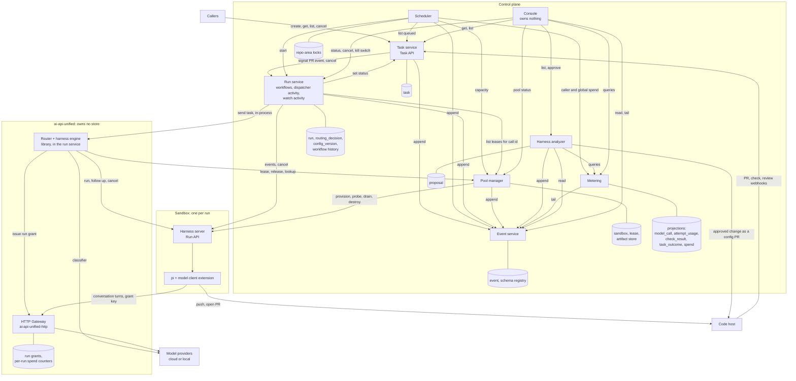

| Component | Objective | Owns | Exposes | Consumes | Scales by | Fails how |
|---|---|---|---|---|---|---|
| Task service | Accept, de-duplicate and track tasks. The Task API (section 11) is its HTTP interface. | `task` | create (idempotent on `external_ref`), get, list, set status, cancel; the code-host webhook receiver | Run service (signal PR events, cancel, run reads), event service (append) | Stateless replicas | No new tasks or status reads. Running tasks continue. The run service retries status updates and the code host retries webhooks. |
| Scheduler | Decide what runs next: priority, concurrency, caps, repo-area locks (section 10). | Repo-area locks (Redis keyspace) | None to other components. Admission decisions go to the event service. | Task service (queued tasks), run service (start), metering (caller and global spend), pool manager (capacity), event service (append) | One logical scheduler, leader-elected | No new admissions. Running tasks continue. Locks expire by TTL if the leader dies holding them. |
| Run service | Run each task's state machine from admission to outcome (section 7). The dispatcher is one activity inside it. It is the only caller of the `ai-api-unified` router. | `run`, `routing_decision`, `config_version`, its Temporal namespace, code-host rate-limit buckets | start, follow up, cancel, kill switch, status, run and profile reads | Router and harness engine (in-process), pool manager, harness server Run API, task service, event service, guardrails library | Temporal workers | Workflows pause and resume from their last step on restart. Sandboxes keep running under their lease TTL. The watch activity re-attaches with `Last-Event-ID` and the router call re-attaches by call id. |
| Pool manager | Provide healthy sandboxes and leave no orphaned sandbox running (section 8.4). | `sandbox`, `lease`, the artifact store | lease (by run id, with `harness_session_id`, returning the sandbox and its `session_state`), release, lookup by run id or call id, capacity, health | Executor, harness server health and drain endpoints, event service, guardrails library | One logical manager, leader-elected | No new leases, so new runs wait. Running sandboxes continue. Reconciliation enforces TTLs on recovery. |
| Event service | One validated, ordered record of every meta-harness domain event (section 13). It calls no other component. | `event`, the per-type schema registry, partitions, retention, the commit notification | append(events), idempotent on `event_id` and validated per type; read(run_id, from_position); tail(filter, from_position) | Nothing | Stateless replicas over one Postgres schema | Producers' client libraries buffer and retry, so runs continue. Consumers lag, then catch up from their cursor. |
| Metering | Turn events into cost, time and success per attempt and task (section 9). | Projection tables: `model_call`, `attempt_usage`, `check_result`, `task_outcome`, `spend` | Queries by caller, profile, model, tier and task type; caller and global spend | Event service (tail) | Stateless workers, one cursor per projection | Projections lag. Runs continue, and the HTTP Gateway still enforces each run's cap. The scheduler treats spend older than its staleness limit as at cap and holds new tasks for capped callers. |
| Harness analyzer | Propose tier and profile changes from evidence. | `proposal` | List, get evidence, approve, reject | Metering (queries), event service (read, append), code host (config PRs) | Batch jobs plus a small API | No new proposals. No effect on runs. |
| Console | Let operators see everything and act on a few things (section 13). | Nothing | Web UI | Event service (read, tail), task service, run service, metering, analyzer, pool manager, traces and metrics backends | Stateless replicas | No visibility. Runs continue. |
| HTTP Gateway | `ai-api-unified-http`, the harness's only model endpoint (section 6.4). | Run grants, per-run spend counters (Redis keyspace) | Conversation turn, issue and revoke run grant | Router (in-process), model providers, guardrails library | Autoscaling replicas | Turns fail, and pi does not retry them, so the run fails and the library's chain moves to the next candidate. The workflow pauses rather than fails (section 17). |
| Router | `ai-api-unified`, in-process in the run service's `route` activity. Classifies and picks a tier, and returns the candidates (sections 6.1 and 6.3). The workflow tries them. | Nothing | `AiRouterCompletions` | Model providers (classifier) | With the run service | Fails with the run service. |
| Harness server | One per sandbox. Exposes the Run API and drives pi (sections 4 and 8.2). | The run's session directory, until drain | Run API | HTTP Gateway, code host | One per sandbox, under the pool manager's targets | The run ends in `ERROR`. The harness engine maps it to a fallback reason. |

**Guardrails** is a library, not a component. The run service, the pool
manager and the HTTP Gateway call it for repo allowlists, credential scoping,
prompt and tool-result checks and spend caps. It owns no store.

**Configuration.** The run service loads `models.json`,
`harness_profiles.json` and `task_policy.json` and owns their version
history. An approved analyzer proposal becomes a pull request against
`config/`, reviewed and deployed like any configuration change. No component
edits running configuration.

**Enforcement.** Each owner has its own Postgres schema and database role, and
its own Redis keyspace. Grants give no role access to another owner's schema.

## 4. The harness

The harness is pi's coding agent (`@earendil-works/pi-coding-agent`), which
the harness server runs in-process through pi's SDK. pi's RPC documentation
recommends the SDK for in-process Node.js integration, and the harness server
is TypeScript in the same sandbox. These owned pieces make pi the
meta-harness's agent and keep every model call inside `ai-api-unified`:

- the **model client**, a pi extension. It registers the only model provider
  pi can see in the image and sends every turn to the HTTP Gateway;
- the **harness server** (section 8.2), which exposes the Run API and runs
  pi's `AgentSession` through the SDK.

The library never knows which agent an image runs. Any image that implements
the Run API and honors the run's model can be the harness half of a
candidate, and a harness profile names the image.

### Model client

The extension registers one complete provider with `pi.registerProvider()`
and its own `streamSimple`. It needs its own stream function because the HTTP
Gateway's `/v1/conversations/turn` is not a protocol pi implements. The
provider exposes a single model, "the run's model", with zero cost metadata,
because cost comes from the HTTP Gateway, and no `promptCache` lifetime, so
pi never warms its cache (see Prompt caching below).

On every turn the model client:

1. Takes pi's transcript context, reading the current system prompt and tools
   from the transcript helpers, and builds the HTTP Gateway's conversation
   request: system prompt, messages, tools, the thinking level the run
   started with, and the `prompt_cache` field set to
   `{"retention": "extended", "key": <harness_session_id>}`.
2. Attaches per-call hints. Agent turns carry no route hint, so the token's
   pin or band decides. Calls the model client makes itself, for compaction
   and for auxiliary text (commit message, PR description), carry
   `route: trivial`.
3. Calls the HTTP Gateway's native conversation endpoint with the run-scoped
   token. As pi's custom-provider contract requires, it calls
   `options.onPayload` before sending and `options.onResponse` on the
   response, awaits `options.onProviderStreamEvent` for each event, and
   honors the abort signal.
4. Maps the turn result into pi's event sequence: `start`, balanced text and
   thinking events, tool-call events whose arguments are parsed input by
   `toolcall_end`, and exactly one `done` or `error`. A tool-use turn arrives
   from the HTTP Gateway as one response, so the model client emits text once per
   turn; with the streaming additions in section 6.5 it emits text token by token.
5. Finalizes the assistant message with the HTTP Gateway's numbers: input,
   output, cached input and cache-write tokens, the per-turn cost, the stop
   reason, and the model the HTTP Gateway actually used. It adds `cached_input_tokens`,
   `cache_write_5m_tokens` and `cache_write_1h_tokens` from each turn's
   `usage` to the run's totals for `GET /usage`. Cache writes are split by
   lifetime because they bill at different rates: 1.25 times the input rate
   for 5 minutes and 2 times for 1 hour on Anthropic and Bedrock.

**Prompt caching.** Every turn sends the whole history, so caching sets most
of a turn's cost: a cached prefix bills at about a tenth of the input rate on
Anthropic.

- **The hint on every turn.** pi passes `cacheRetention` and `sessionId` to
  the provider on every call. The image sets `PI_CACHE_RETENTION=long`, and
  the model client maps `long` to the `prompt_cache` retention `extended`
  above: 1 hour on Anthropic and Bedrock, 24 hours on OpenAI. A run often
  waits more than 5 minutes between turns while tests or builds run, and the
  default cache would expire in that gap. `harness_session_id` as the key
  sends every turn of a session to the same OpenAI cache.
- **No cache warming.** pi's `cacheWarming` setting is `off`, and the model
  client's model declares no `promptCache` lifetime. Otherwise pi would send
  billed cache-refresh calls through the HTTP Gateway.
- **A byte-identical prefix.** The model client keeps the system prompt and
  tool list byte-identical for the whole run: no timestamps, no run ids, and
  a fixed tool order. A compaction rewrites the history, so the turn after it
  writes a new cache once.
- **No HTTP Gateway change.** The HTTP Gateway already accepts `prompt_cache`
  on the conversation turn and returns the cached-token fields in `usage`.

A guardrail block from the HTTP Gateway names the tool-call ids whose results the guardrail blocked. The
model client replaces those tool results with a short notice, resends the turn,
and the harness server emits `guardrail_blocked`. A budget rejection ends the
turn with `error`, and the harness server ends the run on its spend limit.

### What pi loads

The harness server creates the session with `createAgentSession()` and
decides everything pi loads:

- **Resources.** A custom `ResourceLoader` supplies only the model client and
  the owned tools. Nothing loads from the cloned repo's `.pi/` directory: no
  settings, extensions, skills or `SYSTEM.md`.
- **Extensions left out.** SDK sessions do not load the CLI's built-in
  `codemode`, `tool_search` and MCP extensions, and the harness server never
  adds them. `codemode` can run classifier and image models with the
  session's credentials.
- **Models.** A `ModelRuntime` with no built-in credentials, so the model
  client's model is the only one pi can call. The harness server never calls
  `setModel`, so pi never switches models and the run grant decides the real
  model.
- **Tools.** The SDK's `tools` option comes from the profile.
- **Context files.** pi loads `AGENTS.md` and `CLAUDE.md` from the working
  directory unless context loading is off, so the profile's `context_files`
  setting decides. The dispatcher already puts the repo's `AGENTS.md` in the
  first prompt (section 7), so turning context files on sends it twice.
- **Settings.** `SettingsManager.inMemory(...)` holds these settings, and pi
  reads no settings file:

| Setting | Value | Reason |
|---|---|---|
| `compaction.reserveTokens`, `compaction.keepRecentTokens` | The profile's `loop.compaction` | See Loop policy |
| `retry.enabled` | `false` | pi's default retry (3 retries, backoff up to 60 seconds) would stack on the HTTP Gateway's fallback chain. A failed turn fails the run, and the library's chain moves to the next harness candidate. Overflow recovery (compact, then retry) stays on. |
| `cacheWarming` | `off` | See Prompt caching |

pi also has virtual models (`registerVirtualModel`), which route each request.
The design does not use them, because the run grant decides the model.

### Tools

| Tool | Source | Limits |
|---|---|---|
| `read`, `ls`, `find`, `grep` | pi built-in | Output capped by bytes; binary files refused |
| `write`, `edit` | pi built-in | The extension's tool-call hook refuses protected paths from the repo policy |
| `bash` | pi built-in | Timeout and output cap per profile; commands outside the profile's allowlist refused by the hook; no network beyond the egress allowlist |
| `run_tests` | owned extension tool | Runs the acceptance checks named in the task; results emitted as `tests_run` events |
| `open_pr` | owned extension tool | Commits, pushes and opens one PR per run; branch protection blocks default branches |
| `ask_for_followup` | owned extension tool | Records a question for the PR description instead of stopping |

A profile's `tools` list sets the SDK's `tools` option. A profile
may remove tools but not add arbitrary ones.

### Loop policy

The extension and the harness server enforce the profile's `loop` settings:

- **Turn and time limits.** The harness server counts turns from pi's events
  and sends `abort` at `max_turns` or `max_minutes`.
- **Plan first.** The first prompt requires a plan before edits; the
  tool-call hook refuses writes until pi has emitted a plan.
- **Test before PR.** `open_pr` refuses until `run_tests` has passed in the
  current session.
- **Compaction.** pi starts compaction when the context passes the window
  minus a reserve (`contextTokens > contextWindow - reserveTokens`) and keeps
  the most recent `keepRecentTokens` of history as they are. The profile's
  `loop.compaction` sets both (pi's defaults are 16384 and 20000). The model
  client handles pi's `session_before_compact` event: it makes the summary
  call to the HTTP Gateway itself, with purpose `compaction`,
  `route: trivial` and no `prompt_cache`, and returns
  `{compaction: {summary, firstKeptEntryId, tokensBefore, usage}}`. pi's own
  summary request never runs. The summary keeps the task spec and acceptance
  checks verbatim.

### Sessions and where context lives

A session is one conversation with pi, named by `harness_session_id`. The run
service picks the id, one per task, so every follow-up on a task's pull
request continues the same conversation.

| When | Where the conversation is | Owner |
|---|---|---|
| During a run | pi's session directory in the sandbox, set through the SDK's `SessionManager`. pi creates the session file once the conversation has its first message, then appends each entry. | The sandbox (harness server) |
| Between runs | A copy of that directory in the pool manager's Cloud Storage bucket, stored under `harness_session_id` when the run ends | Pool manager |
| Between runs, briefly | The finished sandbox itself, kept for the session for up to `sticky_window` (default 10 minutes) | Pool manager |
| On each model turn | The request the model client sends to the HTTP Gateway, which forwards it and keeps no copy | Nobody: the HTTP Gateway keeps no state between turns |
| In ai-api-unified | Nothing. A router call sends the new input and `harness_session_id`, never the conversation | None |
| In the event service | Each turn's text and tool calls, as a record for the console and metering. A run never resumes from it. | Event service |

A follow-up runs in a sandbox that already holds the session. Before the lease
returns, the pool manager either hands back the sandbox it kept for the
session or copies the session directory from its bucket into a fresh one
(section 8.4). The harness server then switches pi to that session and
continues it, so the conversation keeps its tool history on the same model.

A pi session records its working directory and never changes it, and outside
interactive mode pi exits with an error when that directory is missing. Every
sandbox therefore clones the repo at the same path, `/workspace`, so a
restored session finds its directory.

pi's `@earendil-works/pi-durable` package stays out of v1. It is marked
experimental, with an API that changes without notice, and it is a separate
harness (`Harness.open(storage)`), not the coding agent. The design does not
use `@earendil-works/pi-env` either, which runs Durable's tools on a remote
machine.

### Events

The harness server subscribes with `session.subscribe()` and maps pi's
events (`message_update`, `tool_execution_*`, compaction, `agent_end`,
`agent_settled`) to the Run API's typed events, each
with run id, sequence number and timestamp: `turn_started`, `model_call`
(model, thinking, tokens, cost, latency, as the model client recorded them from
the HTTP Gateway), `tool_call`, `tool_result`, `file_changed`, `tests_run`,
`guardrail_blocked`, `compacted`, `turn_finished`, `heartbeat`,
`run_finished`. `agent_settled` from pi marks the end of a turn that will not
continue on its own; the harness server then finishes the run or, in a
follow-up, waits for the next input.

### Harness profiles

A profile is the harness's configuration and the "harness" half of a routing
candidate.

```json
{
  "version": "2026-11-03.1",
  "profiles": {
    "pi-lean":    {"image": "harness-pi:1.0", "prompts": "lean/v3",
                   "tools": ["read", "ls", "find", "grep", "edit", "bash", "run_tests", "open_pr"],
                   "loop": {"max_turns": 60, "plan_first": false,
                            "compaction": {"reserve_tokens": 16384, "keep_recent_tokens": 20000}},
                   "context_files": false,
                   "max_minutes": 20, "max_followups": 2, "budget_multiplier": 3,
                   "resources": {"cpu": 2, "memory_gb": 4}},
    "pi-careful": {"image": "harness-pi:1.0", "prompts": "careful/v2",
                   "tools": "*",
                   "loop": {"max_turns": 200, "plan_first": true, "test_before_pr": true,
                            "compaction": {"reserve_tokens": 32768, "keep_recent_tokens": 40000}},
                   "context_files": false,
                   "max_minutes": 120, "max_followups": 4, "budget_multiplier": 6,
                   "resources": {"cpu": 4, "memory_gb": 8}}
  }
}
```

- `image` names the sandbox image; a different agent is a different image.
- `prompts` names a versioned prompt set: system prompt, task template,
  compaction template, PR template.
- `loop` sets the policy: turn limit, whether the first turn must produce a
  plan, whether tests must pass before `open_pr`, and `compaction`, which
  maps to pi's `compaction.reserveTokens` and `compaction.keepRecentTokens`.
- `context_files` decides whether pi loads `AGENTS.md` and `CLAUDE.md` from
  the repo.
- `max_minutes`, `max_followups` and `budget_multiplier` bound the run.
- Startup validates every profile: the image exists, the prompt set exists,
  every tool name is known.

## 5. Technology

| Concern | Choice | Reason |
|---|---|---|
| Language | Python 3.12 for the control plane; TypeScript inside the sandbox image only | ai-api-unified is Python and the dispatcher uses it in-process; pi and its extensions are TypeScript |
| Harness | pi's coding agent, run in-process through its SDK (`createAgentSession()`), with an owned model client extension and Run API server | A maintained agent loop, tools, compaction and session format; its extension points let the model client send every model call to the HTTP Gateway. pi recommends the SDK over RPC for in-process Node.js integration. |
| API | FastAPI | Matches ai-api-unified-http |
| Durable workflows | Temporal Cloud | Runs last hours, wait on external events, retry with backoff, survive restarts. Timers, signals and per-run history come built in. |
| Platform | Google Cloud: one GKE Autopilot cluster (section 15) | Sandboxes need Kubernetes with gVisor, and one platform for everything is simpler. No Cloud Run. |
| Sandboxes | Pods with the gVisor runtime class in a `sandbox` namespace, one per run | Isolation, autoscaling, egress control. Managed sandbox services implement the same executor interface. |
| System of record | Cloud SQL for PostgreSQL, one schema and role per owning component | Each service's own tables (section 12); the event service's append-only `event` table with LISTEN/NOTIFY as its internal commit notification |
| Locks, counters and rate limits | Memorystore for Redis, one key prefix per owner | The scheduler's repo-area locks, the HTTP Gateway's run grants and spend counters, the run service's code-host token buckets |
| Telemetry | OpenTelemetry to Cloud Trace, Cloud Logging and Cloud Monitoring; domain events in the event service | Every run is one trace, from task to pull request; every event carries its trace id |
| Objects, images, secrets | Cloud Storage (bucket per owner), Artifact Registry, Secret Manager (mounted only into the owner's pods) | Same one-owner rule as the databases |

Cloud or local models are an ai-api-unified configuration matter: a local
model is an `openai-compatible` engine entry in `models.json`, and it can be
the model half of any harness-and-model candidate, served by vLLM on an
optional GPU node pool (section 15). The meta-harness adds nothing else for
this.

## 6. Routing

Routing happens at two levels, both inside `ai-api-unified`. Level 1 runs
once per task and picks a harness-and-model candidate. Level 2 runs on every
model call inside a run, in the HTTP Gateway. The tier candidates and the
profiles change only through `models.json` and `harness_profiles.json`.
The harness analyzer proposes those changes as config PRs (section 3, harness analyzer).

Every sequence diagram in this document groups its participants in boxes by
owner: the meta-harness control plane, the ai-api-unified library running
inside the run service process, the sandbox (a meta-harness image, one per
run), the HTTP Gateway service (ai-api-unified-http), and parties outside
the system (callers, the code host, model providers).

**Level 1: per task, in the run service.** The router classifies the task,
then tries the tier's candidates in order. Here both `standard` candidates
fail on the task and the router escalates to `complex`.

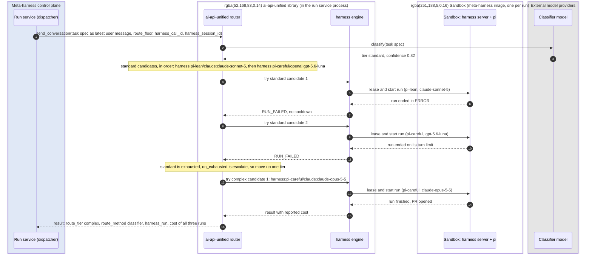

**Level 2: per model call, in the HTTP Gateway.** The run grant pins the
candidate's model. Agent turns stay on that model. The model client's
compaction call sets `route: trivial`, which the HTTP Gateway turns into a
band so the summary runs on a cheap tier.

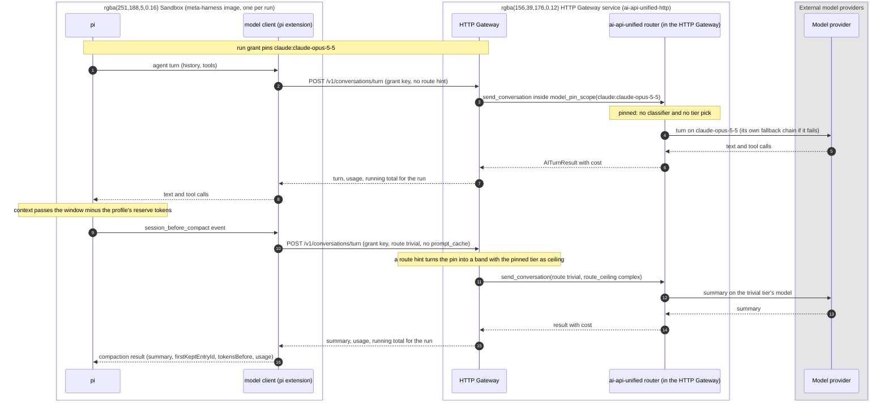

### 6.1 Task routing

The dispatcher renders the task spec (title, description, acceptance checks,
repo, file hints, size signals) into one prompt and sends it through
`AiRouterCompletions`. The router classifies it, picks a tier, and runs it on
the tier's first candidate. Each candidate is a `harness` engine entry: a
harness profile and the model the harness will use.

```json
"completions": {
  "engine": "harness",
  "providers": {"harness": {"pool_url": "https://pool.meta-harness.internal", "gateway_url": "https://gateway.meta-harness.internal"}}
},
"router": {
  "tiers": [
    {"name": "trivial", "description": "Config, copy, dependency bumps, one-file mechanical edits with existing tests.",
     "models": ["harness:pi-lean/openai-compatible:qwen3-coder-next", "harness:pi-lean/google-gemini:gemini-3.5-flash-lite"],
     "thinking": "off"},
    {"name": "standard", "description": "A feature or fix inside one module, with clear acceptance checks.",
     "models": ["harness:pi-lean/claude:claude-sonnet-5", "harness:pi-careful/openai:gpt-5.6-luna"],
     "thinking": "low"},
    {"name": "complex", "description": "Cross-module changes, migrations, concurrency, security-sensitive code, or vague requirements.",
     "models": ["harness:pi-careful/claude:claude-opus-5-5", "harness:pi-careful/openai:gpt-6-sol"],
     "thinking": "high"}
  ],
  "classifier": {"engine": "openai-decisions", "model": "gpt-6-luna", "min_confidence": 0.7},
  "default_tier": "standard",
  "on_exhausted": "escalate",
  "fallback_on": "unavailable,rate_limited,quota_exhausted,timeout,run_failed"
}
```

A candidate name is the harness profile, a slash, and the inner model
reference, written here behind a `harness:` prefix. This example was written
for the withdrawn `harness` engine, which parsed that string and gave the
router a registered engine to validate it against. Without the engine the
router has nothing to validate `harness:` candidates with, so where the
tier-to-candidate map lives is open question 4. The inner reference must
still be a configured `ai-api-unified` model, and startup still checks it.

The classifier reads the latest user message, so the dispatcher sends the
task spec as that message and keeps instructions in the system prompt.

The library loads `models.json` once per process and reads settings only when
it builds a client. So the dispatcher builds one router client per process and
configuration identity, and shares it across tasks. Sharing is safe because
per-call state lives in context variables. The meta-harness's own
configuration (`harness_profiles.json`, `task_policy.json`, `callers.json`)
follows the same pattern: loaded and validated at startup, held in memory,
reloaded on a file change with the new version recorded in `config_version`.

What the router does with a task, all of it existing behavior applied to
harness candidates:

- **Classify** with the configured classifier; below `min_confidence`, use
  `default_tier`.
- **Try candidates in order.** A candidate that fails with a trigger reason
  (sandbox unavailable, rate limited or quota exhausted at the inner model,
  timeout, or the run ending in `run_failed`) moves to the next candidate in
  the tier. Infrastructure reasons start the library's cooldown for the
  failed candidate; `run_failed` starts none, because one hard task says
  nothing about a candidate's health and must not put it in cooldown for every
  concurrent run.
- **Escalate** when the tier is exhausted. A task that the classifier called
  hard fails visibly rather than running on a weaker tier. A failed run is
  real spend; the router's cost report for the request sums every attempt.
- **Pin.** The reserved `model` provider option names one candidate and runs
  the call inside the library's model-pin scope:
  `provider_options: {"model": "harness:pi-careful/claude:claude-opus-5-5", "harness_call_id": ..., "harness_session_id": ...}`.
  The call skips the classifier, ignores `route`, `route_floor` and
  `route_ceiling`, and never escalates. If the pinned run fails with a
  trigger reason, the chain tries its own configured candidates. The pair
  need not appear in a tier; the library builds it on first use. The catalog's allow
  and deny lists still apply, and a denied pair fails before any lease. The
  result includes `route_method: model_pin` and the pair. Three
  callers use it: a follow-up pins the original candidate; exploration pins a
  challenger; and a task submitted with a `pin` field runs on exactly that
  harness and model.
- **Floors per call.** Every router call sets its own `route_floor` and
  `route_ceiling`. The dispatcher leaves the router's client-wide follow-up
  setting unused, because it serves many concurrent tasks.

Caller hints use the router's per-call options:

- `complexity: high` on a task passes `route_floor: "complex"`.
- `max_tier: standard` passes `route_ceiling: "standard"`.
- A retry after a failed attempt passes `route_floor` one tier above the
  failed attempt. Retries never route down.

**What the call returns.** The dispatcher learns routing and cost only from
the router call's return value, never from library events.

| Where | Fields |
|---|---|
| Result | `route_tier`, `route_method`, `route_confidence`, `model_pin`, `provider_engine`, `model_name`, `thinking`, and `harness_run` (`run_id`, `sandbox_id`, `profile`, `end_reason`, `turns`, `pr_url`, `elapsed_ms`, `cache_hit_rate`) |
| `result.usage` | The run's token totals: input, output, `cached_input_tokens`, `cache_write_5m_tokens` and `cache_write_1h_tokens` |
| `result.cost` | `request_id`, `status`, `elapsed_ms`, `tags` (`config_id`, `config_version`, `run_id`), `total_usd`, `classifier_usd`, `wasted_usd`, `failed_calls`, and `calls[]`, one line per try: `call_id`, `outcome`, `fallback_reason`, `served`, `elapsed_ms`, `usd_cost` |
| `exception.cost` | The same cost report, attached to the raised exception when every candidate fails. The dispatcher reads a failed task's attempts and dollars from the exception, not from the shared client |
| `preview_route()` | Before a run: tier, confidence and `usd_max`, used for the run's budget (section 6.2) |

A harness try's `call_id` is its run id, so each cost line joins the pool
manager's lease record for that try. The dispatcher writes the result fields
as `task_routed` and one `attempt_finished` per `calls[]` line (section 13).

### 6.2 Task policy

`config/task_policy.json` holds the rules that are about the task rather than
its difficulty.

```json
{
  "version": "2026-11-03.1",
  "floors_by_task_type": {"security": "complex", "dependency": "trivial"},
  "exploration": {"share": 0.05, "eligible_tiers": ["trivial", "standard"],
                  "challengers": ["harness:pi-careful/openai-compatible:qwen3-coder-next"]},
  "max_run_minutes": 240
}
```

- **Floors by task type** become `route_floor` on the router call.
- **Exploration.** The dispatcher pins a configured share of eligible tasks to a
  challenger candidate with the `model` provider option, so the analyzer keeps
  current data on every profile and model. Complex and security tasks never
  explore.
- **Budget.** A run's spend cap is `preview_route()`'s `usd_max` for the tier
  times the profile's `budget_multiplier`, capped by the task's `max_usd`.

### 6.3 The run loop

**Decision, 2026-11-04: the run loop lives in the workflow, not in an
ai-api-unified engine.** The earlier design made a whole run one blocking
`asend_conversation` call on a `harness` completions engine, inside the
library's fallback chain, so the router could treat a run as a completion.
That was reversed before it was built, for three reasons:

1. Temporal already owns durability, retries, cancel and per-attempt
   visibility. The engine rebuilt each of those inside a library call
   (re-attach by call id, the lease TTL as `request_timeout_seconds`, cancel
   through the run's terminal state). Two owners of one lifecycle is where
   the hard bugs would have lived.
2. The fallback chain was built for calls that cost cents and take seconds.
   Applied to runs, a fallback is a new sandbox and a new multi-dollar
   attempt, decided inside a library that cannot see the task's budget or
   history.
3. It put the pool manager and the Run API client into ai-api-unified, so
   the library would depend on meta-harness infrastructure and every Run API
   change would be a library release.

The `samples/temporal-run-task` worker showed the alternative working: its
`run_harness` activity is the engine's step table, in the workflow's hands.

**What ai-api-unified does for a task.** One short `route` activity sends the
task prompt through `AiRouterCompletions` with a classify-only call and
returns the route: the tier, `route_method`, `route_confidence`, and the
tier's ordered candidate list from `models.json`, each candidate a harness
profile and an inner model. The library still owns principle 1: no
meta-harness code names a model or a profile.

**What the workflow does.** It loops over the candidates. For each one it
runs the steps below as activities, then decides from the terminal state
whether to try the next candidate, escalate a tier under the task policy
(section 6.2), or end. The budget check between candidates is the workflow's:
the task's remaining spend, the attempts so far, and the limits in the task
policy are all in its hands.

| Step | The workflow, through activities |
|---|---|
| Identify | `run_id` is the workflow id, the candidate index and the attempt kind (`run` or `followup-N`), the same on every retry of the activity. The sample uses `<workflow id>:run_harness`. |
| Lease | Asks the pool manager for an existing lease on `run_id` first, so a retried activity re-attaches to a run already in progress; otherwise requests `lease(run_id, image, harness_session_id, resources)` for the profile's image. The response holds the sandbox address, the lease TTL and the `session_state`: `new`, `kept` or `restored`. Until the pool manager exists, the executor starts one sandbox per run (section 8.3). |
| Grant | Asks the HTTP Gateway for a run grant (ai-api-unified-http 1.18.0), which it issues and stores. The grant holds the run id, tags, the candidate's inner model as a pin, the spend limit, and an expiry at `max_minutes` plus grace. Only the grant's key goes to the sandbox. A retried activity asks again with the same terms and gets a new key for the live grant. |
| Start | When `session_state` is `new`, `POST /run` on the sandbox's harness server with the prompt, acceptance checks, profile, limits and grant key. When it is `kept` or `restored`, `POST /followup` with the new input and its own grant key. |
| Wait | Follows the harness server's event stream until `run_finished`, heartbeating the last event id on every event. The activity's heartbeat timeout catches a dead worker, and its start-to-close timeout, the lease TTL, is the hard upper bound. A workflow cancel reaches the activity through its heartbeat, and the activity sends `POST /cancel`. |
| Collect | Reads `/usage`, revokes the run grant, releases the lease, and returns the terminal state: status, end reason, turns, the files changed, the PR URL, elapsed time, token totals, and the dollars the HTTP Gateway counted against the grant. The workflow records one cost line per run from that figure. |
| Decide | In the workflow. A run that ended `FINISHED` ends the loop. A run that ended `ERROR` for an infrastructure reason (no sandbox, a lost harness server, `model_error` from a provider outage) tries the next candidate. A run that ended on a limit (`max_turns`, `max_minutes`, `spend_limit`) is final: trying a dearer candidate after a cheaper one spent its budget doubles the spend, so only the task policy's explicit retry-up rule or a human repeats it. This answers open question 3. |

Each candidate is one run and one sandbox. Every attempt, candidate and
decision is an event in the workflow's history, so the console and the
analyzer read the loop from Temporal, not from a library's logs.

The workflow never calls a model itself. The classifier call happens in the
`route` activity, through the library.

The library's PR A additions (`run_failed`, reported-dollar cost lines,
`exception.cost`, `route_confidence`, the candidate index) are shipped in
ai-api-unified 3.29.0. The run loop uses `route_confidence` and the candidate
list. The rest stay in the library for an engine that may come later, and
cost the meta-harness nothing.

### 6.4 Model calls inside a run

The harness sends every turn to the HTTP Gateway's native conversation endpoint
with the run-scoped token. The HTTP Gateway:

1. Resolves the token to run, profile, model policy and remaining budget.
2. Sets the observability context: `caller_id` is the meta-harness, tags are
   run, task, profile, harness and model.
3. Sends the turn through its router. With a **pinned** policy (the default)
   the HTTP Gateway wraps the call in the library's model-pin scope for the
   candidate's inner model. The turn skips classification and runs on that
   model with the library's fallback chain, cooldowns, guardrails and caching
   intact. With a **banded** policy the turn sets `route_floor` and
   `route_ceiling` instead, and the router may answer easy turns from a
   cheaper tier. Under either policy the token decides the engine and model;
   the HTTP Gateway rejects a request body that names a different one.
4. Adds the turn's cost to the run's counter in Redis, so the total is exact
   across HTTP Gateway replicas. Returns the turn's usage and the running total in
   the response. Rejects the turn with a clear error once the cap is
   spent. The pi extension reports the usage and total, and the harness emits
   them in its `model_call` events. The meta-harness reads no HTTP Gateway event
   output.

A pinned call ignores route hints by design. So the HTTP Gateway handles the
harness's `route: trivial` on compaction and auxiliary calls. When a request body includes `route`, the HTTP Gateway runs that one call
as a band instead of a pin, with no floor and the pinned model's tier as the
ceiling. The call runs on the named tier, an unknown or missing route still
falls back to the pinned model, and agent turns, which have no `route`, stay
pinned. Under a banded policy the router honors the hint as it is, within the band.

### 6.5 Required additions to ai-api-unified

ai-api-unified's `docs/harness_engine_design.md` specified two releases. PR A
shipped in 3.29.0. PR B, the `harness` engine, is withdrawn: the run loop
lives in the workflow (section 6.3).

| Where | Addition |
|---|---|
| Library, PR A: result contract (3.29.0) | A `run_failed` fallback reason with no cooldown. |
| Library, PR A | Reported-dollar cost lines, so an engine can record dollars stated by the HTTP Gateway rather than computed from tokens and the pricing registry. |
| Library, PR A | The request cost report attached to the raised exception as `exception.cost` when every candidate fails. |
| Library, PR A | `route_confidence` on `AITurnResult` and `AIPromptResult`. |
| Library, PR A | The candidate index in the request context, so the harness engine can name each try. |
| Library, PR B (withdrawn 2026-11-04) | The `harness` completions engine, the pool and Run API client, the HTTP Gateway grant client, `providers.harness` in `models.json` and the `harness_run` result summary. Not built: the run loop lives in the workflow (section 6.3), and these clients live in the meta-harness run service. |
| Library | A classify-only entry point on `AiRouterCompletions` that returns the route and the tier's ordered candidates without running a completion. The `route` activity needs it. If the router cannot expose this cheaply, the activity can call the classifier and read the tier map itself, since both are in the library already. |
| HTTP Gateway | Run grants (built in ai-api-unified-http 1.18.0, `POST`, `GET` and `DELETE /v1/run-grants`): the harness engine asks the HTTP Gateway for a run grant, which it issues and stores in Redis; the engine revokes it when the run ends. The grant's key is opaque, and the grant sits on top of the existing per-caller attribution. The engine authenticates to request and revoke with an HTTP Gateway API key from its environment. A grant holds run identity, tags, model pin or band, spend limit and expiry. The grant overrides the request body's engine and model. The pin is built; the band waits for the `route` row below. |
| HTTP Gateway | `route` accepted in the conversation request body. On a pinned token, a body `route` switches that call from pin to band with the pinned model's tier as ceiling; agent turns without `route` stay pinned. |
| HTTP Gateway | A per-run spend counter in Redis, the running total on every conversation response, and a budget rejection error. |
| Library, optional | A streaming form of `send_conversation` that yields typed events (text delta, tool-call start, arguments and end, usage, done). It routes through router and chain and commits to a candidate at its first delta. The console's per-turn view does not need it; it streams model text token by token. PII redaction does not apply to streams. |
| HTTP Gateway, optional | A server-sent-events form of the conversation endpoint, for the streaming form above. |
| Library, optional, not scheduled | A cancel event on completions calls that engines poll. Until it exists, the Run API cancel and `request_timeout_seconds` cover cancellation (section 7). |

Out of scope on the library side, by decision: an event sink, factory
configuration injection, harness profiles in `models.json` (they stay in
`harness_profiles.json`), and a library tool loop.

## 7. Run lifecycle

One task can produce several runs: the first attempt, fallbacks to another
candidate inside the router call, follow-ups from review feedback or CI
failures on its PR, and retries on a higher tier. One run is one sandbox.

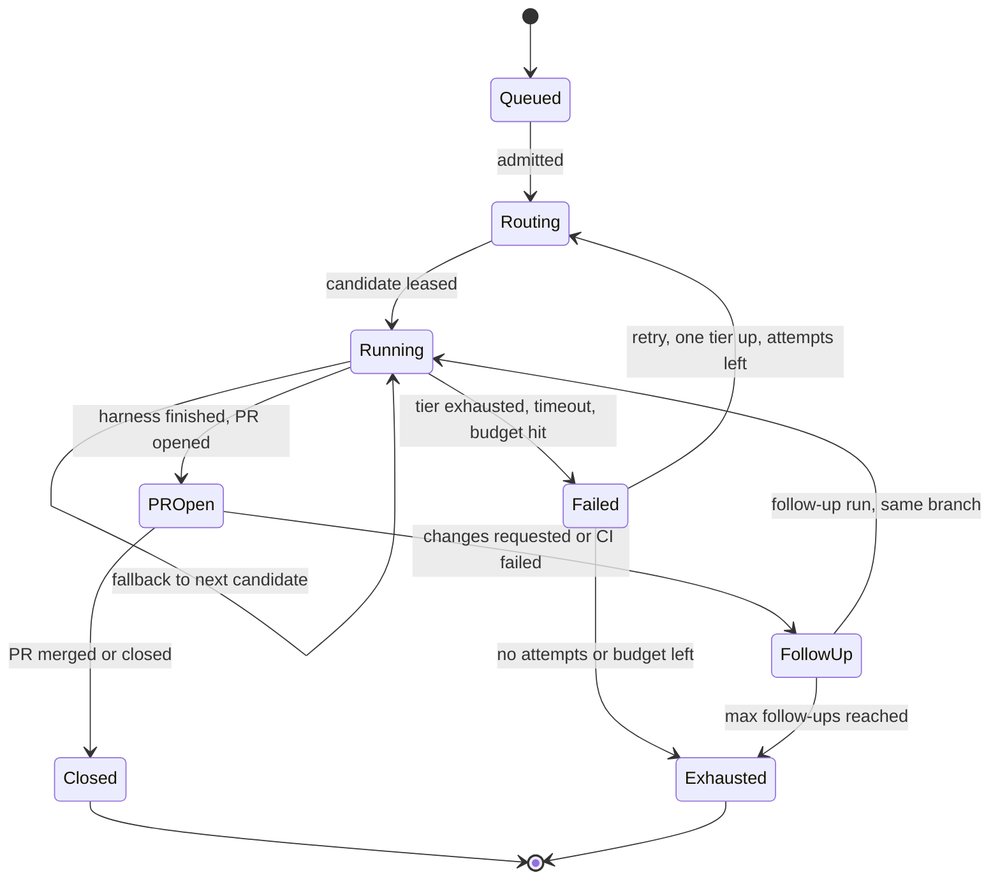

Each task has one Temporal workflow, and its workflow id is the task id.
Every run of the task happens inside that workflow: the first attempt,
fallbacks, follow-ups and retries one tier up. Temporal allows only one open
execution per workflow id. `start` keeps the default conflict policy, Fail,
so a second `start` for a running task fails with `Workflow execution
already started` and never creates a duplicate run. `start` also sets the
reuse policy to Reject Duplicate, so a closed task's id never starts again.
The Temporal web UI and `temporal workflow show --workflow-id <task id>`
find any task's workflow from the id `POST /v1/tasks` returned.

The run workflow lives in the run service, in Temporal terms:

1. **Admit.** The scheduler grants a slot (section 10) and calls the run
   service's `start`.
2. **Prepare.** Guardrails resolve the repo policy and mint a code-host token
   scoped to the target repo. The dispatcher activity builds the prompt from a
   versioned template: task spec, acceptance checks, the repo's `AGENTS.md`,
   and the instruction to open one PR labeled `ai:meta-harness`.
3. **Route and run.** One long-running activity sends the task through the
   router with the task's floors, ceilings, exploration pin, a
   `harness_call_id` for the attempt, the task's `harness_session_id`, and
   `request_timeout_seconds` equal to
   the lease TTL. The router classifies the task, and the harness engine leases a
   sandbox, starts the run and waits for it to end. The call returns when the run ends, with the result and
   the cost report. If every candidate fails, the router raises and the same
   report is on `exception.cost`. The dispatcher activity writes the
   `routing_decision` row, which the run service owns, and appends
   `task_routed` and one `attempt_finished` per `calls[]` line through the
   event service client (sections 6.1 and 13). A retried activity sends the
   same call id, and the engine re-attaches to the run in progress.
4. **Watch.** A second activity asks the pool manager for the leases on the
   call id. Each new lease is one candidate tried: the activity writes a
   `run` row, attaches to that sandbox's event stream through the executor
   as its only consumer, appends the events through the event service client
   in batches, heartbeats the workflow, and marks the run stalled when the
   run misses a heartbeat window. Code-host webhooks for the run's PR (checks
   completed, review submitted, merged, closed) arrive at the task service,
   which signals the workflow.
5. **Follow up.** Review comments or failed CI on the run's PR become a
   follow-up run on the same branch. An activity calls the router again
   inside the model-pin scope for the original candidate. It sends only the
   new input and the task's `harness_session_id`, never the conversation.
   The pool manager hands back the session's kept sandbox or restores the
   session directory into a fresh one, and the harness engine calls
   `POST /followup` to continue the conversation.
6. **Close.** When the PR merges or closes, or when attempts and budget are
   spent, the workflow appends the outcome events and sets the task's
   terminal status through the task service, which reports it.
7. **Cancel.** The console sends cancel or kill switch (per run, per caller,
   global) to the run service, which appends the audit event with the
   operator as actor. The workflow calls `POST /cancel` on the sandbox
   through the executor and releases the lease with the pool manager, which
   destroys the sandbox. The harness engine's blocking call sees the run's `CANCELED`
   state and returns, so the router never forwards a cancel.

Every terminal state releases the lease. The pool manager collects
artifacts into its artifact store and destroys the sandbox.

Timeouts come from each profile (`max_minutes`), and the task policy sets the
hard ceiling.

### Sequences

Six diagrams below each show one end-to-end scenario across the whole
system. They were drawn for the withdrawn `harness` engine, so they show the
router calling into a sandbox. Under section 6.3 the router only returns the
candidates, and the workflow's activities do the lease, grant, run and
collect steps those diagrams give the router. The messages between the
sandbox, the HTTP Gateway and the pool manager are unchanged. Each diagram is
redrawn when the step it shows is built. Sections 8.3 and 8.4 also say
"harness engine" in the same sense: read it as the run service's activities.

**1. Happy path**

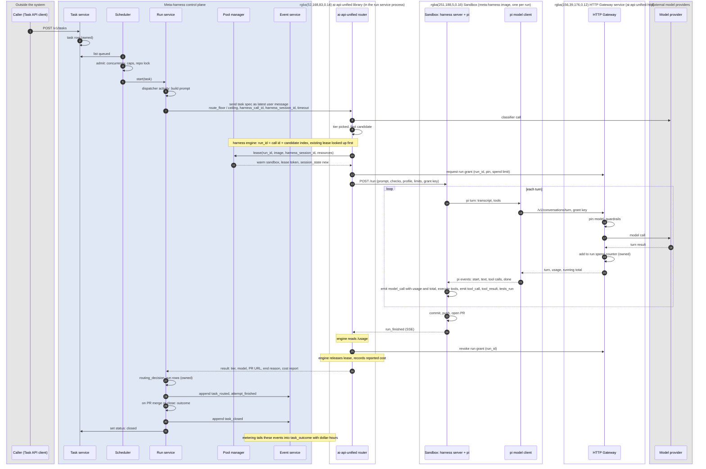

**2. Console attaches to a run in progress**

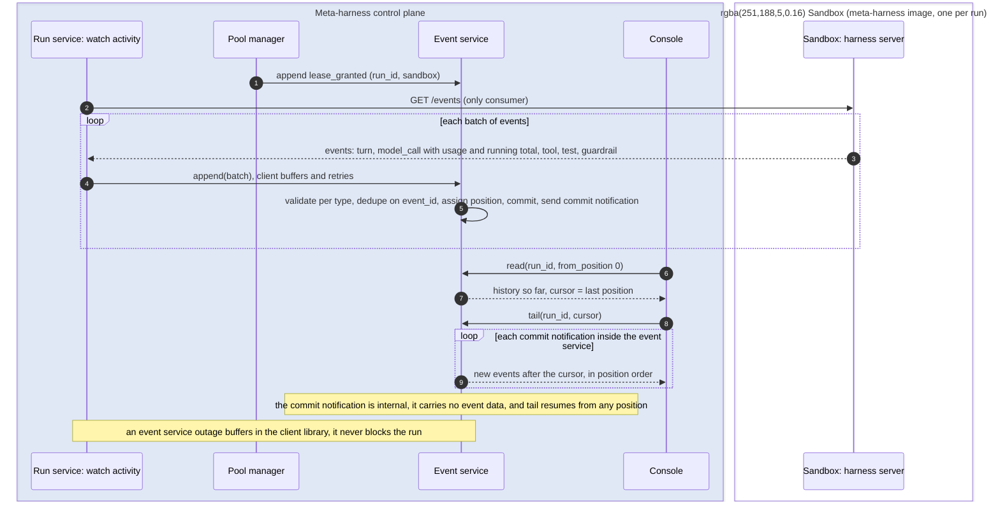

**3. Compaction or auxiliary call inside a run**

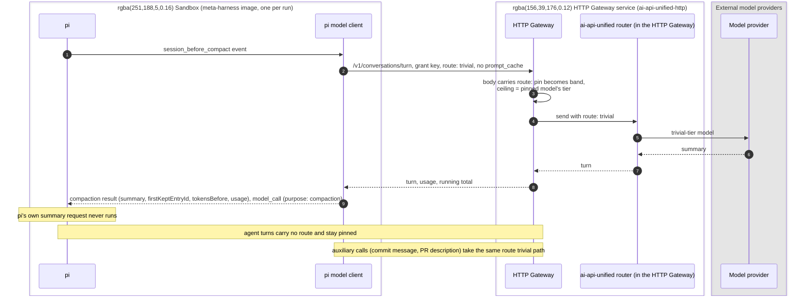

**4. Spend cap hit**

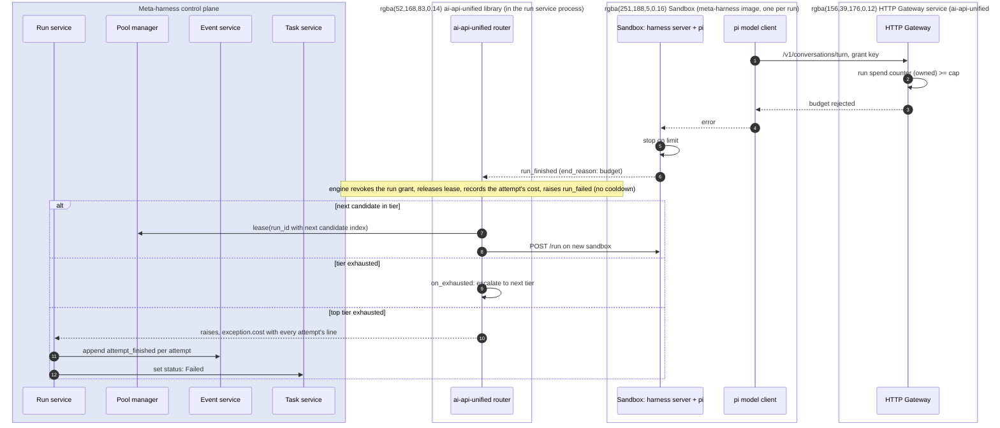

**5. Follow-up on an existing PR**

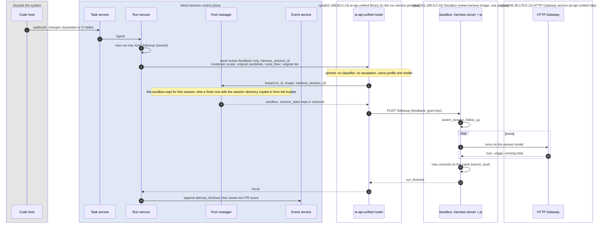

**6. Operator cancel or kill switch**

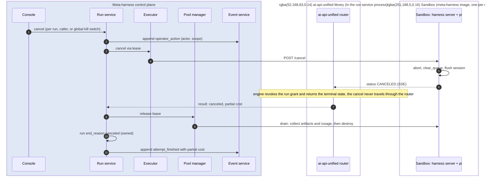

## 8. Harness execution

### 8.1 Sandbox

One sandbox per run, as a pod with the gVisor runtime class in the `sandbox`
namespace (section 15).

- **One image**, built from a common base: git, language toolchains, Node,
  pi, the model client extension and the **harness server** (section
  8.2). Profiles select prompts, tools and limits on that image; a profile
  may name a different image when a toolchain or a different agent needs
  it.
- **Repo** cloned with the run's code-host token at `/workspace`, the same
  path in every sandbox, on a fresh branch. Branch
  protection blocks pushes to default branches.
- **Model endpoint**: the HTTP Gateway URL, set in the image, and the
  run-scoped token, which arrives in the `POST /run` or `POST /followup` body.
  No provider key exists in the sandbox.
- **Egress** limited to the code host, package registries and the HTTP Gateway.
- **Resources** from the profile; 2 vCPU and 4 GB by default.
- **Lifecycle**: owned by the pool manager (section 8.4). A sandbox serves
  exactly one run; the pool manager destroys it when the run ends.

### 8.2 Harness server and the Run API

The harness server is a small TypeScript service inside every sandbox. It
exposes one authenticated HTTP API to the harness engine and runs pi
in-process through pi's SDK (`@earendil-works/pi-coding-agent`). It creates
the session with `createAgentSession()` and the setup in section 4, and uses
`AgentSessionRuntime` for `newSession()`, `switchSession()` and `fork()`. pi
reports every state change as a typed event through `session.subscribe()`,
so the server parses nothing from terminal output.

| Endpoint | Purpose | pi SDK calls |
|---|---|---|
| `GET /health` | Readiness: session created, model client registered, repo cloned at `/workspace`, HTTP Gateway reachable | session state |
| `POST /run` | Start a new session for the task; the body holds the prompt, acceptance checks, profile, limits and the run-scoped token | `newSession()`, `prompt()` |
| `POST /followup` | Continue the session the sandbox already holds, kept or restored by the pool manager before the lease returned. The body holds the new input and the run-scoped token, and no session reference. | `switchSession()` for a restored session, then `prompt()` |
| `GET /events` | Server-sent events, resumable with `Last-Event-ID` | `session.subscribe()`: `message_update`, `tool_execution_*`, compaction events, `agent_end`, `agent_settled` |
| `GET /status` | `CREATING`, `RUNNING`, `FINISHED`, `ERROR`, `CANCELED`, `EXPIRED`, plus the last heartbeat | session state |
| `POST /cancel` | Stop pi. The session file already holds every entry. | `abort()`, which waits until the session is idle |
| `GET /usage` | Token totals (input, output, `cached_input_tokens`, `cache_write_5m_tokens`, `cache_write_1h_tokens`), call counts, and the HTTP Gateway's running total, as the model client recorded them, for reconciliation against the run's `model_call` events | model client counters |
| `GET /metrics` | OpenTelemetry metrics: turns, tool calls, files changed, test runs, elapsed time | server-side counters |

The server waits with `waitForIdle()` and sends `steer()` or `followUp()` when
input arrives while pi is still working. It never calls `setModel`: the model
comes from the run's token and the thinking level from the `POST /run` body.
The agent gets shell access only through its `bash` tool, under the profile's
limits.

### 8.3 Executor interface in the control plane

The executor is the interface to wherever sandboxes run. Every executor
backend provides these operations:

| Operation | Called by | Purpose |
|---|---|---|
| validate | Startup | Fail if any profile names an image this executor cannot run |
| provision | Pool manager | Create a sandbox from an image; return when `/health` is green |
| destroy | Pool manager | Delete the sandbox and release its resources |
| inventory | Pool manager | List the sandboxes that exist, for reconciliation |
| run, follow up, cancel | harness engine, through the lease | The Run API calls, proxied with the lease token |
| events | harness engine | The sandbox's event stream |
| status, usage | harness engine and pool manager | The sandbox's status and usage endpoints |
| save session | Pool manager, when a run ends | Copy the session directory to the pool manager's Cloud Storage bucket under `harness_session_id` |
| restore session | Pool manager, before a `restored` lease returns | Copy a session directory from the bucket into a fresh sandbox, which has the repo cloned at `/workspace` |
| artifacts | Pool manager, on drain | Logs and the final session directory, copied to the pool manager's bucket |

Implementations: Kubernetes pods on GKE, Docker (development), managed sandbox
services, and a fake that replays recorded event streams for tests.

### 8.4 Pool manager

The pool manager is the only component that creates and destroys sandboxes.
It is a single leader-elected service that owns the
`sandbox` and `lease` tables and the artifact store, with a reconciliation
loop against the executor's actual inventory. Other components reach leases
only through its interface.

**Sandbox states**

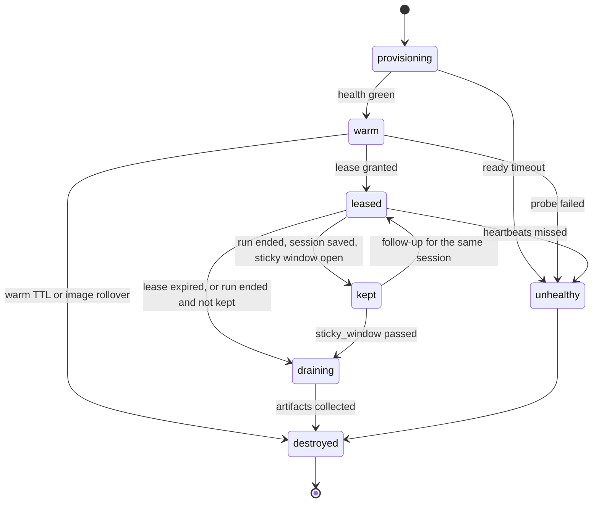

- `provisioning`: pod created, image pulling, harness server starting.
- `warm`: `/health` green, no repo, no credentials, no run. Idle, ready to
  lease.
- `leased`: bound to one run. The pool manager injects the run's code-host
  token at lease time, and the sandbox clones the repo then, always at
  `/workspace`. The grant key
  arrives later, in the `POST /run` or `POST /followup` body.
- `kept`: the run has ended and the sandbox waits for the same session's
  next follow-up, for up to `sticky_window`. The manager has saved the
  session directory, and the harness engine revoked the run grant when the
  run ended. The repo and session directory stay in place.
- `draining`: the run has ended; the manager is collecting artifacts (session
  directory, logs, `/usage`).
- `destroyed`: pod deleted, record kept for audit.

**Leases**

- The harness engine requests `lease(run_id, image, harness_session_id,
  resources)`. The request is idempotent on `run_id`. The response holds the
  sandbox address, the lease TTL and a `session_state`:
  - `kept`: the sandbox kept for that session is still inside its sticky
    window, so the manager hands it back.
  - `restored`: the bucket holds a session directory for that id, so the
    manager takes a warm sandbox of that image (or provisions one) and
    copies the directory in before returning. The repo is cloned at
    `/workspace`, the working directory the pi session recorded, because pi
    exits with an error when that directory is missing.
  - `new`: neither exists, so the manager hands out a warm sandbox of that
    image, or provisions one.
- A lease has a TTL of the profile's `max_minutes` plus a grace period.
  When the TTL expires the manager destroys the sandbox whether or not the
  lease was released, so a caller that crashes cannot leak a sandbox.
- The lease is the only path to a sandbox's address and credentials. The Run
  API accepts a per-lease bearer token, so a sandbox cannot be addressed
  outside its lease.
- **Saving sessions.** When a run ends, the manager copies its session
  directory to its Cloud Storage bucket under `harness_session_id` before it
  keeps or drains the sandbox. A kept sandbox that fails loses nothing.
- **Warm sticky.** When a run finishes, the manager may keep its sandbox
  alive for a short window (`sticky_window`, default 10 minutes) keyed by
  `harness_session_id`, with the repo and session directory intact. The
  harness engine has already revoked the run grant. A
  follow-up for the same session inside the window gets that sandbox back and
  skips the restore; otherwise the manager drains the sandbox and the follow-up
  restores from the session directory in a fresh one. The window never
  extends a lease TTL, and a sticky sandbox is still single-session: it is
  never leased to another run.

**Warm pool**

- A target count of warm sandboxes per image, set in the pool configuration
  (`warm: 4`) and adjusted by the manager from queue depth: the number of
  admitted tasks waiting per image over the last few minutes.
- Warm sandboxes hold no repo and no secrets, so they are safe to keep idle.
- The manager destroys and replaces a warm sandbox older than `warm_ttl`
  (default 2 hours), so no sandbox outlives a routine image or node change.
- Per-image and global maximums cap total sandboxes; the node autoscaler
  follows the manager's demand.

**Health**

- Before a lease: `/health` must be green within `ready_timeout`, else the
  manager marks the sandbox `unhealthy` and replaces it; the lease request moves to the next
  warm sandbox.
- During a run: the harness engine forwards missed heartbeats to the manager.
  Two missed windows mark the sandbox `unhealthy`; the manager destroys it
  and the router's fallback decides whether another candidate runs. The manager
  never repairs a sandbox in place.
- The manager probes idle warm sandboxes on an interval and destroys any that
  fail.
- The reconciliation loop runs every 30 seconds: it lists the executor's
  actual sandboxes, destroys any with no record or whose lease has expired,
  marks records whose pod has vanished, and provisions sandboxes until each
  image is back at its warm target.

**Recycling**

- A sandbox serves exactly one session: one run, or that run and the
  follow-ups a warm-sticky window hands back to it. It is never reused across
  sessions. The repo, tokens, session and any files the agent created are
  specific to that session, and a fresh sandbox per session is the security
  boundary between sessions.
- Recycling therefore means: drain (collect artifacts to the artifact store,
  read `/usage` for reconciliation), destroy the pod, and provision a fresh
  replacement to meet the warm-pool target.
- **Image rollover.** When a profile changes its image version, the manager
  stops leasing the old image, destroys its warm sandboxes, provisions the
  new image to the warm target, and lets leased sandboxes on the old image
  finish their runs.
- **Node rollover.** The manager honors the orchestrator's drain signals:
  it destroys warm sandboxes on a draining node at once; leased sandboxes
  get until their lease TTL, after which the autoscaler releases the node.

**Metrics** (OpenTelemetry, alertable): sandboxes by state and image,
provisioning time, time-to-lease, warm hit rate, health failures by cause,
lease TTL expiries, orphans destroyed by reconciliation, and artifact
collection failures.

## 9. Metering

```
dollar-hours per successfully completed task = Σi (Di × Hi) / Σi Ci
```

| Term | Source |
|---|---|
| Di, dollars for attempt i | The harness's `model_call` events, tailed from the event service. They hold the HTTP Gateway's per-turn usage and cost (cached tokens included) and the run's running total. Add `classifier_usd` from the router call's cost report (or `exception.cost` when every candidate failed) and the control plane's own calls for the run |
| Hi, hours for attempt i | Active execution time from `RUNNING` to a terminal state, from the harness server's status |
| Ci, success for the task | Unweighted share of the task's checks that passed: CI checks on the PR, acceptance checks named in the task, and merge. Read from the run service's `check_completed` and `task_closed` events |

The HTTP Gateway returns the turn's usage and the run's running total on every
response. The pi extension reports them and the harness emits them in each
`model_call` event, so attribution needs no log parsing and no HTTP Gateway event
output. The meta-harness reads nothing from ai-api-unified's event or cost
streams.

The harness's `model_call` events are the source for Di. The router call's
cost report and the harness server's `/usage` are cross-checks. Each
`calls[]` line has `call_id` equal to the run id, so metering joins it to its
run's events and lease record, counts nothing twice, and flags any gap over
5%. Metering still records the cost of a task whose every candidate failed:
the dispatcher reads it from `exception.cost`. Metering keeps the report's
`wasted_usd` per task as the spend on failed tries.

Metering tails the event service and owns its projection tables: one
`model_call` row per `model_call` event, one `attempt_usage` row per run, a
`check_result` row per check, a `task_outcome` row when the task closes, and
`spend` per caller and period. Other components query these through
metering's interface, never the tables.

**Cache hit rate.** Metering reports the cache hit rate, cached input tokens
divided by input tokens, per run, harness profile and model, from each
`model_call` event's `cached_input_tokens` and `input_tokens`. The engine's
`harness_run.cache_hit_rate` and `result.usage` totals are the cross-check.
Metering keeps `cache_write_5m_tokens` and `cache_write_1h_tokens` separate,
because the two bill at different rates, so it can price cache writes and
check them against each turn's cost. A
low rate means something in the prompt prefix changes between turns, which
multiplies the cost of every turn after it, so it raises an alert (section
13).

### Spend controls

- **Per turn:** the HTTP Gateway rejects a turn once the run's cap is spent.
- **Per run:** the harness stops at its cap or `max_minutes`; the lease TTL
  destroys the sandbox if it does not.
- **Per caller:** a configurable daily cap; the scheduler reads the caller's
  spend from metering, stops admitting that caller's new tasks at the cap and
  warns at 80%.
- **Global:** a hard daily ceiling and a kill switch.

## 10. Scheduling and scale

### Admission

The scheduler runs every few seconds and on every task event:

1. Order tasks by priority, then age.
2. Admit a task only if all hold: global concurrency below the limit, the
   caller below its concurrency quota and daily cap, sandbox capacity
   available, and the target repo area not locked by another run.
3. **Repo-area locks.** The lock key is the repo plus the top-level directories
   the task names. Unscoped tasks lock the whole repo.

### Throughput

Each of these scales independently:

| Resource | Unit of scale | Limit |
|---|---|---|
| Sandboxes | Warm-pool targets and maximums per image, set by the pool manager | Node autoscaler follows the manager's demand; a second pool on a managed sandbox service |
| HTTP Gateway | Replicas | Stateless and autoscaling; the single path for all agent tokens, so it has its own SLO and canary deploy |
| Model providers | ai-api-unified fallback chains per candidate | Fallback and cooldowns across providers |
| Control plane | Stateless service replicas and Temporal workers | Each service holds its own state behind its interface (section 3); one activity per active run |
| Code host API | App installation with webhooks | No polling; conditional requests |

Per run, the control plane's own load is one classification, about two short
completions, and the event stream. The harness's turns go directly from the
sandbox to the HTTP Gateway.

## 11. Task API

| Method | Path | Purpose |
|---|---|---|
| POST | `/v1/tasks` | Submit a task. Returns the task id. Idempotent on `external_ref`. |
| GET | `/v1/tasks?external_ref={ref}` | The caller's task with that `external_ref`, so a caller can find a task by its own id |
| GET | `/v1/tasks/{id}` | Task state, current run, routing decision, PR URL, outcome |
| GET | `/v1/tasks/{id}/events` | Server-sent events for the task's runs |
| POST | `/v1/tasks/{id}/cancel` | Cancel the active run and close the task |
| GET | `/v1/runs/{id}` | Run state, candidate, usage, cost so far |
| POST | `/v1/webhooks/code-host` | PR, check and review events for PRs the meta-harness opened |
| GET | `/v1/profiles` | The active harness profiles, tier candidates and task policy with their versions |
| GET | `/health` | Liveness and configuration identity |

Task fields:

| Field | Required | Meaning |
|---|---|---|
| `external_ref` | yes | The caller's own id; the deduplication key |
| `repo` | yes | Code host URL |
| `task_type` | yes | `bug`, `feature`, `refactor`, `dependency`, `test`, `security`, `docs` |
| `priority` | yes | Integer; higher runs first |
| `title`, `description` | yes | The task text; treated as untrusted |
| `acceptance_checks` | yes | Commands or check names that define success |
| `paths` | no | Repository paths the task touches; scopes the repo-area lock |
| `complexity` | no | `low`, `medium`, `high`; becomes a `route_floor` hint |
| `max_tier` | no | A tier name; becomes `route_ceiling` |
| `max_usd` | no | A cap tighter than the profile's |
| `pin` | no | A candidate such as `harness:pi-careful/claude:claude-opus-5-5`; the task runs on exactly that harness and model with no classification or escalation |

Callers authenticate with a per-caller key. The key sets the caller's
concurrency quota and daily cap.

`external_ref` is unique per caller. The task table has a unique index on
`(caller, external_ref)`, and both the deduplication and the lookup use it.
One task per request: to fix three bugs, a caller submits three tasks and
gets three task ids.

The task service exposes the Task API over HTTP. It serves task routes from its
own table and answers run, profile and event routes by calling the run
service and the event service.

## 12. Data model

Each table belongs to one owner (principle 8). The owner keeps it in its own
Postgres schema under its own role. No other role has a grant on it.

| Owner | Entity | Fields |
|---|---|---|
| Task service | task | id, caller, external_ref, repo, task_type, priority, spec, acceptance_checks, created_at, status |
| Run service | run | id, task_id, attempt_no, kind (initial, fallback, followup, retry), candidate, harness_profile, profile_version, model, model_policy, image, sandbox_id, state, started_at, running_at, ended_at, end_reason, fallback_reason |
| Run service | routing_decision | id, task_id, attempt_no, request_id, route_tier, route_method, route_confidence, model_pin, provider_engine, model_name, thinking, config_id, config_version, classifier_usd, total_usd, wasted_usd, failed_calls, route_floor, route_ceiling, explored, est_usd_max (from `preview_route()`'s `usd_max`), created_at |
| Run service | config_version | kind (tiers, profiles, task_policy), version, document, effective_at |
| Pool manager | sandbox | id, image, executor, executor_ref, state (provisioning, warm, leased, kept, draining, unhealthy, destroyed), created_at, destroyed_at, destroy_reason |
| Pool manager | lease | run_id, call_id, sandbox_id, harness_session_id, session_state (new, kept, restored), granted_at, expires_at, released_at, release_reason |
| Event service | event | event_id (UUID, unique), position (assigned on insert, monotonic), event_type, schema_version, time_utc, source (task, scheduler, dispatcher, watch, workflow, pool, analyzer), actor, run_id, task_id, session_id, request_id, seq, trace_id, config_id, config_version, tags (jsonb), payload (jsonb) |
| Event service | event_type | name, schema_version, json_schema, retention_class |
| Metering | model_call | run_id, seq, turn, purpose (turn, compaction, auxiliary), tier, method, engine, model, thinking, input_tokens, cached_input_tokens, cache_write_5m_tokens, cache_write_1h_tokens, output_tokens, usd, latency_ms |
| Metering | attempt_usage | run_id, usd_total, calls, input_tokens, cached_input_tokens, cache_write_5m_tokens, cache_write_1h_tokens, output_tokens, cache_hit_rate, active_hours |
| Metering | check_result | task_id, check_name, kind (ci, acceptance, merge), passed, observed_at |
| Metering | task_outcome | task_id, ci_share, merged, total_usd, wasted_usd, active_hours, dollar_hours, closed_at |
| Metering | spend | caller, period, cap_usd, spent_usd |
| Harness analyzer | proposal | id, kind (tier, profile, task_policy), evidence, proposed_change, status (open, approved, rejected), decided_by, decided_at, config_pr_url |

`model_call` holds one row per model call inside a run, so the analyzer can see
which model answered each turn; the run row records only the candidate the run
started on.

`event` is indexed on `(run_id, position)`, `(run_id, time_utc)` and
`(event_type, time_utc)`, and partitioned by time and retention class. The
metering tables are projections of it, built from a cursor, and can be
rebuilt by replaying it.

Stores outside Postgres follow the same rule: the scheduler owns its
repo-area locks, the run service owns its Temporal namespace and code-host
rate-limit buckets, the pool manager owns the artifact store, and the HTTP Gateway
owns the run grants and per-run spend counters. Each Redis keyspace
has one owner.

## 13. Observability

Domain events go to one event service. Every producer appends to it and every
consumer reads from it. The console is one of those readers. Operational logs, traces and metrics go to OpenTelemetry. Every
event includes the trace id, so events and traces join on it. No one has to log
into a machine to observe the system.

### Event service

The event service is the system of record for what happened in every task
and run. It owns the `event` table, the per-type schema registry, position
assignment, partitions, retention and the commit notification (section 12).
It calls no other component. It holds the meta-harness's own events only. ai-api-unified keeps its own events, cost ledger and logs. The meta-harness learns routing and cost facts from the router
call's return value and from the harness's run events.

| Operation | Contract |
|---|---|
| `append(events)` | Idempotent on `event_id`. The service validates each event against its type's registered schema. It rejects an unknown type or invalid payload back to the producer as a bug, and the client never retries it. |
| `read(run_id, from_position)` | A run's events in `position` order, paged |
| `tail(filter, from_position)` | A live stream of events matching a filter (run, task, type, source), in `position` order, resumable from any position |

**Producers.** Only meta-harness components append, through the event
service's client library.

| Producer | Events |
|---|---|
| Task service | `task_created`, status changes, received PR webhooks |
| Scheduler | Admission decisions, with the reason a task is held |
| Run service: dispatcher activity | What it learns from the router call's return value or `exception.cost` (section 6.1): `task_routed` from the result fields and one `attempt_finished` per `calls[]` line, joined to its lease by `call_id` |
| Run service: watch activity | The sandbox's Run API stream: `turn_started`, `model_call` (with the HTTP Gateway's usage and running total), `tool_call`, `tool_result`, `file_changed`, `tests_run`, `guardrail_blocked`, `compacted`, `turn_finished`, `run_finished`. It stays the only consumer of each sandbox stream. Heartbeats are not stored. |
| Run service: workflow | Run state transitions, `check_completed` from PR signals, `task_closed`, and operator actions it receives (cancel, kill switch) as audit events with the actor |
| Pool manager | `lease_granted` (with `session_state`), `lease_released`, `session_saved`, `session_restored`, `sticky_handoff`, `sandbox_recycled`. The lease record, not any library event, names the sandbox for each try. |
| Harness analyzer | `proposal_opened`, and approvals and rejections as audit events with the actor |

The console produces no events. Its operator actions are commands to the run
service and the analyzer, which record them.

**Write path.** The client library buffers locally and retries. The outbox
lives in the client, not in each producer's tables. Retries are safe because
`append` is idempotent on `event_id`. An event service outage never blocks a
run.

**Live delivery.** After an append commits, the event service sends a
commit notification, Postgres `NOTIFY`, with the run id and the new highest
`position`. The notification contains no event data and is internal: its listeners are the
event service's own `tail` handlers, which fetch the new rows and stream them
to their callers. A missed notification costs latency, not data, because
the next fetch catches up. The design uses `NOTIFY` because it fires only on commit. If notification volume exceeds what Postgres can handle, Redis can send the commit notification instead.

**Ordering.** Each producer sets `seq` within its own stream. The event
service assigns `position` on insert. Concurrent transactions can commit out
of `position` order, so `tail` re-reads a short window behind each caller's
cursor and suppresses events it has already sent. Delivery is at least once,
and a consumer can drop a repeat by `event_id`.

**Consumers.**

| Consumer | Calls |
|---|---|
| Console | `read` for a run's history, then `tail` from the last position (section 7, sequence 2) |
| Metering | `tail` with one cursor per projection, into `model_call`, `attempt_usage`, `check_result`, `task_outcome` and `spend` |
| Harness analyzer | `read` for routing, attempt and run events over time |
| Alerts | `tail` for stalls, failed tasks with every tier exhausted, budget stops and reconciliation gaps |
| Audit and export | `read` for operator and configuration events, and bulk export by time range |

**Retention.** The table is partitioned by time and by each type's retention
class from the schema registry. Short-lived types (per-turn text, tool
output) expire by dropping whole partitions rather than deleting rows. The
event service keeps run, routing, attempt and audit events long.

### Signals

| Signal | Source | Carried by |
|---|---|---|
| Domain events | The producers above | Event service |
| Traces | One trace per task, spanning routing, scheduling, each run, each Run API call and each HTTP Gateway call | OpenTelemetry; `task_id` and `run_id` on every span, and the trace id on every event |
| Metrics | Queue depth, admission decisions, sandboxes by state, lease latency, run durations, turns per run, model calls by tier, spend by caller, HTTP Gateway latency and error rate | OpenTelemetry metrics |
| Logs | Operational text, structured, with `task_id`, `run_id` and trace id on every line; prompt and response content only when configured | Existing log pipeline |

### Console

A read-only web console served by the control plane. It owns no store and
holds no database connection. Every view drills down to the next; every list
filters by time, caller, harness profile, model, tier, task type and state.
The Tasks view also finds a task by its `external_ref`.

**Telling runs apart.** Tasks running at the same time differ by task id.
A task's own runs never overlap: fallbacks, retries and follow-ups run one
after another. The Tasks view lists them by run id in order, and the Run view
opens one.

**Where each view reads.** Event timelines come from the event service's
`read` and `tail`. Task and queue state come from the task service, run state
and configuration from the run service, cost and outcomes from metering,
sandboxes from the pool manager, proposals from the analyzer, and traces and
metrics from the OpenTelemetry backends.

**Reading events.** The console never connects to a sandbox or to a producer.
To open a run it calls `read` for the run's history and then `tail` from the
last position. A run in progress opens at any point with no gap, and a slow
console falls behind without slowing any producer.

**Granularity.** Tool calls, tool results, file changes, test runs, guardrail
blocks, compactions, tokens and spend are live as they happen, the last two
from the harness's `model_call` events. Model text arrives once per turn, and
token by token once the streaming additions in section 6.5 exist.

**Sensitive output.** Event payloads contain repository content. The console scrubs secrets
from the events it reads. The HTTP Gateway's per-turn redaction applies to what the model receives.

| View | Shows |
|---|---|
| Overview | Tasks in each state, runs active, sandboxes by state, spend today against caps, HTTP Gateway health, kill-switch state |
| Queue | Admitted and waiting tasks with the reason each waiting task is held: concurrency, caller cap, repo lock, no sandbox |
| Tasks | One task: spec, every routing decision, every run including fallbacks, every check result, outcome, PR link |
| Run | Live timeline of the run's events; each turn with its model call (model, thinking, input, cached input, cache-write and output tokens, cost, latency), tool calls, file changes, test runs, compactions and guardrail blocks; the trace; the sandbox it ran in |
| Routing | Tier picked versus candidate that served; classifier confidence; floors, ceilings, fallbacks between candidates and escalations between tiers |
| Pool | Sandboxes by image and state; warm targets versus actual; provisioning and lease latency; health failures and orphans destroyed; image rollover progress |
| HTTP Gateway | Turns per second, latency, error rate, fallbacks and cooldowns per provider, budget rejections |
| Spend | Cost by caller, harness profile, model, tier and task type; dollar-hours per successfully completed task over time; cache hit rate by harness profile and model |
| Configuration | The active tier candidates, harness profiles and task policy, their version history, and the analyzer's pending proposals with their evidence |
| Audit | Every operator action and configuration change |

The console limits operator actions to cancel and kill switch, which it sends
to the run service as commands, and approving or rejecting a proposal, which it
sends to the analyzer. The receiving service records each as an audit event
with the operator as actor. The console never writes a table.

### Alerts

Alerts tail the event service and read OpenTelemetry metrics. They fire on: a run
stalled past its heartbeat window, lease TTL expiries, warm pool below target
for longer than the provisioning time, HTTP Gateway error rate or latency past its
SLO, a task failing with every tier exhausted, spend past 80% of any cap,
usage reconciliation gaps over 5%, and a harness profile and model whose
cache hit rate falls below its configured floor.

## 14. Security

- **Identity.** A code-host app installed per repo, with repo-scoped tokens
  minted per run and expiring within an hour.
- **Secrets.** Secret Manager mounts each secret only into its owner's pods.
  The HTTP Gateway holds the provider keys for every model call a run makes.
  The run service holds one more: a key for the classifier model only, issued
  from a provider project limited to that model and given its own spend limit,
  so a leaked key exposes classification and nothing else. Sandboxes hold a
  run-scoped HTTP Gateway token and a code-host token, both short-lived. No secret appears in
  prompts, task specs or logs.
- **Untrusted text.** Task descriptions, review comments, CI logs and every
  tool result pass ai-api-unified's prompt-injection and tool-result checks at
  the HTTP Gateway, and the prompt template places them in a delimited data
  section.
- **Sandboxing.** gVisor, a default-deny NetworkPolicy, the Secure Web Proxy
  allowlist, no provider keys, no cluster credentials and no Google Cloud
  permissions. The harness server is the only process that talks to the
  control plane, over mutual TLS.
- **Audit.** Every launch, follow-up, cancel and configuration change is an
  event in the event service, recorded by the service that received it, with
  its actor.

## 15. Deployment

The meta-harness runs on Google Cloud, one project per environment. Every
managed service has one owning component (principle 8), and Workload
Identity enforces the same rule at the infrastructure layer. ai-api-unified is
unchanged: it runs in-process in the run service and HTTP Gateway pods.

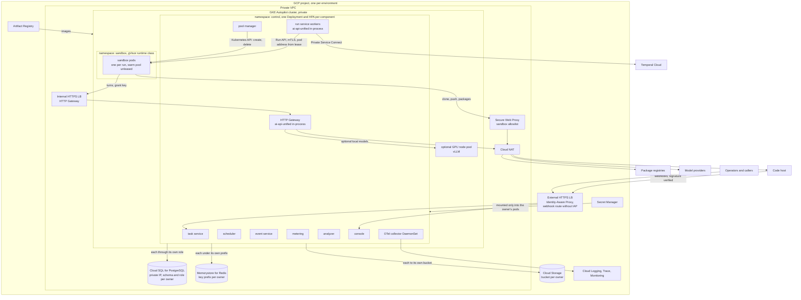

### Compute

- **One GKE Autopilot cluster**, private and regional.
- **`control` namespace.** One Deployment per component: task service,
  scheduler, run service workers, pool manager, event service, metering,
  analyzer, console and HTTP Gateway, each with a horizontal pod
  autoscaler. The scheduler and pool manager run two replicas with leader
  election.
- **`sandbox` namespace.** One pod per run with the gVisor runtime class
  (GKE Sandbox). The pool manager creates and deletes these pods through the
  Kubernetes API, and the warm pool is pre-created, unleased pods. A
  default-deny NetworkPolicy allows ingress only from the run service and
  pool manager on the Run API port, and egress only to the HTTP Gateway's internal
  load balancer and the Secure Web Proxy.
- **Run API addressing.** The run service and pool manager reach a sandbox at
  the pod address in its lease record, over mutual TLS. No load balancer sits
  in front of the sandboxes, because each run talks to exactly one pod.
- **No Cloud Run.** Sandboxes need GKE, and one platform is simpler. Cloud
  Run stays a later option for the HTTP Gateway only.
- **Optional local models.** A GPU node pool runs vLLM behind the HTTP Gateway, as
  an `openai-compatible` engine in `models.json`. Nothing else changes.

### Managed services

| Service | Owner and use | Fails how |
|---|---|---|
| Cloud SQL for PostgreSQL | One regional high-availability instance on a private IP. One schema and database role per owning component (section 12), with IAM database authentication per component. The `event` table is partitioned by time and retention class, and the instance is sized for the event service, the heaviest writer. | Failover to the standby takes about a minute. Services retry, and event clients buffer. Sandboxes never touch it, so runs in progress keep working. New admissions and leases wait. |
| Temporal Cloud | The run service, reached over Private Service Connect. Workflow history, timers and signals. | Workflows stop advancing, but sandboxes keep running and finish their work. When Temporal returns, activities retry and re-attach by call id and `Last-Event-ID`. A run whose lease TTL expires during the outage is lost and retried as a new attempt. |
| Memorystore for Redis | Standard tier with a replica. One key prefix per owner: HTTP Gateway (run grants, spend counters), scheduler (repo-area locks), run service (code-host token buckets), event service (commit notification fallback, unused while `NOTIFY` suffices). | Failover keeps the data. If spend counters or run grants are lost, the HTTP Gateway fails closed and rejects turns for any run it cannot verify or meter. Those runs end, and the run service retries them as new attempts. If locks are lost, the scheduler stops admitting until it rebuilds them from the run service's active runs. |
| Cloud Storage | One bucket per owner: pool manager (session directories under `harness_session_id`, sandbox logs), run service (run artifacts), event service (exports). | Drain retries collection, and a sandbox stays in `draining` until its artifacts are saved or a limit passes. Follow-ups that need a saved session wait. |
| Artifact Registry | Every image: the harness image and one per control-plane component. | Pods cannot pull uncached images. Running services and warm sandboxes are unaffected, and image rollover pauses. |
| Secret Manager | Each secret is mounted only into its owner's pods. Provider API keys go to the HTTP Gateway, except the classifier-only key, which goes to the run service with the HTTP Gateway API key the harness engine uses to request and revoke run grants. | Secrets are read at pod start, so an outage blocks new pods only. |
| Cloud NAT and Secure Web Proxy | All egress. The proxy enforces the sandbox allowlist. | Fails closed: sandbox egress stops, runs fail on clone or push, and the run service retries them. No bypass route exists. |

### Network and identity

- **VPC.** The cluster is private in its own VPC, with Cloud NAT for egress.
- **Sandbox egress.** The Secure Web Proxy allows the HTTP Gateway's internal
  address, the code host and package registries, and nothing else. A sandbox
  never reaches a model provider. The default-deny NetworkPolicy enforces
  the same limit inside the cluster.
- **HTTP Gateway.** An internal HTTPS load balancer fronts the HTTP Gateway.
- **Console and Task API.** An external HTTPS load balancer with
  Identity-Aware Proxy fronts both. Programmatic callers present a service
  account identity to IAP and their per-caller key to the Task API.
  Code-host webhooks cannot present IAP credentials, so the webhook route
  uses its own backend without IAP, and the task service verifies the code
  host's signature on every delivery.
- **Workload Identity.** Each component has one Kubernetes service account
  bound to one Google service account. IAM grants follow ownership: a
  component's account reaches only its own database role, buckets and
  secrets. Only the pool manager's account can create or delete pods in
  `sandbox`. Sandbox pods run under an account with no Google Cloud
  permissions.
- **Redis prefixes.** Memorystore has no per-prefix IAM, so each owner's
  client wrapper enforces its prefix. This is the one store where code enforces
  the rule rather than IAM grants.
- **Run grants** are application-level: the harness engine asks the HTTP
  Gateway for a run grant, which it issues and stores; the engine revokes it
  when the run ends. The sandbox holds only the grant's opaque key. The engine
  authenticates with an HTTP Gateway API key, mounted only into the run
  service. Grant keys are not Google Cloud credentials.

### Observability

An OpenTelemetry collector DaemonSet sends traces to Cloud Trace and logs to
Cloud Logging. Cloud Monitoring holds the metrics that drive the autoscalers
and the alerts in section 13. The event service remains the record of domain
events, and events join to traces by trace id.

### Local development

Docker Compose runs Postgres, Redis, the Temporal dev server and every
service. Sandboxes use the Docker executor behind the same pool manager
interface, from the same images, and a local proxy enforces the same egress
allowlist.

## 16. Repository layout

```
meta-harness/
  config/
    models.json                # ai-api-unified: tiers of harness x model candidates, classifier, providers
    models.dev.json            # overlay for local development
    harness_profiles.json      # image, prompts, tools, loop policy, limits per profile
    task_policy.json           # floors by task type, exploration, hard ceilings
    callers.json               # keys, quotas, caps, repo allowlists
    prompts/                   # versioned prompt sets
  images/
    harness-pi/                # Node, pi, the model client extension, the harness server
      extension/               # model client, tool-call hook, run_tests / open_pr / ask_for_followup tools
      server/                  # Run API over pi's SDK (in-process AgentSession)
  src/meta_harness/
    # one package per component; each owns its tables, migrations and interface
    task_service/              # task table, Task API (FastAPI), code-host webhooks
    scheduler/                 # admission, repo-area locks
    run_service/               # Temporal workflows; dispatcher and watch activities; run, routing_decision, config_version
      executors/               # GKE pods, Docker (development), fake (recorded events)
    pool/                      # pool manager: sandbox and lease tables, warm pool, health, reconciliation, artifact store
    events/
      service/                 # event service: event table, schema registry, partitions, retention, commit notification
      client/                  # producer client: local buffer and outbox, retries, append / read / tail
      schemas/                 # one schema per event type
    metering/                  # projections from tail, query API
    analyzer/                  # proposal table, evidence, approve / reject, config PRs
    console/                   # read-only web console; no store, calls the services above
    guardrails/                # library: repo policy, credential scoping, text checks, spend caps
  deploy/
    terraform/                 # project, VPC, GKE Autopilot, Cloud SQL, Memorystore, buckets, IAM, proxy
    k8s/                       # control and sandbox namespaces, Deployments, HPAs, NetworkPolicies, runtime class
    compose/                   # local development: Postgres, Redis, Temporal dev server, services, egress proxy
  tests/
    contract/                  # Run API contract; the image against a recorded HTTP Gateway
  docs/
    technical-design.md
```

## 17. Risks

| Risk | Effect | Mitigation |
|---|---|---|
| The HTTP Gateway is the single path for every agent token | An outage stops all runs | Autoscaled, multi-zone, canaried. pi's own retry is off (section 4), so a failed turn fails the run and the library's chain moves to the next candidate. When every candidate fails this way, the workflow pauses rather than fails |
| A run outlives the worker that started it | A worker restart mid-run loses the caller | The run is an activity. Leases, grants and `POST /run` are idempotent on run id, and the retried activity re-attaches to the run and its event stream from the last heartbeated event id. Shown live by the sample's restart demo |
| Weak prompts or loop policy in a profile | Wasted spend | Profiles are configuration; the analyzer measures each profile and model; exploration keeps the data current |
| pi's extension points prove insufficient | A model call bypasses the HTTP Gateway, or policy cannot be enforced | A contract test drives one turn end to end: HTTP Gateway turn, pi events, tool call, tool result, cost per turn, model switching disabled. With the SDK setup in section 4, a leak of pi's own catalog or pricing and a compaction that bypasses the model client are both preventable, so the test only confirms them. Fork pi only when the test shows one of these failures. The provider interface cannot represent a library tool-call or finish-reason shape. pi's own catalog or pricing leaks into a session. A compaction or auxiliary call bypasses the model client. The extension cannot constrain the tool set and loop policy. A fork replaces pi's model layer with the extension and codes the Run API into pi directly; nothing above the image changes |
| pi releases change the SDK API or provider interface | The image breaks | Pinned pi version per image; the contract test runs on every image build |
| Event service outage or write backlog | Console, metering and alerts lag | The client library buffers and retries, keyed on `event_id`, and never blocks a run; consumers resume `tail` from their cursor |
| A component reads or writes another owner's table directly | Hidden coupling, schema changes break other services | One schema and role per owner with no cross-grants; the console holds no database credentials |
| Follow-up loops | Spend spikes | Per-turn cap at the HTTP Gateway, follow-up limits, caller caps, kill switch |
| Agents weakening tests to pass checks | False Ci | Acceptance checks defined outside the agent's PR; protected test paths |
| Parallel agents in one repo | Merge conflicts | Repo-area locks; rebase-and-retry follow-up |
| Classifier routes hard tasks low | Failed attempts | Round up when unsure; retry one tier up; analyzer tunes tier descriptions |
| Prompt injection through task text, comments or tool results | Unsafe agent actions | HTTP Gateway checks on prompts and tool results, scoped tokens, sandboxing, branch protection |

## 18. Open questions

1. Whether a managed sandbox service is worth adding as a second pool for
   burst capacity, judged on cost per run-hour and start latency against GKE
   Autopilot.
2. Pinned versus banded model policy: whether answering a run's easy turns from
   a cheaper tier changes its results. An A/B between the two policies on the
   same profile answers this.
3. Answered 2026-11-04 (section 6.3): a run that ends on a limit
   (`max_turns`, `max_minutes`, `spend_limit`) is final. It does not move to
   the next candidate. Only the task policy's explicit retry-up rule or a
   human repeats it.
4. Where the tier-to-candidate map lives, now that no `harness` engine
   exists for the router to validate candidates against. Recommended: the
   router keeps the classifier and the tier names and descriptions in
   `models.json`, and returns the chosen tier. `harness_profiles.json` maps
   each tier to its ordered profile-and-model candidates, and the run
   service validates them at startup against the images and the library's
   configured models. Both are configuration, so principle 1 holds. Decide
   when the `route` activity is built.
