# Meta-Harness Technical Design

## Scope

The meta-harness runs AI coding tasks in parallel. A team sets goals, and each
goal queues tasks from GitHub issues across one or more repos. For each task
the meta-harness picks a harness profile and a model to fit the task's
difficulty, and runs them in an isolated per-run sandbox. It meters every
model call and records the outcome, usually a merged pull request. Tasks run
independently, so one task's failure or one model provider's outage leaves the
others running.

### Components

Parts of this design are built and parts are planned. The State column says
which, and the Build plan section orders the rest. A section that describes a
planned component says so.

| Component | What it does | State | Code |
|---|---|---|---|
| **Meta-harness control plane** | | | `src/meta_harness/` |
| Task service | Accepts and tracks tasks and serves the Task API. Code-host webhooks are planned. | built | `tasks/` |
| Planner | Turns a goal's labeled GitHub issues into tasks with their dependencies, by a periodic sweep. Records what becomes of the pull requests of tasks that ended `ready` or `review_unresolved`. Drafts a goal from a label's issues. Planning tasks, the `feature` and `new-system` modalities, issue write-back and Jira and Linear adapters are planned. | partly built | `planner/` |
| Meta-harness scheduler | Admits queued tasks by priority, global concurrency, repo-area locks, closed dependencies and the goal's budget. Acts on cancels and the kill switch, which it owns. Caller quotas and daily caps are planned. | built | `scheduler/` |
| Supervisor | Looks at every open task once a minute and decides who has it: its workflow, the scheduler, its goal's sweep, an operator, or no one. Records that, and moves the tasks no one has. It moves a task with no workflow behind it, and a parked task whose pull request ended outside any sweep. It moves an unstarted task of an ended goal. It sees a `ready` task of an auto-merge goal through its merge, and retries a task that failed on the system's side. Runs in the planner's process. Goal-level stalls and deadlines on operator waits are planned. | partly built | `supervisor/` |
| Meta-harness run service | Runs each task as a Temporal workflow, the RunTask workflow. The workflow routes the task, runs its candidates, opens its pull request, runs the review loop on it and merges it. Takeover, operator review, exploration and an HTTP API of its own are planned. The only caller of the ai-api-unified router. | partly built | `run_service/` |
| Pool manager | Leases per-run sandboxes by run id, keeps a warm pool, and replaces unhealthy sandboxes. Until it exists, the run activity starts each sandbox itself. | planned | |
| Event service | Holds the ordered record of every meta-harness domain event. | built | `events/` |
| Metering service | Computes cost, time and success per attempt and per task. | planned | |
| Harness analyzer | Proposes changes to router tiers, harness profiles and task policy from metering evidence. | planned | |
| Operator console | The cloud web app operators run the meta-harness from, built on Mantine. It has goals, tasks, live runs, cancel, the kill switch, and configuration with versions and rollback. Its Inputs, Routing, Pool, Spend and Audit views are planned. | partly built | `console/`, `edge/` |
| Configuration | Versioned router tiers, harness profiles and repo registry, checked on save, served by the planner process | built | `config/` |
| **ai-api-unified library**, in the meta-harness run service process | | | the `ai-api-unified` repo |
| ai-api-unified router | Classifies a task, picks a tier, and returns the tier's ordered harness-profile-and-model candidates and thinking level, building none of them. | built | `AiRouteClassifier` |
| **Per-run sandbox**, one container per run | | built | `images/harness-pi/` |
| Harness server | Serves the harness server Run API and runs the harness in-process. | built | `server/` |
| pi | The default harness: pi's coding agent, third-party (pi.dev), used unmodified. | built | `@earendil-works/pi-coding-agent` |
| pi model client extension | Sends every pi model call to the HTTP Gateway, and holds the owned `submit_review`, `update_plan` and `create_issue` tools. The compaction handler and the owned `run_tests` tool are planned. | partly built | `extension/` |
| **HTTP Gateway** | The only model endpoint a per-run sandbox can reach. Holds the provider API keys, pins each run's model, and enforces each run's spend limit. Its guardrail checks are off as shipped. | built | the `ai-api-unified-http` repo |
| **Outside the system** | | | |
| Code host | Repositories, pull requests, checks, reviews and webhooks. | | |
| Model providers | Cloud model APIs, or local models on vLLM. | | |
| Google Cloud | Infrastructure. Temporal runs on the deployment's VM today; Temporal Cloud is planned. | | |

The run service itself scopes per-run code-host access. It uses a read-only
clone token per run from the GitHub App, and the app's write token only for
Publish. The HTTP Gateway's run grants and the scheduler's goal budget cap
spend.

## Principles

- Configuration, edited in the operator console, picks the harness profiles
  and models a task runs on. The router configuration maps each tier to its
  harness-profile-and-model candidates, and each harness profile defines a
  harness.
- Every AI call goes through ai-api-unified. That covers the router's task
  classification, the planner's goal classification, and every model turn a
  harness makes. A model turn reaches the HTTP Gateway on the run's grant key.
- The system decides by default, and an operator can override any decision at
  any time. That includes a goal's modality, latitude and auto-merge, a plan,
  and any running task, which the operator can take over.
- Only the control plane writes to the code host. A per-run sandbox reads its
  task's repo. The meta-harness run service pushes, opens pull requests, posts
  reviews and merges, and the planner writes issues. So a prompt injection
  inside a run cannot reach the code host.
- A misconfiguration stops a service at startup, before any run. Each service
  checks every harness profile and router tier candidate against the images
  and the ai-api-unified configuration, and names the bad setting.
- A task's cost includes every run it took, failed runs included. The harness
  analyzer then compares harness profiles and models on the full cost of a
  completed task.
- Every decision is an audit record in the event service, where the operator
  console reads it. That holds whether a meta-harness component,
  ai-api-unified or an operator made it.
- Operators and programs control the meta-harness through one REST API, and
  the operator console reaches the meta-harness only through it.

## Goal seeking

The meta-harness exists to get a goal's work merged. Every component is
judged against these rules.

### First principles

1. **The goal is merged work that makes main better.** A task that has stopped
   is a defect of the system. Each stop has an owner and a next step.
2. **A pull request merges when main is better with it than without it**. That
   means it does the core of its task and its checks pass. It also breaks
   nothing that worked and opens no security hole. A finding that does not
   fail that test is a follow-up: it is posted on the pull request and does
   not hold the merge. Once the pull request merges, its follow-ups are filed
   as one issue for a later pull request. Quality comes from many pull requests layered on each
   other.
3. **Progress is kept.** A clean review stands for the commit it read. A
   conflict with the base is resolved before a review, so a clean review can
   merge at once. A retry starts where the last try stopped.
4. **The obvious next step is taken without asking.** No person is needed to
   resolve a conflict or run a flaky check again. The same holds for a retry
   after a failure of the system and a retry with a stronger model. So does a
   merge of what passed the merge test.
5. **A failing step is not repeated without limit.** The Task Shepherd sends a
   task back at most three times. Where it can it changes the step: a
   stronger model first, then a person.
6. **A person is asked only for a decision or a permission that is theirs to
   give.** The ask says what happened in two lines. It offers actions ordered
   by expected outcome, best first. Each action is a button that does the
   whole job and says what it may spend. Reading something is never the
   action asked for.
7. **Every decision is shown,** with what was seen and why it was chosen. The
   rules are fixed and listed, so the same facts give the same decision.
8. **A person can always decide differently.** Every offered action stays
   available, and a task can be taken over or paused. A goal's settings say
   how much is done without asking.
9. **A spend limit that is set is never passed.** Limits are optional: a
   goal may have no budget. Reaching one is an ask to a person, with
   raising it as a button.

### What is tried, in order

For a task that is not moving, the first action in this list that applies is
taken. When it is a person's to take, it is the one recommended:

1. Merge it: a review passed the commit and its checks passed.
2. Clear what blocks the merge, such as a conflict with the base.
3. Fix the findings that fail the merge test.
4. Try again with a stronger model, once.
5. Close it, when other merged work already covers it.
6. Ask a person, with the actions that remain as buttons, best first.

### Friction rules

Each of these was learned from a goal that stopped moving or spent on
nothing. They are kept as rules so the same stop does not come back.

- **Work is planned only when it is still needed.** The planning task looks
  in the repository before it plans a piece of work. What is already there is
  left out, and the plan says so with where it found it ("Already done:").
  Two issues that ask for the same change are planned as one (`planning.prompt`).
- **A goal builds a piece of work once.** An issue that is the same work as
  one the goal already has is held as a copy (`planner/copies.py`), and a plan
  is approved once however often Approve is pressed (`plans.claim_approval`).
- **A planned task is one run's work.** The planner's new tasks meet the same
  sizer as an incoming issue before the plan is shown. One too large for a
  pull request sends the planner back to resize it, twice at most, before an
  operator is asked (`planner/draft_sizes.py`).
- **A goal keeps up with its base.** A pull request the code host would take
  is merged whatever its task's tries say. One the base has left behind is
  started over on the current base once before anyone is asked
  (`supervisor/remedies/start_over.py`).
- **A wait nobody can end is ended.** A task held for a budget that cannot be
  raised is not left holding a place for a day (`remedies/end_hold.py`).
- **A canceled goal asks for nothing.** Its running tasks stop, and none of
  its tasks is listed as needing the operator.
- **Work the meta-harness cannot do is said before it is tried.** An issue
  that changes a workflow file is held as a person's when it is taken in.
- **Work that is already there closes its task.** A run that changes nothing
  used to fail, and the task went round its retries for work the base branch
  already had. Now another model reads the base branch and says whether the
  work is there. When it is, the task closes as already done and the planner
  closes its issue with a comment saying where the work is. When it is not,
  the task fails as before, with what is missing (`RunTask._already_done`,
  `planner/tracker_progress.py`).
- **Many stuck tasks take one action.** A goal's page moves each stuck task by
  its recommended step with one button (`planner/unstick_api.py`).

### Who speaks

The Goal Planner and the Task Shepherd talk to a person. Each speaks in the
first person and in one place, with its own mark so a reader knows who is
talking:

| | Goal Planner | Task Shepherd |
|---|---|---|
| Job | Decides what work a goal needs: its tasks, their size, split and order | Gets each task to merged: watches every open task, acts, and asks when it must |
| Speaks on | A goal's page | A task's page |
| Voice | Friendly and casual, with little technical detail | Brief and factual: what it saw, what it did, what it needs |

The Task Shepherd is the name people see for the supervisor, a name that
read as "the boss". The code, its tables and its events keep `supervisor`.

### One charter for every model

The first principles are kept as one text, the charter (`config/charter.txt`,
read by `src/meta_harness/charter.py`), given to every model that decides
something. A task's own run, a review, a fix and a planning run close their
prompt with it, before the writing rules. So do the control plane's own calls
that decide: a goal's draft, a task's size, a split, a plan's suggested fix
and a failure's diagnosis. A call that only writes, such as an update or a
name, gets the writing rules alone. The worker and the planner check the
charter at startup, and stop when it is missing or empty. The reviewer's
prompt applies the merge test: a finding either blocks the merge
or is a follow-up, and it says which (Review loop).

## Architecture

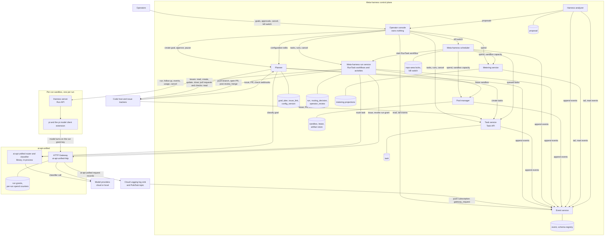

| Component | Owns |
|---|---|
| Planner | `goal`, `plan`, `issue_link`, `pull_request_end` |
| Configuration, in the planner process | `config_version`, `active` |
| Task service | `task` |
| Meta-harness scheduler | Repo-area locks and the kill switch: Postgres rows today, Redis for the locks later |
| Meta-harness run service | `run`, `routing_decision`, `operator_review`, its Temporal namespace, code-host rate-limit buckets |
| Pool manager | `sandbox`, `lease`, the artifact store |
| Event service | `event`, the schema registry |
| Metering service | Its projection tables |
| Harness analyzer | `proposal` |
| Operator console | Nothing |
| HTTP Gateway | Run grants, per-run spend counters |
| Harness server | The run's pi session directory |

A component reads and writes only its own tables. It gets what it needs from
another component through that component's API or the event service, as the
scheduler reads a goal's spend from `attempt_finished` events. No query joins
two components' schemas, though today they share one Postgres.

Configuration is a set of versioned JSON documents, edited in the operator
console's Configuration view. Every value a kind's view shows edits in place,
and each edit is staged rather than saved. The staged changes are reviewed
together as a diff against the active version, with a note, before they are
checked and stored as one version. The JSON stays as Advanced. The built kinds
are `tiers` (the ai-api-unified router's `router` section), `profiles` (the
harness profiles) and `repos` (the repo registry). The `config` component,
`src/meta_harness/config/`, keeps every version of each in its
`config.config_version` table and the active one in `config.active`. The
planner process serves its API for every kind, until the run service has an
HTTP API of its own. A kind's first version is seeded from the deployment's
file on the first read.

A harness profile added in code reaches the deployment by itself. At startup
the planner compares the shipped `config/harness_profiles.json` with the
history of the `profiles` kind. It adds every profile whose name no version
ever had, as a new version with origin `shipped` and a `config_changed` event.
A profile an operator changed or removed is never touched, because its name is
in the history. An addition the check would refuse is skipped. The task
policy's `max_usd_by_size` reaches it the same way, one size at a time, so a
size an operator changed or removed is never put back. Tiers are not
added this way: they are an ordered routing list, and an added tier would
change how tasks route.

A save is checked the way the service that reads the kind checks its
configuration at startup. The router must parse and name a default tier, and
every tier candidate must be a harness pair naming a profile that exists.
Every profile needs known tools and positive limits, and a profile a tier
still names cannot be removed. The task policy's `max_parallel` must be a
positive whole number no larger than the sandboxes the VM holds
(`MH_MAX_SANDBOXES`). Each reviewer pair must name a profile that exists. A
refused save lists every reason. A saved version becomes active at once, is a
`config_changed` event with the operator as actor, and applies to the next
task routed. A running task keeps what it started with. Rolling back saves an
earlier version's document again as a new version, after the same check. With
`MH_CONFIG_SOURCE=db`, as the cloud deployment sets it, the worker, the
planner and the scheduler read the active versions. Otherwise they read the
files, as the zero-cost end-to-end check does. The `modalities` and `access`
kinds are planned, and an approved harness analyzer proposal will apply as a
new version the same way.

## Routing

Once per task, the ai-api-unified router in the meta-harness run service
picks a tier and returns its candidates, each a harness profile and a model.
The RunTask workflow tries them in order. On every model call inside a
run, the HTTP Gateway routes the call.

When both `standard` candidates fail on infrastructure, the RunTask workflow
escalates to `complex`:

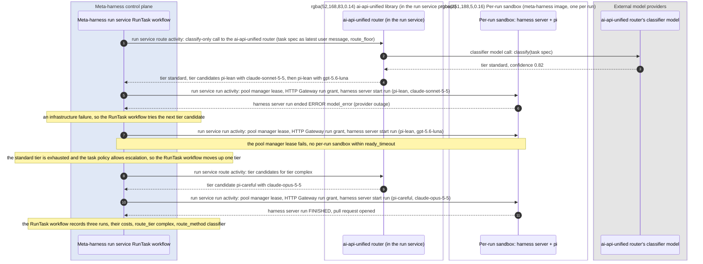

Inside a run, a compaction call goes to a cheap tier:

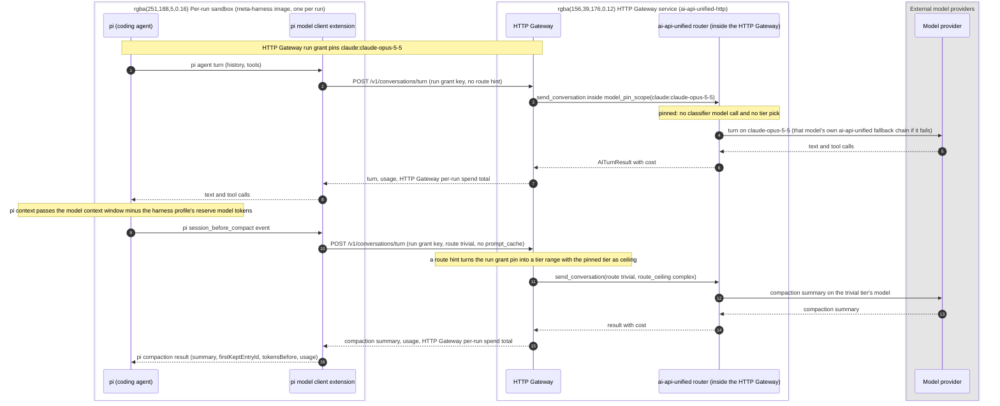

### Task routing

The meta-harness run service dispatcher activity renders the task spec
(title, description, acceptance checks, repo, file hints, size signals) into
one prompt. The meta-harness run service `route` activity sends that prompt through
`AiRouterCompletions` in classify-only mode. The ai-api-unified router in the
meta-harness run service classifies it, picks a tier, and returns the tier's
candidates, in order.

```json
"router": {
  "tiers": [
    {"name": "standard", "description": "A feature or fix inside one module, with clear acceptance checks, or anything smaller: config, copy, a one-file edit.",
     "models": ["harness:pi-lean/claude:claude-sonnet-5-5", "harness:pi-lean/openai-responses:gpt-5.6-luna"],
     "thinking": "medium"},
    {"name": "complex", "description": "Cross-module changes, migrations, concurrency, security-sensitive code, or vague requirements.",
     "models": ["harness:pi-careful/claude:claude-opus-5-5", "harness:pi-careful/openai-responses:gpt-6-sol"],
     "thinking": "high"}
  ],
  "classifier": {"engine": "openai-decisions", "min_confidence": 0.7},
  "default_tier": "standard",
  "on_exhausted": "escalate"
}
```

The shipped tiers are `standard` and `complex`. The task policy and the
`route: trivial` calls name a `trivial` tier. It is planned, with the
compaction handler and the auxiliary calls that would use it. Until a tier
of that name exists, a `trivial` floor is no floor. A `route: trivial` call
then runs on the run's pinned model, as any unknown route does.

A tier candidate takes the form `harness:<harness profile>/<provider>:<model>`.
An OpenAI model is named with the `openai-responses` engine. Every harness
turn sends tools with a reasoning level, and the `openai` engine sends them
through Chat Completions, which OpenAI refuses for its reasoning models. A
save naming `openai` in a tier is refused. At startup the planner moves the
active tiers' `openai` candidates to `openai-responses` as a new version,
origin `shipped`. A reviewer pair naming `openai` runs on
`openai-responses`. The review loop compares a reviewer with the pull
request's author by model, so one model reached through two engines never
reviews its own work.
The ai-api-unified router reads `harness` as its provider and returns the
string unchanged. In classify-only mode (`AiRouteClassifier`) the router never
builds or probes a candidate, so the meta-harness run service validates each
candidate itself at startup. It checks that the candidate's harness profile
exists and names an image the executor backend can run. It also checks that
its `<provider>:<model>` is a model the ai-api-unified library has
configured.

The ai-api-unified router's classifier model reads the latest user message.
So the meta-harness run service dispatcher activity puts the task spec in
that message and keeps instructions in the system prompt.

The meta-harness run service `route` activity builds one ai-api-unified router client per
process and shares it across tasks; the library keeps per-call state in
context variables.

- The ai-api-unified router classifies the task with its classifier model,
  and below `min_confidence` it picks `default_tier`.
- The RunTask workflow tries the tier's candidates in order. A run that ends
  on infrastructure moves to the next candidate. That is no per-run sandbox
  within `ready_timeout`, a rate limit or exhausted quota at the model, a lost
  harness server, or `model_error` from a provider outage. A run that ends on
  a limit
  (`max_turns`, `max_minutes`, `spend_limit`) ends the task.
- When a tier runs out and `on_exhausted` is `escalate`, the RunTask workflow
  calls the `route` activity again with `route_floor` one tier up, within the
  task policy's limits.
- A fix run, an exploration run and a task with a `pin` field skip routing.
  Each runs one named pair, such as
  `harness:pi-careful/claude:claude-opus-5-5`, with no escalation. A fix run
  pins the pair that opened its pull request, so it continues that pull
  request's pi session on the same model. A review run tries the task
  policy's reviewer pairs in order. The meta-harness run service checks a
  pinned model against the ai-api-unified allow and deny lists before any
  lease, and the RunTask workflow records `route_method: model_pin`.
- Each router call sets its own `route_floor` and `route_ceiling`, because
  one router client serves many tasks at once.

Caller hints use the ai-api-unified router's per-call options:

- `complexity: high` on a task passes `route_floor: "complex"`.
- `max_tier: standard` passes `route_ceiling: "standard"`.
- A retry after a failed attempt passes `route_floor` one tier above the
  failed attempt.

The RunTask workflow learns routing only from the meta-harness run service
`route` activity's return value. It learns cost only from the meta-harness
run service run activity's Collect step. It reads neither from
ai-api-unified library events.

| Where | Fields |
|---|---|
| Meta-harness run service `route` activity result | From the ai-api-unified router: `route_tier`, `route_method`, `route_confidence`, `thinking`, the ordered tier candidates, and `classifier_usd` for the ai-api-unified router classifier model call |
| Meta-harness run service run activity Collect result | `run_id`, `sandbox_id`, the harness profile, `end_reason`, `turns`, `elapsed_ms`, the prompt cache hit rate, the run's model token totals (input, output, `cached_input_tokens`, `cache_write_5m_tokens` and `cache_write_1h_tokens`) from the harness server Run API `GET /usage`, and the dollars the HTTP Gateway counted against the run's HTTP Gateway run grant |
| The task's `max_usd` | The task's spend limit across all its runs, $10.00 when the task names none. Each run's grant gets what the task has left |

The RunTask workflow writes the meta-harness run service `route` activity
result as the meta-harness domain event `task_routed`. It writes each
meta-harness run service run activity Collect result as one
`attempt_finished`. Each run's `attempt_finished` holds its `run_id`, so it
joins the pool manager's lease record for that run.

### Task policy

The task policy holds the rules for task types, exploration, run budgets,
parallelism and review. It is the `task_policy` configuration kind, seeded
from `config/task_policy.json` and edited on the console's Configuration page.
The scheduler reads `max_parallel` each admission pass. The run service reads
`review.reviewers` and `review.max_rounds`. The planner reads
`max_usd_by_size` when it makes an issue a task. `writing_pass` is a switch:
`false` turns the writing pass off (What the meta-harness writes), and left
out or `true` it is on. `credential_redaction` is a switch too. Only `true`
turns on the replacing of tokens, keys and passwords in what is posted
(Credential redaction), and left out or `false` it is off. `max_task_usd` is
the most one task may spend whatever else is set (Budgets). Those fields are
built today. The policy's other fields are planned.

```json
{
  "version": "2026-11-03.1",
  "max_parallel": 8,
  "floors_by_task_type": {"security": "complex", "dependency": "trivial"},
  "exploration": {"share": 0.05, "eligible_tiers": ["trivial", "standard"],
                  "challengers": ["harness:pi-careful/openai-compatible:qwen3-coder-next"]},
  "review": {"reviewers": ["harness:pi-review/claude:claude-opus-5-5",
                           "harness:pi-review/openai-responses:gpt-5.6-luna"],
             "max_rounds": 3, "operator_alert_minutes": 240},
  "max_usd_by_size": {"small": "3.00", "medium": "8.00", "large": "20.00"},
  "max_run_minutes": 240
}
```

- `max_parallel` is the most tasks that run at once across every goal. It
  can be no more than `MH_MAX_SANDBOXES`, the sandboxes the deployment's VM
  holds, and a saved change applies at the next admission pass.
- `floors_by_task_type` sets `route_floor` on the router call.
- The RunTask workflow pins a configured share of eligible tasks to a
  challenger harness-profile-and-model pair. That keeps the harness
  analyzer's data current on every harness profile and model. Complex and
  security tasks never explore.
- A run's HTTP Gateway run grant spend limit is what the task has left of
  its `max_usd` after the runs before it. The `max_usd` is $10.00 when the
  task names none. So a task's runs together never spend more than its limit. With the review
  loop, a task's `max_usd` also caps the total of its meta-harness review and
  fix runs. `preview_route()` cannot estimate a harness run, because a run's
  turn count is unknown before it starts.
- `max_usd_by_size` gives a task its `max_usd` from its issue's size (Issue
  sizing), when the issue names no limit of its own on a `Spend limit: $N`
  line. It is an object from `small`, `medium` and `large` to a finite dollar
  amount above 0 and at most the task ceiling (`max_task_usd`, else $100.00).
  The Task API refuses a task's limit above that ceiling. A save that breaks
  this is refused, and a limit read above the ceiling gives none. A size it
  leaves out, an issue not sized, or a policy without it gives the task no
  limit, so the $10.00 default applies. A change applies to the
  tasks made after it.
- `reviewers` lists the review run's
  harness-profile-and-model pairs in order. The RunTask workflow skips any
  reviewer pair whose model wrote the pull request, so a different model
  always reviews. `max_rounds` caps the fix runs per pull
  request. `operator_alert_minutes` sets when a review round blocked on an
  operator raises an alert. Whether a clean pull request merges is the goal's
  `auto_merge` setting.

### The run loop

The RunTask workflow runs a task's tier candidates in order, one run each. It
checks the budget between candidates, because it holds the
task's remaining spend, its attempts so far and the task policy's limits.

| Step | What happens |
|---|---|
| Identify | `run_id` is the RunTask workflow id and the attempt number, `run-task-<task>:run-<N>`, the same on every retry of the run activity. Each candidate tried, in any tier, takes the next attempt number, so no two runs of a task share an id. A review or fix run takes its task's next attempt number, with tier `review` or `fix`. |
| Lease | Asks the pool manager for an existing pool manager lease on `run_id` first, so a retried run activity re-attaches to a run in progress. Otherwise requests `lease(run_id, image, harness_session_id, resources)` for the harness profile's image. The pool manager response holds the per-run sandbox address, the pool manager lease TTL and the `session_state`: `new`, `kept` or `restored`. In a deployment without the pool manager, the run activity starts one per-run sandbox per run itself, with the Docker executor backend. |
| Grant | Asks the HTTP Gateway for an HTTP Gateway run grant, which the HTTP Gateway issues and stores. The run grant holds the run id, tags, the tier candidate's inner model as a pin, the spend limit, and an expiry at `max_minutes` plus grace. Only the run grant key goes to the per-run sandbox. A retried run activity asks again with the same terms and gets a new run grant key for the live run grant. |
| Start | When `session_state` is `new`, `POST /run` on the per-run sandbox's harness server Run API. The request holds the prompt, acceptance checks, harness profile, limits, bash allowlist, the tier's thinking level and run grant key. The pi model client extension sends that thinking level on every turn; a pinned run sends none, so the HTTP Gateway's default applies. When it is `kept` or `restored`, `POST /followup` with the new input and its own run grant key. |
| Wait | Follows the harness server's event stream until `run_finished`, heartbeating the last harness server event id on every event. Before there are events, while it clones the repo and starts the sandbox, the activity heartbeats every 3 seconds, since either can outlast the heartbeat timeout and a second attempt would remove the first one's clone. The run activity's heartbeat timeout catches a dead Temporal worker, and its start-to-close timeout, the harness profile's `max_minutes` plus 10 minutes, is the hard upper bound. A RunTask workflow cancel reaches the run activity through its heartbeat, and the run activity sends `POST /cancel` to the harness server. |
| Collect | Reads the harness server's `/usage` and `/record`, and a finished run's changes from `GET /bundle`. Then revokes the HTTP Gateway run grant and releases the pool manager lease. Returns the terminal state: status, end reason, turns, the files changed, the run's final summary, elapsed time and model token totals. A final summary that is missing, under three words or only narration gives way to one the run service writes from `/record` (`run_service/summaries.py`). It lists the files, how each acceptance check ended and the command counts, under a line that says where it came from. It leaves out the run's plan, whose steps the run wrote. A harness image without `/record` falls back to the files its events named. The terminal state also holds the dollars the HTTP Gateway counted against the run grant. The RunTask workflow records one cost line per run from that figure. |
| Decide | In the RunTask workflow. A run that ended `FINISHED` ends the candidate loop. A run that ended `ERROR` for an infrastructure reason (no per-run sandbox, a lost harness server, `model_error` from a provider outage) tries the next tier candidate. A run whose activity ended because the worker under it shut down (`WorkerShutdown`, which every deploy's restart causes) is neither. The workflow waits 20 seconds for the worker to be back and takes the same run up again, up to five times. The activity re-attaches to the run by its run id, so the restart costs the task no attempt and no candidate. A run that ended on a limit (`max_turns`, `max_minutes`, `spend_limit`) is final. Another candidate would spend the budget again, so only the task policy's retry-up rule or an operator repeats a run that ended on a limit. When every candidate of every tier it may reach fails on infrastructure, as in an HTTP Gateway outage, the task fails with every run listed. Pausing such a task to resume later is not built. |
| Publish | A meta-harness run service activity, after Decide ends the loop on a finished run. Commits the run's changes to the branch `mh/<task>` and pushes it with the meta-harness run service's code-host app token. Opens the pull request, labeled `ai:meta-harness`, with `Closes <issue>` and the run's final summary, which goes through the writing pass first (What the meta-harness writes). The summary is the part of the run's last message between its `<pr-summary>` and `</pr-summary>` lines (`run_service/summaries.py`). One that is missing, unmarked, under three words or only narration gives way to one the meta-harness writes under its own heading, `What this change touches`. The run service writes it from the harness's record of the run: the files it wrote or edited, how each acceptance check ended and how many commands it ran. Publish adds the files the branch changes that the record does not name, such as one a bash command changed. With no record, Publish writes it from the files the branch changes. Its first line says the run left no summary, and it quotes none of the run's words. Neither goes through the writing pass (`run_service/pr_summary.py`). Publish records the summary it posted on the task as `pull_request_summary`, once for the opening and once for each fix round, with its source. The source is `run` for the run's own words, `recorded` for the run service's fallback from `/record`, or `files` for Publish's own. It appends the event at once, not through the client outbox. An event service that does not store it fails Publish, and Temporal retries it. A retried Publish may find the pull request its own earlier attempt opened, as after a failed label request. It then reads the opening summary back from the description and records that. A fix round's retry adds no second section, and records the section the description holds, whatever its own writing pass returned. The console shows that source on the task's Changes tab and beside the pull request in the task's details. It also shows it on the task's path and on the goal's board. The description is written when the pull request is opened, and no later push changes it. A retried Publish finds the branch and the pull request it made. A finished run that changed nothing fails the task. A fix run pushes to its pull request's branch. With the Docker executor backend, Publish commits and pushes from the workspace the host mounts. A run that changed no file opens no pull request. Its task then gets one more run, by a reviewer pair on the base branch, from `prompts/already-done-v1.txt`: it is told what the first run said, as a claim to test, and ends with `submit_review`. Verdict clean ends the workflow with outcome `already_done`: the task is closed, its reason starting `the work is already on the base branch:` with the reviewer's summary. Any other verdict, no verdict, or no reviewer pair fails the task as one that changed nothing, with the missing parts in its reason. A task that asked for no review gets no such check. The check is behind the patch `nothing-changed-check`. |

The harness server's own token, which every one of those calls carries, is in
no process's environment. The worker starts the sandbox without it and sends
it in `POST /token` once the server is up, before any run exists; the server
takes the first and refuses another. A process's environment can be read by
anything under its uid (`/proc/1/environ`), and the agent's bash tool runs
under the server's, so a token passed there was the agent's to read: with it,
a review run's own code could steer, stop or cancel the run that reports its
verdict. The worker keeps its copy in the run's directory beside the
workspace, which no sandbox mounts, so a worker that restarts finds it again.
The server's memory holds the token, and that is closed to the agent too. The
image starts the server from a copy of node that can be executed but not read
(`node-server`, mode 0111). The kernel marks a process started from a binary
it cannot read as not dumpable, and then nothing else under its uid can open
its memory, its memory map or its `/proc` entries. The agent's own `node` is
the ordinary one. The sandbox's dropped capabilities rule out running the
tools under another uid, which this makes unnecessary. The egress check of
the zero-cost end-to-end check reads `/proc/1/mem`, `/proc/1/maps` and
`/proc/1/environ` from inside a sandbox and fails if one opens.

The RunTask workflow's Temporal history records every attempt, tier candidate
and decision. The operator console and the harness analyzer read each run's
`attempt_finished` from the event service. A goal's spend is summed from
those events, so `record_attempt` appends the event at once, not through the
client's outbox, and releases the goal's grant only after the event service
has stored it. An event service that does not store it fails the activity,
which Temporal retries; the event's id is the same each time.

### Model calls inside a run

The harness server's pi model client extension sends every pi model turn to
the HTTP Gateway's native conversation endpoint. The run grant key is its
bearer credential. The HTTP Gateway:

1. Looks up the HTTP Gateway run grant by its run grant key: the run, harness
   profile, model policy and spend limit.
2. Sets the ai-api-unified observability context: `caller_id` is the
   meta-harness, tags are run, task, harness profile, harness and model.
3. Sends the turn through the ai-api-unified router inside the HTTP Gateway.
   A pinned run grant model policy is the default. With it the HTTP Gateway
   wraps the call in the ai-api-unified library's model-pin scope for the
   tier candidate's inner model. The turn skips the classifier model call and
   runs on that model with the ai-api-unified fallback chain, cooldowns,
   guardrails and caching intact. With a tier-range run grant model policy
   the turn sets `route_floor` and `route_ceiling` instead. The
   ai-api-unified router inside the HTTP Gateway may then answer easy turns
   from a cheaper tier. Under either model policy the HTTP Gateway run grant
   decides the provider and model. The HTTP Gateway ignores any provider or
   model the request body names.
4. Adds the turn's cost to the HTTP Gateway per-run spend counter in Redis,
   so the total is exact across HTTP Gateway replicas. Returns the turn's
   usage and the run's total in the response. Once the run has spent its
   limit, the HTTP Gateway refuses the next turn with
   `402 run_grant_spend_limit`. The pi model client extension reports the
   usage and total, and the harness server emits them in its `model_call`
   events.

A request body with `route` runs that one call on the named tier, capped at
the pinned model's tier. The `route: trivial` on compaction and auxiliary
calls is one. An unknown route falls back to the pinned model, and pi agent
turns, which have no `route`, stay pinned. Under a tier-range model policy
the router honors the hint within the tier range.

## Run lifecycle

A task's runs are its first attempt, fallbacks to other candidates and
retries a tier up, each in its own per-run sandbox. Once the task's pull
request is open, its RunTask workflow runs the review loop.

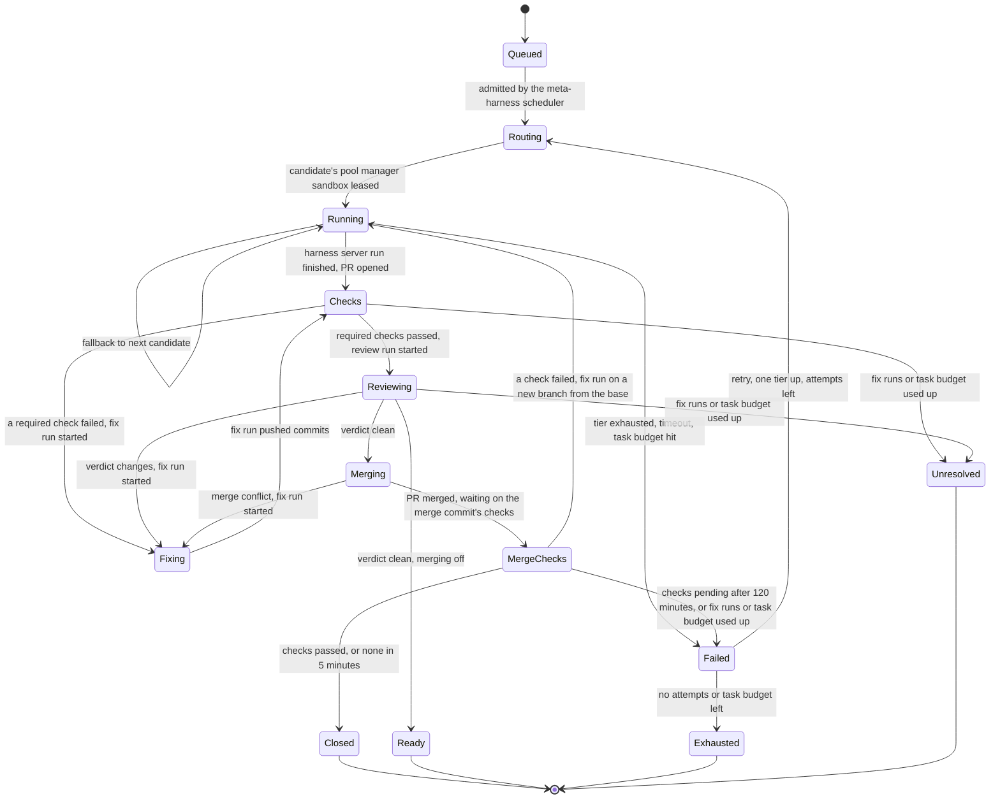

Each task has one RunTask workflow, whose Temporal workflow id is the task
id, and every run of the task happens inside it. A review or fix run is a
run of that task, inside the same RunTask workflow. `start` uses Temporal's Fail
conflict policy and Reject Duplicate reuse policy, so a task id starts at most
one RunTask workflow, even after it ends.

From admission to close:

1. The meta-harness scheduler grants a slot and calls
   the meta-harness run service's `start`.
2. The guardrails library resolves the target repo's repo policy and mints a
   read-only code-host access token scoped to the target repo, for the clone.
   The meta-harness run service dispatcher activity builds the harness prompt
   from a versioned prompt template. The prompt holds the task spec, the
   acceptance checks, the target repo's `AGENTS.md`, and the instruction to
   finish with a summary for the pull request.
3. The meta-harness run service `route` activity routes the task with its floors,
   ceilings and exploration pin. The RunTask workflow writes the
   `routing_decision` row, appends `task_routed`, and runs the candidates
   through the run loop, appending one `attempt_finished` per run.
4. The meta-harness run service run activity is the only consumer of its
   sandbox's harness server Run API event stream. It writes the `run` row and
   appends the run's harness server Run API events through the event service
   client library in batches. It heartbeats the RunTask workflow, and marks
   the harness run stalled when the harness run misses a heartbeat window.
   Code-host webhooks for the run's pull request (checks completed, merged,
   closed) arrive at the task service, which signals the RunTask workflow.
5. The RunTask workflow runs review and fix runs on the pull request
   until a review comes back clean, then merges it.
6. The RunTask workflow appends the outcome meta-harness domain events and
   sets the task's terminal status through the task service. It does so when
   the pull request merges or closes, or when attempts and task budget are
   spent. It also does so when the meta-harness review loop ends `ready` or
   `review_unresolved`.
7. The operator console sends a cancel to the task service, which records the
   request on the task, and the kill switch to the meta-harness scheduler.
   Each appends the audit meta-harness domain event with the operator as
   actor. On its next admission pass the scheduler cancels the RunTask
   workflow of each task with a cancel request. While the kill switch is on,
   it cancels the workflow of every running task and admits none. The kill
   switch is global today; per-run and per-caller scopes are planned. The
   RunTask workflow cancels the meta-harness run service run activity. The
   activity calls the harness server Run API `POST /cancel` on the per-run
   sandbox directly and revokes the HTTP Gateway run grant. It also releases
   the sandbox lease with the pool manager, which destroys the per-run
   sandbox.
8. Planned: an operator can take over any running task from the operator
   console. The meta-harness run service stops the active run with
   `POST /cancel`, revokes its run grant, and runs the Publish step on the
   work so far. The branch `mh/<task>` gets the run's changes and the pull
   request opens as a draft, or the existing pull request gets the commits.
   The task becomes `taken_over`, owned by that operator, and the RunTask
   workflow waits on a Temporal signal while the operator works the branch. No
   review, fix or merge runs on a taken-over task. The operator ends the
   takeover from the operator console with hand back or close. Hand back
   starts a follow-up run on the branch, with the operator's notes as its
   input, and the task continues through the review loop. Close ends the task
   with the operator's outcome. Both append audit events with the operator as
   actor.

Every terminal state releases the pool manager sandbox lease. The pool manager
then collects run artifacts into its artifact store. It destroys the per-run
sandbox, or keeps it for the same pi session's next follow-up run.

Timeouts come from each harness profile (`max_minutes`), and the task policy
sets the hard ceiling.

### Parallel attempts

A task that has not started can be set to make 2 to 4 attempts at once
(`POST /v1/tasks/{id}/attempts`). Its RunTask workflow routes it, takes that
many of the tier's candidates, and runs one attempt on each in parallel. Each
attempt has its own per-run sandbox and workspace, and an equal share of the
task's spend limit. Each is an `attempt_finished`. When more than one
finishes, the task waits for an operator to compare them in the console and
pick one. The pick reaches the workflow as an `operator_message` signal with
`when` `choose`, recorded as `attempt_chosen`. The picked attempt's changes
publish as the pull request, which goes through the review loop as any other;
the others are never pushed. The path is behind the `parallel-attempts` patch.

### Review loop

The RunTask workflow of the task that opened a pull request owns it until it
merges or closes. Review and fix are runs of that task, inside its workflow,
recorded as its attempts with tier `review` or `fix`. The task keeps its
scheduler slot and its repo-area lock while they run. Once its pull request is
open, that lock blocks no other task. The review loop is checks, reviews and
short fix runs, and holding the area through it kept every task behind it
waiting for hours. A later merge can bring a conflict. The task's own merge
settles it: it takes in the base first and sends a conflict to a fix run.
Separate review and fix tasks would add signals between workflows without
adding control. The loop:

1. The RunTask workflow waits for the code host's checks on the pull
   request's head commit. A failed required check goes to step 3 with the
   check's output. Passing checks go to step 2.
2. A review run: the first reviewer pair in the task policy whose model did
   not write the pull request. It runs in a new pi session on the review
   harness profile, which has no edit tools. The review run reads the pull
   request diff, the task's spec and acceptance checks. Its prompt names the
   code host's checks that passed at the reviewed commit, and tells it not to
   run them again. It runs a command only to confirm a finding, or for an
   acceptance check none of them covers (#199). With no checks on the code
   host, it runs the acceptance checks itself. A changed file outside the
   issue's `Paths:` with no reason in the summary is a finding. The repo's own
   versioning rule, in its AGENTS.md, decides about its version files whatever
   the paths say. A version change that rule asks for is never a finding, and
   one it forbids, or a missing one it requires, is. A review after the first
   is given the round before's findings and summary (prompt `review-v5`). It
   judges first whether each is fixed, then the fix. It raises a new finding
   only for a bug, a failing check or a part of the task left undone, so
   rounds converge. Its summary begins with how many of those findings are
   fixed, not fixed and new. Every review is shown the pull request's
   description as it stands on the code host (up to 8,000 characters). It
   judges what the description explains, such as why a file outside the task's
   paths changed. An operator's edit to it counts at the next round. Its
   `submit_review` tool ends the run with verdict `clean` or `changes` and its
   findings. The meta-harness run service posts them as a pull request review
   and records the verdict with the reviewed head SHA in a
   `pull_request_reviewed` event. The summary and each finding go through the
   writing pass before they are posted. The fix run is given the review as the
   review run wrote it.
   A round after the first can still find something new in code it already
   read, and a loop that keeps doing so never ends. So the run service reads
   which lines changed on the branch since the round before's head
   (`review_follow_ups`, behind the `review-follow-ups` patch). A new finding
   on code nothing changed since is a follow-up. It is posted on the pull
   request marked "Follow-up, not blocking", counted apart in
   `pull_request_reviewed` (`follow_ups`, the finding numbers), and sent to no
   fix run. A finding still holds the merge when it names no file or is within
   3 lines of a changed line. So does one the round before raised too (the
   same file, within 15 lines), and every finding when the change cannot be
   read whole. A round whose findings are all follow-ups is clean.
   The reviewer also sorts its own findings (prompt `review-v5`, behind the
   `review-merge-bar` patch). It judges the pull request by one test: is the
   main branch better with it merged as it is than without it? A finding
   blocks only when it fails that test. Any other is a follow-up, and
   `submit_review` takes `blocking: false` on it. The loop treats it like a
   follow-up on unchanged code: posted and counted apart and sent to no fix
   run. A finding with no mark blocks. The tool refuses a `changes` verdict
   with no blocking finding, and a `clean` one may list follow-ups. A rule of
   thumb in the code can always be given one more case it misses. So a finding
   on one is raised once and does not hold the pull request round after round.
   A comment on a merged pull request is easily forgotten. So once a task's
   pull request has merged, the planner's sweep files the follow-ups its last
   review left as one issue in the goal's tracker (`planner/follow_ups.py`).
   The issue links the pull request and gives each finding with its file and
   line. Its text goes through the writing pass. It has no goal label, so the
   goal that made the pull request still finishes, and an operator takes the
   issue into a later goal. Each closed issue is looked at once: its link
   keeps the issue filed (`follow_ups_ref`), or '' when there was nothing to
   file. The filing is a `follow_ups_filed` event on the task.
   A fix run's summary is added to the open pull request's description as a
   `Fix round <n>` section, once. So the next review reads there what a fix
   run is asked to explain: why it changed a file outside the task's paths. A
   fix run that leaves no usable summary gets the same fallback as Publish, so
   its round still shows.
3. On `changes` or a failed check, a fix run: the pair that opened the pull
   request, with the findings or the check output as its input. It continues
   the pull request's pi session in a follow-up run (`POST /followup`), and
   its Publish step pushes to the pull request's branch. The loop returns to
   step 1.
4. On `clean`, the meta-harness run service merges the pull request through
   the code-host API at the reviewed head SHA. So a commit pushed after the
   review never merges unreviewed. A merge conflict with the base branch goes
   to a fix run. The goal's `auto_merge` may be off, or the repo's merge
   policy may forbid merging. The RunTask workflow then leaves the clean pull
   request open and ends the task `ready`. The operator console lists it for
   an operator to merge.

The loop stops at the task policy's `max_rounds` fix runs per pull request,
or when the task's runs have spent its `max_usd`. The RunTask workflow then
leaves the pull request open, ends the task `review_unresolved`, and a
meta-harness alert rule fires. A pull request closed on the code host ends
the loop and the task.

An operator can dismiss a finding before its fix run starts (#207, behind the
`review-hold` patch): the first part of the operator review. When the task
policy's `review.hold_minutes` is above 0, a review that asks for changes
waits that long before its fix run. The task stays `running`, marked
`waiting_on: review`, its status reason saying how many findings wait and for
how long. The operator dismisses any finding that is wrong, with why
(`POST /v1/tasks/{id}/reviews/{round}/findings/{n}/dismiss`, `n` from 1), and
may end the wait at once (`.../reviews/{round}/proceed`). Each reaches the
workflow as an operator message. The fix run is asked only for the findings
not dismissed, and the next review is given those as the round before's. With
every finding dismissed, the round counts as clean and goes on to the merge.
The dismissals are posted as a comment on the pull request, and recorded as
`finding_dismissed`. The hold and the operator's end of the wait are
`review_hold` and `review_proceeded`. A review no one answers goes to its fix
run with every finding when the wait ends. With `hold_minutes` 0, as it is
unless an operator sets it, findings go straight to the fix run.

A task short of budget holds and asks before it ends (#188, behind the
`budget-hold` patch). Before every run, the first included, the workflow works
out what the run may spend. That is what the task has left of its `max_usd`,
or, when that is less, the task's share of what its goal has left. The goal's
blocking line is its `max_usd` plus its allowed overage. What the goal has
left is that line less what its tasks' runs have spent. The task's share is
that amount divided among the goal's running tasks. Spend is recorded only
when a run ends, so each share is also written down as granted when it is
worked out (`run_service/goal_grants.py`), under one lock per goal, and kept
until that task's run is recorded. A share is never more than what is left
once the other running tasks' grants are taken off, nor more than the task's
own spend limit. So the grants in force together never pass the line, whether
the tasks asked at once or one after another. A task that finds everything
left granted to runs under way holds like any other, says so, and looks again
every few minutes; the scheduler admits no new task of that goal meanwhile. A
goal whose budget only warns
(`budget_mode: warn`) caps no run and holds none. A run needs what the task's
last run of that kind spent, and at least $0.10. When the run may spend less
than that, the task holds. It stays `running`, with its repo-area lock and its
place in the parallel limit, marked `waiting_on: budget`. Its status reason
says what the next run needs and what is left. A run that stops at its spend
limit holds the same way and, once there is budget, runs again. The operator
answers through `POST /v1/tasks/{id}/budget`: `raise` with a new `max_usd` for
the task, or `end`, which ends the task as it would have ended. An answer that
leaves the next run still short holds the task again (behind the
`budget-hold-again` patch). Its status reason is rewritten with what is left
now, so the hold's reason and its `budget_request` say what the raise left. A
task held for its goal's budget looks again every five minutes. So raising the
goal's budget on its page lets its tasks go on by themselves. A budget resume
(`POST /v1/goals/{id}/resume-budget`) tells them to look again at once. A task
no one answers in 24 hours ends as if ended. The hold and the answer are
recorded as `budget_hold` and `budget_decision`.

A hold is a request with an amount. One module
(`meta_harness/budget_request.py`) writes its status reason as a sentence and
reads it back, so the Task API serves the same hold as numbers. A task that
waits on budget has `budget_request`, null on any other task. For the task's
own spend limit it has `for: task` and the run that cannot start (`what`). It
has what that run needs and what the task has left of its limit. It has the
request itself: `add_usd`, enough for the run in whole dollars and at least
$1, and `to_usd`, the limit that grants it. For the goal's budget it has
`for: goal` and the goal's id, and the amount is the goal's own budget
resume's. The Task page's alert reads "this task asks for $2.00 more" and
grants it in one click ("Grant $2.00: its limit becomes $5.00"). Another limit
can still be set there, and End is beside it. The needs-you list names the
item by the amount ("Grant $2.00 more"). A hold whose reason is not that
sentence has no amounts, and the page asks for a new limit.

The loop as built differs from those steps (#85), each difference until
what it waits on exists:

- A fix run starts a new pi session on a fresh clone of the pull request's
  branch. It does not continue the session that wrote it, because a saved pi
  session cannot be restored into a new sandbox yet. The branch holds the
  earlier work.
- `wait_checks` polls the code host for the head commit's check runs and
  statuses until all complete, rather than waiting for a webhook. A repo with
  no checks five minutes after a push counts as passing. The checks listed at
  one moment are not always all a commit will have: a workflow that is queued
  has a check suite before any of its jobs is a check run. So while a GitHub
  Actions suite on the head has not completed, the wait goes on, for up to 15
  minutes, and neither "passed" nor "none" is said. Other apps' suites are
  not waited on: an app gets a suite on every push whether it reports or not.
- `merge_pull_request` answers `merged`, with the merge commit, for a pull
  request that has already merged: after GitHub refuses the merge, and before
  the base is brought into the branch. A merge whose answer was lost and is
  asked again then closes its task, and nothing is merged into a merged
  branch.

The review is posted as a comment review, because GitHub refuses an approval
or a change request from the pull request's own author. A reviewer pair whose
harness profile is not active is skipped. With no reviewer left, the task ends
`ready` and unreviewed, with the reason, and never merges.

The merge (#86) reads the goal's `auto_merge` from the planner when it is due,
so a change made while the task runs applies. It squash-merges with `sha` set
to the reviewed head commit. A commit that landed after the review goes back
to the checks and a new review. A pull request that changes a file under
`.github/` or `deploy/`, or `src/meta_harness/versioning.py`, is never merged
on a review alone, whatever `auto_merge` says. The deploy runs that one file
of `src/` to name the version: in a job of its own with no Google Cloud
identity, whose answer the deploy job checks is a version before using it, and
on the VM as `mh`, not root. A workflow runs with the repo's secrets, and a deploy
applies its Terraform as the project's owner and its scripts as root on the
VM. The task ends `ready`, naming the paths, and an operator's Merge takes it
through. A workflow file is further off still: the code host refuses a push
of one from the meta-harness's App, which is never given that permission. So
an issue whose `Paths:` name a file under `.github/workflows/` is held when
the sweep takes it in, as a person's change, and no answer lifts that hold.
A run that changes one anyway ends its task at the push with the same words,
as a failure the supervisor never retries.

A goal builds a task for every issue it takes in, so it must tell two issues
that are the same work (`planner/copies.py`). Each issue's link keeps a hash
of what its work is: its title, and either the planning task its provenance
line names or its body, without the lines saying what it waits on and where
it came from. An issue whose hash another issue of the goal already has is
held as a copy, naming the first, and makes no task; the issue the goal saw
first is always the original. Run anyway takes a copy in when both are meant.
An issue with almost nothing under its title is never called a copy. Only an operator's does: the task records who sent it back
(`resume_by`), the workflow tells the merge activity, and a merge the
supervisor asks for is held like any other. Merges are one at a time per repo. The run service's merge activity
holds the repo's merge lock, a Postgres advisory lock, from checking the
branch to merging it. A branch that lacks the base's newest commits, because
another task's pull request merged while it was reviewed, is not merged. The
base is merged into it through GitHub's merges endpoint, not `update-branch`,
so the merge commit has provenance trailers. The new head goes back to the
checks. So no pull request merges against a base it was not checked on.
Whether it is also reviewed again depends on the pull request's own diff
against the base. The merge activity compares that diff at the reviewed head
and the new one (`same_diff` in its result). When the diff is the same, as
when the base's changes touch none of its files, the clean review stands. The
new head's checks run, and it merges with no new review (behind the
`same-diff-no-review` patch). A merge can be asked for again, by an operator
or the supervisor. When its base came in the same way, it merges on the same
terms, with no new review (behind the `resume-standing` patch). It is reviewed
again when the diff changed or the new head's checks fail. It is also reviewed
again when the diff cannot be read whole (300 files or more, or a file with no
patch). A conflict with the base becomes a fix run. The host merges the base
into the fix run's clone, the run resolves the conflict markers, and its
publish commits the merge. Its prompt says that a conflict in a version or
lock file follows the repo's AGENTS.md versioning rule. Where a pull request
sets no version, the rule keeps the base's version files as they are. Where it
does, the rule keeps the base's version with this pull request's bump on top.
Lock files are regenerated by their tool. The merged head goes back to the
checks and a new review like any other. A merge asked for again, by an
operator or the supervisor, may meet a conflict. It starts with this fix run,
before any review (behind the `conflict-first` patch). Branch protection or
any other refusal ends the task `ready` with GitHub's reason.

A clean review is kept (behind the `base-before-review` and
`clean-review-stands` patches). The task behind one pull request passed review
four times and never merged. Each review read a branch that already conflicted
with its base, and the conflict was found only at the merge. Its fix run was
reviewed in full again, and a retry reviewed the same commit a review had just
passed. So now:

- Before each review the loop brings the base into the branch
  (`bring_base`, `run_service/base_activities.py`). A base that merges in
  cleanly gives a new head, whose checks and review follow. One that does
  not is a conflict fix run, before any review. A clean review is then of
  a commit that holds the base, and merges at once unless the base moved
  while it was read.
- Conflict fix runs are counted apart from the fix rounds for findings and
  failed checks, up to the task policy's `max_rounds` of each. So a base that
  keeps moving cannot use up the rounds the findings need. A loop its conflict
  fixes did not settle ends `review_unresolved`, after the clean verdict when
  there was one. It ends with "the pull request conflicts with its base, and N
  conflict fix runs did not resolve it".
- A retried task whose pull request is still at the commit its last review
  passed is not reviewed again. `resume_state` reads the last
  `pull_request_reviewed` event. When its verdict is clean at the pull
  request's head, the loop starts with that verdict standing. The checks run
  and it merges, or ends `ready` when its goal does not merge by itself. When
  the event cannot be read, the pull request is reviewed.

Nothing merges onto a broken base (#202). Before a merge, the workflow reads
the checks on the base branch's newest commit (`base_health`). While one has
failed, or one still runs, the pull request is not merged. The task waits, its
status reason saying which checks at which commit, and looks again every
minute. A check canceled because a later merge replaced its run is no failure.
When they pass, it merges. When they have not passed after the task policy's
`merge_wait_minutes`, the task ends `ready` with the reason. Its pull request
stays open for an operator to merge once the base is repaired. The wait is 60
minutes when the policy does not say, and 0 merges without looking. A fix for
a check that failed after the task's own merge does not wait, since it is what
repairs the base. So merges follow one another at the pace of the base's
checks, its deploy included. A failed deploy holds every later merge until the
base passes. Behind the `merge-base-health` patch. The merge commit's message
has a `Version:` line saying what kind of change the task was, from its type.
The line is `feature` for a feature task, `none` for a docs or test task,
`fix` for any other.

In this repo no pull request sets the version (#201). Every pull request used
to bump it in five files, so with tasks in parallel every pair of open pull
requests conflicted there. Each conflict was a fix run, and reviewers had the
bump reverted as a change outside the issue's paths. Now the `VERSION` file
holds a base. The version of a commit is that base bumped once for each commit
on main's first-parent line since `VERSION` last changed
(`src/meta_harness/versioning.py`). The bump is minor for a feature, patch for
a fix, and none for a change that ships nothing. A commit's kind is its
`Version:` line, else its subject's prefix (`feat/`, `fix/`, or `chore`,
`docs`, `test`, `ci` for none), else a fix. The deploy works the version out,
with the whole history checked out. It gives the version to the edge image as
a build argument and to the VM's services in their environment, as
`MH_VERSION`. The version files hold the base and change only with `VERSION`.
A deploy that passes its smoke task publishes its version as a GitHub release
(`v<version>`, on the deployed commit). The README's version badge reads that
release. CI fails a pull request that changes a version file. A merged pull
request's `Closes` line closes the issue. The task then waits, still `running`
and holding its repo-area lock, for every check on the merge commit, deploys
included. This is recorded as `merge_checks`, and its status reason says so
("merged as ...; waiting for the checks on the merge commit"). A check that
did not pass there was either canceled, because a later merge replaced its
run, or failed. When the base has a newer commit that holds the merge, the
same check on the base's newest such commit judges it. That run covers this
merge too. So a deploy can fail for a reason outside the code (a refused
login, a provider's outage) and pass on the next commit. That is not this
merge's failure. A canceled check waits for the newer commit's run. A failed
one waits while that commit's checks still run, and stands as failed once they
finish without it. Passing checks, or none within five minutes, end the task
`closed`. A failed check that gave no output starts no fix run, since a fix
run can only change code and has nothing to go on. The task ends `failed`,
naming the check, for an operator. A failed check with output becomes a fix
run from the base, with the checks' output as untrusted input. A fix run that
changes nothing looks at the merge commit's checks once more, and ends the
task `failed` only if they still fail. The fix run's publish opens a new pull
request on `mh/<task>-merge-<n>` that names the merged one and closes nothing.
That pull request goes through the review loop, the merge and this wait again.
The rounds count toward `max_rounds` and the runs toward the task's `max_usd`.
When either is used up, or the checks still run after 120 minutes, the task
ends `failed` with the checks named. Behind
`workflow.patched("merge-checks")`: a workflow started before it ends `closed`
at the merge. The status reasons, the no-output rule and the second look are
behind `workflow.patched("merge-checks-judged")`. The deploy workflow's update
step first logs in to the VM with a command that does nothing, up to six
times. Its SSH key is new each run, and the VM refuses it until the key
arrives. The update then starts once.

A task that ends `ready` or `review_unresolved` leaves its pull request open
with no workflow watching it, and its repo-area lock is released. The
planner's sweep watches it instead (#74). For each such task of a goal with a
pull request, the sweep reads the pull request from GitHub. Its app token
reads pull requests, checks and statuses. The sweep reads whether the pull
request is open, draft, merged or closed, and its head SHA. It reads the head
commit's checks too: pending, passed, or failed with the failed check names.
It records each change as an event on the task, tagged with the goal. The
events are `pull_request_checks` once a new head commit's checks settle,
`pull_request_merged`, and `pull_request_closed` for a close without merging.
Each event's id is the one the RunTask workflow uses for the same fact. So a
repeated sweep, or a sweep after the workflow, records it once. The sweep then
reports the end to the task service. A merged pull request moves the task to
`closed`, and one closed unmerged moves it to `canceled` with that reason.
Pending checks are recorded when they settle; a head with no checks at all is
not recorded. The code-host webhook will make the sweep immediate later.

### Operator review

Operator review is built (#236). The console shows an operator when an agent
is reviewing a pull request, and the operator can take the review over.

The notice (`console/src/features/tasks/reviewing.tsx`): a review run with a
`run_prompt` of kind `review` and no `attempt_finished` yet is in progress.
The Overview starts with each pull request being reviewed now, and the task's
page shows a banner. The header inbox lists it with a browser notification.
Each offers Take over this review, and Open the diff. A comment on the diff's
lines there posts to the pull request under the operator's name.

The takeover:

- `POST /v1/tasks/{id}/review/claim` claims the review of a running task
  with a pull request, at any point of its review loop. The task service
  records the operator on the task (`review_claimed_by`), appends
  `operator_review_claimed` with the operator as actor, and queues the claim
  for the task's workflow. The first claim wins: another operator's is
  refused, naming who holds it.
- The agent's review still finishes and is posted, so the operator starts
  from its findings.
- The round then waits for the operator (behind the `operator-review`
  patch). The task stays `running`, marked `waiting_on: operator_review`,
  its status reason naming the operator, and keeps its repo-area lock. The
  wait is a Temporal condition on a signal, so it survives restarts.
  Nothing releases a claim but the operator.
- `POST /v1/tasks/{id}/review/verdict`, once the round waits: `clean`, or
  `changes`. `changes` takes the agent's findings the operator keeps (`keep`,
  numbered from 1). It also takes the operator's own (`findings`: `body`, with
  `path` and `line` when they have them). The operator's verdict decides the
  round. The fix run is asked for exactly the kept findings and theirs. So an
  operator can drop an agent's wrong finding and can ask for a change the
  agent did not. With none of either the round is clean and goes on to the
  merge. The workflow posts the verdict as a pull request comment that names
  the operator, and the task service appends `operator_review_submitted`.
- `POST /v1/tasks/{id}/review/release` gives the review back, and the round
  decides on the agent's verdict (`operator_review_released`).
- A claim is for one round: the next review is the agent's alone unless it
  is claimed again. A claimed round skips the timed hold of
  `review.hold_minutes`, since the operator's verdict already chooses the
  findings.
- The task's page shows the operator review panel while a review is held
  (`console/src/features/tasks/OperatorReview.tsx`). The panel says that the
  agent's review is still running, or shows the agent's findings to keep or
  drop and fields for the operator's own. Its actions are Submit: changes
  needed, Submit: no change needed, and Give the review back to the agent. A
  task waiting for an operator's review is first in the Overview's Needs you
  list.

The routes are the task service's, beside the review hold's, not the run
service's: the run service has no HTTP API. Not built: an alert when a
claimed round has waited longer than `review.operator_alert_minutes`, and a
`review_started` event (the `run_prompt` of kind `review` stands in for it).

### What the meta-harness writes

Every text the control plane writes for people goes through one pipeline,
`src/meta_harness/outbound/`. That covers a tracker issue or comment, a pull
request's description, a review and a comment on one.
`outbound.prepare(text, Context)` runs its stages in a fixed order and returns
the text as `Checked`, a string only the pipeline makes. The adapters that
write to the outside take nothing else. They are the GitHub, Jira and own
trackers, and the code host's publish, review and comment calls.
`outbound.require` refuses a plain string and says how to fix it, so a write
that skips the pipeline fails the first time it runs. A `Checked` text keeps
the context it was prepared for. `require` also refuses one prepared for
another destination, or a body where a title goes. A text for a tracker
(`outbound.for_tracker`) always names its kind and who wrote it. A default
would let a model's text skip the writing pass unnoticed.

| Stage | What it does | Applies to |
|---|---|---|
| `redact` | Credentials become `[redacted]`: tokens, keys and passwords, never personal data (see Credential redaction). First, so no later stage or model sees one | Every text, and only when the task policy's `credential_redaction` is `true`. It is off by default |
| `deslop` | The writing pass: scan, one rewrite when there are findings, kept only when clean and whole | Text a model wrote (`source: generated`), never a title, an operator's own words (`person`) or the fixed strings in this code (`fixed`) |
| `inert` | Puts each `@mention` in a code span, and each issue a model's text says it closes (`fixes #12`, `GH-12`, or its URL). The text then notifies no one and closes nothing. Prose that holds a stray backtick, one with no partner on its line or a span over several lines, gets a zero-width space in each mention and reference instead, since a code span added beside a stray backtick would pair with it and leave the name live. Code is left as it is, and so is the `Closes` line this code adds | A text for GitHub that a model wrote or this code composed; closing references only in a model's text; never an operator's own words |
| `fit` | Cuts the text to what its destination takes (GitHub 64,000 characters, Jira 31,000, a title 250), and says that it was cut | Every text |
| `stamp` | The provenance line, last, so nothing rewrites or cuts it | A text given a provenance, never a title |

A post composed here from parts sends each model-written part through as
`generated`, then the whole as `fixed`. The whole is redacted and cut, with no
second rewrite. Such a post is a pull request's description around the run's
summary, or a review's body around its findings. A stage
(`outbound/stages.py`) is a small class with `applies(context)` and `run`. A
stage that fails passes its text on unchanged, unless it is a blocker. A
blocker's failure or refusal raises `Blocked`, which names the stage and what
to do. No shipped stage blocks: a refused pull request description would stall
its task, so `redact` replaces. The result records
what each stage did (`Checked.report`), and from it the caller records
`writing_checked`, with `redacted` when credentials were taken out. A new
stage is a class placed in `STAGES`, and its place there sets when it runs.

#### Credential redaction

The `redact` stage is off unless the task policy says
`credential_redaction: true`, a switch on the Task policy page. A policy that
cannot be read keeps the switch as it was last read, and one that has never
been read counts as on. On, the stage replaces credentials
(`outbound/credentials.py`), and a redaction that fails stops the post:

- By shape: a private key block, a user name and password inside a URL, a
  Slack webhook URL, a `Basic` or `Bearer` authorization header, a JSON Web
  Token, and the tokens of GitHub, Anthropic, OpenAI, AWS, Google, Slack,
  Atlassian, npm and PyPI.
- By value: this service's own secrets. They are the environment variables
  whose names end in `KEY`, `TOKEN`, `SECRET` or `PASSWORD`, or their plurals,
  and the password in any variable that is a URL. A variable that holds
  several, such as `MH_SERVICE_KEYS`, has each of its keys redacted. A value under 12 characters, or one that is a
  file's path, is left alone.

It does not look for personal data: a name, an email address, a phone number
or an address is posted as written. Each redaction is logged as a warning,
since a credential that reached a post needs replacing. The warning names the
kind of credential and never its value.


The meta-harness checks everything it posts on a code host for people to read
for the tells of model-written text, before posting it. The tells are filler,
puffery, "not X but Y" framing, long sentences and runs of em dashes. The
check applies to text written from now on; nothing already posted is changed.
Code, diffs, quoted text, log output and check output are never touched.

The first check is in the prompt. Every prompt whose answer a person reads
ends with the same short block of writing rules
(`src/meta_harness/outbound/rules.py`). The text then comes out clean and the
control plane's rewrite rarely runs. That covers each run prompt that asks for
a summary, a review or a plan's issues (`repo-task-v2`, `fix-v2`, `review-v5`,
`plan-v1`). It also covers each model call the control plane makes itself
through the HTTP Gateway's `/v1/structured`. Those calls write a goal's
updates, a plan's suggested fixes, a goal's draft and name, an issue's sizing
and a split's parts. They also write a task's name, a failure's diagnosis and
the writing pass's own rewrite. The block is a file of the writing skill,
`WRITING-RULES.md`, named by `config/planner.json`'s `writing_pass.rules`. So
the rules a model is told and the rules the scanner holds it to are kept
together. It is read from the shipped file, never from the stored
configuration: the skill is locked (Skills), since the rules end every prompt.
A test fails a `/v1/structured` call whose system prompt leaves the block out.

The run checks next. Each profile that writes for people names the
`no-ai-slop2` skill. Its prompt tells the run to apply the skill to its
summary, its review or its issue drafts before it finishes. A task or review
run can run
the skill's scanner with `python3`. A planning run cannot: its profile reads
only, so it applies the skill's rules by reading them.

Last by the control plane, in the writing pass
(`src/meta_harness/run_service/writing.py`), which needs no run:

| Text | Where the pass runs |
|---|---|
| The run's summary in a pull request's description | The Publish activity, when the pull request is opened. The lines the meta-harness adds around the summary are not rewritten |
| A review's summary and each finding | The activity that posts the review |
| A comment: findings an operator dismissed, an operator's verdict | The activity that posts the comment |
| The body of an issue a plan drafted | The planner, when the plan is approved |
| A goal's update: its headline, body, what comes next and each thing it asks of the operator | The planner, before the update is saved. An update is shown on the goal's page and posted nowhere; it goes through the same pipeline, as `own` text. The update's `goal_update_written` event records a pass that found something as `writing`, and its rewrite's cost is a writing cost of the goal |
| The Overview report: its headline, spend and finished lines, and each goal it says is moving, not moving or needing the operator | The planner, before the report is kept. It is shown in the console and posted nowhere, as `own` text. Its `overview_report_written` event records a pass that found something as `writing`, and its rewrite's cost is a writing cost of no goal |
| The Overview's answer to the operator's question | The planner, before the answer is returned. It is shown in the console and posted nowhere, as `own` text. Its `overview_question_answered` event records a pass that found something as `writing`, and its rewrite's cost is a writing cost of no goal |

1. The text goes through the skill's scanner, `no-ai-slop-scan.py`. It is read
   from the shipped skill, which is locked (Skills). It runs as a child
   process with no model and none of this process's environment. Only the hits
   the scanner decides by itself count as findings; a candidate that needs a
   reader to confirm does not. Neither does a word `writing_pass.names` lists.
   The scanner's word lists hold `harness`, which is this product's name, so a
   text that only names the meta-harness is posted with no rewrite. A hit on a
   line the control plane reads back, which the rewrite must keep, is no
   finding either. A long acceptance check scans as a long sentence, and no
   rewrite could clear it.
2. A text with findings gets one rewrite, on the model
   `config/planner.json`'s `writing_pass` names, through the HTTP Gateway's
   `/v1/structured`. A text over 20,000 characters is not rewritten. The
   model is given each finding with its line. The scanner reports a long
   sentence as a line and a word count only, and a line of a description is a
   whole paragraph. So the pass finds the sentence and quotes it. Told the
   line alone, the model split the wrong sentence in over half of the
   rewrites production recorded, and each of those was dropped.
3. The rewrite is kept only when the scanner finds nothing in it. It must also
   keep every heading, link, code span, code block, number and listed name of
   the original. It must keep every line the control plane reads back too:
   `Paths:`, `Depends on:`, `Closes`, and each line under
   `## Acceptance checks`.
   Otherwise the rewrite is dropped and the original is posted, and the
   record's reason names the findings the rewrite still had.

The pass never stops a post. The text stays as it was when the scanner cannot
run, the HTTP Gateway does not answer, or the pass takes over 70 seconds. Each
post's pass is recorded as `writing_checked`: on the task, or with the goal's
tag for a plan's issue. It holds the kind of text, how many texts the pass
looked at and the scanner's findings by category. It also holds how many were
rewritten and kept, and the reasons a rewrite was dropped. The model and its
cost are there too, with the original and the rewrite of each text that
changed. The task's Timeline shows it as a note on the step it happened in. A
rewrite's cost is a model cost of kind `writing`, of the task or the plan's
goal. The task policy's `writing_pass: false` turns the pass off, with a
switch on the Task policy page. Prompts still end with the writing rules, and
runs are still told to apply the skill. `writing_pass`'s settings, and the
rules file they name, are
checked when the planner and the run service's worker start.

The pass looks only at model-written text. So CI holds the strings this code
and the console write for people to the same scanner
(`tests/outbound/test_fixed_strings.py`). The test scans every string of three
words or more under `src/` and `console/src`. A hit the scanner decides by
itself fails the change that wrote it, and the failure names the file, the
words and the fix. Docstrings, SQL, migrations, test files and the strings a
model reads (a
prompt, a response schema's descriptions) are left out; the test's
`MODEL_FACING` names those.

Not built: the pass on merge-check notes, which are a task's status reason and
are not posted. Also not built: the pass on a pull request description updated
after a fix run, since no description is updated today.

#### Provenance

Each thing the meta-harness writes on a code host or a tracker says where it
came from (`src/meta_harness/run_service/provenance.py`). Text for people to
read ends with one line, added after the writing pass so the pass never
rewrites it:

    Provenance: meta-harness 0.49.0; kind review; task t-12; model harness:pi-review/x:y; round 2

The line names the meta-harness version and the kind of post (`pull_request`,
`review`, `comment`, `issue`). Then it names whichever of goal, task, run,
model, round and operator (`by`) are known where the post is written:

| Post | What its line names |
|---|---|
| A pull request's description, and a fix round's section in it | Task, run, model; the fix round |
| A review, and each of its inline comments | Task, the reviewer's model, the round |
| A comment on a pull request | Task; for a line comment from the console, the operator |
| An issue a plan or a split creates | Goal; the planning task; the operator who approved or split |
| A comment on a tracker issue: progress, a reply, a split | Goal; the task, for progress |

A commit the meta-harness makes ends with git trailers instead:
`Meta-Harness-Version`, `-Goal`, `-Task`, `-Run`, `-Model`, `-Round` and
`-By`. That covers a run's commit and a conflict fix's clean merge of its
base. It also covers the merge that brings a stale branch's base in before it
merges, and the squash merge, where the trailers follow the `Version:` line.
The `pull_request_opened`, `pull_request_reviewed`, `pull_request_merged` and
`pull_request_commented` events hold the same fields as `provenance`. The
task page's details show the newest of each as a Provenance row. Nothing
already posted is changed. A local repo's merge only moves its base, so it
makes no commit and has no trailers.

### Run provenance

Each run of a Task API task has a record of where it came from. The RunTask
workflow builds it from what the control plane holds and never from the run's
output (`src/meta_harness/run_service/run_provenance.py`). The record names
the task, its goal, its issue (`external_ref`), and its parent task and type.
Of the run it names the number, kind (`task`, `review`, `fix`), pair, template
and route tier. It names the run this one follows: the task's run before it,
earlier workflows' runs included when the task resumes. The first run follows
none, and neither does each of several attempts made at once. It names the
run's `workflow` too: 1 for the task's first RunTask workflow and one more for
each time the task was sent back.

- `record_prompt` appends it as `run_provenance` just before the run's
  `run_prompt`. Its stable event id includes the workflow, since a task sent
  back with no pull request numbers its runs from 1 again. A record's run must
  be one of its task's runs, and its earlier run must be an earlier run of the
  same task. A record that fails either is logged as an error and not
  appended. The run still starts.
- The Publish activity writes it under the pull request description's Run
  heading. It writes the task, goal, issue, parent task, the run it follows,
  and the workflow when it is not the first. The commit message's trailers add
  `Meta-Harness-Issue` before the commit's own provenance trailers (see
  Provenance). The record's goal fills their `Meta-Harness-Goal` and the
  description's provenance line. A fix run that pushes to the open pull
  request adds its own run lines and provenance to the description under
  `Run for fix round <n> (<run id>)`. It adds them once, however often Publish
  is retried.
- A task sent back may run its next workflow under its other id
  (`run-task-<id>` or `<id>`). A run that follows one of the other id's runs
  still follows a run of the same task. Its earlier run must still have a
  lower number.

The record is built from the task the workflow loads and passed as activity
input, so it changes no activity a workflow runs. A workflow already running
when it deployed records it for its later runs. Those records lack the issue
and parent task, which the task it loaded then did not hold.

### Sequences

#### A task from admission to its pull request

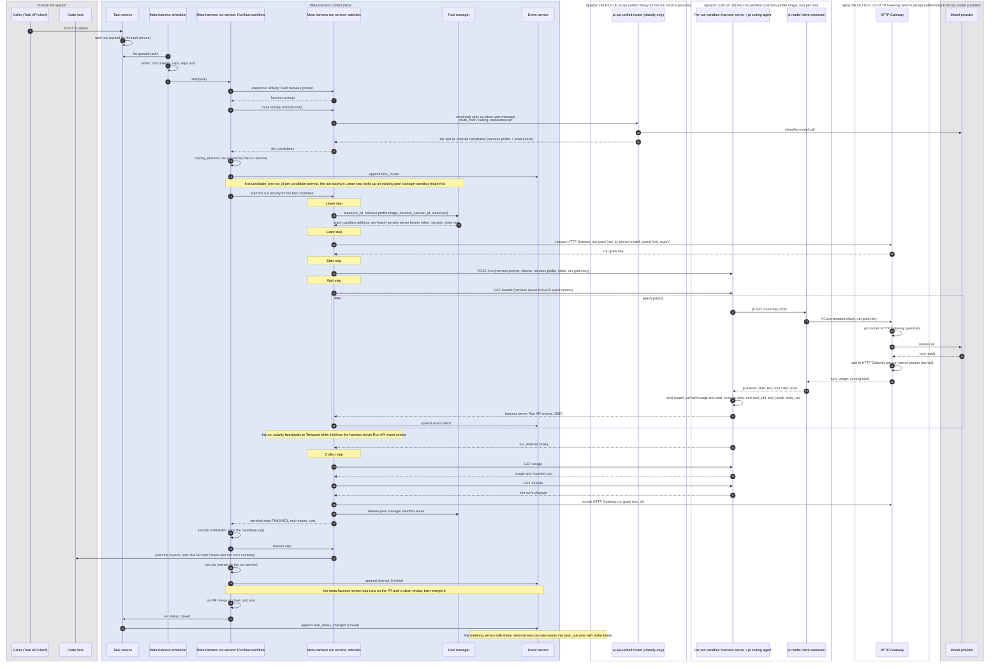

#### The operator console opening a run in progress

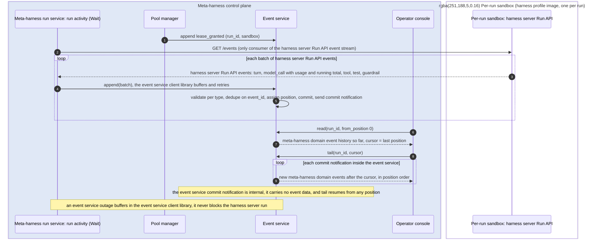

#### A compaction or auxiliary call inside a run

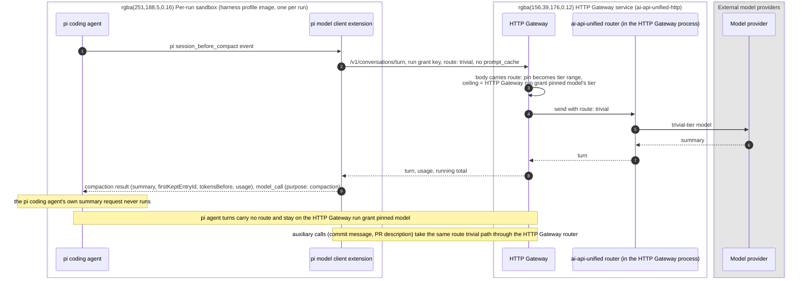

#### A run reaching its spend limit

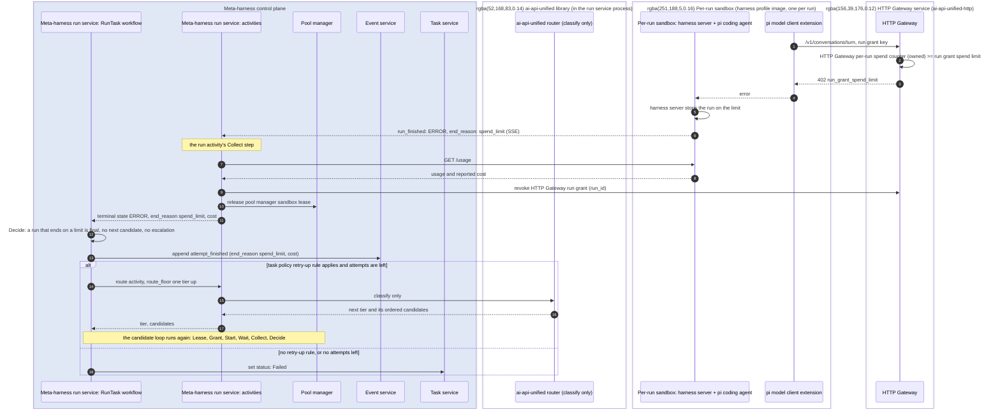

#### The review loop on an open pull request

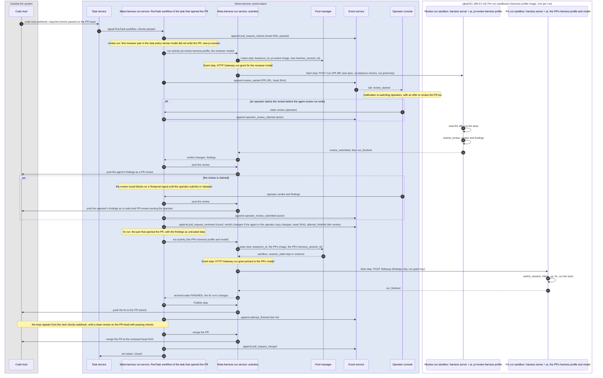

#### An operator cancel or kill switch

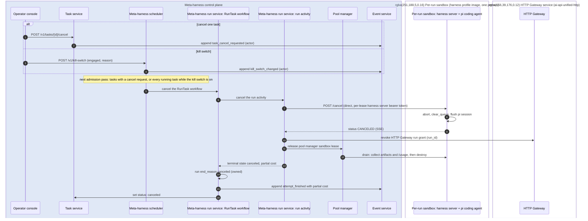

## The harness

A harness is the coding agent a run uses, set by its harness profile's image.
Any image that serves the harness server Run API and honors the run's pinned
model can be one. The default harness is pi's coding agent
(`@earendil-works/pi-coding-agent`). The meta-harness adds to pi:

- the pi model client extension, which registers the only model provider pi
  can see and sends every pi turn to the HTTP Gateway;
- the harness server, which exposes the harness server Run
  API and runs pi's `AgentSession` through pi's SDK.

### Model client

The pi model client extension registers one pi model provider with
`pi.registerProvider()` and its own `streamSimple`. The pi model client
extension needs its own stream function because the HTTP Gateway's
`/v1/conversations/turn` is not a protocol pi implements. The pi model
provider exposes a single pi model, "the run's model", which is whatever
model the HTTP Gateway run grant pins. The pi model has zero cost
metadata, because cost comes from the HTTP Gateway. It declares no
`promptCache` lifetime, so pi never warms the provider prompt cache.

On every pi turn the pi model client extension:

1. Takes pi's transcript context, reading the current system prompt and pi
   tools from pi's transcript helpers, and builds the HTTP Gateway's
   conversation request. The request holds the system prompt, messages,
   pi tools, the thinking level the run started with, and the
   `prompt_cache` field set to
   `{"retention": "extended", "key": <harness_session_id>}`. Each earlier
   assistant turn goes back as its HTTP Gateway conversation token. Each pi
   tool result goes as `{"type": "tool_result", "tool_call_id", "result",
   "is_error"}`, the same for every model provider. The HTTP Gateway builds
   the answering model provider's own tool-result message from it
   (ai-api-unified-http 1.19.0). So the pi model client extension holds no
   per-provider message code.
2. Attaches per-call routing hints. pi agent turns have no route hint, so the
   HTTP Gateway run grant's model policy decides. That policy is one pinned
   model, or a tier range: the router tiers from a `route_floor` to a
   `route_ceiling`. Calls the pi model client extension makes itself, for pi
   session compaction and for auxiliary text (commit message, pull request
   description), have `route: trivial`.
3. Calls the HTTP Gateway's native conversation endpoint with the run grant
   key. The pi model client extension follows pi's custom-provider contract.
   It calls `options.onPayload` before sending and `options.onResponse` on the
   HTTP Gateway response. It awaits `options.onProviderStreamEvent` for each
   pi provider stream event and honors pi's abort signal.
4. Maps the HTTP Gateway turn result into pi's provider event sequence. The
   sequence holds `start`, balanced text and thinking events, tool-call
   events, and exactly one `done` or `error`. By `toolcall_end` the pi model
   client extension has parsed a tool call's arguments into input. A tool-use
   turn arrives from the HTTP Gateway as one response, so the pi model client
   extension emits text once per turn.
5. Finalizes pi's assistant message with the HTTP Gateway's numbers. They are
   the input, output, cached input and cache-write model tokens, the per-turn
   cost, the stop reason, and the model the HTTP Gateway used. The pi model
   client extension also keeps the run's totals for the harness server Run
   API's `GET /usage`. To them it adds `cached_input_tokens`,
   `cache_write_5m_tokens` and `cache_write_1h_tokens` from each HTTP Gateway
   turn's `usage`. The HTTP Gateway reports provider prompt cache writes by
   lifetime because they bill at different rates. On Anthropic and Bedrock a
   5-minute write bills at 1.25 times the input rate and a 1-hour write at 2
   times.

Every HTTP Gateway conversation turn sends the whole pi session history, so
provider prompt caching sets most of a turn's cost. A cached prefix bills at
about a tenth of the input rate on Anthropic.

- pi passes `cacheRetention` and `sessionId` to the pi model provider on every
  call. The harness profile image sets `PI_CACHE_RETENTION=long`. The pi model
  client extension maps `long` to the `prompt_cache` retention `extended`.
  That is 1 hour on Anthropic and Bedrock, and 24 hours on OpenAI. A run often
  waits more than 5 minutes between pi turns while tests or builds run. The
  default provider prompt cache would expire in that gap. `harness_session_id`
  as the provider prompt cache key sends every turn of a pi session to the
  same OpenAI prompt cache.
- pi's `cacheWarming` setting is `off`, and the pi model
  client extension's pi model declares no `promptCache` lifetime. Otherwise pi
  would send billed provider prompt cache refresh calls through the HTTP
  Gateway.
- The pi model client extension keeps the system prompt and pi tool list
  byte-identical for the whole run. They hold no timestamps and no run ids,
  and the pi tool order is fixed. A pi session compaction rewrites the pi
  session history, so the pi turn after it writes a new provider prompt cache
  entry once.
- The HTTP Gateway accepts `prompt_cache` on the
  conversation turn and returns the cached-model-token fields in `usage`.

When an HTTP Gateway guardrail check blocks tool results, the HTTP Gateway
response names their tool-call ids. The pi model client extension replaces
those tool results with a short notice and resends the pi turn. The harness
server emits the `guardrail_blocked` harness server Run API event. When the
HTTP Gateway refuses a turn with `402 run_grant_spend_limit`, the pi model
client extension ends the pi turn with `error`. The harness server ends the
run `ERROR` with end reason `spend_limit`.

### What pi loads

The harness server creates the pi session with `createAgentSession()` and
decides everything pi loads:

- A custom `ResourceLoader` supplies only the pi model client
  extension, the owned pi extension tools, and the skills the run was sent.
  Nothing loads from the cloned task repo's `.pi/` directory: no pi
  settings, pi extensions, pi skills or `SYSTEM.md`.
- **Skills** come from the control plane. A skill is a directory in the usual
  layout: `SKILL.md` (its frontmatter names it and says what it is for) and
  the files beside it. The control plane keeps skills as the `skills`
  configuration kind (`src/meta_harness/config/skills.py`). The kind is
  versioned and rolled back like the rest of the configuration, and available
  to every goal's runs. A harness profile names the skills its runs load
  (`skills: [...]`, checked against the kind, and needing the `read` tool).
  The run service sends their files with `POST /run`. The harness server
  writes them to a directory of its own outside the workspace, so none reaches
  the repo or the pull request. It loads those and no others. pi tells the
  model each skill's name and description and where it is. The model reads the
  rest when its work needs it, so a skill it does not use costs a line of the
  prompt. A skill's scripts run inside the per-run sandbox, under the
  profile's bash allowlist and the egress proxy, so a skill grants no access.
- **A locked skill** is one the control plane itself depends on. The control
  plane runs the skill's script in its own process, or puts the skill's text
  in its prompts. An admin who could change such a skill could run code that
  holds the control plane's credentials, so a pull request decides what it
  holds. `config/skills/locked.json` names the locked skills; today
  `no-ai-slop2`, for the writing pass's scanner and the writing rules. A
  locked skill is always the shipped files, with `"locked": true` in its
  source:
  - A save or a rollback that changes or removes one is refused, and so is
    an import under its name. Each refusal says to change it with a pull
    request.
  - Each deploy sets the stored copy, which runs load, to the shipped files
    (`store.sync_locked`), as a new version.
  - The control plane reads the script and the rules from the shipped files,
    never from the stored configuration. It runs the script with none of its
    own environment.
  - The Skills page shows a lock on its row, which says why, and no remove
    button.
  - A service does not start when the list is unreadable, or leaves out the
    skill `config/planner.json`'s `writing_pass.skill` names.

  An admin imports, changes and removes every other skill.
- The kind is seeded from `config/skills/`. A skill added there later reaches
  a deployment as a new version, as a shipped profile does. It ships
  `no-ai-slop2` (MIT, from codeandtheory/machine-ai-skills, with its scanner
  script). The shipped copy is adapted to check the text a run is about to
  write, rather than a previous reply. That text is a pull request summary, a
  review or an issue draft. Every shipped profile that writes for people names
  it (`pi-lean`, `pi-careful`, `pi-review`, `pi-plan`). Their prompts tell the
  run to apply it to its summary, review or drafts before it finishes (What
  the meta-harness writes). A skill or bash command a shipped profile starts
  to name reaches the deployment's profile of that name as a new version,
  once. One an operator removed is not added again. An admin imports a skill
  on Configuration, Skills. The source is an https git repository on a public
  host, given as a branch or tag and a path. The commit read is kept. Or it is
  a folder on their machine (`POST /v1/config/skills/read`, which saves
  nothing). The admin reads every file in full and saves the skill as a new
  version. The import form picks the repository from the registered repos. It
  then picks a branch or tag and a directory holding a `SKILL.md` from what
  the repository lists (`GET /v1/config/skills/source`). It refuses a name a
  list lacks, and an empty branch is the default branch. A list that cannot be
  read says why and takes a typed value. A skill holds text files only, at
  most 200 files and 2 MB; a skill a profile names cannot be removed.
- pi SDK sessions leave out the pi CLI's built-in `codemode`, `tool_search`
  and MCP extensions. The harness server keeps them out, because `codemode`
  can run classifier and image models with the session's credentials.
- A `ModelRuntime` with no built-in credentials leaves the pi model client
  extension's model as the only one pi can call. The harness
  server never calls `setModel`, so pi never switches models and the HTTP
  Gateway run grant decides the real model.
- pi's SDK `tools` option comes from the harness profile.
- pi loads `AGENTS.md` and `CLAUDE.md` from the pi working
  directory unless pi context loading is off, so the harness profile's
  `context_files` setting decides. The meta-harness run service dispatcher activity puts
  the task repo's `AGENTS.md` in the first pi prompt, so turning
  pi context files on sends it twice.
- `SettingsManager.inMemory(...)` holds these pi settings,
  and pi reads no settings file:

| Setting | Value | Reason |
|---|---|---|
| `compaction.reserveTokens`, `compaction.keepRecentTokens` | The harness profile's `loop.compaction` | Context windows differ by model, so each harness profile sizes its own compaction |
| `retry.enabled` | `false` | pi's default model-call retry (3 retries, backoff up to 60 seconds) would stack on the HTTP Gateway's ai-api-unified fallback chain. A failed pi turn fails the run, and the RunTask workflow's Decide step moves to the next tier candidate. pi's context-overflow recovery (compact, then retry) stays on. |
| `cacheWarming` | `off` | Warming calls would be billed provider prompt cache refreshes |

The HTTP Gateway run grant decides the model, so the harness server registers
no pi virtual models (`registerVirtualModel`).

### Tools

| Tool | Source | What the meta-harness adds |
|---|---|---|
| `read`, `ls`, `find`, `grep` | pi built-in tool | Nothing |
| `write`, `edit` | pi built-in tool | The pi model client extension's tool-call hook refuses protected paths from the task repo policy |
| `bash` | pi built-in tool | A timeout and output cap from the harness profile. The pi model client extension's tool-call hook refuses commands outside the harness profile's allowlist |
| `run_tests` | owned pi extension tool, planned | Runs the acceptance checks named in the task and emits `tests_run` harness server Run API events |
| `submit_review` | owned pi extension tool, meta-harness review harness profiles only | Ends the review run with verdict `clean` or `changes` and its findings, as a `review_submitted` harness server Run API event. The meta-harness run service posts them as a code-host pull request review |
| `update_plan` | owned pi extension tool, offered to every run whose profile has `write` | Records the agent's plan as a checklist (each step pending, in progress or done) in a `plan_updated` event. The Task page shows the newest one as its plan (`features/tasks/Plan.tsx`), with a progress bar and a line saying whose it is. While its run is under way it reads as live. It shows when the agent last updated it and marks the step in progress as going on. With no run under way it is "as the last run left it" and that step is where the work stopped. A new run that has recorded none yet shows the earlier run's as an earlier run's. A running task with no plan says one may come. The task prompt asks for it on any task of more than a few steps |
| `create_issue` | owned pi extension tool, planning harness profiles only | Records one issue draft as an `issue_drafted` harness server Run API event. Its fields are `draft_id` (the agent's own short name for it), `repo`, `title`, `body` (which states its acceptance checks), `labels` and `depends_on`. `depends_on` names other drafts' ids, or existing issues as `owner/repo#number`. A second call with the same `draft_id` replaces the draft; a draft that depends on itself is refused. It writes nothing to the code host: the planner creates the issues once the plan is approved |

A harness profile's `tools` list chooses from these tools. Until `run_tests`
exists, a run runs its acceptance checks with `bash`. The protected-path
refusal on `write` and `edit` is planned too. Branch protection blocks default
branches. The pull request description holds the run's final summary, under
`What this change does`. The harness prompt asks the run to end its last
message with it between a `<pr-summary>` line and a `</pr-summary>` line. Only
that part is kept, so the narration around it is left out. The summary says
what changed and why, and the files or areas touched, naming any outside the
task's paths and why. It also gives the checks run and how they ended. Last, it
says what the change does not do, or what the run decided where the task left
room, since no person answers questions during a run. A run may leave no marked
summary, or one under three words, or one that is only narration (that the
checks pass, that it kept to its paths). The description then says so plainly
under `What this change touches`. It lists the files changed and the checks
run from what the run service recorded, never from the run's own text or plan
(the run loop's Publish step).

### Loop policy

The pi model client extension and the harness server enforce the harness
profile's `loop` settings. Of these, the turn and minute limits are built.
Plan-first, `test_before_pr` and the compaction handler are planned, and until
the handler exists pi compacts with its own summary request, on the run's
model:

- The harness server counts pi turns from pi SDK
  events and sends `abort` to the pi session at `max_turns` or `max_minutes`.
- The first pi prompt requires a plan before edits. The pi model client
  extension's tool-call hook refuses writes until pi has emitted a plan.
- With `test_before_pr`, the Publish step runs only when
  the `run_tests` pi extension tool has passed in the run's pi session.
- pi starts pi session compaction when the pi context passes the model context
  window minus a reserve (`contextTokens > contextWindow - reserveTokens`). It
  keeps the most recent `keepRecentTokens` of pi session history as they are.
  The harness profile's `loop.compaction` sets both (pi's defaults are 16384
  and 20000). The pi model client extension handles pi's
  `session_before_compact` pi SDK event. It makes the summary call to the HTTP
  Gateway itself, with purpose `compaction`, `route: trivial` and no
  `prompt_cache`. It returns
  `{compaction: {summary, firstKeptEntryId, tokensBefore, usage}}`. pi's own
  compaction summary request never runs. The compaction summary keeps the task
  spec and acceptance checks verbatim.

What happens to a run's context as it fills, as built: the harness server
tells pi that every model has a context window of 200,000 tokens and answers
of 8,192 (`images/harness-pi/server/harness.ts`), whatever the model's real
limits are. pi compacts with its own defaults: it starts when 16,384 tokens
are left and keeps the most recent 20,000 as they are. The run's own model
writes the summary, and nothing fixes what the summary must hold, so the
task's text, its acceptance checks and the agent's plan survive only when
that model keeps them. The run records each compaction as a `compacted`
event with its reason. What a run should do in its place is specified in
`docs/specs/context-compaction.md`.

### pi sessions

A pi session is one conversation with pi, named by `harness_session_id`. Today
every run starts its own pi session, named after its `run_id`. A candidate
that follows a failed one starts from the task, not from another model's
transcript. With the review loop, the meta-harness run service keeps the
session of the run that opened a pull request. Every meta-harness fix task on
that pull request continues it in a follow-up run. A meta-harness review run
starts its own pi session, so the reviewing model never sees the authoring
model's conversation.

| When | Where the conversation is | Owner |
|---|---|---|
| During a run | pi's session directory in the per-run sandbox, set through pi's SDK `SessionManager` | The per-run sandbox (harness server) |
| Between runs | A copy of that pi session directory in the pool manager's Cloud Storage bucket, stored under `harness_session_id` when the run ends | Pool manager |
| Between runs, briefly | The finished per-run sandbox itself, kept for the pi session for up to `sticky_window` (default 10 minutes) | Pool manager |
| On each model turn | The request the pi model client extension sends to the HTTP Gateway, which forwards it and keeps no copy | Nobody |
| In the event service | Each turn's text and tool calls, as a meta-harness domain event record for the operator console and the metering service | Event service |

A follow-up runs in a per-run sandbox that holds the pi session. The pool
manager supplies it before the pool manager sandbox lease request returns. It
hands back the per-run sandbox it kept for the pi session, if it kept one.
Otherwise it copies the pi session directory from its Cloud Storage bucket
into a fresh per-run sandbox. The harness server then switches pi to that pi
session and continues it. So the pi session conversation keeps its tool
history on the same model.

### Events

The harness server subscribes to the pi session with `session.subscribe()`
and maps pi SDK events (`message_update`, `tool_execution_*`, compaction,
`agent_end`, `agent_settled`) to the typed harness server Run API events, each
with run id, sequence number and timestamp: `turn_started`, `model_call`
(model, thinking, model tokens, cost, latency, as the pi model client
extension recorded them from the HTTP Gateway), `tool_call`, `tool_result`,
`file_changed`, `tests_run`, `guardrail_blocked`, `compacted`,
`review_submitted`, `plan_updated`, `issue_drafted`,
`turn_finished`, `heartbeat`, `run_finished`. The `agent_settled` pi SDK
event marks the end of a pi turn that will not continue on its own. The
harness server then finishes the run or, in a follow-up, waits for the next
input on the harness server Run API.

### Harness profiles

A harness profile sets a harness's image, tools, limits and resources, and is
the harness half of a router candidate. `config/harness_profiles.json` holds
them:

```json
{
  "version": "2026-11-07.1",
  "profiles": {
    "pi-lean":    {"image": null,
                   "tools": ["read", "write", "edit", "ls", "find", "grep", "bash"],
                   "max_turns": 80, "max_minutes": 45,
                   "resources": {"cpu": 2, "memory_gb": 6},
                   "bash_allow": ["cd", "ls", "cat", "grep", "git", "python", "uv", "poetry", "pytest", "ruff", "..."]},
    "pi-careful": {"image": null,
                   "tools": ["read", "write", "edit", "ls", "find", "grep", "bash"],
                   "max_turns": 200, "max_minutes": 120,
                   "resources": {"cpu": 2, "memory_gb": 6},
                   "bash_allow": ["..."]}
  }
}
```

- `image` names the harness profile image for the per-run sandbox. `null` uses
  the deployment's default, `harness-pi`, which has Node, git, Python 3.12, uv
  and Poetry. So a run can install and test any of the three registered repos.
- `tools` lists the pi tools the run may use.
- `max_turns` and `max_minutes` bound the run. The harness server stops pi at
  either, and the run activity may take `max_minutes` plus 10 minutes before
  Temporal retries it.
- `resources` sets the per-run sandbox's CPU and memory.
- `bash_allow` names the programs pi's `bash` tool may run. The harness server
  loads it as an inline pi extension. Its `tool_call` handler refuses any
  other program, and any command or process substitution, with a reason pi
  reads as the tool's result. It keeps a run to the tools its task needs; the
  per-run sandbox, not the list, is the security boundary.
- `services` names what the run gets beside its sandbox: `["postgres"]`, or
  `[]` for none. Left out, the machine's `MH_SANDBOX_SERVICES` decides, which
  the VM sets to `postgres`, so every profile gets it without an operator
  rewriting the profiles they keep. With `postgres`, the run service starts a
  Postgres container (`postgres:16-alpine`, or `MH_SANDBOX_POSTGRES_IMAGE`) on
  the run's own network before the sandbox. The container has its data in
  memory, one CPU and 512 MB, and no port on the host. The run service waits
  until it takes connections. The sandbox is given its URL as `DATABASE_URL`
  and `MH_DATABASE_URL` (or the names in `MH_SANDBOX_DATABASE_ENV`), and
  reaches it by name, not through the egress proxy. It is removed with the
  sandbox. So a task's tests that need a database run in its sandbox (#200).
  Before, this repo's `db` tests could not run there, and every review
  reported it. One fix run spent 75 turns trying to start a Postgres in
  `/tmp`.
- The meta-harness run service checks every harness profile at startup: its
  tools, limits, resources, services and allowlist, and every tier
  candidate's profile name.

Planned profile fields: `prompts`, a versioned harness prompt set;
`loop.plan_first` and `loop.test_before_pr`; `loop.compaction`, mapped to pi's
`compaction.reserveTokens` and `compaction.keepRecentTokens`; and
`context_files`. The review harness profile, `pi-review`, has no `write` or
`edit` tool and adds `submit_review`. The planning harness profile,
`pi-plan`, has no `write` or `edit` tool either, adds `create_issue`, and its
Bash allowlist names only programs that read (`ls`, `cat`, `grep`, `find`,
`git` and the like; the allowlist names programs, not subcommands). No run
pushes: only the control plane writes to the code host.

## Harness execution

### Sandbox

Each run gets one per-run sandbox: a pod with the gVisor runtime class in the
`sandbox` namespace.

- The pod runs the harness profile's image, built from a common base. The base
  has git, language toolchains, Node, pi, the pi model client extension and
  the harness server. A harness profile names another image when it needs
  another toolchain or another coding agent.
- The per-run sandbox clones the task's repo at `/workspace` with the run's
  read-only code-host access token. Every per-run sandbox uses that path,
  because a restored pi session needs the working directory it recorded. The
  meta-harness run service's Publish step reads the run's changes through
  `GET /bundle` and pushes them. With the Docker executor backend, the
  meta-harness run service clones on the host into the mounted workspace and
  publishes from it. The clone's git directory is beside the workspace, not
  inside it. The per-run sandbox mounts it read-only, and every host git
  command names the git directory and the work tree outright. So what pi
  writes in the workspace never runs on the host when the Publish step commits
  and pushes. That covers a hook, a rewritten `.git` file and a
  `core.fsmonitor` setting. A git repository inside the workspace would get
  around that, since git reads a nested repository's own configuration when
  status or diff looks at it. So every host git command first refuses a
  workspace that holds a `.git` below its top (the task fails, to be retried).
  Status and diff ignore submodules.
- The image sets the HTTP Gateway URL, and the run grant key arrives in
  the `POST /run` or `POST /followup` body.
- Egress reaches only the code host, package registries and the HTTP Gateway.
- CPU and memory come from the harness profile, 2 vCPU and 4 GB by default.
- The pool manager owns the per-run sandbox. The sandbox serves one run at a
  time. When the run ends the pool manager destroys it, or keeps it for the
  same pi session's next follow-up run.

### Harness server

The harness server is a small TypeScript service in every per-run sandbox. It
serves the harness server Run API to the meta-harness run service run
activity. It runs pi in-process through pi's SDK, using `AgentSessionRuntime`
for `newSession()`, `switchSession()` and `fork()`.

| Endpoint | Purpose | pi SDK calls |
|---|---|---|
| `GET /health` | Harness server readiness: pi model client extension registered, the workspace directory exists, HTTP Gateway reachable. A `warm` per-run sandbox passes it before it clones any task repo | pi model runtime state |
| `POST /run` | Start a new pi session for the run. The body holds the prompt, acceptance checks, harness profile, limits and the HTTP Gateway run grant key. It also holds the skills the profile names, each with its files | `newSession()`, `prompt()` |
| `POST /followup` | Continue the pi session the per-run sandbox holds, kept or restored by the pool manager before the pool manager sandbox lease returned. The body holds the new input and the HTTP Gateway run grant key, and no pi session reference. | `switchSession()` for a restored pi session, then `prompt()` |
| `GET /events` | Harness server Run API events as server-sent events, resumable with `Last-Event-ID` | `session.subscribe()`: `message_update`, `tool_execution_*`, pi compaction events, `agent_end`, `agent_settled` |
| `GET /status` | `CREATING`, `RUNNING`, `FINISHED`, `ERROR`, `CANCELED`, `EXPIRED`, plus the last harness server heartbeat event | pi session state |
| `POST /messages` | An operator's message to the run in progress: `next_turn` steers pi, `after_stop` queues it as a follow-up. Records `operator_message_delivered` | `steer()`, `followUp()` |
| `POST /stop` | End the run after the turn in progress, `FINISHED` with end reason `stopped_by_operator`, so its work publishes | `abort()` at the turn's end |
| `POST /cancel` | Stop pi. The pi session file keeps every pi session entry written before the cancel, so a later follow-up run can continue the pi session. | `abort()`, which waits until the pi session is idle |
| `GET /usage` | Model token totals (input, output, `cached_input_tokens`, `cache_write_5m_tokens`, `cache_write_1h_tokens`), model call counts, and the HTTP Gateway's running total, as the pi model client extension recorded them. These totals serve reconciliation against the run's `model_call` meta-harness domain events | pi model client extension counters |
| `GET /record` | What the run did, for a summary when its own is missing or unusable. It holds the full text of its last turn when that turn called no tool. It holds update_plan's last checklist and the files it wrote or edited. It lists each acceptance check with whether a bash command containing it ran and passed the last time. It says how many commands ran and failed | `session.subscribe()`: `turn_end`, `tool_execution_end` |
| `GET /metrics` | Harness server OpenTelemetry metrics: pi turns, pi tool calls, files changed, test runs, elapsed time | harness server counters |
| `GET /bundle` | The run's changes against the commit it cloned, as a git bundle, for the meta-harness run service's Publish step. The Docker executor backend reads the mounted workspace instead | none: git in the workspace |

The harness server waits with `waitForIdle()`, and sends `steer()` or
`followUp()` when input arrives while pi is working. The model comes from the
run grant and the thinking level from the `POST /run` body, so the harness
server calls no `setModel`.

### Executor backends

The pool manager reaches per-run sandboxes through an executor backend. The
run activity calls the harness server Run API directly, over mutual TLS, at
the address and with the bearer token in its lease. Every executor backend
provides these operations:

| Operation | Called by | Purpose |
|---|---|---|
| validate | Pool manager startup | Fail if any harness profile names a harness profile image this pool manager executor backend cannot run |
| provision | Pool manager | Create a per-run sandbox from a harness profile image; return when the harness server `/health` is green |
| destroy | Pool manager | Delete the per-run sandbox and release its resources |
| inventory | Pool manager | List the per-run sandboxes that exist, for pool manager reconciliation |
| address | Pool manager, when it grants a pool manager sandbox lease | The per-run sandbox's pod address and its per-lease harness server bearer token, returned in the pool manager sandbox lease |
| status, usage | Pool manager, on drain | The harness server status and usage endpoints |
| save session | Pool manager, when a meta-harness run ends | Copy the pi session directory to the pool manager's Cloud Storage artifact bucket under `harness_session_id` |
| restore session | Pool manager, before a `restored` pool manager sandbox lease returns | Copy a pi session directory from the pool manager's Cloud Storage artifact bucket into a fresh per-run sandbox, which has the task repo cloned at `/workspace` |
| artifacts | Pool manager, on drain | Harness server logs and the final pi session directory, copied to the pool manager's Cloud Storage artifact bucket |

The backends are Kubernetes pods on GKE, Docker for development and the
deployment without GKE, and managed sandbox services. A fake backend replays
recorded Run API event streams for tests.

### Pool manager

The pool manager creates and destroys every per-run sandbox. It is one
leader-elected service that owns the `sandbox` and `lease` tables and the
artifact store, and it reconciles them against the executor backend's actual
sandboxes.

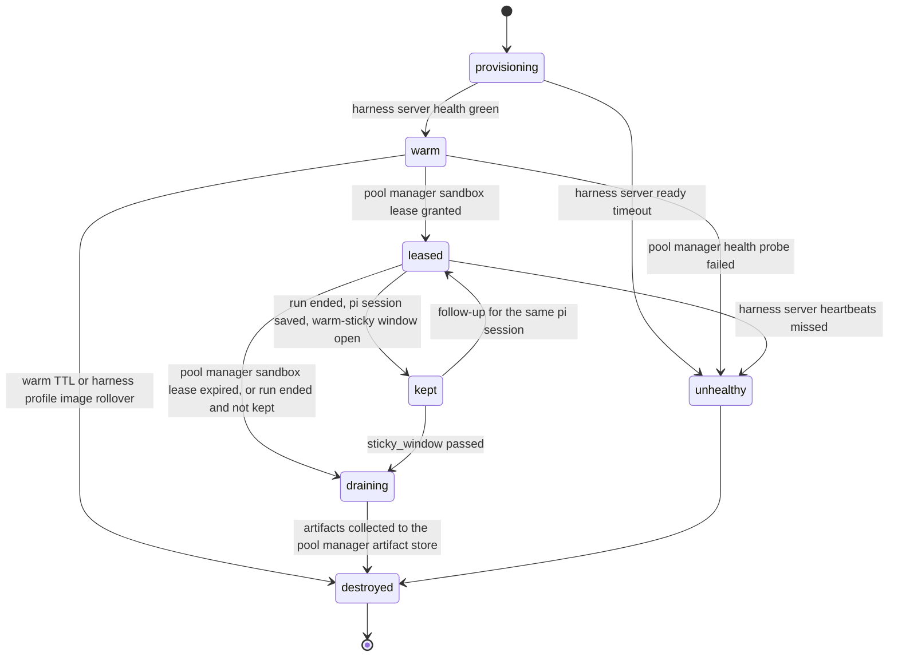

A `warm` sandbox has a healthy harness server and no repo, credentials or run.
At lease time the pool manager injects the run's read-only code-host access
token. The run grant key
arrives later, in the `POST /run` or `POST /followup` body. A `kept` sandbox
holds a finished run's repo and pi session for up to `sticky_window`, with its
run grant already revoked. A `draining` sandbox is having its pi session
directory, harness server logs and `/usage` collected. A `destroyed` sandbox
keeps its `sandbox` record for audit.

The run activity requests `lease(run_id, image, harness_session_id,
resources)`, idempotent on `run_id`. The response holds the per-run sandbox address,
the lease TTL and a `session_state`:

- `kept`: the per-run sandbox kept for that pi session is still within its
  `sticky_window`, and the pool manager hands it back.
- `restored`: the artifact store holds a pi session directory for that
  `harness_session_id`. The pool manager copies it into a warm per-run sandbox
  of that image. The sandbox clones the repo at `/workspace`, the working
  directory the pi session recorded.
- `new`: the pool manager hands out a warm per-run sandbox of that image, or
  provisions one.

A lease's TTL is the harness profile's `max_minutes` plus a grace period. The
pool manager destroys the per-run sandbox when it expires, whether or not the
run activity released the lease. So a crashed run activity leaks nothing. The
lease is the only way to a per-run sandbox's address, and the harness server
Run API accepts only that lease's bearer token. When a run ends, the pool
manager saves its pi session directory to the artifact store under
`harness_session_id` before it keeps or drains the per-run sandbox. A
follow-up for the same pi session within `sticky_window` (default 10 minutes)
gets the kept sandbox back and skips the restore.

The pool manager keeps a warm target per image (`warm: 4`), adjusted from the
meta-harness scheduler's queue depth per image. The pool manager replaces a warm per-run sandbox older than `warm_ttl` (default 2
hours), and per-image and global maximums cap the total. The GKE node
autoscaler follows the pool manager's demand.

The pool manager replaces a per-run sandbox whose harness server is not
healthy within `ready_timeout`. The lease goes to the next warm per-run
sandbox. During a run, two missed harness server heartbeat windows mark the
per-run sandbox `unhealthy`. The pool manager destroys it, and the RunTask
workflow's Decide step decides whether another candidate runs. The pool
manager also probes idle warm per-run sandboxes on an interval. Every 30
seconds it reconciles. It destroys sandboxes with no record or an expired
lease and marks records whose pod has vanished. It also provisions back to
each image's warm target.

A per-run sandbox serves one pi session: one run, and the follow-ups
`sticky_window` hands back to it. A fresh per-run sandbox per pi session is
the security boundary between pi sessions, so recycling is drain, destroy and
provision a replacement. When a harness profile changes its image version, the
pool manager stops leasing the old image and replaces its warm per-run
sandboxes. Leased per-run sandboxes on it finish. On a node drain, warm
per-run sandboxes go at once and leased ones run until their lease TTL.

The pool manager's metrics are sandboxes by state and image, provisioning
time, time to lease and warm hit rate. They also count health failures by
cause, lease TTL expiries, orphans destroyed by reconciliation, and artifact
collection failures.

## Metering

The metering service measures each completed task in dollar-hours:

```
dollar-hours per successfully completed task = Σi (Di × Hi) / Σi Ci
```

| Term | Source |
|---|---|
| Di, dollars for attempt i | The run's `model_call` events, each with the HTTP Gateway's token usage, cost and the run's running total, plus the `route` activity's `classifier_usd` |
| Hi, hours for attempt i | The run's time from `RUNNING` to a terminal state |
| Ci, success for the task | The share of the task's checks that passed: CI checks on its pull request, its acceptance checks, and the merge |

A task's attempts include its review and fix runs, and the metering service
reports the review loop's share apart, from each attempt's tier. Each run's
`attempt_finished` event has the dollars the HTTP Gateway counted against its
run grant. That figure and the harness server's `GET /usage` cross-check Di,
and the metering service flags a gap over 5%. Spend on failed runs, including
every run of a task whose candidates all failed, counts as the task's wasted
spend.

The metering service tails the event service into its own tables:
`model_call`, `attempt_usage`, `check_result`, `task_outcome`, and `spend`
per caller and period.

It also reports the prompt cache hit rate, cached input tokens over input
tokens, per run, harness profile and model. It keeps 5-minute and 1-hour
cache writes apart because they bill at different rates. A low hit rate means
the prompt prefix changes between turns, which multiplies the cost of every
later turn. The metering service then raises an alert.

### Spend controls

- The HTTP Gateway refuses a turn once the run has spent its run grant's
  limit. The harness server then ends the run `ERROR` with `spend_limit`.
- The harness server ends a run `EXPIRED` at `max_minutes`, and the lease TTL
  destroys the per-run sandbox if the harness server does not.
- The meta-harness scheduler stops admitting a caller's tasks at the caller's daily spend
  cap, and warns at 80%. When the metering service lags, the meta-harness
  scheduler treats spend older than its staleness limit as at cap.
- A hard daily global spend cap and a kill switch stop everything.

## Scheduling

### Admission

The meta-harness scheduler runs an admission pass every few seconds and on
every task event:

1. It orders tasks by priority, then age.
2. It admits a task when global run concurrency is under its limit and the
   caller is under its concurrency quota and daily spend cap. The pool manager
   must also have sandbox capacity, and no other run may hold the task's repo
   area. A task sent back only to merge its reviewed pull request (`resume:
   merge`) takes no area. It writes no code, so it neither waits for nor holds
   one.
3. A repo-area lock covers the repo plus the top-level directories the task
   names. A task that names none takes no area and runs beside the others.
   Each run has its own clone and branch, and the merge step turns a conflict
   into a fix run. The locks are kept in Redis with a TTL, so a meta-harness
   scheduler leader that dies holding them cannot strand a repo.
4. It admits a goal's task once every issue the task depends on is closed. The
   goal must be active, have spent less than its blocking line, and run fewer
   of its tasks than its `max_parallel`. The blocking line is its `max_usd`
   plus its allowed overage, and a goal whose budget only warns is never held
   for budget.

A held area's reason names every task in the way, in a fixed order, so the
same holders always give the same reason.

Every queued task a pass does not start has a reason, and the scheduler stores
it (`scheduler.task_hold`, `scheduler/holds.py`). Each held task has one row
with the reason, its kind and what it names. The row also has when the task
began waiting for it and when a pass last looked. The row goes when the task
starts or is queued no longer. The rows survive a restart, so a deploy records
`task_held` only for a task whose reason is new or has changed. A task past
the system's parallel limit, and every queued task while the kill switch is on
or the scheduler drains, has a hold too. The Task API serves a queued task's
hold as `held`.

As built, the global limit is the task policy's `max_parallel`, 8 as shipped.
The scheduler reads it each pass and checks it at startup against
`MH_MAX_SANDBOXES`. The locks are expiring Postgres rows the scheduler renews
while a task is `queued`, `running` or `taken_over`, which covers the task's
review loop. An area is a path from the issue's `Paths:` lines. Two areas
conflict when they are the same path or one is a directory above the other. So
`console/src/features/goals` and `console/src/features/tasks` run together,
while `console` excludes both. A task whose issue has no `Paths:` line takes
no area, so a repo's tasks run side by side. Its lock row only counts it as
running.
A goal's `max_parallel`, when set, holds the goal to that many running
tasks; null inherits the task policy's, and the planner refuses one above
it. The planner, not the scheduler, holds a task `blocked` until its
dependencies close. Caller quotas, spend caps, sandbox capacity and the
modality's default parallelism are planned.

Parallel tasks merge one at a time per repo, each on a head that holds the
current base (Review loop, the merge). The repo's AGENTS.md asks each task to
keep to its paths and to add new files rather than logic to a central list.
Every run's prompt names the paths.

### The supervisor

Every other part of the control plane moves a task when something happens to
it. A workflow step ends, a sweep sees an issue close, or an operator presses
a button. Each state has one such mover, and a task whose event never comes
stays where it is. A `running` task whose workflow timed out is one. So are a
`ready` task whose merge GitHub refused once and a `blocked` task of a goal no
sweep covers. The supervisor (`src/meta_harness/supervisor/`) works the other
way. Once every `MH_SUPERVISOR_SECONDS` (60; 0 turns it off; checked at
startup) it looks at where every task that has not ended `closed` stands now.
It then decides who has it.

| Owner | Meaning |
|---|---|
| `workflow` | Its RunTask workflow is running in Temporal, and will move it |
| `scheduler` | It is queued, and an admission pass starts it or records why it holds it |
| `planner` | Its goal's sweep moves it: releases it when its dependencies close, ends it at its pull request |
| `supervisor` | No one has it, and the supervisor's own action moves it |
| `operator` | It waits on a person, and the standing says what for |

Each task has one of them. `rules.decide` is a pure function of a task's
facts. They are its status, what it waits on, whether it was asked to cancel
and whether the scheduler started it. The other facts are its workflow's state
in Temporal, its pull request's state on the code host and its goal's status.
The function is total. A test walks every combination and fails unless each
has an owner and an operator is always told what to do. It also fails when a
task is left to a driver that is not there. Such a driver is a workflow that
ended, or a sweep that does not cover its goal. The same test compares the
rules' statuses with the task service's, so a status added without a rule
fails it.

Each pass saves the answer as the task's standing (`supervisor.standing`). The
standing has the owner, situation and reason, what an operator is asked and
since when, and the supervisor's attempts and its last error. The pass records
`task_standing` when the standing changes, and the Task API serves it with the
task. A task's page shows it as Who has it. Where the owner is the supervisor,
the pass acts:

| Situation | Action |
|---|---|
| A `running` or `taken_over` task, or a `queued` one the scheduler started, whose workflow ended or does not exist | `recover` (`POST /v1/tasks/{id}/recover`): back to `queued`, to resume at its pull request when it has one. The scheduler starts a new workflow. A task asked to cancel is `canceled` instead. After three recoveries it fails, for an operator: something ends its workflows |
| A `ready` or `review_unresolved` task whose pull request merged or closed, of a goal no sweep covers, or of no goal | Ended as a sweep would: `closed` or `canceled`, with the pull request's end recorded |
| A `queued` or `blocked` task of a goal that was canceled or completed | Canceled, with the reason |
| A `ready` task of an active goal with `auto_merge` on, whose pull request the code host would merge, or that conflicts with its base | `merge` (`POST /v1/tasks/{id}/drive`): back to `queued` to resume at the merge. The merge step resolves a conflict in a fix run before any review. Reviewed first, a head that cannot merge meets new findings each round. It may then never reach a clean review, and with it the conflict fix |
| The same, with its head's checks failed | `review`: back through checks, review and fixes |
| The same, with checks that have not reported, or mergeability the code host has not worked out | `wait`: the supervisor has it and looks again each pass. After a day it is an operator's, told to see what holds the checks |
| A `failed` task whose failure was the system's, of an active goal or of none | `retry`: back to `queued` after a wait of 5 minutes, then 30, then 2 hours. It resumes at its pull request when it has one |
| A `review_unresolved` task whose review loop the system stopped, not its findings | `review`: back through the loop after the same waits |

A `ready` task is one whose workflow ended without merging. Either its goal
does not merge by itself, or the code host refused the merge at that moment.
It refuses when, for example, the required checks had not reported or the base
was failing. The first is an operator's. The second used to be too, forever:
the workflow tried once, and no one saw a conflict that appeared later. Now
the supervisor reads how the pull request stands (`supervisor/pulls.py`) and
sees the merge through. The pull request stands `clean`, `conflict`,
`checks_failed`, `checks_pending`, `blocked` or `unknown`, read from its
`mergeable` and `mergeable_state` and its head commit's checks. `blocked` with
the checks passed means a rule on the branch wants what only a person gives,
an approval or an exception. That task is an operator's. A pull request that
stands `clean` is merged whatever the task's tries say: asking the code host
for a merge it would take spends nothing, so that send-back is none of the
task's tries, which on a busy base were soon used up by the base moving under
it. It is asked once per head commit, or again after a wait when the refusal
was only a required check still running; refused at the same commit for
anything else, the task is an operator's (`merge_refused`). So is one whose
merge is held because its pull request changes `.github/` or `deploy/`
(`merge_held`): the supervisor never asks for that merge. The supervisor sends
one task back at most three times between an operator's retries (`drives`).

A task held for budget is raised by the supervisor once when the raise is
small (`remedies/raise_limit.py`). The raise is worked out from the task's
whole spend limit, not from the hold's sentence, which counts from what the
task had left when its workflow started; the workflow is sent the new limit
less what the task's earlier runs spent. When the next run needs more than
the task policy lets one task spend, no raise is asked for: that ceiling is a
hard cap. The supervisor ends the hold (`remedies/end_hold.py`), so the task
does not wait out a day in a running place with other tasks blocked behind it,
and the task goes on from where it ends. A goal that asks first leaves that
to the operator, whose panel says the limit cannot be raised and why.

A task parked at a pull request that is going nowhere has one more step the
supervisor takes by itself: it is started over on the current base
(`remedies/start_over.py`). Its pull request is closed, its branch deleted,
and it runs fresh from the base as it is now, as after an operator's Start
over. That covers a pull request that conflicts with its base when the fix
runs sent to resolve it did not, and a review that never came clean once its
fix rounds and its stronger model were used. The fresh run meets the task's
spend limit anew, so this happens once per task (the task policy's
`remedies.start_over`, counted in the ledger). So a goal's tasks keep up with
a base that other work is merging into, without a person pressing Retry on
each. A goal that asks first is offered the start-over as its first button.
Only after it is the task an operator's, and its standing says what was
tried.

A task fails because the work could not be done, or because the system failed
while the work was fine (`supervisor/failures.py`). The work could not be
done: the run changed nothing, hit its turn limit, a setting is wrong, the
review never came clean. The system failed: the worker restarted under it in a
deploy, or a sandbox did not start. The same goes when every model was
unavailable or the code host answered 5xx. The first kind is an operator's.
The second needs only another try, and used to get none: a task that failed in
an outage stayed failed after the outage ended. The supervisor reads the
recorded reason. It calls a failure the system's only when the reason names an
error on a fixed list. The list holds errors of the control plane and of what
it depends on. A reason it does not recognize, and any that names the task's
own limit, is the task's. So an unknown failure waits for a person and is not
run again. It retries only a failure less than a day old: one older is an
operator's, told that a retry should now run. A task's retries share its three
tries with its merges (`drives`). A retry after the worker's own restart,
which every deploy causes, is not one of them. The control plane interrupted
that run, so the task keeps its tries, and what it has spent still bounds it.

A recovery waits until the task has stood with no workflow for three minutes.
A status write still on its way is then not taken for a lost one. A recovered
task's next workflow gets what the task has left of its spend limit. The task
keeps what its runs spent since an operator last retried it
(`spent_carried_usd`). So neither a recovery nor a drive gives a task its
limit again. An action that fails is tried again after a wait that doubles, up
to an hour. Every action is one the task service refuses when it no longer
applies, so a repeat does nothing. A task whose workflow Temporal cannot be
asked about is left as it is, with that as its standing. So is one whose pull
request the code host does not answer for.

A `blocked` task of a swept goal is the sweep's while each issue it waits on
is being worked. It is an operator's, and its standing names the issue, when
one of them is in the way. An issue is in the way when its task failed, was
canceled or ended unresolved and waits on an operator. It is also in the way
when it is the task's own issue. The same goes when no goal holds it, so no
task will ever close it.

The planner's sweep used to drop its own errors. A pass over the goals was
wrapped whole with its exceptions dropped, so one goal that raised left every
goal after it unswept. What a sweep could not do (a repo it could not list, an
issue it could not read) was returned and thrown away. Each goal's sweep,
follow-up and plan collecting now runs by itself. One goal's failure is
recorded on that goal and the next goal still gets its turn. What a goal's
latest sweep could not do is kept and logged when it changes. It is served
with the goal (`sweep`: when, and the errors) and listed by `GET
/v1/supervisor` (`sweeps_failing`). An issue the planner refused for having no
acceptance checks is read again on every sweep, so adding the checks is all it
takes.

A supervisor pass that fails is logged as an error and reported by `GET
/v1/supervisor`. That path also gives when the last pass ran and how many
tasks each owner has.

Built so far are the supervisor's actions and the standing of every task. A
run that the worker's restart interrupts is taken up again by its own workflow
(Decide). The supervisor retries a task that fails on a restart all the same,
and that retry is none of its tries.

A RunTask workflow may run for 72 hours (`EXECUTION_TIMEOUT`), longer than any
wait inside it. It was six, while a budget hold waits a day and an operator's
review has no limit. Temporal ended those workflows mid-wait, running none of
their code, with the task still `running`. The supervisor now notices a dead
workflow, which Temporal's limit used to.

The console's Needs you is the supervisor's record. The Overview and the inbox
read the tasks whose standing's owner is an operator (`GET
/v1/tasks?has_it=operator`, longest waiting first). Each has what to do and
since when. A task of a paused or planning goal is left out: that hold is the
goal's, and shows on the goal. Because the list is the supervisor's, the
Overview says so when the supervisor is off, late or failing, or a goal's
sweep cannot finish. The list may then be missing something.

A goal has a standing too (`supervisor/goals.py`), read from its tasks'
standings and served with the goal. `standing` has `state`, `reason`, `ask`,
the tasks an operator has, and how many are moving. A goal's status says what
an operator set it to or what the planner found; it does not say whether the
goal is getting anywhere. `moving`: at least one task is being worked or waits
to start with no one's help. `needs_you`: the goal is active with work left,
none of it moving, and an operator has what is left, or its issues were
refused. `held`: the goal itself is paused, planning or stopped by its budget.
`idle` and `done` are the rest. This is what `stalled` was meant to say and
nothing ever set. The standing is read from the record, and the goal is not
moved to a status its sweep does not cover. So a goal that waits on an
operator stays swept, and it goes on the moment one task is unstuck. A goal
that needs the operator says so at the top of its page, with what each task
needs. It says so in the Overview's list of goals and in the inbox too.

An operator removes an issue from a goal that has started with Remove from
goal, on the goal's table of issues. The dialog says what that does to the
issue's task. The goal lets the issue go for good and nothing changes on the
tracker. `issue_link` keeps the row, marked `dropped`, which keeps the goal's
label from taking the issue in again. A removed issue is not listed with the
goal, does not count toward the goal being met, and is free for another goal.

Planned: an open issue whose task was canceled given a new task. That is
#256's first part, which waits until an operator has had Remove from goal to
take out what should not run again. Also planned: a reminder outside the
console when a wait for an operator grows long.

#### Remedies

When the supervisor has a task, `rules.decide` names the situation it is in
and the remedy for it. The same facts always give the same remedy. Each
remedy is a small class in its own module under
`supervisor/remedies/`, listed by id in `remedies/registry.py`. It knows its
most tries (`of`) and how many it has made (`tries`), and `apply` runs it
through the Task API or the planner. Adding a remedy means writing its
module, listing it, and having `decide` name it for its situation. A test
walks every remedy `decide` can name and fails one with no module.

| Remedy | Situation | What it does | Tries |
|---|---|---|---|
| `recover` | A task with no workflow behind it | Queues it again where its pull request stands, with what it spent carried over; cancels one asked to cancel | The Task API's recovery cap |
| `end_at_pull_request` | A parked task whose pull request merged or closed, which no sweep covers | Closes or cancels it to match | — |
| `merge` | A ready task of an auto-merge goal that the code host would merge, or that conflicts. Also an unresolved one of such a goal whose review came back clean, kept from merging only by a conflict with its base (`review_clean_conflict`) | Sends it back for its merge: a conflict gets a fresh set of fix rounds first, and the merge waits for a clean review | The task's drives |
| `review` | A task whose checks failed after its review. Also, for a goal that does not merge by itself, an unresolved task whose review came back clean and only a conflict kept from merging | Sends it back through the review loop | The task's drives |
| `retry` | A task that failed on the system's side | Runs it again after a wait that grows each try | The task's drives |
| `cancel_for_goal` | An unstarted task of an ended goal | Cancels it | — |
| `wait` | A pull request whose checks have not reported | Nothing this pass | — |
| `retry_stronger` | A task that failed on its own account (it could not finish the work), whose last route was below the complex tier | Runs it again with `complexity: high`, so its route is the complex tier: a stronger model and the careful profile | The task policy's `remedies.retry_stronger` (1) |
| `fix_again` | A review its fix rounds did not settle, on a swept goal, when its last review was not clean | Sends it back through its review loop with `complexity: high`: a fresh set of fix rounds, on the complex tier | The task policy's `remedies.fix_again` (1) |
| `auto_split` (planner) | An open issue of an active goal the sweep held as too large, that no one split, ran anyway or made a task of. Also an open issue whose task failed at its run's turn or time limit on the strongest tier, with no pull request: the work is larger than one run (`failures.out_of_run`) | After the sweep, drafts the parts (`splits.draft`) and splits it as the Split button would (`split_issue.py`). An issue whose task failed that way is claimed by its task's id, and its task is closed once the parts exist, with the reason naming them. While the planner may still split it, the supervisor's standing names the planner as its owner (`failed_too_large`), so no operator is asked. Keyed in the ledger by the issue's `ref`. A try that fails counts, so it stops at its limit. A held issue then keeps its Split and Run anyway, and a failed task is offered Retry and Cancel | The task policy's `remedies.auto_split` (1) |
| `rerun_checks` (run service) | A pull request's head commit whose checks ended with a failed GitHub Actions job (`wait_checks`) | Re-runs the failed jobs of each such workflow run (`POST .../actions/runs/{id}/rerun-failed-jobs`, the GitHub App's Actions write permission) and waits on. One that passes counts as passed, and one that fails again goes to its fix run. Stateless: a workflow run already past its attempts is not re-run. Never on a merge commit, where a re-run could deploy an old commit | The task policy's `remedies.rerun_checks` (1), counted by the workflow run's own attempt |
| `raise_limit` | A running task held at its own spend limit (`budget_request` for `task`). Its next run needs at most twice that limit, and its goal's budget has room for the raise | Raises the task's spend limit to what the run needs, as an operator's Raise would. A goal's budget is never raised by a remedy | The task policy's `remedies.raise_limit` (1) |

A remedy with a setting in the task policy's `remedies` counts its tries in
the ledger. The setting is 0 to 3 tries: 0 turns the remedy off, and it is 1
when the policy names none. Such a remedy is also one of the task's drives, so
the Task API's own cap holds too. Once its tries are used, the task's
situation is the operator's again, with the ask it had before. The console's
Task policy view edits both settings.

#### Offered actions

When a task is an operator's, the supervisor also says what the operator can
do, best first (`supervisor/moves.py`). It works that out from the same facts
its rules decide on. The ask used to be a sentence, and the console worked out
its own buttons from the task's failure message. A pull request that
conflicted with its base was offered "Read the last review". Each action is
something a button does in full, which reading is not:

| Action | What its button does |
|---|---|
| `merge` | Merges the pull request: its review is clean |
| `resolve_and_merge` | A fix run resolves the conflict with the base, its checks and a review run, and it merges once the review is clean |
| `retry_stronger` | The review loop again, with a stronger model writing the fixes |
| `retry` | Back through the review loop, or a new run when there is no pull request |
| `merge_as_is` | Merges with the last review's findings unfixed. Never offered for a pull request that conflicts |
| `open_pull_request` | Opens the pull request, for an approval or a rule only a person lifts |
| `open_goal` | Opens the goal, to resume it or approve its plan |
| `start_over` | Closes the pull request with a comment, deletes its branch, and runs the task fresh from the current base, with a new pull request (`POST /v1/tasks/{id}/restart`) |
| `cancel` | Ends the task. Its pull request stays open |

The order follows Goal seeking's "What is tried, in order". An unresolved review
whose pull request conflicts: `resolve_and_merge`, then `retry_stronger`
while a stronger model has not tried, then `cancel`. One that does not
conflict: `retry_stronger` while one has not tried, `retry`,
`merge_as_is`, `cancel`. A review that passed the commit the pull request
is at: `merge`, or `resolve_and_merge` when it conflicts. A situation whose
control is on the page already (a budget hold, a review hold) has no offered
actions. Neither does a failed task, whose message offers its own ways out.

The facts are read, not inferred from a status reason. For a parked task with
an open pull request the supervisor reads how it stands for a merge, now for
an unresolved review too. It also reads the task's `pull_request_reviewed`
events. They give how many reviews it had, how many passed and what the last
left open. They also give whether the last passed the commit the pull request
is at. The standing keeps the actions (`moves`) and that account (`saw`), and
the Task API serves both. One account reads "4 of its 12 reviews passed, and
the last left 2 findings open". An unresolved review whose pull request
conflicts is the supervisor's own while it has tries
(`review_unresolved_conflict`, `review`). The loop brings the base in and
resolves the conflict before it reviews. Out of tries, it is an operator's,
with the conflict said.

A fix run that resolves a conflict changes none of the work, and says so
wherever a person looks. While it runs the task's status reason is "resolving
its pull request's conflict with main". Once it finishes the reason is "its
conflict with main is resolved, and its checks and a review come next". Both
are behind the `conflict-status` patch. The task's timeline names the step
"Resolving the merge conflict", read from the run's recorded prompt, where any
other fix run is "Fix run". The Task Shepherd's panel shows the status reason
for a task its workflow has.

Every try is one record in the ledger (`supervisor/ledger.py`): a
`supervisor.remedy` row and a `remedy_applied` event, with the same fields.
`situation`, `remedy`, `try`, `of` and `outcome` (`started`, `done` or
`failed`) are for code and tests. `because`, `did` and `next` are plain
sentences for a person, a page or the planner's update. None of them then
needs to read raw events to learn what was done for a task. A try that could
not be applied is recorded `failed`, with its error, and is tried again later.
A plan's draft that names a whole top-level directory on its `Paths:` line
(`tests`, `src`) gets a gap. The gap says every other task touching it would
wait for it, so the planner's suggested fix can narrow it. The planning prompt
asks for the files, or the narrowest directories, from the start.
A failure whose reason names neither kind the rules know (`failures.known`) is
read once by a model (`supervisor/diagnose.py`). One structured call
answers `transient` or `permanent` with a one-line why. The ledger records it
as a `diagnose` row whose `finding` is the kind, keyed by the reason, so the
same failure is not read again. The answer is only the rules' `failure` fact:
the model classifies, and never picks an action. A call that fails leaves the
failure the task's own. Each call is a `failure_diagnosed` event, counted as
planning cost.

The task's path notes each of the ledger's tries on the step it started. One
note reads "Unstuck: ran it again on the complex tier, with a stronger model
(try 1 of 1). Next: …". The planner's update is given what was unstuck since
the last one, and says it as something done, not asked. That is `unstuck` in
its facts, and in its digest, so it is news once.
`GET /v1/supervisor/remedies` serves the ledger for a task (`task_id`), a goal
(`goal_id`) or every task, newest first.

### Throughput

| Resource | Scales by | Notes |
|---|---|---|
| Per-run sandboxes | Warm targets and maximums per image | The GKE node autoscaler follows the pool manager's demand; a managed sandbox service can add a second pool |
| HTTP Gateway | Replicas | All model traffic goes through it, so it has its own SLO and canary deploy |
| Model providers | ai-api-unified fallback chains per model | Fallback and cooldowns spread load across providers |
| Control plane | Stateless replicas and Temporal workers | One run activity per active run |
| Code host API | The GitHub App's installation and webhooks | Conditional requests, no polling |

Per run, the control plane's own load is one router classification, about two
short completions, and the run's event stream. A harness's model turns go straight
from the per-run sandbox to the HTTP Gateway.

## REST API

Every REST API path starts with `/v1` and enters through the external HTTPS
load balancer, which routes it to the service that owns it.

In the deployment that exists, the edge does this work. It signs operators in
with Google and admits the identities on the access list
(`MH_CONSOLE_OPERATORS`, the platform stack's `operators` variable). It holds
the session in a signed cookie. It forwards each `/v1` request to the service
that owns the path's prefix, from its `ROUTES` table, so a new path prefix
needs a `ROUTES` entry. The request goes with the service key and the
operator's identity in `X-MH-Actor`. Every operator may read every path. Only
the admins, `MH_CONSOLE_ADMINS` (the platform stack's `admins`, a subset of
the operators), may write configuration, use the kill switch and open the
`/v1/admin` paths. The edge serves those paths itself. While the list is
empty, every operator is an admin. An admin who is not an operator stops the
edge at startup.

Those two lists are only the first access list. The users are records the
planner keeps (`planner.console_user`, `planner/users.py`). An admin changes
them on the console's Users page: invite an email as an admin or a regular
user, set a role, deprovision. The edge reads the users every ten seconds and
decides each request by them (`edge/directory.py`). So a deprovisioned user's
session ends at their next request and a new role applies at once. The first
time the edge finds no users, it hands the planner its first access list
(every operator an admin when `MH_CONSOLE_ADMINS` is empty). From then on the
users decide. A planner the edge cannot reach changes nothing: the users last
read go on deciding. An edge that has never read the users, such as a fresh
instance while the planner restarts, knows neither who was deprovisioned nor
who is an admin. It lets nobody in by the first access list: it answers 503
with `Retry-After`, which the console retries, and asks the planner again
every second until a read succeeds. An invited user becomes active at their first sign-in. A
sign-in the edge cannot report to the planner, as during a deploy, waits. The
edge reports it after its next read of the users that reaches the planner. The
console sends no email: an invitation is text the admin copies and sends. The
rest of this section is the design for the GKE deployment.

Identity-Aware Proxy authenticates every `/v1` path except the webhooks.
Operators sign in through Identity Platform, and programs present
a Google service account's token. Each service accepts traffic only from the
load balancer and checks the IAP signed header on every request. The access
list, a configuration document, maps each verified identity to a role. An
operator may call every path, and a caller may submit tasks and read its own
tasks and runs. It also gives each caller its concurrency quota and daily
spend cap. Every write records an audit event with that identity as actor.
Locally, with no IAP, each service takes bearer keys from its environment
instead.

Each webhook path skips IAP, and its owning service checks the code host's or
tracker's signature on every delivery. Services call one another with a
Google-signed ID token for the target service, and each service accepts only
the service accounts listed for it. A per-run sandbox holds no REST API
credential.

| Method | Path | Owner | Purpose | State |
|---|---|---|---|---|
| POST | `/v1/tasks` | Task service | Submit a task, idempotent on `external_ref`. Returns the task id. A task names at least one acceptance check, except a `plan` or `smoke` task and a goal's task a service submits. That one is the planner's for a sized issue with no checks, which runs with the gap shown | built |
| GET | `/v1/tasks` | Task service | Tasks by status, goal or `external_ref`, or by who has them (`has_it`: `operator`, `supervisor`, `workflow`, `scheduler` or `planner`). `has_it` reads the supervisor's standing and lists the longest in their situation first. A caller sees its own | built |
| GET | `/v1/tasks/{id}` | Task service | State, current run, routing decision, pull request URL and outcome. `held` says why the scheduler holds a queued task: `{reason, kind, since, last_checked, detail}`. It is null for a queued task the scheduler does not hold and for a task in any other status. `kind` is one of `goal_budget`, `goal_status`, `goal_parallel`, `system_parallel`, `repo_area`, `kill_switch`, `draining` or `start_failed`, so a page need not read the reason's words. `detail` names what the reason is about (`goal_id`, the tasks holding the places as `holders`, the shared `paths`). The list (`GET /v1/tasks`) has `held` on each queued task too. The task service reads it from the scheduler's record with scheduler code (`scheduler/holds.py`) | built |
| POST | `/v1/tasks/{id}/cancel` | Task service | Cancel a task that has not started, or ask for its active run to stop, which the scheduler does | built |
| GET | `/v1/pulls/{task_id}/diff` | Meta-harness run service, served from the planner process | The files the task's pull request changes, with their added and removed counts and patches, and its head commit. The Task page's Changes tab | built |
| GET | `/v1/pulls/{task_id}/checks` | Meta-harness run service, served from the planner process | The code host's checks on the commit the task waits on: its pull request's head, or its merge commit once merged (`of`). Each check has its state, times and log, with how long it took on the default branch's newest commit (`usual_seconds`). The answer also says how they stand together. Read only, for the Task page's Checks tab | built |
| POST | `/v1/pulls/{task_id}/comments` | Meta-harness run service, served from the planner process | A review comment on lines of the pull request's head commit, posted as the GitHub App with the operator named in its text. It is recorded as `pull_request_commented` with the operator as actor | built |
| POST | `/v1/tasks/{id}/attempts` | Task service | Run a task that has not started as 2 to 4 attempts at once | built |
| GET | `/v1/pulls/{task_id}/attempts` | Meta-harness run service, served from the planner process | A task's attempts side by side: candidate, how each ended, cost, and the changes in each one's workspace. Also whether the task waits for a pick | built |
| POST | `/v1/tasks/{id}/messages` | Task service | An operator's message to a running task (`when`: `next_turn`, `after_stop`), or `stop` after the current turn, recorded as `operator_message`. The scheduler hands each to the task's RunTask workflow as an `operator_message` signal. A message is for the run its task was on: one whose task is no longer running, or has changed status since it was written, is dropped (`dropped_at`) and never handed over, since a retried task's workflow keeps its id and an old `stop` would reach the new run. The workflow's `deliver_message` activity gives it to the harness server of the run in progress (behind the `operator-messages` patch) | built |
| GET | `/v1/tasks/{id}/reviews` | Task service | The task's review rounds, oldest first. Each has its verdict, reviewer, reviewed commit, summary, findings and review URL, from the `review_submitted`, `pull_request_reviewed` and `finding_dismissed` events. Findings are numbered from 1, each with who dismissed it and why when an operator did. Each round also says what came next, read from the events before the next round. That is its own fix run, the merge, another review when the head changed before it could merge, waiting, or the loop's end. The Task page's Reviews tab | built |
| POST | `/v1/tasks/{id}/reviews/{round}/findings/{n}/dismiss`, `/v1/tasks/{id}/reviews/{round}/proceed` | Task service | An operator's word on a review its task holds for them (`waiting_on: review`): dismiss finding `n` (from 1) with a `reason`, or end the wait now. 409 unless the task holds a review. The scheduler hands each to the task's workflow | built |
| POST | `/v1/tasks/{id}/budget` | Task service | An operator's answer to a running task held for budget (`waiting_on: budget`). `{"action": "raise", "max_usd": ...}` saves the task's new spend limit, which must be above the old one. With `max_usd` left out, the task only looks at its budget again. `{"action": "end"}` ends it. The scheduler hands the answer to the task's workflow. `GET /v1/tasks?waiting=true` lists the tasks waiting on an operator, each held for budget with its `budget_request`: what it asks for, as numbers | built |
| GET | `/v1/tasks/{id}/spend` | Task service | Where the task's money went: each of its runs, oldest first, from its `attempt_finished` and `run_finished` events. A run has its kind (the task's own run, review or fix), candidate, turns, model calls, input, cached-input and output tokens, cost, and how it ended. Their totals are given in all and by kind against the task's `max_usd`. A run's input tokens are every token its model read: the HTTP Gateway's `input_tokens` plus the run's cache writes, which that count leaves out. So the cached share is of the whole prompt. The totals also give `writing_usd`, what the writing pass's rewrites of the task's posts cost (its `writing_checked` events), which no spend limit counts. They give `all_usd` too, the runs' cost plus that: the task's figure on the Costs page. The Task page's Spend tab | built |
| GET | `/v1/goals/{id}/spend` | Planner | Where the goal's money went. Each of its tasks, most expensive first, has what its runs spent in all and by kind of run, and its runs and turns. The goal's total and its split by kind are set against its budget. Opened from the Goal page's spend line | built |
| POST | `/v1/tasks/{id}/retry` | Task service | Send a `review_unresolved`, `failed` or `canceled` task back to `queued`, with `max_usd` as its new spend limit when given. With `complexity: "high"` its next runs are on the complex tier, a stronger model. Its `retries` counts up and `task_retried` is recorded. The scheduler starts a new RunTask workflow for it (the one case a task id runs a second workflow, after the first has ended). With an open pull request the workflow resumes at the review loop, on the pull request's head. Its fix rounds and spend are counted from nothing and its runs numbered after the earlier ones. A pull request that has merged ends the task `closed`. With none, or one closed unmerged, it makes a new first run, numbered after the earlier ones too, so it never works in an earlier run's directory or clone | built |
| POST | `/v1/tasks/{id}/merge` | Task service | Ask for a `ready` or `review_unresolved` task's pull request to be merged: back to `queued` with `resume: merge`. Its new workflow merges through the merge queue whatever the goal's `auto_merge` says, then waits for the merge commit's checks. A head that moved goes through checks, review and fixes first. A conflict goes first to the fix run that resolves it, then through checks and review. Either way the operator's request stands: once those come back clean it merges, whatever `auto_merge` says | built |
| POST | `/v1/tasks/{id}/restart` | Task service | Start a `ready`, `review_unresolved`, `failed` or `canceled` task with a pull request over: back to `queued` with `resume: restart`, recorded as `task_restarted`. Its workflow closes the pull request with a comment and deletes its branch (`close_for_restart`, `run_service/restart_activities.py`), then starts a new first run from the current base. The task keeps its id and history. A task with no pull request is refused (409) and told to retry. `max_usd` sets its new spend limit | built |
| POST | `/v1/tasks/{id}/clear` | Task service | Take a `ready` or `review_unresolved` task off the list: `closed` when its pull request's merge is recorded, else `canceled`. The reason names the pull request and who cleared it. The pull request stays on GitHub | built |
| POST | `/v1/tasks/{id}/status` | Task service | Set a task's status. Services only: the RunTask workflow and the planner | built |
| POST | `/v1/tasks/{id}/recover` | Task service | The supervisor's action for a `running` task, or a `queued` one the scheduler started, with no RunTask workflow behind it. It takes `why`, and `spent_usd`, what its runs have spent. The task goes back to `queued` to resume at its pull request, `canceled` when it was asked to cancel, or `failed` after three recoveries. Services only. 409 for a task in any other status | built |
| POST | `/v1/tasks/{id}/drive` | Task service | The supervisor's action for a `ready` or `review_unresolved` task it can move on (`action` `merge` or `review`, `why`, `spent_usd`). Also for a `failed` one whose failure was the system's (`retry`). The task goes back to `queued`, with its spend carried. Services only. 409 for a task in any other status, a merge or review with no pull request, or a task already sent back three times | built |
| GET | `/v1/supervisor` | Planner | The supervisor's last pass: when it ran, how many tasks each owner has, and what it recovered, ended and canceled. Also what it could not do, and how often it runs | built |
| GET | `/v1/supervisor/remedies` | Planner | What the supervisor did to unstick tasks, newest first, for a task (`task_id`), a goal (`goal_id`) or all. Each try has its situation, remedy, try of how many, and outcome. Why, what it did and what comes next are sentences | built |
| POST | `/v1/tasks/{id}/take-over` | Meta-harness run service | Stop the active run, publish its work so far, and hand the task to the calling operator | planned |
| POST | `/v1/tasks/{id}/hand-back`, `/close` | Meta-harness run service | End a takeover: a follow-up run continues on the branch, or the task closes with the operator's outcome | planned |
| GET | `/v1/runs/{id}` | Meta-harness run service | Run state, candidate, token usage and cost so far | planned |
| GET | `/v1/routing` | Meta-harness run service | Routing decisions and the candidate each task finished on, by modality, tier and time | planned |
| GET, POST | `/v1/kill-switch` | Meta-harness scheduler | Read the kill switch, or turn it on or off with a reason. While it is on, the scheduler stops every running task and admits none. `mode` sets it instead: `stop` is on, `drain` admits nothing new and lets running tasks finish (a deploy that replaces the VM drains), and `off` ends both. `kill_switch_changed` records the mode. Scopes smaller than everything (a run, a caller) are planned | built |
| POST | `/v1/tasks/{id}/review/claim`, `/verdict`, `/release` | Task service | An operator review: take the review of a running task's pull request over, give the verdict, or give the review back. The round then waits for that verdict: `clean`, or `changes` with the agent's findings kept and the operator's own. 409 for a task with no review to take, a review another operator holds, or a verdict before the agent's review has finished | built |
| GET, POST | `/v1/goals` | Planner | List goals, or create one from `statement`, `repos` and `label`; the planner sets the rest. Each listed goal has `cost_usd`, what its tasks' runs spent, the same total as `/v1/goals/{id}/spend`. `planner/goal_costs.py` works it out in one read of every task and every `attempt_finished` for the whole list, kept 30 seconds. It is null, never 0, with `cost_unknown` saying why when the Task API or event service did not answer. The goal row's own `spent_usd` is written only by a budget check, so it is not the goal's cost. `start` (default `true`) creates it `active` and sweeps it at once. `start: false` saves it `paused`, not started (`started_at` null), and takes in no issue until its first `/resume` | built |
| GET, PATCH | `/v1/goals/{id}` | Planner | The goal with its issues, plan or phases, criteria and spend, or change its modality, latitude, `auto_merge`, priority or budget. The spend is `cost_usd` as on the list. It is the one figure the console shows for a goal: on its page, its budget alert and dialogs, and the Overview. The board's per-task costs come from `/v1/goals/{id}/spend`. Built: the goal with its issues, and changes to its title, statement, `label`, `repos`, `auto_merge`, priority, budget (`max_usd`, null for none), `budget_mode`, `budget_overage_percent`, `max_parallel` (null to inherit) and `strict_issues`. The Goal page's in-place edits send each alone, and each is recorded as `goal_changed` with the fields changed. A repo must be registered. `label` may be null only when the goal holds, in its repos, issues an operator picked by ref (`picked` on its issues), else 409. Issues its label swept in do not count. Tasks the goal already made keep their issues, and its next sweep takes in issues by the new label and repos. The goal lets go an issue it holds with no task yet in a repo it no longer names. That is recorded as `issue_dropped`, and the issue never becomes a task there | partly built |
| GET | `/v1/repos` | Planner | The repo registry: the repos a goal may name | built |
| GET | `/v1/repos/available` | Planner | The repos the deployment's GitHub Apps are installed on that the registry does not list yet, and each app's page for installing it on more. Configuration, Repositories adds from it | built |
| GET | `/v1/labels` | Planner | Every label on the registered repos' open issues (or one repo's, with `repo`), with its open-issue count in total and per repo. Each also has how many of those issues open goals hold (`held`, `held_by`). The New goal form's Label field suggests from it | built |
| GET | `/v1/repos/{owner}/{name}/issues` | Planner | A registered repo's open issues, newest first, with a `label` and text `q` in the title when given. It answers a page at a time from `cursor`, each issue with the open goal that holds it, if any | built |
| POST | `/v1/goals/draft` | Planner | A goal a model drafts from the open issues of one label (`label`) or several (`labels`), each issue read once. It can also draft from the `refs` chosen. The draft is a title, statement, theme and modality, made through the HTTP Gateway with `config/planner.json`'s `goal_drafting`. A goal takes one label, so a draft from several answers `label` null and the issues it read in `refs`. The New goal form sets those as the goal's picked issues. Saves nothing | built |
| POST | `/v1/goals/draft-from-spec` | Planner | A title and a statement for the goal a specification asks for, for the New goal form to fill in as soon as a spec is chosen. `spec` is a document's `name` and `text`, or an issue's `ref`, which is read from the goal's tracker (`repos`, `tracker`, `tracker_settings`). One model call through the HTTP Gateway with `config/planner.json`'s `goal_drafting`, on the specification cut to what a planning prompt carries. What the model wrote goes through the outbound pipeline, and the cost is a planning cost of no goal. 422 for a specification that cannot be read or is empty, 502 when the model fails, each saying what to do. Saves nothing (`planner/spec_draft.py`) | built |
| POST | `/v1/goals/enrich` | Planner | A more detailed statement a model proposes for a goal, from its `statement` and what is known about it: `title`, `repos`, `tracker`, `project`, `label` and the `issues` it would take (`ref`, `title`, `body`). With `goal_id`, what the request leaves out is read from that goal. The proposal states the outcome, the scope, what is out of scope, how success is checked, the constraints and which issues the goal covers. It answers `statement`, `added` (each part added, with `what` and `why`) and `questions` only the operator can answer. What the model would have to assume goes into the questions, never into the statement. It is one call through the HTTP Gateway with `config/planner.json`'s `goal_enrich` (checked at startup), built with `retrying.async_transport`. The writing pass runs on the answer. Its cost goes into `costs.daily_cost` as a planning cost of the goal, or of no goal without `goal_id`. A model that fails after its retries answers 502 with a sentence the console shows. 404 for an unknown `goal_id`. Saves nothing (`planner/enrich.py`) | built |
| POST | `/v1/goals/{id}/enrich/accept` | Planner | Save the `statement` the operator accepted and edited from a proposal, and record `goal_changed` with the operator as its actor and `enriched: true`. 409 for a `met` or `canceled` goal, or one whose status moved during the save (`planner/enrich.py`) | built |
| POST | `/v1/goals/{id}/pause`, `/resume`, `/cancel` | Planner | Pause, resume or cancel the goal. Resuming a goal not started starts it: it sets `started_at` and sweeps the goal at once. Cancel also cancels the goal's `queued` and `blocked` tasks and asks its `running` tasks to stop, whether they have a pull request or not: a canceled goal spends no more. A parked task's pull request stays open on the code host. Nothing of a canceled goal is the operator's afterwards: the supervisor stops a task still running or held for budget, and its failed and parked tasks stand as needing nothing, which the Overview's list follows. The goal comes back with `tasks`: the task ids `canceled`, `stopping`, `left` (parked with a pull request open) and `errors`. Cancel takes `close_issues`: with it, each open issue the goal created (by its plans, or as a part of an issue it split) is closed in its tracker as not planned (the adapter's `close_unplanned`: not planned on GitHub, the workflow's Won't Do status in Jira), after a comment that the goal was canceled. An issue that existed before the goal is never closed, nor one whose task was left with a pull request open. The goal then comes back with `issues` too: the refs `closed`, and `errors` for each the tracker would not close, with its reason (`planner/cancel_issues.py`). The console's Cancel goal dialog offers it for a goal whose plan was approved, on unless turned off | built |
| GET, POST | `/v1/goals/{id}/left-open`, `/v1/goals/{id}/close-left-open` | Planner | What an ended goal left open in its tracker. The first lists the open issues the goal created, by its plans or as parts of an issue it split, each with its title. An open issue that is on no such record still counts when its own text carries the planner's provenance line naming this goal, which covers one an approval created and failed to record; an issue a person or another goal wrote never does. The second closes them as not planned, as a cancel with `close_issues` does, and answers the refs `closed` and the `errors`; 409 while the goal is still open, which cancels first. An ended goal's page shows the list as a notice with the button that closes them, after asking (`planner/cancel_issues.py`, `console/src/features/goals/LeftOpenIssues.tsx`) | built |
| POST | `/v1/goals/{id}/resume-budget` | Planner | Raise the budget of a goal that is over it or stopped by it, so it can go on. The raise is `add_usd`, or with no body a worked-out amount. That amount is what it has spent, plus what its issues not yet done are likely to cost, rounded up to a whole dollar. Makes a `budget_exhausted` goal `active` and tells its running tasks held for the goal's budget to look again at once. Answers `{goal, from, to, spent_usd, how, tasks_told}`. 409 for a goal with no budget, one that only warns, one within its budget, or an `add_usd` that leaves it stopped | built |
| GET | `/v1/goals/{id}/spec` | Planner | The specification a goal was created with: `{name, text, created_by, created_at}`. A goal is created with one as `spec`: a document's `name` and `text` (Markdown or plain text, 200,000 characters at most), or the `ref` of an issue of the goal's tracker, such as a Jira epic, whose description is the specification. Such a goal needs no label and no issues. Its planning task reads the specification between markers, as data, and breaks all of it into tasks sized for one pull request. On approval the tasks are created under one epic: the issue named by `ref`, or one the planner creates for the goal (`create_epic` in the tracker's adapter; an Epic in Jira, by the project's `epic_type`), which carries no goal label. 404 for a goal with none (`planner/specs.py`) On GitHub each of the plan's issues is made a sub-issue of that epic as it is created; one GitHub refuses to place stands alone, and is still the task. The goal's page lists the work that needed no building, with where it already is: what the plan left out as done or as the same work as another issue, and each task that closed as already done (`console/src/features/goals/AlreadyDone.tsx`). | built |
| GET | `/v1/goals/{id}/narrative`, `/v1/overview/narrative`, `/v1/overview/personas` | Planner | A narrative summary for one kind of reader, `?persona=`: of a goal's work, or one across the running goals' narratives. The readers are the planning configuration's `narratives.personas` (a label and who the reader is), listed by `/v1/overview/personas` for a page to offer. A narrative is written from the facts an update is written from, by one call to the model `narratives.model` names, through the writing pass. It is stored with the digest of those facts (`planner.narrative`) and served from storage until they change, so reading one spends nothing. A read never waits for the model: when a narrative must be written, the read answers at once with what is stored and `writing: true`, the write goes on in the background, and the page reads again until it is there. The Overview's is kept against the goals' digests. Past `narratives.max_usd` for the day, or when the call fails, a stored narrative is served marked `stale` with `why`; with none stored, 503 says what to do. Each one written is a `narrative_written` event with its cost. The goal's page and the Overview show it folded, with the reader picked from the list and a Copy button (`planner/narratives.py`) | built |
| GET, POST | `/v1/goals/{id}/next-steps`, `/v1/goals/{id}/next-steps/{step}/goal` | Planner | A goal's next steps: up to three things the planner would do next if it carried the work on, each with a title, one sentence on why and the statement of a new goal. Read from storage and written again, in the background, only when the goal's facts change; `?write=false` reads what is stored and writes nothing. The POST starts a new goal from one step, with the first goal's repos, tracker and settings, planned first. A step already started answers with its goal and makes no other | built |
| GET | `/v1/repos/{owner}/{name}/spec-files`, `/v1/repos/{owner}/{name}/spec-files/text?path=` | Planner | A specification picked from the goal's repo. The first lists a registered repo's Markdown and text files on its default branch, those under `docs/` first, leaving out folders of other people's code; `complete` is false when the repo holds more than are listed. The second reads one as `name` and `text`. Both go through the owner's GitHub App with `contents: read`. The New goal page offers this first, then an issue of the goal's tracker (the adapter's `choices("parent")`: Jira's epics, GitHub's open issues), then a file from the operator's machine. The page sends a picked file's text as the goal's `spec`, so the goal keeps what it was planned from (`planner/spec_files.py`) | built |
| GET, POST | `/v1/goals/{id}/unstick` | Planner | Get the goal's stuck tasks moving in one action (`planner/unstick_api.py`). Each task that waits on a person takes the first move the supervisor ranked for it, through the Task API under the operator's name: merge, resolve the conflict and merge, retry, retry with a stronger model, or start over. A task held for its own spend limit is raised to what its next run needs, or ended when that is more than one task may spend. GET answers what it would do with nothing done, `{moves, left}`; POST does it and answers `{done, failed, left}`. A task is left, with why, when its first move is one only a person makes, or it waits on its goal's budget. Ending a task and merging one with its findings unfixed are never taken here. The goal's page offers it as one button, "Get N tasks moving", whose dialog names each task and its step first | built |
| POST | `/v1/goals/{id}/sweep` | Planner | Sweep an active goal's label now, rather than at the next interval; a goal stopped by its budget may be swept too | built |
| POST | `/v1/goals/{id}/complete`, `/reopen` | Planner | Set an `active`, `paused` or `stalled` goal `met` by hand, or move a `met` or `canceled` goal back to `active`, which sweeps its label at once | built |
| GET | `/v1/goals/{id}/issues` | Planner | Each of the goal's issues with its `title` (as its last sweep read it; null before one has). Its sizing: `size`, `size_reasons`, `missing`, `split`, its `paths` and `checks_named`, null and empty for an issue not sized. Why it is held (`held_reason`) and what it was split into (`split_into`). Its task's status, what the task waits on (`task_waiting_on`), pull request URL, pull request state (`open`, `merged` or `closed`) and checks. The checks are the newest recorded head commit's `passed`, or `failed` with the failed check names. They are `pending` while an open pull request has none recorded. `summary_source` says whose words its description's opening summary is: `run`, or `recorded` or `files` for a fallback the meta-harness wrote. It is null when none was recorded. `fix_summaries_written` is how many fix rounds' summaries the meta-harness wrote. The goal's board shows the two apart: a badge for the opening summary's source, and one for those fix rounds. The task's facts come from the Task API and the `pull_request_*` events on it. With them comes the goal's status (`goal_status`). For a goal no sweep covers, `states_checked_at` says when its open issues' states were last read from the tracker, at most a minute old. For such a goal `states_complete` says whether every one could be read. `GET /v1/goals/{id}` reads them the same way | built |
| GET, PUT | `/v1/goals/{id}/plan` | Planner | GET: the goal's newest plan version. With it, `planning_asked_at`: when planning was last asked for (`goal.plan_asked_at`), kept after the planner is done. The plan page tells the wait from it: how long the planner has been planning, then how long the plan took and how long it has waited for approval. It has `version`, `drafts`, its decisions on the goal's issues in `items`, those `issues`, its `summary` and `gaps`, `invalid` reasons, and `source` planned or edited. `created` is the issue each draft became, and `tracked` where an approval put them. PUT takes `drafts` and, when given, `items`, the planning task still drafting if one is (`planning_task_id`), and the label its issues carry. PUT: an operator's edited `drafts`, saved as the next version, valid or not. Only for a goal in `planning` with no planning task in flight | built |
| POST | `/v1/goals/{id}/approve`, `/replan` | Planner | Approve: apply the newest plan, settling each decision on the goal's issues. It creates its new tasks' issues, in dependency order, with the goal's label, holds them for the goal, and makes it `active`. `track` (default true) says whether the new tasks become issues in the goal's tracker or are kept in the meta-harness. Each draft's body goes through the writing pass before it becomes an issue. An invalid plan is refused (409) with its reasons. A refusal by GitHub (502, with GitHub's reason) leaves the goal in `planning`. Approving again goes on from the next draft, making none twice. One approval runs at a time: it holds a claim on the goal (`approving_at`), and a second approval while it stands is refused (409), since an approval outlasts a browser's wait and each further press used to create every issue again. The plan's read says `approving` while one runs, with `plan.created` growing as each task exists, and `approve_error` with why the last one stopped. The console follows that count instead of waiting on the answer, and offers no approval while the planning task is still drafting. A claim 15 minutes old is taken for dead. Replan, with an optional `note`: start a new planning task, given the note and the plan it replaces. Approving a phase is planned | built |
| POST, DELETE | `/v1/goals/{id}/issues`, `/v1/goals/{id}/issues/{ref}` | Planner | Add issues to the goal by ref, or remove one from it, with or without a task. A ref another goal holds is refused, naming that goal. Removing an issue cancels its task when the task has not ended, and answers `{dropped, task_canceled}`. A task with a pull request open is refused (409) unless `force=true`, which cancels the task and leaves the pull request open. The goal keeps the ref marked `dropped`, so its label never sweeps the issue back in. Adding it back by ref clears the mark, and another goal may take it meanwhile | built |
| POST | `/v1/goals/{id}/issues/run-anyway` | Planner | Make an issue the sweep held (`ref`) a task whatever its size and gaps. That happens at the next sweep, which an active goal runs at once. 404 for an issue the goal does not hold or removed. 409 for one not held or closed, or for a met or canceled goal. The route reads the issue from GitHub first and records it closed, and answers 502 when it cannot be read. Records `issue_released` | built |
| POST | `/v1/goals/{id}/issues/split` | Planner | Create the issues a held one (`ref`) splits into, from `issues` (`title`, `body`; 1 to 20), in its repo with the goal's label. A goal with no label holds them by ref. Each body must have acceptance checks and a `Paths:` line (422 names each part and what it lacks), and gets a `Split from` line. The original gets a comment naming its parts and closes once they are done. A refusal by GitHub is a 502 naming the issues created before it, which are recorded as the split. The held issue stays held, saying what it was split into, across sweeps. One split already is refused (409), as is a closed one. One the goal removed is a 404, checked as for run-anyway. Records `issue_split` | built |
| POST | `/v1/goals/{id}/issues/fix-draft`, `/fix-accept` | Planner | Fix with AI for an issue the goal holds (`ref`). fix-draft: one model call drafts each part its sizing marks missing or doubted, as `drafts` (`part`, `heading`, `doubted`, `reason`, `text`), with `kept` false. Nothing is written. Records `issue_fix_drafted`. When a draft was kept while the issue's task ran, and the task has ended, it answers that draft with `kept` true and no model call; `fresh: true` asks the model anyway. fix-accept: `parts` (`part`, `text`) are added to the issue's description as sections, the issue is labeled and sized again (`issue_sized`), and a kept draft is cleared. 409 while the issue's task has not ended: the issue is left as it is, and fix-accept keeps the edited parts for the next run. 409 also for a heading the description has already, or for a draft of an issue with nothing marked. 422 for an empty part. 502 when the issue cannot be read or the model call fails | built |
| GET | `/v1/activity` | Planner | Every pull request the meta-harness opened in the last `days` (91), oldest first, for the Overview's Pull requests row. Each has its state (in review, waiting, blocked, left open, merged, closed), when it was opened and reached that state, its fix rounds and latest run. It is merged or closed as its `pull_request_merged` and `pull_request_closed` events say. Waiting and blocked mean waiting on the operator, so they follow who the Task Shepherd says has the task (its `standing`), as the console's Needs you does: a task the Shepherd or a planner has is in review, and one that is over with its pull request still open is left open. A task not looked at yet is judged by its status. The follow-up of a goal that is no longer swept reads the pull requests of its canceled, failed and parked tasks until each ends, so one closed or merged by hand stops being counted. The answer holds the newest 500, with how many older ones are left out. No cost: that is `/v1/costs`'s. From the Task API and the tasks' events | built |
| GET | `/v1/overview/report` | Planner | The planner's latest Overview report on all running goals (`planner/overview.py`), null before the first. With `since`, an ISO 8601 time when the operator last looked, it first writes a new one when the goals' facts changed, unless the last is under `overview.min_seconds` old or the day's reports reached `overview.max_usd`. The answer's `written` says whether it wrote one, `note` why an older one is shown, and `error` why a new one could not be written | built |
| POST | `/v1/overview/ask` | Planner | Answers `question`, the operator's question about the work, from the facts the Overview report is written from and the events of any goal or issue it names (`planner/overview.py`). `since` is optional, as for the report. Returns the `answer`, `in_record` (false when the record does not hold the answer), the goals and issues it read, its `model` and `usd_cost`. 429 with when it resets once the day's reports and answers reached `overview.max_usd` | built |
| GET | `/v1/inputs` | Planner | Queued issues across every registered repo, by repo and by goal, with each one's state | planned |
| GET | `/v1/config` | Configuration, in the planner process | Every kind with its active version | built |
| GET | `/v1/config/models` | Configuration, in the planner process | The models a tier candidate can name, as `<engine>:<model>`: every priced completions model in ai-api-unified's model registry, OpenAI's through `openai-responses`. A tier candidate's model select offers them | built |
| GET | `/v1/config/images` | Configuration, in the planner process | The harness images the deployment builds, which a harness profile's image is picked from. They are the one image `make images` (`mh-images.service`) builds, `HARNESS_IMAGE` from `HARNESS_DIR`, and `default`, the image a profile with no image runs. Another directory under `images/` is not listed, since nothing builds it. 422 says why when the build directory has no readable Dockerfile (`config/images.py`) | built |
| GET | `/v1/config/images/programs` | Configuration, in the planner process | The programs a harness image has (`?image=`, empty for the default), which a harness profile's bash allowlist is picked from. They are every executable file on the image's PATH and bash's builtins. A container of the image with no network and no capabilities lists them, and they are kept per image id. Only an image the deployment builds is run. 422 says why when they cannot be listed (`config/programs.py`) | built |
| GET | `/v1/config/classifiers` | Configuration, in the planner process | The engines the router's classifier can name, each with its models: the engines ai-api-unified's provider registry lists for classification, and `none`. Each engine's models come from its model registry. `openai-decisions` has its Decisions models and the others their provider's priced completions models. `openai-compatible` has none, so its model is typed. The tiers view picks the classifier's engine and model from them, and refuses a name the list lacks | built |
| GET | `/v1/config/{kind}` | Configuration, in the planner process | The active version of `tiers`, `profiles`, `repos` or `task_policy`; `modalities` and `access` are planned | built |
| GET | `/v1/config/{kind}/versions` | Configuration, in the planner process | The document's version history | built |
| PUT | `/v1/config/{kind}` | Configuration, in the planner process | Save a new version, checked as at startup; 422 lists every reason a bad one is refused. A `repos` version that drops a repo an open goal names is refused, naming the goal | built |
| POST | `/v1/config/{kind}/rollback` | Configuration, in the planner process | Make an earlier version's document active again, as a new version | built |
| GET | `/v1/proposals` | Harness analyzer | Pending and decided proposals with their evidence | planned |
| POST | `/v1/proposals/{id}/approve`, `/reject` | Harness analyzer | Decide a proposal; an approved one applies as a new configuration version | planned |
| GET, POST | `/v1/events` | Event service | Events by run, task, type or source after a position, paged; services append with POST | built |
| GET | `/v1/events/tail` | Event service | The same filter as server-sent events, resumable from any position | built |
| GET | `/v1/spend` | Metering service | Spend and dollar-hours grouped by goal, modality, repo, model, harness profile or tier, over a time range | planned |
| GET | `/v1/pool` | Pool manager | Per-run sandboxes by image and state, warm targets and lease latency | planned |
| POST | `/v1/webhooks/code-host`, `/v1/webhooks/{tracker}` | Task service, planner | Code-host and issue-tracker webhooks, each checked by its signature | planned |
| GET | `/v1/limits` | Planner | The task policy's `max_parallel`, which a goal inherits and may lower, and `max_sandboxes`, the VM's ceiling on it | built |
| GET | `/v1/search` | Planner | Goals whose title, statement, label or id hold `q`, and tasks whose title, id or issue ref do, through the Task API's `q`. The console's command palette | built |
| GET, PUT | `/v1/me/settings` | Planner | The signed-in user's own settings: planner defaults for New goal (repos, modality, latitude, budget, auto-merge), appearance and browser notifications. A user reads and writes only their own row, keyed by the identity the edge names | built |
| GET | `/v1/version` | Edge | The version and the deployed commit (`MH_COMMIT`, which the release stack sets), shown in the footer at the end of every signed-in console page, the commit linked to GitHub | built |
| GET | `/v1/me` | Edge | The signed-in operator's identity and roles (`operator`, and `admin` for an admin) | built |
| GET | `/v1/admin/logs` | Edge | The VM's services' and the edge's log entries from Cloud Logging, newest first, at most 500, by unit, lowest severity, time and text. Every entry has a message. A service's line is its text. A request Cloud Run served, which has none, reads as its method, path, status and time, and counts as an error at 500 or above. An audit entry reads as its method and status, and any other structured entry as its fields. An empty line a service printed is left out. The VM's Ops Agent ships the journal as `mh_journald`; the edge reads with its own service account's `roles/logging.viewer`. Admins only | built |
| GET | `/v1/admin/deploys` | Edge | What is deployed: the version, the commit the VM and the edge run, and the edge's revision. Admins only | built |
| GET, POST | `/v1/admin/users` | Planner, through the edge | The console's users: list them, or invite an email with a role (`admin` or `user`). `PATCH /v1/admin/users/{email}` sets the role and `DELETE` deprovisions. The last admin can be neither deprovisioned nor made a regular user (409). Each change is recorded (`user_invited`, `user_role_changed`, `user_deprovisioned`) with the admin as actor and shows on the Audit page. Admins only | built |
| GET | `/v1/costs` | Cost service, in the planner's process | Costs over time: `from`, `to`, `bucket` (`day`, `week`, `month`), `group_by` (`source`, `kind`, `goal`, `task`, `repo`, `model`, `engine`, `operator`, `label`, `outcome`) and a comma-separated filter on each. `label` is the labels of the issue a task worked on. `outcome` is what became of its pull request: `merged`, `closed` without merging, still `open`, or `none` opened. Its `pull_request_merged` and `pull_request_closed` events record the outcome, whatever the task's status. So a canceled task's pull request left open is `open` until it merges or closes. The planner's sweep, or the hourly follow-up of a goal no sweep covers, records the merge or close then. Both are a task's facts, not a cost row's. The planner gives them when costs are asked for, so a relabel or a merge shows at once. A task whose issue has several labels puts an even share of its cost under each in a breakdown by label. The series then add up to the total. `choices` offers the labels and outcomes of the tasks that spent. Answers the buckets, one series per value most expensive first (the eighth and later folded into `other`), each bucket's total and the total. It also gives the daily average, the change against the same span before, and the least-squares `trend` through the totals. Then a month projected at the trend, the ten costliest tasks, and what each source is. An admin sees every source and goal; anyone else, only the model cost of their own work (`scope: own`). `POST /v1/costs/harvest` reads every source now (admins) | built |
| GET | `/health` | Every service | Liveness and configuration identity | built |

The run service has no HTTP API yet. Until it has one, run service code serves
a path it owns that needs the GitHub App, such as a pull request's diff. It
serves it from the planner process, as the configuration API is served.

| Task field | Required | Meaning |
|---|---|---|
| `external_ref` | yes | The caller's own id, unique per caller |
| `repo` | yes | The repository URL |
| `task_type` | yes | `bug`, `feature`, `refactor`, `dependency`, `test`, `security`, `docs`, or `plan` for a planning task. `review` and `fix` are reserved: no caller may submit them, and review and fix are runs of their task |
| `parent_task_id` | no | Reserved. No task has a parent today |
| `priority` | yes | Higher runs first |
| `title`, `description` | yes | The task text, treated as untrusted |
| `acceptance_checks` | yes | Commands or check names that define success. At least one, except for a `plan` or `smoke` task, which may send an empty list. A planning task's result is its issue drafts, and a smoke task passes by ending closed |
| `paths` | no | The paths the task touches, which scope its repo-area lock |
| `complexity` | no | `low`, `medium` or `high`, which becomes `route_floor` |
| `max_tier` | no | A tier name, which becomes `route_ceiling` |
| `max_usd` | no | The task's spend cap, which caps each run's grant |
| `pin` | no | One candidate, such as `harness:pi-careful/claude:claude-opus-5-5`, run with no routing or escalation |
| `goal_id` | no | The task's goal. The planner sets it |
| `depends_on` | no | The `external_ref`s this task waits for |

A unique index on `(caller,
external_ref)` deduplicates submissions and serves the `external_ref` lookup.

### Goals

A goal holds the work toward one outcome: its tasks come from GitHub issues
across one or more registered repos. Goals run side by side and compete for run
capacity by priority.

| Field | Meaning |
|---|---|
| `title` | The goal's name in every list and header, at most 80 characters. The operator writes it, and a goal drafted from a label takes the drafted one. Otherwise the planner's goal drafting model writes it from the statement after the goal is created (`goal_titled`). It does so at startup too, for any goal without one. Until then, the console shows the statement's start |
| `statement` | What the goal is, in prose; the console calls it the goal's description. The planning task reads it |
| `repos` | The registered repos the goal may change |
| `label` | The GitHub issue label that queues an issue for this goal, in any of its repos. Optional: a goal also holds the issues an operator picks by ref (`POST /v1/goals/{id}/issues`, or `refs` when it is created). Its sweep takes those in beside its label's. A goal needs a label or picked issues, unless it takes the issues assigned to the meta-harness in its tracker |
| `modality` | `fix`, `feature` or `new-system`, which picks the goal's rules. The planner classifies it when it is unset |
| `latitude` | 0 to 1: how far the planner may go beyond what the goal names. The modality's default when unset |
| `success_criteria` | Checks the planner evaluates to decide the goal is met. Each is a command against a repo, an issue query such as "no open issues with the label", or a check name. A goal that names none is met when every issue it holds is closed and none of its tasks is queued, blocked or running |
| `auto_merge` | Whether a pull request whose review comes back clean merges without an operator. The modality's default when unset |
| `autonomy` | How much is done for the goal's tasks without asking: `ask`, `standard` or `full`. With `ask`, the supervisor asks before each of its own actions (a merge, a send-back, a retry, a stronger model): the task is the operator's, the ask says what the supervisor would do, and that action is the first button. Housekeeping is done either way: recovering a task with no workflow, a wait, ending a task whose pull request ended. With `standard`, the supervisor takes those actions itself, and a clean pull request waits for the operator. `full` is `standard` with `auto_merge` on. The two fields say one thing between them: setting `autonomy` sets `auto_merge`, and a caller that sets only `auto_merge` moves the goal between `standard` and `full`. A goal from before the setting reads as `full` when its `auto_merge` is on, else `standard`. The goal's page edits it as one choice of three, each saying what it does |
| `max_usd`, `priority` | One budget and one priority for all the goal's tasks, review and fix runs included |
| `budget_mode` | What the budget does when the goal's runs have spent it. `block` (the default) stops the goal at its blocking line. `warn` lets it keep going, with the budget reached recorded and shown and nothing held or refused. It has no effect on a goal with no budget |
| `budget_overage_percent` | How far past its budget a `block` goal may go before it stops: a whole number, 0 or more, 10 by default. The goal blocks at `max_usd × (1 + overage / 100)`, and between the budget and that line it runs on, over budget. 0 blocks at the budget exactly. Ignored in `warn` mode |
| `max_parallel` | The most of the goal's tasks that run at once. Null inherits the task policy's `max_parallel`; a goal may set it lower, never higher. The New goal form sets it, and the Goal page shows the value in use, marked inherited or set, and edits it in place. A change applies at the next admission pass |
| `strict_issues` | Whether an issue missing acceptance checks, paths or a testable outcome is held instead of run (Issue sizing). False by default: such an issue runs, with the gap on its card. A change applies at the next sweep to the issues not yet made tasks |
| `status` | `planning`, `active`, `paused`, `met`, `stalled`, `budget_exhausted` or `canceled` |

A `feature` or `new-system` goal starts in `planning`. For every active goal the planner runs a loop:

1. Each open issue with the goal's label in one of its repos is sized (Issue
   sizing). It becomes a task unless its size or its gaps hold it for an
   operator. The task's `external_ref` is `github:<owner>/<repo>#<number>`.
   The planner refuses an issue in another repo and comments why.
2. The RunTask workflow routes and runs each task within the modality's
   routing floor and ceiling.
3. The review loop reviews each pull request to the modality's bar, merges it
   and so closes its issue.
4. When the goal's issues are closed, or a phase ends, the planner evaluates
   the success criteria.
5. If they pass, the goal is `met`. If work is still queued, the loop goes on.
   If nothing is queued and the criteria fail, a `fix` goal waits for
   issues, and a `feature` or `new-system` goal gets a planning task for its
   next step.

`planning` becomes `active` when its plan is approved. A goal that plans over
issues that exist, and has no open issue yet when it first starts, starts no
planning task: a planning run would spend on nothing. It goes back to
`paused`, not started, and Start answers 409 with what to do: label an issue
or pick issues, then start it again. An operator moves
`active` to `paused` and back. `active` becomes `met` when its criteria pass
or an operator completes it. A `paused` or `stalled` goal can be completed
too. It becomes `stalled` when every open issue is blocked by a failed issue
or waits on an operator. It becomes `budget_exhausted` when a `block` goal's
spend reaches its blocking line. A `warn` goal never becomes
`budget_exhausted`. `stalled` and `budget_exhausted` return to `active` once
an operator unblocks the goal or raises its budget. The next sweep finds the
line above what is spent, and a budget resume does it at once. Any open goal
can be canceled. Canceling a goal ends what it has not started. Each of its
`queued` and `blocked` tasks is canceled with the reason "its goal was
canceled", recorded as the task's `task_status_changed`. Each `running` task
with no pull request is asked to stop, as a task cancel does. A task with a
pull request open is left for the operator, who merges it, closes it or
cancels the task. Pausing a goal cancels nothing: its tasks wait and resume
with it. An active goal's sweep sends a canceled task back to work when its
issue is still open and still the goal's (`retaken` in its result). The task
is retried against the spend limit it had, and resumes at its pull request
when one is open. So reopening a canceled goal brings its open issues' tasks
back. An operator who wants an issue left alone removes it from the goal
(Remove from goal), and the goal never takes it in again. A failed task is not
retaken: the supervisor retries a failure that was the system's, and any other
is an operator's. A task whose issue was closed is not retaken either. A `met`
or `canceled` goal takes no more issues until an operator reopens it, which
makes it `active` again. So a `fix` goal over a label that keeps receiving
issues is reopened, or given a criterion that never passes. A goal can also be
saved without starting (`start: false`). It is created `paused` with
`started_at` null, which tells it from a goal paused after running, and takes
no issue until its first resume. That resume sets `started_at`, records
`goal_changed` with the status change, and runs the goal's first sweep at
once, as creating an active goal does. `goal_created` records `start`.

As built, every goal is a `fix` goal with a label and is created `active`,
or `paused` and not started when it is saved without starting.
With no success criteria yet, a goal is met by the rule for one that names
none. The planner applies it on each sweep, which is also when it sees that a
task's merge closed an issue. An `active` goal becomes `met`, and the planner
emits `goal_met`, when all of this holds. It has held at least one issue, its
issues are all closed, and its label has no open issue it could take in. None
of its tasks is queued, blocked, running, taken over, ready or unresolved.
A goal that never held an issue waits for its first one, and a paused goal,
including one saved without starting, is not checked. An operator completes a
goal with Complete goal and reopens a `met` or `canceled` one with Reopen
goal. A reopened goal whose label has no open issue is met again on its next
sweep. Every change of status is a `goal_changed` event, the goal's history.
Nothing sets `stalled` yet. `success_criteria`, the modality classifier and
latitude are planned.

The planner classifies a goal statement's modality with the ai-api-unified classifier's `classify_choice`,
the call the router uses to pick a tier, reading each modality's
`description`. At or above `classifier.min_confidence` it sets the modality.
Below it, or on a refusal, it sets `feature` and lists the goal as "modality
uncertain" in the operator console. An operator confirms or changes it there
without holding the goal up. The classifier also sets an unset latitude,
starting from the modality's default. It moves it up for a statement that asks
for open-ended improvement and down for one that names an exact change. The
planner records each classification as `goal_classified` with its confidence,
so the harness analyzer can measure how often operators override it. An
operator can change the modality or the latitude at any time; a new modality
applies from the next planning task.

#### Issue sizing

An issue that is too big for one task spends its whole limit and ends
unresolved: one issue became 2,100 changed lines across 22 files. So the
sweep sizes each issue the first time it sees one, before it becomes a task
(`planner/sizing.py`). Sizing is one model call through the HTTP Gateway's
`/v1/structured`, with a completions engine the gateway serves and the model
`config/planner.json`'s `issue_sizing` names. The gateway refuses the router
classifier's `openai-decisions` there, and `engine` `none` turns sizing off.
The call reads the issue's title and body as data. It answers the issue's
`size` (`small`, `medium` or `large`), its `reasons` and what it is `missing`
(`acceptance_checks`, `paths`, `testable_outcome`). For a large one it also
answers the titles of the issues it would `split` into. Whether acceptance
checks or paths are missing is the planner's own reading: no
`## Acceptance checks` or no `Paths:` line. A testable outcome is the model's
call. When the model calls checks or paths missing that the planner reads in
the issue, the sizing records a doubt (`doubts`) with the model's
`missing_reason`. The card shows it as "Its checks may not prove the fix" or
"Its paths may not cover the change", with the reason. A doubt holds no
issue, on a strict goal either. The answer is stored on the issue link (`size`, `sizing`) and
recorded as `issue_sized` with the model and its cost.

Sizing calls keep a pace: at most `issue_sizing.max_per_minute` start in a
minute (30 when left out), across every goal. The HTTP Gateway allows one key
60 requests a minute, and the planner's updates, writing pass and naming share
that key. A sizing the gateway turns away with 429 waits as long as its
`Retry-After` asks and is sent again, under the `PATIENT` retry policy. The
sizing an operator waits on (Fix with AI) keeps the default deadline. A plan's
new tasks are sized when its planning task ends (`planner/draft_sizes.py`). A
task whose text has not changed since it was sized is not sized again, so a
resize round sizes only what the planner rewrote. One goal's plan is collected
by one caller at a time (`planning.collect`), and a read of the plan waits two
seconds for it at most, then answers that the planner is still working. Each
read of the plan's page, and the sweep, once started its own sizing of the
whole plan: a plan of fourteen tasks met the gateway's limit, one task was
sized five times, and the plan was shown with none of them sized.

An issue opened by someone with no write access to the repo is held before it
is sized. That is an author whose GitHub `author_association` is not OWNER,
MEMBER or COLLABORATOR. Anyone may open an issue, and its text becomes an
agent's instructions. Its `held_reason` names the author and says to read the
issue, its raw text too, then Run anyway. An issue an operator picked by ref
is not held. Every task's title and description leave out HTML comments, which
GitHub hides from whoever labeled the issue. They also leave out any line
shaped like the prompt's `--- task ---` markers (`tracker.task_text`).
An operator's yes to an outsider's issue (a pick by ref, or Run anyway) is a
yes to what it said then: the next sweep records a hash of its title and whole
body (`approved_hash`). Its author can edit it afterwards. When what it says
no longer matches, the sweep holds it again, saying who changed it, and no
task is made, made over or split from the new text until an operator reads it
and runs it anyway again.
The planning task's prompt keeps the same rule, since it reads a goal's
issues before any operator has. An outsider's issue reaches it by its title
alone, with a note that its text is withheld, until an operator picked it or
ran it anyway. Every issue's title and body go through `task_text`, and the
prompt says the issues are data, with no instruction in one to follow.

After sizing:

- A `large` issue is held: it does not become a task, and its link's
  `held_reason` says why, with the suggested split. The goal's board shows it
  under Needs attention, with Run anyway and Split. Run anyway
  (`POST /v1/goals/{id}/issues/run-anyway`, `issue_released`) makes it a task
  at the next sweep, which an active goal runs at once. Split asks the planner
  for the parts (`POST /v1/goals/{id}/issues/split-drafts`, one model call,
  `split_drafted`, a planning cost; `planner/splits.py`). Each part is a
  complete issue: what to change, the outcome a reviewer checks, its paths on
  a `Paths:` line and its acceptance checks. The operator can edit, drop or
  add to them. When the planner
  cannot draft them, the dialog says why and starts from an outline of the
  suggested split. Creating them (`POST /v1/goals/{id}/issues/split`,
  `issue_split`) opens each in the held issue's repo with the goal's label and
  a `Split from` line naming the original. It refuses a part with no
  acceptance check or no `Paths:` line (422, naming each part and what it
  lacks). For a goal with no label it holds them by ref. Each part is
  created under the original's parent (read first, `Issue.parent`), so a
  Jira split stays in its epic. When the tracker refuses that parent, the
  part is created without it and `issue_parent_refused` names the part, the
  parent, the original and what to do (set the parent by hand). The split
  goes on.
  A part, known by its `Split from`
  line, is never held for its size: it was cut to size already. The goal takes them in
  as it takes any issue. When GitHub refuses a draft partway, the issues
  created before it are the split. They are recorded, with `issue_split` (and
  `issue_added` for each one a goal with no label holds by ref), and the 502
  names them. The original gets a comment naming its parts, and the same holds
  for an issue an approved plan split. It needs nothing from the operator: an
  update never asks about it. Once every part is closed, the sweep closes it
  with a comment saying so. A goal counts it done from then on, even in a
  tracker with no done state to move it to. The split is recorded on its link
  (`split_into`), so later sweeps keep that reason and neither size nor split
  it again. A second Split is refused (409). While a split is creating its
  issues, its claim (`split_into` empty) refuses Run anyway (409), so the
  original never starts beside its smaller issues. A split that created
  nothing releases the claim, and Run anyway is open again. An issue that was
  split is never run anyway: the action is refused (409) and its card offers
  no button. A task of its own beside its parts would do the same work twice.
  Two
  originals were run that way on 2026-11-20, each beside all of its parts. Neither
  action takes an issue the goal removed (404) or one closed on GitHub since
  the last sweep (409). Each reads the issue first, and records one it finds
  closed. A sweep may have read the issue before a split began and sized it
  small. So it looks at the link again under the row's lock just before it
  makes the task. A split issue, or one being split, stays held with the
  reason its split recorded. One an operator removed from the goal, or another
  goal holds, makes no task. Nor does a sized issue whose link is gone,
  deleted when an operator removed its repo from the goal. Its sizing is
  recorded only on a link the goal holds and has not removed. When two goals'
  sweeps first see one issue at once,
  the one that did not record it first stops, and neither holds nor
  runs it. An operator can still act while the task is being made, after
  that last look. So the task is recorded on the issue's link only if the goal
  still covers it (`store.bind_task`). That means its repo is still the
  goal's, and the link was neither removed nor taken by another goal.
  That check reads the
  goal's row and the link's under the locks a goal update and Remove from
  goal take. When it fails, the sweep cancels the task it just made and
  records nothing. That keeps a removed issue off the goal's board. When the
  task is recorded first, the operator's change finds an issue with a task. A
  goal update keeps it, and Remove from goal cancels it.
- An issue missing something runs, with the gap on its card. One with no
  acceptance checks, its own or the repo registry's defaults, runs with none.
  Its run asks the agent to run the repo's tests. A goal that sets
  `strict_issues` holds it instead, as it holds a large one, until it is run
  anyway. An issue with no checks that is not sized because sizing is off is
  refused, as it was before sizing existed. Once a later sweep sizes it, the
  refusal is cleared. A sized issue is held or run, never refused, so its
  card says one or the other.
- A held issue edited since it was sized is sized again on the next sweep. So
  adding what it lacked, or cutting it down, lets it go. A split one is
  not. Edited means its title or body changed, by a hash kept with the
  sizing: a comment moves an issue's update time and changes neither, so the
  planner's own comment on a held issue sizes nothing.
- Fix with AI fills in what the sizing marks missing or doubted
  (`planner/fix_issue.py`). `POST /v1/goals/{id}/issues/fix-draft` makes one
  model call, on the model `config/planner.json`'s `issue_fixing` names. It
  reads the issue's text, the paths the goal's other issues in that repo
  name, and the repo registry's default checks. It answers each marked part
  as the text of a section: acceptance checks, a `Paths:` line, or a testable
  outcome. It writes nothing and records `issue_fix_drafted`, a planning cost
  of the goal. `POST /v1/goals/{id}/issues/fix-accept` takes the operator's
  edited text per part. It adds each part to the end of the issue's
  description (`Tracker.add_section`), through `outbound.prepare` as a
  person's words, with the goal and the operator as provenance. A missing part
  goes under the heading the planner reads (`Acceptance checks`, `Paths`,
  `Outcome`). A doubted one goes under `More acceptance checks` or
  `More paths`, since a description takes a heading once. The issue is then
  labeled as the meta-harness's and sized again, recorded as `issue_sized`.
  An active goal is swept at once, so a strict goal's held issue can run. A
  heading the description has already is refused (409) before anything is
  written. Both routes leave an issue whose task has not ended (`closed`,
  `failed` or `canceled`) as it is, and answer 409 saying so: its run read
  the issue already. A fix-accept refused this way keeps the operator's parts
  on the issue's link (`issue_link.fix_kept`, `planner/issue_fix.py`). Once
  the task ends, fix-draft answers the kept draft with no model call, for the
  next run; `fresh: true` drafts anew. An accept that writes the issue clears
  it. A model call that fails after its retries answers 502, and nothing
  changes.
- The size is stored on the task as its `complexity` (small `low`, medium
  `medium`, large `high`, which also sets the router's `complex` floor). The
  task's `max_usd` is the issue's own `Spend limit: $N` line, else the
  task policy's `max_usd_by_size` for its size.

Some split issues were also run as one (Run anyway, before Split and Run
anyway refused each other). Each kept a task of its own beside its parts. When
that task failed and every part merged, nothing ended it. The goal's page
asked the operator to retry it, which would have written the parts' merged
work again. So the sweep ends it (`planner/covered.py`). A failed task with no
pull request, whose issue's parts are all closed, is closed with the reason.
Its issue goes back to being replaced by its parts, which closes it on the
tracker and lets the goal be met. A `failed` task may become `closed` for
this alone. A task that is running, or has a pull request, ends by itself.

A sizing call that fails, or a gateway the planner has no address or key for,
leaves an issue never sized waiting, with no task. The failure is the sweep's
error, and the next sweep sizes it again before it makes the task. So a large
issue, or one a strict goal would hold, never runs unsized. The sweep goes on
to the goal's other issues. A held issue whose new sizing fails keeps the
size it had.

#### Modalities

| | `fix` | `feature` | `new-system` |
|---|---|---|---|
| Work comes from | A standing queue: issues with the label, taken as they arrive | One spec in the goal statement, which a planning task breaks into dependency-ordered issues across the goal's repos | The goal statement. The planning task writes one phase of issues at a time, and replans after each phase from the repos as they are |
| First work | The issue itself | The plan | A design document and a skeleton that runs end to end, which every later issue must keep working |
| Parallelism | High: independent issues, one per repo area | The dependency graph | Low until the skeleton exists, higher after |
| Routing | `route_ceiling: standard`; escalation on failure | Floor `standard` | Floor `complex` for the design and skeleton issues, `standard` after |
| Bar to merge | A regression test that fails before and passes after, a small diff, no public API change | Each issue's acceptance checks, and a goal-level acceptance check once the last issue merges. Docs and a version bump per the repo's rules | Conformance to the goal's design document, the end-to-end check green, and each phase ending runnable |
| Operator checkpoints | None | Approve the plan before the first task runs | Approve each phase's plan |
| Measured by | Queue size, time to merge, cost per merged fix | Criteria met, spend against budget | Phase criteria met, then goal criteria met |

The planner reads these rules from the modalities document:

```json
{
  "version": "2026-11-07.1",
  "classifier": {"min_confidence": 0.7},
  "modalities": {
    "fix":        {"description": "Fix defects that already have an issue each. Small, bounded changes to code that exists.",
                   "intake": "queue", "plan": false, "approve": [], "latitude": 0, "auto_merge": true,
                   "route_ceiling": "standard", "parallel": 8,
                   "merge_bar": ["regression_test", "small_diff", "no_api_change"]},
    "feature":    {"description": "Add one capability to a system that exists, from a spec. Several issues across the repos it touches.",
                   "intake": "plan", "plan": true, "approve": ["plan"], "latitude": 0.25, "auto_merge": true,
                   "route_floor": "standard", "parallel": "graph",
                   "merge_bar": ["acceptance_checks", "docs", "version_bump"],
                   "goal_check": "acceptance"},
    "new-system": {"description": "Build something that does not exist yet, from a goal statement, in phases that each end runnable.",
                   "intake": "phases", "plan": true, "approve": ["phase"], "latitude": 0.5, "auto_merge": true,
                   "route_floor": {"design": "complex", "skeleton": "complex", "default": "standard"},
                   "parallel": {"skeleton": 1, "default": "graph"},
                   "merge_bar": ["design_conformance", "e2e_green", "phase_runnable"]}
  }
}
```

The planner fills a task's fields from its issue:

| Task field | From the issue |
|---|---|
| `external_ref`, `repo` | `github:<owner>/<repo>#<number>` and its repo |
| `title`, `description` | The issue's title and body, treated as untrusted |
| `acceptance_checks` | The body's `## Acceptance checks` list, else the registry's checks for the repo |
| `task_type`, `complexity`, `max_tier` | The labels `type:<task type>`, `complexity:<low, medium or high>` and `max-tier:<tier>`, within the modality's floor and ceiling |
| `depends_on` | `Depends on: <issue>` lines in the body, plus the tracker's blocked-by links |
| `paths` | `Paths: <path>, <path>` lines in the body: the areas the task locks, and the paths its run, review and fix prompts tell it to keep to |
| `goal_id` | The goal |

The repo registry lists the repos the meta-harness may
change, with each one's default branch, default acceptance checks and merge
policy. For this project they are `davecthomas/ai-api-unified`,
`davecthomas/ai-api-unified-http` and `davecthomas/meta-harness`.

A task waits in `blocked` until every issue it depends on is closed. Tasks
with no open dependency run in parallel, within the modality's parallelism and
the repo-area locks. The planner refuses a dependency cycle and shows its
issues. A task that waited on another repo's change uses that repo's merged
commit.

The sweep, the dependency order and the `blocked` state are built. The
`type:` label is read; the `complexity:` and `max-tier:` labels, the
cycle check, operator issues and the `meta-harness:failed` label are
planned.

Operators publish releases and deploy. An issue labeled `meta-harness:operator`
belongs to its goal, but the meta-harness never runs it. The operator console
lists it as needing an operator,
and closing it unblocks the issues that depend on it.
A goal can therefore hold "publish ai-api-unified 3.31.0" between a library
change and the ai-api-unified-http change that pins the new version:

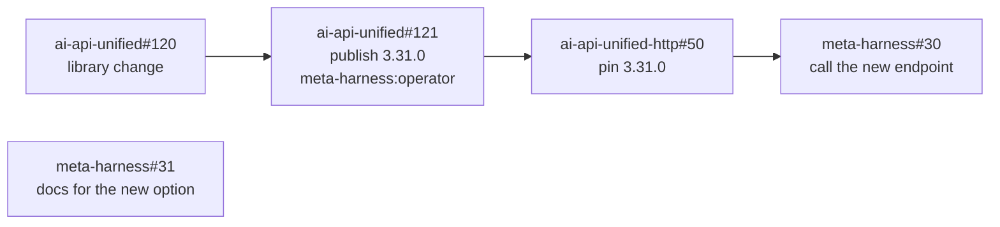

Here ai-api-unified#120 and meta-harness#31 run at once. ai-api-unified-http#50
waits for an operator to close the release issue, and meta-harness#30 waits for
ai-api-unified-http#50 to merge.

Each pull request says `Closes <issue>`, so its merge closes the issue. A task
that ends without a merge leaves its issue open, labeled `meta-harness:failed`
with a comment holding the outcome. The issues that depend on it stay blocked.
An issue labeled while the goal is active joins it, including the
issues a planning task writes.

An issue closed some other way than by its task's pull request (another pull
request, or by hand) has no work left. Each sweep cancels such a task when
it has opened no pull request of its own: queued, blocked, or running with
none. So a goal never pays to redo finished work, and the task frees its
repo area for the ones behind it. A task with a pull request is left to its
workflow, since its own merge is what closes its issue.

A goal is `met` when its success criteria pass. It is `stalled` when every
open issue
is blocked by a failed issue or waits on an operator issue, which raises
an alert. Its `max_usd` covers every task it queued. What happens once it is
spent is the goal's `budget_mode`. A `block` goal runs on, over budget, to its
blocking line, `max_usd` plus `budget_overage_percent` of it. From there the
meta-harness scheduler admits no more of its tasks and the goal becomes
`budget_exhausted`. Its running tasks share what it has left before that line,
run by run. They hold for an operator when that is too little (see the review
loop's budget hold). So a goal's tasks started together no longer spend
several times its budget. A `warn` goal keeps going: nothing is held
or refused for its budget. Each task's own spend limit is unchanged either
way.

The deployment's budget policy governs every goal and task. It is the task
policy's `budget_policy`, which the Task policy page sets with a switch.
`block`, the default, leaves each goal's budget and each task's spend limit
to stop work as it says. Under `track` nothing is held, refused or ended for
either, and spend is still recorded and shown against them. Every goal behaves
as `warn` whatever its own mode. The planner serves it no blocking line, a
`budget_exhausted` goal becomes `active` at its next sweep, and there is
nothing to resume. A task that starts gets the ceiling for one task as its
spend limit, whatever its own `max_usd` says. No task runs without a spend
limit under either policy. The task policy's `max_task_usd`
($100.00 when it names none, at most $1,000) is the most one task may spend
across all its runs. Under `block` a task's limit is its own, or $10.00, and
never more than the ceiling. The Task API refuses a `max_usd` above the
ceiling when a task is made, retried or has its limit raised (422, naming
the ceiling). A task that reaches the ceiling holds for budget, as at any
spend limit. An operator ends it, or raises the ceiling in the task policy
first. A task
already running keeps the limit it started with. Services read a saved
policy within five seconds, and one that cannot be read counts as `block`.

Each sweep of a goal with a budget adds up what its tasks' runs have spent
and saves it on the goal (`planner/budget_api.py`). The first time the spend
reaches the budget the planner records `goal_budget_reached`, with the spend,
the budget, the mode and the blocking line. It records it once per budget, so
raising the budget lets it be recorded again. A `budget_exhausted` goal is
swept like an active one, so its pull requests are still watched. The goal the
planner serves has `budget_block_at`: the blocking line in dollars, null in
`warn` mode or with no budget. Admission and the budget hold read it, so the
line is worked out in one place. The goal also has `budget_state` (`ok`,
`over` for past the budget and still running, or `blocked`). A goal that is
over or blocked has `budget_resume_to`, the budget a resume would set.

A goal stopped by its budget resumes in one step.
`POST /v1/goals/{id}/resume-budget` raises its `max_usd` and makes a
`budget_exhausted` goal `active`. It answers each of its running tasks held
for the goal's budget with `raise`, so they look again at once. Its queued
tasks start at the scheduler's next pass. With `add_usd` the budget rises by
that much, refused when the goal would still be stopped. Without it the new
budget is worked out (`planner/budget.py`). It is what the goal has spent plus
an estimate for its issues not yet done, rounded up to a whole dollar. The
estimate is the average cost of its finished tasks for each such issue, or the
default task spend limit when none has finished.
The answer says the old budget, the new one and how it was
worked out, and the change is recorded as `goal_changed` with
`resumed: true`. A `warn` goal has nothing to resume. A budget changed by
hand (`PATCH /v1/goals/{id}` with `max_usd`, `budget_mode` or
`budget_overage_percent`) takes effect at once too. The planner looks at the
goal's spend as a sweep would before it answers. So the goal's status,
`budget_state` and `budget_resume_to` are the new budget's, and its tasks
held for the budget are told to look again.

#### Latitude

A goal's `latitude`, from 0 to 1, sets how much scope the planner may add on
its own. It governs the planning task's prompt, the drafts the planner
accepts, and the loop's decision step.

| Latitude | The planner may | Example |
|---|---|---|
| 0 | Only the issues the goal names or people labeled. It drafts none, and it refuses a draft outside them. A `fix` goal at 0 is a pure queue | "Fix these twelve issues" |
| 0.25 | Draft the issues the statement needs and nothing beyond them. A draft must trace to a sentence in the statement | "Add the `route_ceiling` option" |
| 0.5 | Draft what the statement needs, plus the work it finds necessary on the way. That work is tests the change needs, a doc the change makes wrong, or a refactor the change needs to land | "Build the review loop" |
| 0.75 | Also draft improvements it finds in the goal's repos that serve the statement, as separate issues the operator sees in Inputs before they run | "Make the sample's end-to-end check faster and more thorough" |
| 1 | Keep going on its own. When the criteria are met it proposes the next goal from what it learned. It continues under the same budget until the budget or the operator stops it | "Improve the meta-harness" |

Above 0.5 every draft has a `latitude_reason`, one line on how it serves
the statement, shown beside the issue in the operator console. Latitude
changes only what the planner may propose. The merge bar,
the budget, the repo list and the
control plane's sole write access to the code host stay fixed. The defaults are
`fix` 0, `feature` 0.25 and `new-system` 0.5, and an operator can change
latitude on the Goal view while the goal runs.

#### Planner

The planner owns the goal loop, the `goal`, `plan`, `issue_link` and
`pull_request_end` tables and
the issue dependency graph. It is the only component that talks to an issue
tracker, through one adapter interface:

| Adapter operation | Purpose |
|---|---|
| `list_open(repo, label)` | The open issues with the goal's label for one repo |
| `list_assigned(repo)` | The open issues a person assigned, in the tracker, to the account the meta-harness signs in as, for a goal that asked to take them. Empty for a tracker with no such way |
| `read(ref)` | One issue: title, body, labels, state, the issues that block it, and its `parent` where the tracker has one |
| `ensure_label(repo, label)` | Make sure an issue created for the repo can have the label |
| `create_issue(repo, title, body, labels, parent=None)` | Create an issue, for an approved plan's draft or a split. `parent` is the ref of an issue to create it under, for a tracker that has parents (Jira). GitHub and the own tracker ignore it, and `Trackers` and `WithOwn` pass it on. Returns it with its `ref`, and with `parent` set only when the tracker took it |
| `comment(ref, text)` | Add a comment to the issue. Returns the comment's address |
| `add_section(ref, heading, text)` | Add `## <heading>` and the text to the end of the issue's description, leaving the rest as it was. The heading and the text come from `outbound.prepare`. A description that already has a section with that heading is refused with a `TrackerError` that is not retryable, and nothing is written |
| `mark(ref)` | Put the meta-harness's label on the issue. The adapter calls it itself before every write |
| `set_status(ref, status)` | Move the issue to `todo`, `in_progress`, `in_review` or `done`, as far as the tracker has such a state. Returns whether it changed |
| `link_pull_request(ref, pr_url, title)` | Record the pull request on the issue, where the tracker does not find it by itself |
| `url(ref)` | Where a person reads the issue |
| `webhook(payload)` | Planned: turn a tracker's webhook into `issue_opened`, `issue_edited`, `issue_labeled`, `issue_closed` events, so the Inputs view and the goal loop never poll |

The interface is `meta_harness.trackers.base.Tracker`, and each tracker is
one adapter module beside it (`src/meta_harness/trackers/`). `repo` is always
the code repo: an adapter whose issues are kept elsewhere maps the repo to that
place itself. A failed call raises `TrackerError`, with whether to try again,
so no caller knows which tracker it spoke to. Outside an adapter a ref is
opaque: stored, compared and passed back. `repo_of(ref)` is the one more
operation: the code repo an issue's work is done in.

`add_section` reads the description, checks its headings (`trackers/base.py`,
`has_section`, in any capitals), marks the issue, and writes the description
back with the section at its end. Its heading and text both come from
`outbound.prepare`, the heading as a title. GitHub's and the own tracker's
heading is `## <heading>`. Jira's is `h2. <heading>`, which the planner reads
as `## <heading>`. The own tracker writes the body only if it is still the
one it read. `WithOwn` sends the call to the tracker the ref names, whether or
not that tracker is told of progress.

**The registry of supported trackers** (`trackers/registry.py`) is the list
of adapter modules. Each describes itself in a `SPEC`. That holds its name and
title, its settings (for the console to draw its form) and the secrets its
sign-in needs. It holds a check of its settings and how to build it. It also
says whether the planner tells it how an issue's task is going
(`writes_progress`). Jira's says yes. GitHub's says no, since a pull request's
`Closes` line links and closes its issue. A new tracker is
one module and one line in the registry.

**The meta-harness's own tracker** (`trackers/own.py`, scheme `mh`) keeps
issues in the meta-harness and in no outside system: rows of
`planner.own_issue`, with refs `mh:<id>`. It is an adapter like the others, so
the sweep, sizing, dependencies, the board and the met check read its issues as
they read any. It is always there, has nothing to set up, and is not part of
the `trackers` configuration. It is what a goal that uses no tracker uses.
Such a goal's work is planned from its description, and every task of its plan
is an issue there. Its pull requests are the only record outside the
meta-harness. The
planner tells it how each task goes, and a task's merge closes its issue, since
nothing else would. A goal on another tracker may also hold such issues. Its
tracker is then `WithOwn` (`trackers/router.py`), which sends each call that
names an issue to the tracker its ref names. The `trackers` configuration may
set up no tracker at all, and every goal then uses none.

**Which trackers are set up, and the default**, is the `trackers`
configuration, versioned and checked like the other kinds.
`config/trackers.json` ships GitHub alone; `config/trackers.local.json`, which
git ignores, replaces it. It holds what is true of a whole tracker,
never of one goal:

```json
{"default": "jira",
 "trackers": {"github": {},
              "jira": {"site": "https://example.atlassian.net",
                       "default_project": "PROJ",
                       "projects": {"PROJ": {"issue_type": "Task",
                                             "statuses": {"in_review": "In Review"}}}}}}
```

One Jira site holds many projects, and a workflow belongs to a project. So
Jira's setup lists the projects the meta-harness works in (`projects`), and
what depends on a workflow is set for each. That is the type of an issue the
planner creates
(`issue_type`) and the project's own name for a status (`statuses`).
`default_project` is required and is one of those listed: the project a new
goal starts with. A save without one is refused. A configuration saved
before projects were listed holds `issue_type` and `statuses` for the whole
site and no `projects`. It keeps working, any project allowed, until its next
save, when the console moves both under the first project added.

A sign-in is never in it: Jira's is the secrets `MH_JIRA_EMAIL` and
`MH_JIRA_TOKEN`. `GET /v1/trackers` lists every supported tracker with its
settings' description and whether it is set up and signed in. It also gives
the default, and `goal_defaults`: what a new goal on it starts with (Jira's
default project).

**A goal says where its issues are.** Every goal names its repos. It also
names its tracker (`goal.tracker`): the default unless it names another that
is set up. It also holds what that tracker asks of a goal
(`goal.tracker_settings`), which the adapter declares in its `SPEC` as
`goal_settings`. Jira asks for the project: one of those its setup lists (422
for another, naming the listed ones). It is the default project when the goal
names none. GitHub asks for nothing. The goal's repos, tracker and tracker
settings are fixed when it is created. Every ref it holds
is its tracker's, and for Jira its project's (422
otherwise). A goal from before goals named a tracker uses GitHub. A project an open goal uses cannot be
removed from the list: the save is refused, naming the goal, as for a repo.

**Names are picked from a list.** A setting's options come from
`GET /v1/trackers/{scheme}/choices/{setting}`, so no form or route is written
for one tracker. The query says what the setting belongs to. For Jira,
`projects` is every project of the site the account sees, for the setup's
list. `project` is the listed projects, for a goal. `issue_type` and
`statuses` take `project`. They list that project's own issue types (sub-task
types left out, since they need a parent) and the status names of its
workflows (`GET /project/{key}/statuses`). They list no other project's, since
a status of another workflow moves none of its issues. An adapter describes a
list of entries with settings of their own as a setting of kind `entries`
(Jira's projects). It describes a pick among them as `entry_of` (the default
project). The Issue trackers page draws both from that description. Each field
offers its list as the operator types and refuses a name the list lacks. It
takes the list's spelling of one typed in other capitals, and marks a saved
name the list no longer has.
When the list cannot be read it says why and takes a typed
name. On the New goal form a `choice` setting is a pick from the list and
never free text. So nothing half-typed reaches the calls that read the goal's
issues. Jira's listed projects stay offered, by key, while Jira cannot be
reached. This is the console's rule for any value a service can list
(`AGENTS.md`, Console).

`Trackers` (`trackers/router.py`) is every supported tracker as one. A call
that names a ref goes to the tracker the ref's first part names. A call made
for a goal goes to the goal's tracker bound to its `Source`, its repos and
tracker settings (`Tracker.bound`). Any other goes to the default: the label
and issue lists before there is a goal, which take `?tracker=` and
`?settings=`.
The repo registry's `tracker` field decides nothing, and the console
no longer shows it.

**Which repo an issue's work is done in**, where the tracker's issues are not
a repo's own (Jira): the goal's repo when it has one. A goal with several
repos reads it from the issue: a `Repo: owner/name` line in its description or
a `repo:<name>` label. Either names the repo by its full name or its name
alone. An issue that names none of the goal's repos is held, saying which
repos and how to name one. It becomes a task once it does.
An issue the planner creates for
such a goal has the `Repo:` line.

In the console, Configuration has an Issue trackers page
(`console/src/features/trackers/TrackersView.tsx`), drawn from
`GET /v1/trackers`. It shows every supported tracker with whether it is set up
and whether its sign-in is there. A missing sign-in is named by its secrets,
with where to add them. Each tracker has Set up, Make default and Remove. Its
settings are edited in place: Jira's site, its issue type and its status
names. Edits stage and save as
one checked version, like the other kinds. The New goal form offers the
trackers that are set up when there is more than one, starting on the default.
It then asks what the chosen tracker asks of a goal
(`features/trackers/GoalTrackerFields.tsx`). For Jira that is its project,
chosen
from the site's projects by name or typed by key. Its label suggestions, the
label's issues and the issue picker read from that tracker and project, once
the goal has said what the tracker asks. A goal's page shows its tracker and
what it told it. A ref reads without its tracker and links to its issue for
any tracker (`features/trackers/refs.ts`). GitHub's address comes from the
ref, another tracker's from the `issue_url_prefix` the tracker reports.

As built, the GitHub adapter (`trackers/github.py`) has every operation but
`webhook`. `done` closes an issue and `todo` opens it again. The statuses
between change nothing, since a GitHub issue is open or closed, and
`link_pull_request` does nothing. The Jira adapter (`trackers/jira.py`)
works with Jira Cloud's REST API version 2, whose descriptions are text:
- An issue's ref is `jira:<KEY>`.
- `list_open` is the goal's project's issues not in a Done status, with the
  label, searched once for all the goal's repos. An issue in a Done-category
  status is closed.
- `list_assigned` is the same project's open issues whose assignee is the
  Jira account the meta-harness signs in as (`assignee = currentUser()`),
  whatever their labels. It is for a goal whose tracker setting `assigned` is
  `yes`; no call is made for any other goal.
- `choices("project")` lists the site's projects the Jira account sees.
- A status name or issue type the site lacks: the console refuses it at entry,
  from `choices`. Saving the configuration (`PUT /v1/config/trackers`) makes
  no call to Jira and keeps it. The adapter reports it at first use. The first
  `set_status` to a configured status name, and the first `create_issue` of
  the project's issue type, check the name against the same `choices`. They
  log a warning that names the setting, the value and the names the site has.
  A check that cannot reach Jira is silent and repeats at the next use.
- What blocks an issue is its "is blocked by" links and the keys its
  `Depends on:` lines name.
- `set_status` moves the issue through its workflow, to the status the
  settings name for ours. Failing that, it moves to one with the usual name
  for it (In Progress or In Dev, Done or Closed, any name with "review").
  Failing that too, it moves to one of the matching Jira category. The name
  comes before the category because a workflow's categories do not always say
  what its statuses mean. One may class
  "Ready for Development" as in progress and "In Code Review" as not
  started. A workflow with no such move is an error that lists where the
  issue can go.
- `link_pull_request` adds a remote link whose id is the pull request's
  address, so adding it twice changes the one link.
- A label with a space is refused before any issue is made.
- An issue's `parent` is read from `fields.parent` (its key, as
  `jira:<KEY>`). `create_issue` with a `parent` sets `fields.parent` to its
  key. When Jira refuses it (a 400 that names the parent, such as a key it
  cannot find or a type that cannot sit under it), the adapter logs a warning
  and creates the issue again without it. The issue it returns then has no
  `parent`, so the caller can tell. Any other refusal is raised as before.
- A goal's tracker setting `parent` (a `choice`, not required) names the
  issue its plan's issues are created under, such as an epic (VL-14274).
  `choices("parent", {"project": ...})` lists that project's open issues of a
  type that can hold others: the types `GET /project/{key}` gives a
  `hierarchyLevel` above 0, or the type named Epic on a site that gives no
  levels. Each is offered by ref (`jira:<KEY>`), newest first. A goal's
  parent must be in its own project (`check_goal`). On approval
  (`planner/planning.py`) each issue the plan creates in the goal's tracker
  is created with that `parent`; one kept in the meta-harness is not. When
  the tracker refuses it, the issue is still created, and
  `issue_parent_refused` names the issue, the parent and what to do, as for
  a split (its `from_ref` is the issue the plan split, empty for a new task).
  The New goal form lists the parents of the chosen project, and asks for none
  before a project is chosen. The goal page shows a Jira goal's parent by the
  name the list gives it, and marks one that is no longer an open epic of the
  project, since Jira may then refuse it. A GitHub goal or one in the own
  tracker has no parent setting, and its plan's issues are created as before.
  `tests/planner/test_plan_parent.py` proves the approval against a mock Jira.

#### Who an issue is assigned to

Status: built (VL-14260). The planner assigns the issues it creates and
starts (`planner/assignees.py`) with each tracker's `assign` call.
`create_issue` does not take an assignee yet, so an issue is assigned by a
second call right after it is created.

**Who.** `assignees.person_for` works it out, the first of these that
applies:
1. The person named in the goal's tracker settings (`assignee`), picked from
   the tracker's people. It names a person of the goal's own tracker, so it
   applies only to an issue there. A task a plan keeps in the meta-harness
   goes to the owner.
2. The goal's owner (`goal.created_by`), when the tracker knows a person with
   that email: the one person `people(repo)` lists with it for the issue's
   own repo, as the id or as a label ending in `(email)`. A tracker without
   `people` is asked for `choices("assignee")`. On the own tracker the email
   is the id.
3. Nobody. The issue is left unassigned and the planner logs why.

The answer is kept for ten minutes for each goal, tracker and repo, so the
tracker's people are listed once for many issues.

**When.**
- An issue created from a plan (approve, `planning.py`) or a split
  (`split_issue.py`) is assigned right after it is created and noted.
- An issue a goal takes in with no assignee (by label, by pick or by
  `list_assigned`) is assigned when its task starts: the sweep's
  `tracker_progress.write` looks at each issue whose task is running, taken
  over, ready or waiting on its review, on every tracker. It reads the
  issue's assignee first and leaves one that has an assignee as it is. Each
  issue is looked at once while the planner runs.
- An issue that already has an assignee keeps it. The meta-harness never
  replaces or adds to a person's assignment.

**A person the tracker does not know.** The setting, or the owner the
tracker matched, names someone the tracker refuses (`assign` raises a
`TrackerError`). The issue is still created, or its task still starts. An
`issue_not_assigned` event names the goal, the issue, the person, the
tracker's reason and what to do (`todo`): add the person to the tracker, or
start a new goal that names another assignee. It is recorded once for an
issue and person. A transient failure of the lookup or the assign call is
retried first, as for any tracker call. After the retries it is reported the
same way, never stops the task, and is tried again when the issue's task
starts. An owner whose email matches no one gets no event: on GitHub, which
shows few emails, that is the usual case.

**On the goal's page.** A goal's update (`updates.py`) reads the
`issue_not_assigned` events of its open issues. They are a fact the update is
written from (`not_assigned`), they change its digest, so a new one is
written, and each person not assigned is one item of what needs the operator,
on the first issue, with the action that opens it.

**Per tracker.** The people are:

| Tracker | Who can be assigned | Matched by |
| --- | --- | --- |
| GitHub | The repo's assignable users (`GET /repos/{owner}/{repo}/assignees`). A goal with several repos assigns each issue from its own repo's list | Login for the setting. Email for the owner, only where GitHub shows it; otherwise nobody |
| Jira | The assignable users of the goal's project (`GET /user/assignable/search?project={key}`) | Account id or display name for the setting, email for the owner |
| Own tracker (`mh`) | The console's users, the people who sign in to the console | Email for both |

**New `Tracker` calls** (`trackers/base.py`, each adapter implementing them,
`WithOwn` and `Trackers` routing them):
- Built: `people(repo)` lists the people the repo's issues can be assigned
  to for the bound goal, each as an id (`value`) and a name (`label`).
  GitHub lists the repo's assignable logins. Jira lists the account ids of
  the bound goal's project, with the display name and the email where Jira
  shows it, and none when no project is bound. The own tracker lists the
  console users who may sign in, by email, for any repo. The planner
  matches the goal's owner among them.
- Built: `choices("assignee", scope)` offers those people for the goal
  setting. GitHub takes the scope's `repos` (comma-separated) and lists the
  logins every one of them can assign. Jira takes `project`. It serves the
  console's pick.
- Built: `assign(ref, person)` sets the issue's assignee. It returns whether
  it changed anything, and changes nothing on an issue that has an assignee.
  A person the tracker cannot assign is a `TrackerError` that is not
  retryable, raised before anything is written. Jira takes an account id or
  a display name that names one person.
- Built: `assignee(ref)` reads the issue's assignee id, empty when none.
- Planned: `create_issue` takes an optional `assignee`, so an issue is
  assigned as it is created.

**The goal setting.** `assignee` is a `choice` setting every tracker declares
in its `SPEC` `goal_settings`, read from `GET
/v1/trackers/{scheme}/choices/assignee`, which calls the adapter's
`choices`. The New goal form shows it as a pick from that list, empty by
default, and never as free text. It passes the goal's project and repos as
the scope, and waits for a project on a tracker that asks for one. When the
goal is saved, each tracker's `check_goal` checks the setting's form
(`base.check_assignee`): empty, or one line in the tracker's own form. That
is a GitHub login, any Jira account id or display name, or an email on the
own tracker. Whether the tracker knows the person is for `assign` to say. A
goal's tracker settings are fixed when it is created, so so is this one. The
goal's page shows the person named as the tracker lists them
(`AssigneeField`), marks one the tracker no longer lists, and says when none
is named. It shows, among what needs the operator, each person the tracker
refused to assign (see "On the goal's page" above).

An issue is one task, by its ref, so what the task was made from can fall
behind the issue. A task that ended canceled or failed is made over when a
control-plane service submits its issue again (`tasks.store.renew`). Its
title, description, acceptance checks, paths, goal and repo become the
submitted ones, and its size and spend limit too when submitted. It goes back
to the queue. One with a pull request keeps it and resumes at its review. The
workflow goes on with one still open and starts a new first run
when it was closed unmerged. A task still running, waiting or done is left
as it is. The sweep does this for an open issue whose task was canceled
(`_retake`). That task goes back to work from what the issue says today.
A task canceled because a person closed its pull request without merging is
not taken up again: that was a no to the work, and Retry on its page takes it
up when it is meant. A part an issue was split into is its plan's own work:
a planned goal does not hold it as having joined after the plan.
An issue held by a goal that has ended (met or canceled) is
released for a new goal with its label to take
(`planner.store.release_from_ended_goal`). An open goal's issue stays its.

**Who an issue is assigned to** (the proposal as it was put to the owner;
what is built is in "Who an issue is assigned to" under the trackers, which
wins where the two differ). The meta-harness set no assignee then, so its
issues were in no one's "assigned to me" list (VL-14260). The rule below is
the choice the owner was asked to approve, or to replace with another, before
the code tasks started.

*Who.* The first of these that gives a person:
1. The person named in the goal's tracker settings (`assignee`), picked from
   the tracker's people.
2. The goal's owner (`created_by`), when the tracker knows a person with that
   email.
3. Nobody. The goal's page says that its issues have no assignee and why.

*When.* An issue made from an approved plan or a split is assigned as it is
created. An issue the goal takes in with no assignee (by label, by pick or
assigned to the meta-harness) is assigned when its task starts. An issue that
already has an assignee keeps it, at both times. The meta-harness never
changes or clears an assignee.

*A person the tracker does not know.* The named person, or the owner, may
have no account the tracker can assign to. The issue is still created and
its task still runs. The goal's page and a `goal_assignee_unresolved` event
say who could not be assigned, in which tracker, and what to do: add the
person to the tracker or project, or name another in the goal's settings.
The event is recorded once for a goal and person, not for each issue.

*Per tracker.* "The tracker's people" are:

| Tracker | People an issue can be assigned to |
|---|---|
| GitHub | The repo's assignable users (`GET /repos/{owner}/{repo}/assignees`). A person is a login. The owner is found by a login whose public or commit email matches; no match is nobody |
| Jira | The assignable users of the goal's project (`GET /user/assignable/search?project={key}`). A person is an account id. The owner is found by email, where the site lets the account read it |
| The meta-harness's own tracker (`mh`) | The console's users. A person is a console user's email. The owner is always one |

A goal with several repos on GitHub checks each repo's list. A person who is
assignable in one repo and not another is assigned in the first and reported
for the second.

*New `Tracker` calls* (`trackers/base.py`), each raising `TrackerError` as
the others do:

| Call | Purpose |
|---|---|
| `people(query)` | The people the tracker can assign to for the bound goal, whose name, login or email match the query. Each is `{id, name, email}`. Feeds the setting's choices |
| `find_person(email)` | The one person with that email, or none |
| `assign(ref, person_id)` | Set the issue's assignee. Returns whether it changed. Does nothing when the issue has an assignee. The adapter labels the issue first (`mark`), as for any write |

`Issue` gains `assignee`, the person's id or empty, so the sweep can see
which issues keep theirs. `create_issue` takes an optional `assignee`, so a
new issue is made assigned in one call where the tracker allows it (GitHub,
Jira). The own tracker sets it in the same write.

*The goal setting.* `assignee` joins the adapter's `goal_settings` in its
`SPEC`, of kind `choice`, optional, for all three trackers. Its options come
from `GET /v1/trackers/{scheme}/choices/assignee`, which calls `people` with
the query the operator types. The New goal form shows it as a pick from that
list and never as free text, with "Goal owner" as the default when the list
holds the owner. A goal's page shows the person named, or the owner, or the
note that nobody is assigned. Like the other tracker settings, it is fixed
when the goal is created.

**Every issue the meta-harness creates or changes has its label**,
`ai:meta-harness` unless the `trackers` configuration names another
(`label`, set on the Issue trackers page). A label is up to 50 characters with
no space or comma, since a Jira label has none. The rule is the adapter's. An
adapter creates every issue with the label beside the ones it was given. It
labels an issue (`mark`) before each write to it: a comment,
a status that moves it, a pull request's link. So a plan's issues, a split's,
a progress comment and a reply all leave the issue labeled, and a new call
site cannot forget to. Both trackers make a label when an issue first
gets it, and adding one an issue has changes nothing. An adapter remembers
which issues it labeled since the service started, so the label
costs one call an issue. An issue the meta-harness only reads is not
labeled.

**Handing an issue over in the tracker.** A person gives an issue to the
meta-harness where they work. On every tracker the goal's label does it.
On Jira, assigning the issue to the meta-harness's account does it too, for
a goal created with "Take issues assigned to the meta-harness" on. That is the
goal's tracker setting `assigned`, a `switch` shown on the New goal form and
on the goal's page. It is fixed when the goal is created, like its project.
Each sweep lists the label's issues and the assigned ones (`list_assigned`)
and takes both in the same way. So such a goal needs neither a label nor picked
issues (`Supported.takes_assigned` tells goal creation so). GitHub has no
assignment: the meta-harness acts there as a GitHub App, and GitHub assigns
issues only to people. A comment that mentions the meta-harness is not
read on either tracker: without webhooks, finding one would mean reading
every issue's comments each sweep.

**Telling a tracker why an issue is not started**
(`planner/tracker_replies.py`). An issue handed over and then held or
refused would otherwise show nothing in its tracker. Each sweep comments on
each of the goal's open issues that has no task and a reason
(`held_reason`, else `refused_reason`). The comment gives the reason, which
says what to do. It adds that the issue is read again each sweep, and that an
operator can act from the goal's page. It comments once for each reason: the
reason last given is kept in `issue_link.replied`. A comment that failed
is tried again
by the next sweep. Every tracker is told, GitHub too. A sweep's result
lists the refs it commented on (`replied`).

**Telling a tracker how a task goes** (`planner/tracker_progress.py`) is
only for an adapter that asks for it (`writes_progress`). Each sweep, and
each follow-up of a goal no sweep covers, works out what each issue with a
task should now say. It writes only when that differs from what was last
written (`issue_link.progress`):

| The task | The issue's status | Comment |
|---|---|---|
| running | in progress | That work started, with the task's id, said once. Or, after a review a person was waiting on, that work is going on again on its pull request. The agents' own review of a new pull request, and a merge an operator asked for, say nothing and leave the issue where it is |
| ready or review unresolved, with a pull request | in review | the pull request, and whether it is ready to merge or its review left findings |
| closed | done | that the pull request merged |
| failed or canceled | unchanged | why |

With a pull request, its link is recorded on the issue. The status goes first
and the comment last. The status and the link are safe to repeat, so a
write that failed is made again by the next sweep without doubling a comment.
For Jira, done is what closes the issue, and so what lets its goal be met. A
sweep's result lists the refs it told (`told`). A sweep
every `MH_PLANNER_SWEEP_SECONDS` stands in for the webhook. The Linear
adapter is planned. The sweep also reads the pull requests of `ready` and
`review_unresolved` tasks and their checks (Review loop). It reads those of
`canceled` tasks that left one open too, until it merges or closes. It reads
them through the run service's code-host functions, with a token
that has `pull_requests: read`,
`checks: read` and `statuses: read`. A goal no sweep covers (met, canceled,
paused or stalled) is followed up every hour instead. The labels and title of
each issue it holds that has a task are read again. Its canceled tasks' pull
requests are watched for their end. So costs by label and by outcome stay true
after the goal ends. A follow-up also records each issue the goal holds as
open that has closed (`issue_closed`). The planner does the same when the
goal's page is read, at most once a minute. So a goal no sweep covers
never shows the state its last sweep saw as today's. A follow-up takes
nothing in and changes no task's or goal's status.
The canceled tasks of no goal, which no goal's sweep lists, have their open
pull requests watched for their end every hour too.
`pull_request_end` notes each task whose pull request's end a sweep recorded,
so it is read no more.

The adapter syncs both ways. The planner pulls in work people write. An issue
labeled in GitHub, Jira or Linear joins its goal. An edit to its body, labels
or dependencies updates the task before it runs. The planner writes back what
it generated: the issues a plan drafted. It also writes what happened. Each
task's state goes back as a label or status (`meta-harness:running`,
`meta-harness:pr-open`, `meta-harness:failed`). So do the pull request link,
the outcome and the close on merge.
One `issue_link` row per issue holds the tracker's state beside the
meta-harness's, and the planner reconciles them on every webhook and on a
periodic sweep. The tracker owns what the work is, and the meta-harness owns
what happened to it. An issue closed by hand while its task runs cancels the
task, with the reason recorded.

A `ref` names its tracker: `github:<owner>/<repo>#<number>`, `jira:<key>` or
`linear:<identifier>`. Each repo in the repo registry names its tracker. For
Jira or Linear it also names the project or team and the field or label that
names an issue's repo.
The GitHub adapter works through the GitHub App, and the Jira and
Linear adapters plug into the same interface.

A `feature` or `new-system` goal's issues come from a planning task,
`task_type: plan`. The planner creates it with the goal statement, the
modality and, for a later phase, what earlier phases built. The planning run
reads the goal's repos and drafts issues with its `create_issue` tool. Each is
in the repo it changes, with acceptance checks and what it depends on.

**The planning configuration** is a configuration kind of its own, `planning`.
It is versioned and edited in the console (Configuration, Planning) like the
others, and seeded from `config/planner.json`'s `planning`. A planning task
runs on its `candidate`, whose profile must exist and have the `create_issue`
tool. `max_usd` is what one planning task may spend. `goals` says which goals
are planned. `track_new_tasks` (true when left out) says whether a plan's new
tasks go to the goal's tracker unless the operator says otherwise.
`max_issues` and `issue_chars` set how much of a goal's issues the planner is
shown.

**The planner's updates.** The planner keeps the operator up to date at the
head of each goal's page (`planner/updates.py`). An update says where the goal
stands, what changed, what needs the operator and what happens next, in plain
language. Each pass of the planner's loop gathers the facts its own records
hold about every open goal. Those are its plan, each issue and its task, and
what is held and why. The pass reduces them to a digest. An update is written,
with one small model call through the HTTP Gateway, only when the digest
differs from the last update's. So a goal that does not change costs nothing.
A goal that closes gets one last
update. The model is given the facts and its last update, and told to say only
what the facts say. The facts say whether the goal is done (`goal.done`) and
how many of its issues are open (`goal.open_issues`). An update that calls the
goal done while one is open is not posted (`written_true`). It is written once
more, told what was wrong. When the second says the same, the update is written
from the facts alone, with no model (`from_facts`): how many issues are still
open and where each stands. So the page always says where the goal is, and never
shows the check as an error. An update once said "All tasks merged, goal done"
above a board that said "1 issue needs you". Updates are rows of `planner.goal_update`, read with
`GET /v1/goals/{id}/updates`; `POST` to the same path writes one now. Each is a
`goal_update_written` event, whose cost is counted as planning. The planning
configuration's `updates` turns them off and names the model (goal drafting's
when left out). It bounds them too: `max_per_goal` updates for a goal, at
least `min_seconds` apart. An update that asks something of the operator does
not wait: it is replaced as soon as the goal moves. An update keeps the plan version it was written about (`plan_version`), and
the read says where a planning goal's plan stands now (`plan`: its version, and
whether a new one is being written). Between a new version and the update
about it, the panel says which version the update is about, that the next is
being written, and asks nothing: a panel once said two tasks were too big to
approve, under an Approve button, after version 2 had split them. An approved plan's goal
gets its update as soon as its first sweep has made its tasks. One that cannot be written is logged, said on the page,
and tried again at the next pass.

**The Overview's rows come with their buttons.** The report says in words what
needs the operator and which goals are not moving. Each such row about a goal
carries the buttons for what that goal needs now: `GET /v1/overview/report`
answers `actions`, by goal id, beside the report. They are read from the
goal's records as the report is read (`actions.for_goal`, three at most for a
goal), with no model, and are not kept with the report: a button is true now
however old the report's words are, and one for a step already taken is gone
at the next read. The console draws them with the button the planner's panel
on a goal's page uses (`needActions.tsx`). Merge, Retry, a review's choices
and a held issue's Split or Run anyway act where they are read. What a goal's
page does in place opens that page with it asked for, `?do=approve`,
`replan`, `budget` or `issues`: approving a plan stays behind the dialog that
says what it creates. A goal named in two rows gets its buttons once, and a
row whose goal needs nothing now links to the goal.

**A goal's next steps** (`planner/next_steps.py`). Many goals end nearly
complete, with more that could be done, and some end short of what was meant:
a rebrand met its specification and left logos too small to read. So the
planner writes up to three next steps for a goal, as what it would do if it
carried the work on. Each has a title, one sentence on why that names the
record it comes from, and the statement of a new goal that would do it. They
are written from the facts an update is written from, the goal's
specification, and the goals already started from this one, so none is
suggested twice. The planner reads its records and not the product, so what
only a look at the result would show is not something it suggests. One call
to the narratives' model writes them, its words go through the writing pass,
and the cost counts against `narratives.max_usd`, which the two share. Each
writing is a `next_steps_written` event. They are kept in
`planner.goal_next_steps` with the digest of their facts and read from there
until the facts change. The goal's page shows them in a panel under the
planner's update: by itself once the goal is met or canceled, and on a running
goal only when the operator asks, since each writing is a model call. Each
step has one button, Start a goal from this. It creates a goal with the
step's statement and the first goal's repos, tracker and settings, planned
from its statement, so nothing runs before its plan is approved. A goal with
no budget hands on $100: a goal made in one click is not left without a
limit. The new goal records the goal and step it came from
(`planner.goal.from_goal`, `from_step`): the step then shows its goal in
place of the button, the new goal's page links back, and a second click makes
no second goal.

**The planner's Overview report** (`planner/overview.py`). One report covers
every running goal (planning, active, stalled or stopped by its budget). It
says which goals are moving and which are not, what the operator needs first
and why, where spend stands against budgets, and what finished since the
operator last looked. The facts of each goal are its latest update, what its
tasks recorded since the last report (`task_status_changed` and the pull
request events), what was done to unstick it, what waits on the operator and
why, and its spend against its budget. Tasks closed and goals met since the
operator last looked are what finished. One model call through the HTTP
Gateway writes the report. The model is told to say only what the facts say,
and the words go through the writing pass. A digest of the facts decides when
to write: each goal's status, where each task is, what waits on the operator
and its budget state. `GET /v1/overview/report` returns the latest report.
With `since`, when the operator last looked, it first writes a new one when
the digest differs from the last report's. Each planner sweep does the same
for the operator's last look (`Overview.refresh`), so a goal that changes gets
a new report before the operator comes back. The sweep writes none before the
operator first opens the Overview, and it reads nothing while the last report
is under `overview.min_seconds` old. A failure is logged once for each new
reason, and the next sweep tries again.
The planning configuration's `overview` names the model (goal drafting's when
left out), `max_response_tokens`, `min_seconds` between two reports, and
`max_usd`, what reports and answers together may cost in a UTC day. It is checked at startup and
when the configuration is saved. Past `max_usd` no model is called: the last
report stays, and the answer's `note` says when it was written. Each report is
an `overview_report_written` event that carries the report, its model and its
`usd_cost`, counted as planning cost of no goal. The planner reads the latest
report and each day's spend back from these events when it starts, so a
restart keeps both. The report only reads: it starts, stops and changes no
goal.

`POST /v1/overview/ask` answers the operator's question about the work from
the same record. It gathers the facts a report is written from, plus the
latest events of the tasks of any goal or issue the question names: a goal by
its id or a running goal's title, an issue by its ref, with or without its
tracker's prefix. One model call answers from them alone. Its answer's
`in_record` is false when the record does not hold the answer, and the answer
says so. The question is sent as data, as a JSON string, and the model is
told to follow no instruction in it. The answer goes through the writing pass
as `own` text. Each answer counts against the same `overview.max_usd`; past it
the route answers 429 with when the limit resets, in its detail and its
`Retry-After` header, and calls no model. Each answer is an
`overview_question_answered` event with the question, the answer, its model
and its `usd_cost`, counted as planning cost of no goal and attributed to the
operator who asked.

**The planner's voice** (`planner/voice.py`). What the planner writes for the
operator, its updates and a plan's summary and gaps, follows the planning
configuration's `voice`. That is `tone` (`casual` as shipped, `balanced`,
`formal`) and `detail` (`low` as shipped, `medium`, `high`). At low detail it
names no file, route, function or command and keeps to a sentence or two. It
raises only what the
operator needs to know or decide. The settings become instructions in the
update's model call and in the planning task's prompt for `plan_summary`. A
task's own description, which an agent works from, is not shortened by them;
the plan's review folds it under the task's title.

The planner speaks to the operator in one place: its panel at the head of the
goal's page. The plan's section shows the plan itself: its order of work, its
decisions on the goal's issues, its new tasks and the approval. The plan's
summary and gaps reach the operator through the planner's update. While a plan
waits for approval, the update says how many tasks it has and what this
goal's work does once built, in two short sentences at most. It says nothing
that holds for every plan, and no fallback or exception. Approving it and each
gap worth weighing are listed under "Needs you", never in the body. A goal with a plan keeps its settings
folded to one line, so the plan comes first.

Every "Needs you" item comes with what resolves it. The update's model picks an
action for each (`approve_plan`, `merge`, `review`, `open_task`,
`raise_budget`, `open_issue`). `actions.actionable` (`planner/actions.py`, shared by every place the planner asks or suggests something) checks it against the
goal's records before it is saved. A merge needs a task whose pull request
passed review, and an approval needs a goal that is planning with a plan that
can be approved. A plan that cannot be approved gets `fix_plan`, which opens
the plan's Plan again, so an Approve button never sits under a sentence asking
for something else. While a planning task writes a new version of the plan
(the planner resizing its own tasks, or a Plan again), the facts say so
(`plan.replanning`), the update is told to ask nothing about the plan, and a
need about the plan is dropped. An action the
records do not support becomes the nearest one they do. A task's or an issue's
own state overrides the model's pick. A review no fix settled
is `settle_review`, a task
ready to merge `merge`, a failed task `retry`, and an issue held for its size
`split_or_run`. The panel also reads each need's task as it is
now, so an update written before the operator acted still offers what fits. On
a review no fix settled it offers Merge as is, Try another fix and See the
findings. It offers Merge on a task that is ready, Retry on one failed or
canceled, and Split and Run anyway on a held issue. Once the task runs it says
"Under way again". Acting from the panel
asks the planner for a new update at once. The panel shows each as a button.
Some resolve the need on the spot: approve the plan, merge after a confirm.
The others open where it is resolved: the task, its changes, the goal's
budget, the issue.

**Suggested fixes** (`planner/suggestions.py`). When a planning task's plan is
saved with gaps, one small model call sorts them. A gap a change to the plan
itself would settle is a fix the planner makes. For example, two tasks that
would clash run in order, or a missing step becomes a task. A gap only the
operator can settle stays a question.
For the fixes, a second planning task revises the plan with
them as its note. Its result is kept in `planner.plan_suggestion`, apart from
the goal's plan versions, so the current plan can still be edited or approved
while it drafts. The planner's update then asks the operator to accept it
(`accept_fix`), with a line for each change. Accepting
(`POST /v1/goals/{id}/suggestion/accept`) makes it the next plan version,
source `suggested`, which is still approved as any plan is. Dismissing it, or
editing the plan or asking for a new one, leaves it behind. At most one fix is
drafted per plan version and none for a version that was itself a fix. The
planning configuration's `suggest_fixes` turns them off. The sorting call is a
`plan_fixes_assessed` event, counted as planning cost; accepting and dismissing
are `plan_fix_accepted` and `plan_fix_dismissed`.

**Task names** (`planner/naming.py`). A task's id says nothing to a person and
its title is a sentence, so each task has a short name. It is two to four
words, at
most 28 characters ("Hint text contrast"), kept in `tasks.task.name`. A task is
created without one. Each planner pass reads the tasks with no name
(`GET /v1/tasks/unnamed`: those of the last 30 days, never a review, fix or
smoke task). It names them a goal at a time. One small model call names up to
25 of a goal's tasks, told the names the goal already has. It saves each with
`POST /v1/tasks/{id}/name`, which numbers a name another task of the goal has
("Hint text contrast 2"). So a name says which task within its goal. The
console calls a task by its name wherever it showed the id. The title is
beside it or on hover, and the id is behind a copy button. A task not yet
named is
called by its title. A call that fails is logged and its tasks are tried again
after ten minutes. Each call is a `task_names_written` event, counted as
planning cost.

**Every goal is planned.** With the planning configuration's `goals` set to
`all`, as shipped, a goal that takes existing issues is planned too. It is
saved `planning` (`goal.planned`), and none of its tasks is made until an
operator approves its plan. `from_description` keeps the earlier behavior:
only a goal that plans its issues from its description is planned. Its
planning task is given the goal and every issue it would take, read together.
Those are its label's, those assigned to the meta-harness, and those picked
for it, less any another open goal holds. It is given `planning.max_issues` of
them, and `planning.issue_chars` of each one's text. It
records its plan with `create_issue`, `plan_issue` and `plan_summary`.
`create_issue` writes a new task.
`plan_issue` records its decision on one existing issue. It can `keep` it, or
`split` it into new tasks that replace it (`replaced_by`). It can `leave_out`
one that is a duplicate, done already or not this goal's. Each decision has
its reason and, for a kept one, what it waits on.
`plan_summary` records how the plan reaches the
goal, and its gaps: what the goal asks for that no task covers, a risk, an
assumption. A profile that names `create_issue` gets the other two with it,
since a deploy never rewrites a deployment's stored profiles. The harness
server reports them as `issue_planned` and `plan_summarized`.

A plan (`planner/plans.py`) so holds its new tasks (`drafts`). It holds its
decision on each existing issue (`items`; one the planner said nothing of is
kept). It also holds its `summary` and `gaps`, and the issues it was made over
(`issues`). It is invalid when it runs nothing, or a decision is on an issue
that is not the goal's. A split that names no new task, or one the plan lacks,
makes it invalid. So does a task that waits on an issue the plan splits or
leaves out. So does a cycle in the dependencies across issues and new tasks.
An operator edits decisions and new tasks alike; each save is a version.

Approving applies the plan (`planning.approve`). Its new tasks become issues,
in the goal's tracker or, when the operator says so (`track: false`), in the
meta-harness's own (`mh:` refs). A goal with no tracker always keeps them
there. Each kept issue is taken into the goal with what the plan says it waits
on (`issue_link.planned_at`, `plan_depends_on`). The sweep adds that to what
the issue's own text names. A split issue stays the goal's, held, with the
tasks that replace it. One left out is marked removed, so the goal's label
does not sweep it in. An issue the plan took in is not held again for its size
or its gaps: the plan was the review. Its size still sets its task's spend
limit. An issue that joins the goal after approval (its label put on later)
is held as a proposed addition. An operator adds it as it is or plans the goal
again. One an operator picks by ref afterward has been looked at and runs.

A planned goal that is under way can be planned again (`POST
/v1/goals/{id}/replan`, Plan again on its page). It goes back to `planning`,
the tasks already running go on, and the scheduler starts none of its others
until the new plan is approved. The planner is given only what no task has
started on. An issue with a task under way, one a plan split, and one removed
from the goal are not the new plan's to decide.

Built for `feature` (#72, #73): a `feature` goal starts in `planning`. One
created without a label gets its own, `meta-harness:goal-<the first 8
characters of its id>`. The planner starts one task with `task_type: plan`,
pinned to the candidate `config/planner.json`'s `planning` names, with that
file's spend limit. Its prompt (`plan-v1`) is the goal's title and
statement, its repos, and the rules for drafts. The rules: one issue is one
pull request, and each body states its `## Acceptance checks` and its
`Paths:`. `depends_on` names drafts and existing issues.
The scheduler holds every
other task of a goal that is not `active`, and admits the plan task of a
goal in `planning`. The run changes no file, so the RunTask workflow ends a
plan task `closed` after its run. There is no publish, no pull request and no
review loop (behind the `plan-task` patch). When the task ends, the planner
reads its `issue_drafted` events. The last call for each `draft_id` is the
draft, and together they are the goal's plan, version 1 (`plan_saved`). A plan
is invalid, with each reason recorded, when it has no drafts or two drafts
share an id. A draft with no title or no acceptance checks makes it invalid.
So does one that names a repo outside the goal, or a dependency that is no
draft and no issue. So does a cycle in the drafts' dependencies. A planning
task that failed leaves an empty plan that says why. The goal waits in
`planning` until an operator approves. They may edit the drafts (each save a
new version), or ask for a new plan with a note, which starts another planning
task. On approval the planner makes sure the label exists and creates the
issues in dependency order. Each body ends with a `Depends on:` line naming
the issues its dependencies became. The planner records each issue against the
plan as soon as it exists, and holds it for the goal. It then makes the goal
`active`, whose sweep takes the issues in as it takes any labeled issue.
Creating issues
needs the GitHub App's `issues: write`. Not built: the modality's rules on
a plan, and plans for a `new-system` phase. A `new-system` phase may end with
its criteria unmet, or a failed task may leave dependents blocked. The planner
then creates a planning task with the failure as input, and that plan goes
through the same approval.

## Data model

| Owner | Entity | Fields |
|---|---|---|
| Task service | task | id, caller, external_ref, repo, task_type, parent_task_id, goal_id, depends_on, pr_url, head_sha, priority, spec, acceptance_checks, created_at, status (including `blocked`, `taken_over`, `ready` and `review_unresolved`), owner (the operator, while taken over), status_changed_at (when it last changed status), recoveries and spent_carried_usd (the supervisor's: how often it was sent back for want of a workflow, and what it had spent then), drives (how often the supervisor sent it back for its merge or review since an operator's last retry) |
| Meta-harness scheduler | task_hold | task_id, kind, reason, detail (what the reason names), since, last_checked. One row per queued task the scheduler holds |
| Supervisor | standing | task_id, owner (workflow, scheduler, planner, supervisor, operator), situation, reason, ask, since, checked_at, attempts, acted_at, last_error. One row per task that has not ended closed |
| Planner | goal | id, created_by, title, modality, modality_source (classifier, operator), modality_confidence, repos, label, statement, success_criteria, latitude, auto_merge, max_usd, max_parallel (null: the system's), strict_issues, budget_mode, budget_overage_percent, spent_usd (at the last sweep), priority, status (planning, active, paused, met, stalled, budget_exhausted, canceled), phase, created_at, started_at (null until the goal first becomes active), closed_at |
| Cost service | daily_cost, harvest | One row per day, source (`model`, `cloud`), item (the kind of run, or the billed service) and the dimensions the source has (goal, task, repo, model, engine, operator), with its dollars; and how far each source has been read |
| Planner | console_user | email, role (admin, user), status (invited, active, deprovisioned), invited_by, invited_at, last_sign_in_at. Who may use the console, and as what |
| Planner | user_settings | identity, settings (jsonb), updated_at |
| Planner | plan | goal_id, version, drafts (each `draft_id`, `repo`, `title`, `body`, `labels`, `depends_on`), invalid (why it cannot be approved; empty when it can), source (`planned` by a planning task, or `edited` by an operator), task_id, note, created (the issue each draft became), created_by, created_at. Planned: phase |
| Planner | issue_link | ref (tracker-qualified), goal_id, task_id, repo, state, depends_on, dropped, size, sizing, held_reason, run_anyway, split_into, title, labels, last_webhook_at. dropped: an operator removed the issue from the goal, and the row stays so the label does not take it in again. size and sizing: what the issue's sizing found (reasons, missing, split, and the issue's paths and checks, with the model and its cost). held_reason: why it waits for an operator; null when it does not. split_into: the issues an operator split it into; null until split. title and labels: the issue's, refreshed by each sweep for an issue with a task, whether the label still lists it or it has closed. Once its goal is met or ended they refresh hourly. Labels give costs by label |
| Planner | pull_request_end | task_id, outcome (`merged` or `closed`), recorded_at. The tasks whose pull request's end a sweep recorded, so an ended task's pull request is read only until it ends |
| Meta-harness run service | run | id, task_id, attempt_no, kind (initial, fallback, followup, retry), candidate, harness_profile, profile_version, model, model_policy, image, sandbox_id, state, started_at, running_at, ended_at, end_reason, fallback_reason |
| Meta-harness run service | routing_decision | id, task_id, attempt_no, request_id, route_tier, route_method, route_confidence, model_pin, candidates (the tier's candidates, in order), thinking, config_id, config_version, classifier_usd, route_floor, route_ceiling, explored, created_at |
| Meta-harness run service | operator_review | task_id, round, operator, claimed_at, verdict, findings, submitted_at, released_at |
| Configuration | config_version | kind (tiers, profiles, repos, task_policy; modalities and access planned), version, document, edited_by, note, origin (seed, edit, rollback), rolled_back_from, created_at |
| Configuration | active | kind, version, changed_at |
| Pool manager | sandbox | id, image, executor, executor_ref, state (provisioning, warm, leased, kept, draining, unhealthy, destroyed), created_at, destroyed_at, destroy_reason |
| Pool manager | lease | run_id, sandbox_id, harness_session_id, session_state (new, kept, restored), granted_at, expires_at, released_at, release_reason |
| Meta-harness event service | event | event_id (UUID, unique), position (assigned on insert, monotonic), event_type, schema_version, time_utc, source (task, meta-harness scheduler, dispatcher, route, run, workflow, pool, analyzer, gateway), actor, run_id, task_id, session_id, request_id, seq, trace_id, config_id, config_version, tags (jsonb), payload (jsonb) |
| Meta-harness event service | event_type | name, schema_version, json_schema, retention_class |
| Metering service | model_call | run_id, seq, turn, purpose (turn, compaction, auxiliary), tier, method, engine, model, thinking, input_tokens, cached_input_tokens, cache_write_5m_tokens, cache_write_1h_tokens, output_tokens, usd, latency_ms |
| Metering service | attempt_usage | run_id, usd_total, calls, input_tokens, cached_input_tokens, cache_write_5m_tokens, cache_write_1h_tokens, output_tokens, cache_hit_rate, active_hours |
| Metering service | check_result | task_id, check_name, kind (ci, acceptance, merge), passed, observed_at |
| Metering service | task_outcome | task_id, goal_id, ci_share, merged, review_rounds, review_loop_usd, total_usd, wasted_usd, active_hours, dollar_hours, closed_at |
| Metering service | spend | caller, period, cap_usd, spent_usd |
| Harness analyzer | proposal | id, kind (tier, profile, task_policy), evidence, proposed_change, status (open, approved, rejected), decided_by, decided_at, config_version |

The `run` row records the candidate a run started on, and `model_call` records
which model answered each turn, which the harness analyzer reads. The event service
indexes the `event` table on `(run_id, position)`, `(run_id, time_utc)` and
`(event_type, time_utc)`. The metering tables are projections of it, and the metering service rebuilds them by replaying it.

Stores outside Postgres have one owner each. The meta-harness scheduler owns
the repo-area locks. The meta-harness run service owns its Temporal namespace
and the code-host rate-limit buckets. The pool manager owns the artifact
store, and the HTTP Gateway owns the run grants and per-run spend counters.

## Observability

**Transient failures are retried before anything reports them.** Every HTTP
client the services build uses `meta_harness/retrying.py`, an httpx transport.
It makes up to five tries with exponential backoff and jitter, inside a
45-second deadline (below Firebase Hosting's 60). It honors `Retry-After` and
GitHub's rate limit reset. A call no person waits on can take the `PATIENT`
policy, whose 150-second deadline outlasts a rate limit's whole window: issue
sizing does. A request that never reached the service, or was
turned away with 429 or 503, is always repeated. One that may have been acted
on (a read timeout, a dropped reply, 500, 502, 504) is repeated only when that
is harmless. The harmless ones are GET, HEAD, OPTIONS, PUT and DELETE, and the
POSTs the client marks safe. Those POSTs are Jira's issue search, event
batches (which have their own ids) and read-only Google Cloud queries. The
transport logs each retry as a warning, a recovery at info and a final failure
as an error. Each line names the method, host and path and leaves out the
query string, so a recurring failure shows under Admin, Logs. The edge's
forwarding loop follows the same rule while a service restarts, and the
console's `call` retries the same way, logging to the browser's console.
`tests/test_retrying.py` fails a client built without the transport.

The VM reaches the internet through Cloud NAT, which limits the ports open to
one destination. The platform stack allocates them dynamically (1,024 to
16,384) and frees a closed one after 30 seconds. The Jira adapter keeps one
pool of reused connections, since all of Jira is one address.

Meta-harness domain events go to the event service, and logs, traces and
metrics go to OpenTelemetry. Every domain event has its trace id, so the
two join.

### Event service

The event service is the record of what happened in every task and run. It
owns the `event` table, the per-type schema registry, position assignment,
partitions, retention and the commit notification, and it calls no other
component.

| Operation | Contract |
|---|---|
| `append(events)` | Idempotent on `event_id`. The event service validates each meta-harness domain event against its event type's registered schema in the schema registry. The event service rejects an unknown event type or invalid payload back to the producing meta-harness service as a bug. The event service client library never retries a rejected append. |
| `read(run_id, from_position)` | A meta-harness run's meta-harness domain events in `position` order, paged |
| `tail(filter, from_position)` | A live stream of meta-harness domain events matching a filter (run, task, type, source), in `position` order, resumable from any position |

Meta-harness services append through the event service client library:

| Producer | Events |
|---|---|
| Task service | `task_created`, `task_status_changed`, `task_cancel_requested`, received code-host pull request webhooks |
| Planner | Built: `goal_created`. `goal_changed` for every change to a goal's title, settings or status (with `resumed: true` for a budget resume). `goal_budget_reached` the first time a goal's spend reaches its budget (the spend, the budget, the mode and the blocking line). `goal_drafted`. `goal_titled` with the model and its cost. `issue_added` and `issue_dropped` for issues picked by ref (and `issue_added` for each issue an approved plan created). `plan_requested` when a planning task starts (with the operator's note on a replan). `plan_saved` for each plan version (its source, how many drafts, and why it is invalid if it is). `plan_approved` with the issues created. `issue_sized` when an issue is sized before it becomes a task (its size, reasons, what it is missing and the suggested split). It also has the model and its cost. `issue_released` when an operator runs a held issue anyway. `issue_split` with the issues a held one was split into. `issue_parent_refused` for a split's part created without its original's parent, which the tracker refused (the part, the parent, the original and what to do). `issue_not_assigned` when the tracker would not assign an issue to the goal's person (the issue, the person, why and what to do). `issue_joined` (with the issue's size and the spend limit it set, for a sized issue). `issue_refused`, `issue_closed` and `task_unblocked`. `goal_met` when a goal is met, on its own or by an operator. No workflow watches a `ready` or `review_unresolved` task's pull request. For it the planner records `pull_request_checks` for a new head commit's settled checks, `pull_request_merged` and `pull_request_closed`. Each is on the task and tagged with the goal, with the workflow's event id for the same fact. Planned: `goal_classified`, `plan_drafted`, `plan_approved`, `issues_created`, `criteria_evaluated`, `planning_task_created`, and the tracker webhooks it received |
| Meta-harness scheduler | Admission decisions: `task_admitted`, and `task_held` with the reason and the kind of hold, recorded when a task's reason is new or has changed. `kill_switch_changed` with the operator as actor |
| Meta-harness run service: RunTask workflow, `route` and run activities | `task_routed` from the meta-harness run service `route` activity result. One `run_prompt` per run, recorded on the task with the run's `run_id` before the run starts by the `record_prompt` activity (behind the `run-prompt` patch). The activity appends it at once, with a stable event id, without the client outbox. So it is stored before `run_harness` starts, ahead of the run's own events. It holds the run's `kind` (`task`, `review` or `fix`) and its `template`: `repo-task-v2` and `fix-v2`, or `repo-task-v1` and `fix-v1` before they asked for a marked summary. A review's is `review-v5`, or `review-v4` and `review-v3` before it. A caller's own text is `inline`. It also holds the filled-in `prompt` sent to the harness server. Just before it comes the run's `run_provenance` (Run provenance). One `attempt_finished` per run from the meta-harness run service run activity Collect result, joined to its pool manager sandbox lease by `run_id` |
| Meta-harness run service: run activity (Wait step) | The per-run sandbox's harness server Run API event stream: `turn_started`, `model_call` (with the HTTP Gateway's model-token usage and running total), `tool_call`, `tool_result`, `file_changed`, `tests_run`, `guardrail_blocked`, `review_submitted`, `plan_updated`, `issue_drafted` (one draft from a planning run's `create_issue`), `compacted`, `turn_finished`, `run_finished`. The meta-harness run service run activity stays the only consumer of each per-run sandbox's harness server Run API stream. Harness server Run API heartbeats are not stored. |
| Meta-harness run service: RunTask Temporal workflow | Built: `pull_request_opened`. `pull_request_checks` for each head commit's checks. `pull_request_reviewed` for each review round (round, verdict, reviewer, reviewed head SHA, review URL). Rounds are numbered over the task's life, so a resumed task's, or a merge fix's, follow the ones it had, behind the `resumed-rounds` patch. `writing_checked` for the writing pass on each pull request description, review and comment it posts (the planner records it for a plan's issues). `pull_request_summary` for the summary each pull request description and fix round holds (fix round, source `run`, `recorded` or `files`, heading, text). `pull_request_merged`. `merge_checks` for the merge commit's checks (merge SHA, state, failed check names, fix round). The task service records `budget_hold` (the reason) when a running task starts waiting on an operator for budget. It records `budget_decision` (`raise` with the new limit, or `end`) for the answer. A review run's findings are in its `review_submitted` harness event. Planned: `pull_request_closed` while the workflow watches the pull request, `review_started`, `task_taken_over`, `task_handed_back` and `takeover_closed` with the operator as actor, and `operator_review_claimed`, `operator_review_submitted` and `operator_review_released` with the operator as actor |
| Pool manager | `lease_granted` (with `session_state`), `lease_released`, `session_saved`, `session_restored`, `sticky_handoff`, `sandbox_recycled`. The pool manager lease record names the per-run sandbox for each run. |
| Harness analyzer | `proposal_opened`, and operator approvals and rejections of harness analyzer proposals as audit events with the actor |
| Configuration, in the planner process | `config_changed` for every configuration version an operator saves, approves or rolls back, with the actor |

ai-api-unified records its own decisions in one `ai_api_request_cost` record
per request. The record lists every provider call the request made, failed
attempts and fallbacks included with their `fallback_reason`. It holds the
model that served the answer, `wasted_usd`, the router tier and method,
guardrail flags and cache hits. It is tagged with the caller id and the
caller's tags. In the meta-harness run service and the planner the library
runs in-process, and the calling service copies the record into its own event,
`task_routed` or `goal_classified`.

The HTTP Gateway writes each record to stdout, and Cloud Logging stores it. A
Cloud Logging log sink selects the HTTP Gateway records whose caller id is the
meta-harness and publishes them to a Pub/Sub topic. The event service receives
them on a Pub/Sub push subscription and appends each one as a
`gateway_request` event. The `run_id` tag, which the HTTP Gateway sets from
the run grant, joins the event to its run. Pub/Sub delivers at least once, so
the event service ignores a `request_id` it has already stored. The HTTP
Gateway refuses to start when its cost records would be lost, so every model
turn of a run reaches the event service.

| Decision | Made by | Event |
|---|---|---|
| A task's tier and candidates | The ai-api-unified router in the meta-harness run service | `task_routed` |
| The next candidate, an escalation, or the end of the loop | The RunTask workflow's Decide step | `attempt_finished` |
| Admitting or holding a task | The meta-harness scheduler | Admission decisions |
| A goal's modality and latitude | The planner, through the ai-api-unified classifier | `goal_classified` |
| Which drafted issues a plan keeps | The planner | `plan_drafted` |
| A turn's model, its fallbacks, guardrail blocks and cache hits | ai-api-unified in the HTTP Gateway | `gateway_request` |
| A review verdict | A meta-harness review run, or an operator | `pull_request_reviewed`, `operator_review_submitted` |
| A merge | The meta-harness run service, or an operator on the code host, which the planner's sweep records | `pull_request_merged` |
| Approvals, takeovers, cancels and configuration changes | An operator | Audit events with the operator as actor, `config_changed` |

The client library buffers events in its own outbox and retries, which is safe
because `append` is idempotent on `event_id`. So an event service outage never
blocks a run. It retries what can change: an outage, a 5xx, a timeout or too
many requests. A refusal that sending again cannot change, such as 401 for a
wrong service key, drops the batch with an error that names the status and
what to do, so later events are not held behind it. A service that records
events stops at startup, naming `MH_SERVICE_KEY`, when the services take keys
(`MH_SERVICE_KEYS`) and it has none to send.

After an event service append commits, the event service sends a commit
notification, Postgres `NOTIFY`, with the run id and the new highest
`position`. The commit notification contains no meta-harness domain event data
and is internal to the event service. Its listeners are the event service's
own `tail` handlers, which fetch the new event rows and stream them to their
callers. A missed commit notification only delays delivery, because the next
`tail` handler fetch catches up. `NOTIFY` fires only on commit; Redis can
replace it if the volume outgrows Postgres.

Each meta-harness producer service sets `seq` within its own event stream. The
event service assigns `position` on insert. Concurrent Postgres transactions
can commit out of `position` order. So the event service `tail` handler
re-reads a short window behind each caller's cursor and suppresses repeats of
meta-harness domain events it has sent. Delivery is at least once, and a
consuming service can drop a repeat meta-harness domain event by `event_id`.

Consumers call:

| Consumer | Calls |
|---|---|
| Operator console | `read` for a meta-harness run's event history, then `tail` from the last position |
| Metering service | `tail` with one cursor per metering projection, into `model_call`, `attempt_usage`, `check_result`, `task_outcome` and `spend` |
| Harness analyzer | `read` for routing, attempt and run meta-harness domain events over time |
| Meta-harness alert rules | `tail` for stalled runs, failed meta-harness tasks with every routing tier exhausted, runs ended on `spend_limit`, and usage reconciliation gaps |
| Audit and export jobs | `read` for operator and configuration meta-harness domain events, and bulk export by time range |

The event service partitions its `event` table by time and by each event
type's retention class from the schema registry. Short-lived event types
(per-turn text, tool output) expire by dropping whole partitions. The event
service keeps run, routing, attempt, `gateway_request` and audit meta-harness
domain events long.

### Signals

| Signal | Source | Carried by |
|---|---|---|
| Meta-harness domain events | Every meta-harness service | Meta-harness event service |
| OpenTelemetry traces | One OpenTelemetry trace per meta-harness task, spanning routing, scheduling, each meta-harness run, each harness server Run API call and each HTTP Gateway call | OpenTelemetry; `task_id` and `run_id` on every span, and the trace id on every meta-harness domain event |
| OpenTelemetry metrics | Task queue depth, meta-harness scheduler admission decisions, per-run sandboxes by state, pool manager lease latency, run durations and turns per run. Model calls by routing tier, spend by Task API caller, HTTP Gateway latency and error rate | OpenTelemetry metrics |
| Operational logs | Operational text, structured, with `task_id`, `run_id` and trace id on every line; prompt and response content only when configured | Existing log pipeline |

### Console

Operators run and configure the meta-harness from the operator console, a
cloud web app. Operators sign in with Google at the edge, and the access list
names who may (see REST API). The operator console owns no store and calls
only the REST API, as the signed-in operator. A session lasts 12 hours. When
one ends while a page is open, the first request the edge answers
`not signed in` takes the operator to the sign-in screen. The screen says the
session ended, and signing in returns them to the page they were on. The
sign-in screen and the Help page open on the splash (`console/src/brand/`,
specified in `docs/specs/octofusion-splash.md`): the octopus's arms flail and
settle, the name comes out of them and the tagline rolls out under it. It is
drawn from the symbol's own SVG paths, whose points are moved along each
arm's centerline on every frame, with no video and no library. It plays in
full every time its screen opens,
holds still under the system's reduced-motion setting, and never delays
sign-in: the sign-in card is there from the first paint. Every
error the console shows says what to do about it. Where the page knows a
remedy, it gives that one. Otherwise it says to reload to try again and points
to the Logs page for the warning that names the error. For a lost session it
says Sign in again.

Every view drills down to the next, and every list filters by goal, modality,
repo, time, harness profile, model, routing tier, task type and state. Built
today: the Overview, Goals and New goal, the Goal page, Tasks with its
terminal tiles, the Task page with its live run, and Configuration. Help
(`console/src/features/help`, at `/help`) is at the foot of the left pane,
above the Admin menu. It is one page, with every section in reading order and
a line of links to each at its top. The sections are Why, First principles,
The goal, Who is talking, How a stuck task gets moving and Spend limits. A
section can be linked to (`/help#spend-limits`). An address from when each had
a page of its own (`/help/<section>`) opens the page there. New goal is the
entry just above Goals. The text is fixed, in `topics.ts`, and follows Goal
seeking. It says only what the meta-harness does today. The supervisor is the
Task Shepherd wherever the console or a status reason names it to a person.
The code, its routes and its events keep `supervisor`.

The Costs page (`console/src/features/performance`, at `/costs`; it was named
Performance, and `/performance` still leads to it) shows what the meta-harness
costs over time. It opens with figures for the chosen range. They are the
total, the daily average, the change from the same number of days before, and
a month at the current trend. The change has no percentage when less than $1
was spent then, since a change from almost nothing means nothing. The controls
start with the cost category: All costs, AI (what model calls cost) or Cloud
(the Google Cloud bill). Each category has its own breakdowns and filters. All
breaks down by category. AI breaks down by model, run type, goal, repository,
operator, label or pull request outcome. The run types are task runs, reviews,
fixes and planning. A label is one of the labels of the issue a task worked
on, and a task with several shares its cost evenly among them. The outcomes
are merged, closed without merging, still open and no pull request. AI has
filters for model, run type, goal, repository, label and pull request outcome.
So what merged work cost and what abandoned work cost are one choice each.
Cloud breaks down by the service billed, with a filter for it. A filter with a
value always shows, so it can be cleared, and its choices are never narrowed
by its own value. Under them is cost per day, week or month as stacked
columns, one segment per value of the chosen breakdown. The trend line runs
through the totals, and a tooltip lists every series of the hovered bucket.
Beside it, where the money went as a ranked list with each share, and the ten
costliest tasks, linked. Wherever costs are stacked or listed, a total ends
them. That holds for the chart's tooltip, the breakdown, the costliest tasks,
a task's runs and the Overview's most expensive tasks today. The range (7, 30
or 90 days, or two dates), the bucket, the breakdown and the filters are in
the URL. The filters are source, kind of work, goal, repository, model, label
and outcome. A series keeps its color whatever is filtered. An admin sees
every source and is told what each is and when it was last read. A regular
user sees the model cost of their own work, and the page says so.

The cost service (`src/meta_harness/costs`) gathers costs into one place. Its
routes and harvest loop run in the planner's process for now, as the
configuration API does. Every `MH_COSTS_HARVEST_SECONDS` (300; 0 turns it off;
checked at startup) it reads each source into `costs.daily_cost`. Model cost
comes from the event service. It is each run's `attempt_finished` and the
planner's own model calls: `goal_drafted`, `goal_titled`, `issue_sized` and
`issue_fix_drafted`, each a planning cost of its goal. A goal proposal
(`POST /v1/goals/enrich`) has no event: the planner writes its cost into
`costs.daily_cost` itself, with no harvest position (`costs.store.record`).
The harvest reads them from the position the
last one reached. It saves them with the new position in one transaction, so
an event is counted once. Cloud cost comes from the Google Cloud billing
export in BigQuery, by billed service. Each harvest reads again the last 35
days, and back to the first of the previous month. A bill is restated, and
Google fills a new export from the previous month. The billing account's
standard usage cost export writes to the platform stack's `billing_export`
dataset (turned on 2026-11-11), which the VM's service account may read and
query. Either export works, standard or detailed usage cost.
`MH_BILLING_EXPORT_TABLE` names the dataset, and the harvest finds the
export's table in it. It takes the standard export's
`gcp_billing_export_v1_<account>` when the dataset has one, else the detailed
export's `gcp_billing_export_resource_v1_<account>`. So the billing account's
id is named nowhere in the repo. The query reads only columns both tables
have. Until Google has created the table, within a day of the export being
turned on, the page says the last read failed and why. The error names both
table prefixes and the export to turn on in Billing, Billing export. Every
failed read is recorded for the page. The planner logs a cloud failure as a
warning the first time, then at most once an hour while the same error
repeats. A different error, or a read that succeeds, resets that. Temporal runs on the
VM, so its cost is inside Compute Engine's. A source is a module with a
`harvest` function. The edge names the caller's role to the services
(`X-MH-Role`), and the cost API decides by it who sees what.

The edge forwards with its own service key, so it decides what a browser may
ask before it forwards (`src/meta_harness/edge/app.py`). It refuses a path
with an empty, `.` or `..` part (400). The role checks read the path as sent,
and the HTTP client collapses dot segments when it forwards. It refuses the
calls only a control-plane service makes (403): appending an event,
submitting a task, setting a task's status, recovery, drive or name, and
reading the tasks still to be named. The task service refuses them a second
time. The edge names the signed-in user's role on everything it forwards
(`X-MH-Role`) and no service does, so a service-only route answers 403 to any
request that carries a role, whether or not the edge's list has the call.

A task names its repo, and the run service clones that repo and pushes to it
on its own host. A repo is `owner/name` on the code host, or the path of a
local bare repo, which the tests, the zero-cost check and the deploy's smoke
task use. A push to a local repo runs that repo's hooks on the host, outside
any sandbox, so a path is taken only when the deployment vouches for it
(`src/meta_harness/local_repos.py`): the smoke repo, `MH_SMOKE_REPO`, or a
repo under a directory in `MH_LOCAL_REPO_ROOTS`, with symlinks followed
first. Production lists no directory, so no task can name a repo an earlier
run's agent built in its workspace. The Task API refuses any other path when
the task is submitted (422), and the run service refuses it again before the
clone and before the push. Both check the two settings at startup.

A caller's key (`MH_TASK_API_KEYS`) is not the planner's. With one, a task
names a repo only from the repo registry, and sets no `goal_id`: a goal's
budget and limits are its own, and the planner alone puts tasks into one. The
Task API refuses either with what to do (422). A control-plane service's
submission is not checked this way: the planner works from the registry already.

The services hold the same rules themselves, so the edge is not the only
check. The event service takes a control-plane service key on every route but
`/health`, and does not start without `MH_SERVICE_KEYS`; the event client
sends `MH_SERVICE_KEY`. The users routes, the configuration writes and the
kill switch's change refuse a request the edge marks as a regular user's
(`X-MH-Role`, `auth.admin_only`).

The header's inbox lists what waits on the operator. Among tasks: a pull
request ready to merge, a review that ended unresolved, and a recent failed
task. Among goals: one over its budget or stopped by it, and a stalled one. It
also lists the kill switch. It refreshes every 30 seconds and, when the
operator turned notifications on in Settings, raises a browser notification
for each new item.

Wherever the console shows failed work, it says what happened, why, and what
to do, with the action that does it
(`console/src/features/tasks/diagnosis.ts`). A failure's recorded reason is
read into a diagnosis: a summary, a cause, a fix, and the actions that apply.
The actions are Retry, Retry with a higher spend limit, open the task, edit
the issue, and Configuration. The recorded error, without the wrappers each
layer adds, is shown when asked for. A reason no rule knows says what was
recorded and what to do next. Tasks that failed the same way are one message
with one action (`FailureGroups.tsx`): "Retry all 6". A goal's alert above its
board shows this, as do the Overview's Needs you section above its table and a
failed task's own alert. Where two or more failed tasks can be retried, the
Overview offers one Retry all N tasks above them. It asks for a confirm first,
which says the most they can spend together. A task's page opens with the Task
Shepherd's panel (`ShepherdPanel.tsx`). The panel shows its mark and name. Its
first line says who has the task: "I need you on this one" or "I have this
one". Or it says that nothing is the reader's to do. Under that are the
standing's reason and its account of the reviews. For a task that waits on a
person, it shows the supervisor's offered actions as buttons (The supervisor,
Offered actions). The first button is filled and marked "(recommended)". An
action that spends or cannot be undone asks first, in a dialog that says what
will run. When such an action fails, the console says "Nothing changed" only
for a refusal, a 4xx answer other than a timeout. After a lost connection or a
gateway's error the service may have done the work, so it says the change may
have gone through and to reload before trying again (`afterFailedChange`,
`console/src/client.ts`). The failure's own message is inside the panel, and offers no buttons
of its own when the panel offers actions. A standing with none shows its ask
as a sentence. The Goal Planner's panel on a goal's page shows its mark the
same way, and Needs you on the Overview shows the Task Shepherd's. The marks
are a target with an arrow, and a crook (`components/Voice.tsx`).

For a failed task, where no actions are offered, a message about one task
marks one next step as recommended. Fixed rules on the kind of failure and the
task's tier choose it (`nextSteps.ts`). For a review its fix rounds did not
settle, or a run stopped at its turn limit, it is Retry with a stronger model.
Retry with the same model is offered beside it. Once the task has run on the
complex tier, the recommendation is the last review (read it, then merge or
fix) or the profile's limit. An unsettled review also offers Merge as it is,
after a confirm that says its findings stay unfixed. A review can come back
clean and then meet a conflict with its base, with no fix round left to
resolve it. That is no review problem. The loop records that ("came back clean
… conflicts with its base"). For a task recorded before, a task page also
reads it from the last `pull_request_reviewed` verdict. Merge is recommended,
with no retry on a stronger model. The recommended action is always the first,
filled button on the left. Each inbox item has a line saying what to do; a
pull request ready to merge links to the pull request itself. The Overview's
numbers are links, each with a line saying what the number is made of. Needs
you says how many failed, how many are ready to merge and how many are held,
and goes to the list.

A goal's Graph view draws the order of work. An issue is drawn to the right of
each issue it waits on, with an arrow from it. Each issue says in words where
it stands. The words are Queued, Waits on 2 issues to its left, Running now,
In review, Done, and Needs you: failed, retry it. Color marks only what is
done and what needs the operator. A goal whose issues do not depend on each
other has no order to draw, and the view says so and draws no boxes.

A value the operator may change is edited where it is shown, one way
everywhere (`console/src/components/InlineField.tsx`). Hovering a value shows
a pencil, and clicking the value or the pencil turns it into its input. The
input is text, a number, a select, a switch, checkboxes, a tag list or a
multi-line text area. Enter or leaving the field commits it, Escape cancels, a
multi-line field commits with Ctrl/Cmd+Enter, and a switch or checkbox commits
on change. A refused value keeps the input open with the reason under it. Ids,
dates, versions, events, computed facts such as spend, and anything the API
cannot change stay read-only.

- Goal page: the title, description, budget, priority, parallel tasks and
  auto-merge (while the goal is open) edit in place. Each commit sends a PATCH
  of that field alone, one `goal_changed` record. There is no Edit goal
  dialog.

- Configuration: every value in a kind's view edits in place. Router tiers:
  each tier's name, description, thinking and candidates (added, removed and
  reordered). Also the classifier, the default tier and what happens when a
  tier is used up. Renaming a tier updates the default tier too, as one
  change. Harness profiles: each profile's tools, max turns, max minutes, vCPU
  and memory, Bash allowlist and image. The allowlist is picked from the
  programs the profile's image has (`GET /v1/config/images/programs`). The
  image is picked from the images the deployment builds
  (`GET /v1/config/images`), and empty is the default image. A profile is
  added or removed from the table. Repo registry: each repo's tracker and
  default acceptance checks. Task policy: max parallel (with the VM's
  ceiling), fix rounds and the reviewer pairs. Each pair is a harness profile
  and a model picked from what the configuration has, as a tier's candidate
  is. Pairs are added, reordered and removed in place
  (`config/ReviewersField.tsx`), and the last one cannot be removed. An edit
  is staged, not saved, because a version is checked as a whole and recorded
  with a note. A changed value is marked, and a bar above the view says "N
  changes to version V" with Discard and Review and save. Review and save
  opens the diff and note and saves version V+1. A refused save keeps the
  changes staged. It shows each reason beside the value it is about: a
  profile's memory, a repo's checks, a tier's thinking or candidate. A reason
  about no one value shows above the view. Leaving the page with staged
  changes asks first, as does making another version active from the history.
  The staged changes are saved or discarded before the rollback. Save there
  opens the same diff and note review, and the leave or rollback goes ahead
  only once that reviewed save succeeds. Advanced: JSON opens the active
  document with the staged changes. Applying it stages what it holds, once its
  structure is one the view can show (a kind's lists are lists and its named
  entries objects). Otherwise it says what is wrong and stages nothing.
- Repositories is a Configuration kind like the others, and the one place a
  repository is added, removed and edited
  (`console/src/features/config/ReposView.tsx`). Add repository chooses from
  the repos the GitHub App is installed on that are not listed yet. It links
  to installing the App on more. Remove and the default acceptance checks, a
  tag list, edit in place. Each stages, and all are reviewed and saved as one
  version. With no repository it says nothing can run until there is one.
- Settings: each field saves when it is committed and shows "Saved" beside
  it for a moment; there is no Save button. Saves run one at a time, each
  built on the settings the one before stored, so quick commits all persist.

The Task page's tab is in its URL (`?tab=`), so a link can name one and Back
returns to the one before. A link that names only a run (`?run=<run id>`)
opens the Terminal on that run alone. Show every run brings the rest back.
Each review round on the Reviews tab links to its own review run (Show review
run). When it sent findings to a fix run, it links to that fix run too. The
Task page leads with its timeline. The task's facts are folded behind one line
that keeps the link to its goal, and open with Show details. They are its
status and its reason, repo, issue, pull request, acceptance checks, turn and
spend, and each run's provenance from its `run_provenance`. The provenance is
the run's number and kind, the run it followed, its workflow, its pair, and
the task that made this one. A browser that leaves the facts open finds them
open on the next task. The timeline's first figure is the time from the task's
start. It is set large and counted by the second while the task goes on, as
the sign that it is running.

The Task page's Timeline tab, the one it opens on, is a picture of the task's
path, drawn from the task's events alone. `console/src/features/tasks/path.ts`
turns them into steps, and no service works anything out for it. The stages
are columns, left to right: Waiting, Run, Pull request, Review, Outcome. Each
step is a card in its stage's column, and time runs left to right along a row.
A step that belongs to an earlier stage than the one before it starts a new
row. A line drawn back to it says why (`3 findings to fix`, `Held for budget`,
`Sent back for its merge by the supervisor`). So a loop shows as a return,
round by round, and a task's number of rows is the number of times it went
back. Steps that share a stage in one row stack in its cell. A second
candidate's run goes under the first's, and the checks under the pull request.
The merge commit's checks and the task's end go under the merge.

The code host runs the repo's checks on each new commit for several minutes,
and the workflow records nothing until they end. Checks always follow a pull
request opening, a finished fix run and a merge. So while one of those is a
task's newest step, the path adds a step that is still going. It reads
"Waiting for the pull request's checks", or "Waiting for the merge commit's
checks". A step still going counts its time by the second, in the browser. The
Terminal tab, which prints nothing during such a wait, shows the same step and
its time above the terminal ("Now: ...").

While a task waits for checks, the console reads them
(`GET /v1/pulls/{task_id}/checks`). It reads every five seconds while any is
going, and only while a page that shows them is open. The Checks tab lists
each one with its state and its time, counted by the second. It also gives how
long the check usually takes and a link to its log. The waiting step, the line
above the terminal and the tab's name say how they stand. A line reads "4 of 6
passed, sandbox running 2m 10s, usually about 4m in all". "Usually" is how
long each check took on the default branch's newest commit, kept ten minutes
per repo. On a merged task, a check that did not pass can be shown as the same
check on the default branch's newest commit. That happens when the newest
commit holds the merge (`planner/merge_checks.py`). The task's own merge wait
applies the same rule. A newer merge cancels the checks still running on the
one before, and that one's deploy then fails for want of them. Neither is the
earlier merge's failure. Such a row says what it replaced ("Canceled by a
newer merge"). The tab says the checks run at the same time, a deploy waiting
for the rest. The terminal prints a line when a wait for checks starts and
when it ends, with the result. It prints one for each review round and for the
merge. On a goal's board a running task's card says what the task is doing now
and for how long, from the same steps.

| Step | From | It shows |
|---|---|---|
| A wait: Queued, Held by the scheduler, Blocked, Held for budget, Held for an operator, Review taken by an operator, Queued again | `task_created`, `task_held`, `budget_hold`, `review_hold`, `operator_review_claimed`, `task_retried`, `task_driven`, `task_recovered`, a status change to `queued` or `blocked` | Its reason and how long it lasted, drawn with a dashed edge. A retry, and a task the supervisor sent back, name who did it |
| A run: Task run, Fix run | `run_prompt`, `run_finished`, `attempt_finished` | Its candidate, how it ended, its length, cost and turns. A run that did not finish is red, with why |
| Pull request opened, Checks | `pull_request_opened`, `pull_request_checks`, `pull_request_summary` | The pull request's number and files changed. Whose words its description's summary is, as a note on the run that wrote it. The checks' result, the failed ones by name, and how long they took |
| A review round | the review run's events and `pull_request_reviewed` | Its round, verdict and number of findings, its reviewer, length and cost |
| Merged, Merge commit's checks | `pull_request_merged`, `merge_checks` | The merge commit, and its checks' result |
| Where it rests: Ready to merge, Review unresolved, Taken over | a status change to one of them | Why, how long it has rested, and what the supervisor asks of the operator |
| Its end: Closed, Failed, Canceled | a status change to one of them | Why |

What an operator did shows on the step it was done in: a message, a dismissed
finding, a raised spend limit, a review sent on. So does the writing pass's
record. The step the task is in now is ringed and marked Now, and a step still
going counts its time up. A line above the picture sums the path. It gives how
long from start to now or to its end, how much of that was waiting, its runs,
review rounds and cost. Hovering a step gives everything known about it.
Clicking a step opens where its details are (`opens` in `TaskPath.tsx`). A
run opens its terminal, a review its round on the Reviews tab, checks the
Checks tab, and a pull request or its merge the Changes tab. A wait has
nowhere else to go, so it opens under the picture with its notes. A `?run=`
link with `tab=timeline` opens with that run's step picked under the
picture: its turns one by one, each with its message, its model calls with
model, tokens and cost, its tool calls opening to their arguments and
output, and the files it changed. The picked run also shows the prompt it
was given, from its `run_prompt` event. The
picture keeps its width and scrolls sideways on a narrow window. The page
reads every step event of the task as it opens, besides its newest events. So
the path is whole however long the task has run. It reads a picked run's own
events when the run is picked. The terminal is a second tab. It takes every
run's `run_prompt` as the page opens and shows it as a `prompt (<template>)`
line heading that run's section. So an older run's Terminal opens on its
prompt. The prompt's full text shows expanded until the operator collapses it
to its line, and that run's prompt stays collapsed in that browser after that.
The Tasks page's terminal tiles read each task's `run_prompt` events beside
their recent events. So a tile shows, expanded, the prompt of each run whose
output it holds and of the newest run. Each prompt is above its run's output,
which scrolls past it as it grows. A tile keeps those prompts apart from the
300 output lines it trims to. So a long run's prompt stays at the top to
scroll back to. A run started before prompts were recorded shows none, and is
told for a task, fix or review run by its attempt's tier.

Tasks from this repo's history, as the picture draws them:

```text
#252, merged after three fix rounds (1h 2m, 3s of it waiting, 8 runs, $8.13)

 WAITING     RUN                 PULL REQUEST        REVIEW                 OUTCOME
 Queued ---- Task run ---------- #257 opened ------- Round 1: 3 findings
 3s          11m 19s  $3.50      Checks passed 4m    51s  $0.19
             +---- 3 findings to fix ----------------------+
             Fix run ----------- Checks passed 4m -- Round 2: 2 findings
             6m 24s  $1.12                           54s  $0.22
             +---- 2 findings to fix ----------------------+
             Fix run ----------- Checks passed 4m -- Round 3: 2 findings
             8m 52s  $1.70                           46s  $0.17
             +---- 2 findings to fix ----------------------+
             Fix run ----------- Checks passed 4m -- Round 4: clean ------- Merged
             6m 17s  $1.05                           37s  $0.19             Merge commit's checks passed 7m
                                                                            Closed

#205, held, out of budget, refused its merge, sent back by the supervisor, unresolved

 WAITING              RUN                PULL REQUEST       REVIEW                OUTCOME
 Held by the          Task run --------- #258 opened ------ Round 1: 2 findings
 scheduler  1h 2m     20m 53s  $7.84     Checks passed 4m   51s  $0.23
                      +---- 2 findings to fix --------------------+
                      Fix run (red: spend limit)
                      4m 12s  $1.96
 +- Held for budget --+
 Held for budget ---- Fix run ---------- Checks passed ---- Round 2: clean ------ Ready to merge
 59m 44s              10m 12s  $2.39                        59s  $0.31            3h 10m: GitHub would
 an operator raised                                                              not merge it
 the limit to $15
 +- Sent back for its merge by the supervisor ---------------------------------------+
 Sent back for its merge ------------------------------- Review
 its pull request conflicts with its base                1m 26s  $0.46
                      +---- back for a fix ------------------------+
                      Fix run ---------- Checks passed ---- Review
                      (two more rows the same way, round 3: 1 finding)
                      Fix run ----------------------------------------------- Review unresolved  [Now]
                      3m 42s  $0.24                                           fix round 3 changed nothing

#263, held, then failed on its first run (6m 59s, 6m 49s of it waiting)

 WAITING              RUN                PULL REQUEST       REVIEW                OUTCOME
 Held by the -------- Task run (red) -------------------------------------------- Failed
 scheduler  6m 49s    9s: the HTTP Gateway refused the run grant                  Needs you: read why, then retry
```

While a task holds its newest review for an operator, the Reviews tab says so
above the rounds. Each finding of that round has a Dismiss button that asks
why, and Send to fix now ends the wait. A dismissed finding shows struck
through, with who dismissed it and why, on any round. Such tasks are in the
Overview's Needs you list, marked "review waits". The Task policy tab has the
wait as "Wait before a fix run". The Task page's Spend tab (#198) lists each
run. A row has its kind, model, turns, tokens in, the share of them read from
the cache, tokens out and cost. The tab marks the most expensive run and links
each to its output. It heads them with the total against the task's limit and
the total's split between the task's own runs, reviews and fixes. The total
also ends the table. On the Goal page, "where it went" beside the spend opens
the goal's. It has the split between own runs, reviews and fixes, and each
task with its runs, turns and cost. Tasks are listed most expensive first,
each linked to its Spend tab, with the totals at the bottom. An ended task's
page offers what can be done with it. Each button says in its tooltip what it
does to the task and to the pull request. Retry is offered from
`review_unresolved`, `failed` or `canceled`, with a spend limit for the retry.
Merge is offered from `ready` or `review_unresolved` with an unmerged pull
request. Mark done is offered when its pull request merged, or Cancel task
when it did not (both `POST /v1/tasks/{id}/clear`). There is no Clear task
button. A running task held for budget shows an alert at the top of its page.
The alert says what the next run needs and what is left. It has a field for a
new spend limit with Raise the limit and carry on, and End the task, which
asks first since it stops a run. One held
for its goal's budget has a field for the goal's new budget instead, holding
the budget a resume would set. With it are Raise the goal's budget and carry
on, a link to the goal, and Look again now. The scheduler hands an answer to
the task's workflow at its next pass. So once one is accepted, a line saying
what was sent replaces the alert ("Limit raised to $15.00. The task continues
at its next step."). The page reads the task again every few seconds
(`console/src/features/tasks/budgetAnswer.ts`). The workflow writes the task
once it has taken the answer, which moves its `updated_at`. The line stays
until then, however long the scheduler takes, and clears when the task waits
no more. When the workflow held it again, the alert comes back with the reason
it wrote. Money reads as dollars and cents everywhere. The services round the
amounts in the reasons they write (`src/meta_harness/money.py`). The console
formats every amount it shows and rounds the amounts in a reason recorded
before that (`console/src/money.ts`). Held tasks head the Overview's Needs you
list, and show under Needs attention on their goal's board and in its alert. A
queued or blocked task says why it has not started in a Waiting to start
notice at the top of its page
(`console/src/features/tasks/WaitingToStart.tsx`). The notice gives the
scheduler's reason and when it last looked, with the action that fits the
hold's kind. A goal over budget offers the goal's Resume and a link to its
budget. A goal that is paused, planning or closed shows its status and links
to it. A parallel limit links the tasks holding the places. A repo area names
the task holding it and the paths they share. The kill switch or a drain links
to the Overview. A blocked task lists each issue it waits on with its state.
One whose goal is canceled or met says that first instead, with a link to the
goal. Such a task will not start whatever it waits on. A queued task nothing
holds says it starts at the scheduler's next pass. The Timeline shows a hold
as a wait, with its reason and how long it lasted until `task_admitted`. The
Tasks page's Queued and blocked list has a Why it waits column, and a goal's
board shows the reason on a queued task's card. A task that ended `failed` or
`review_unresolved` says so in an alert at the top of its page. The alert
gives its reason and each run that did not finish, linked to that run. It
links to the task's warnings and errors on the Logs page. Its goal's page
shows an alert above the board. It lists each failed or unresolved task with
its reason, linked to the task, and each issue the planner refused.
New goal starts with the user's default repos chosen, or the registered repo
when only one is registered. New goal chooses a goal's issues in one place: its Label field and Pick
issues. A label, typed or set by a draft, selects every open issue with it in
the goal's repos that no other goal holds. The form lists them under the
field. Pick issues shows them checked and locked, marked "via label",
since the label takes them whatever is unchecked. To leave one out, the
operator clears the label and picks by hand. Issues picked by hand are sent
as the goal's `refs`; the label's are not. The picker's Label filter suggests
the labels of the repos it shows, with their open-issue counts, as the Label
field does. Above the form, "Draft from a label (optional)" stays closed until
asked for. It lists a label's open issues read-only and has a model draft the
title and description from those no other goal holds. It fills the form and
saves nothing. New goal asks where the goal's issues come from, in one
control. Issues that exist make a `fix` goal, by label and by picking. Issues
planned from a spec, or from the description, make a `feature` goal, whose
label is optional. Loading a spec selects planning from the spec, and another
answer lets go of the spec. Under the control, and again beside Save and plan,
the form says where the split into issues is decided: a planning task makes
it, and it opens on the goal's page to be edited and approved before anything
is created or run. A spec that is chosen also writes the goal's title and
description (`POST /v1/goals/draft-from-spec`), into whichever of the two the
operator has left empty. A description the operator wrote is kept, with the
spec's on offer, and removing the spec takes back what it wrote. On a
goal in `planning`, the Goal page shows its plan (#75). While the planning
task drafts, it shows a notice with a link to the task's run, reread every 5
seconds. Then it shows each draft as a card, in the order the work can be
done. A card has the draft's repo, title, body and what it waits on, with its
acceptance checks set apart. Above the cards, a small graph shows the order of
work: which draft follows which. The page says which version is shown and who
made it, and links to the planning task's run. A draft is edited, added or
removed in a dialog. The page holds edits until Save as version N+1, and
leaving with unsaved edits asks first. An invalid plan lists its
reasons and cannot be approved. Approve the plan says how many issues it
will create and with which label, then creates them and starts the goal.
Replan takes a note and starts a new planning task. The body shows as text,
not rendered Markdown.
The Goal page keeps itself current while it is open and the goal is not
closed. It rereads the goal and its issues every 5 seconds. It skips the
reread while the browser tab is hidden, and rereads at once when the tab shows
again. It also listens to the live stream of the tasks it knows, and each
reread renews that list. An
issue with no task yet has nothing to listen to, so without the reread a
started goal's cards would stay in Queued. Each of its buttons rereads the
board at once. The section's header says when it last refreshed, or why a
reread failed, without clearing what it shows. A card with no task yet shows
its issue's title. The planner stores the title on the issue link when it
takes the issue in, and refreshes it on each sweep. The Goal page shows an
active goal's issues as a board, with columns Queued, Running, In review, Done
and Needs attention. Needs attention holds a failed task, failing checks, a
refused issue or a failed dependency. It also holds an issue the planner held
for its size or its gaps. Each card has its task's status and cost, and its
pull request with its checks. It also has its issue's size (its reasons on
hover) and what the issue is missing. A held card says why, with the suggested
split, and offers Run anyway and Split. Split's dialog lists the suggested
issues as drafts to edit and create, each with the goal's label and a `Paths:`
line (`console/src/features/goals/sizing.tsx`). A card whose issue the sizing
marks missing something or doubted offers Fix with AI, and so does its row in
the goal's issue picker (`console/src/features/goals/FixIssue.tsx`). It calls
fix-draft and shows each drafted part beside what the issue has for it, to
edit. Accept sends the edited parts to fix-accept once, and the card shows the
new sizing. Discard sends nothing. A 409 while the task runs shows its message
and keeps the draft, to accept once the task ends. A failed call says so on
the card, and nothing changes. A Graph view lays the
same issues out by dependency, colored by column, and a Table view lists
them. Issues done and spend against budget head the section, and the page
reloads them as the goal's tasks record events. Past the budget the spend line
says where the goal stands, such as "$10.40 spent of $10.00: over budget,
stops at $11.00". For a goal that only warns it says "over budget, and it
keeps going". The bar turns orange past the budget, and red once the goal is
stopped. A goal over its budget or stopped by it shows an alert at the top of
its page. The Goals list marks it, and it heads the Overview's Needs you list.
A goal that stops offers Resume in its alert, in the page's actions and in its
Needs you row. So do the page and the Needs you row of a task held for its
budget. Resume says "Raise the budget from $10.00 to $45.00", with the amount
editable before confirming (`console/src/features/goals/budget.tsx`). Each
field the operator set on a goal edits in place on the Goal page, with no
dialog. The title is the page heading, and the description is under it. The
rest are in the goal's facts. The label has New goal's suggestions, and can be
cleared only when the goal holds picked issues. The repos are checkboxes of
the registered repos, at least one. The budget can be cleared to None. For a
goal with a budget, the same row holds what happens when the budget is
reached: Stop, or Warn and keep going. For Stop it also holds the allowed
overage in percent. The other facts are the priority, the parallel tasks,
auto-merge and strict issues. The parallel tasks field is empty for the system
setting and takes no more than it. Auto-merge and strict issues are switches.
A click on a field, or on its pencil icon on hover, turns it into its input,
with New goal's limits. Enter or leaving it saves, Escape cancels, and the
description saves with Ctrl/Cmd+Enter. A save sends only that field
(`PATCH /v1/goals/{id}`), shows that it is saving and then the saved value. A
refused save keeps the input open with the API's reason under it. The
modality, the goal's id, Created, Started and Ended are read-only, and a met
or canceled goal shows every field read-only until it is reopened. Cancel goal
asks first (`console/src/features/goals/CancelGoal.tsx`). Its dialog says how
many tasks that have not started are canceled and how many running ones are
stopped. It also says how many have a pull request open and are left, with a
link to each. The page of a goal no sweep covers says when its issues'
states were read from GitHub. The rest
of the table is planned.

The console's left pane lists the plain pages first (Overview,
Costs), then Goals and Tasks, each opening to its history
(`console/src/components/NavTree.tsx`). Goals lists the open goals, the first
ten with a link to all of them. The met and canceled ones are under a closed
"Past goals" row, the first twenty with a link. Each goal opens to its tasks,
read only once it is opened, and the goal whose page is showing starts open.
Tasks lists what is in progress across every goal: the tasks an agent is
working on and the ones whose pull request waits on someone. It shows the
first ten with a link to the Tasks page. A task that has not started is under
its goal.
The closed, failed and canceled ones are under "Past tasks", fifty at a time
with Show more. Every row has a dot in its status's color. The lists read
again on each page change and every 30 seconds, and a list that could not be
read says why and to reload. The admin pages are one Admin entry at the bottom
of the pane, under New goal. A click opens them in a menu beside the pane, and
the entry is highlighted while an admin page shows
(`console/src/components/AdminMenu.tsx`).

The kill switch is on every page (`console/src/components/KillSwitch.tsx`).
An admin has a Stop everything button in the header while a task runs; with
nothing running there is nothing to stop, so it is not shown. `GET
/v1/kill-switch` says how many tasks run (`running`: the tasks that hold an
area lock). The button asks first, with an optional reason that is recorded. While the switch is on, a red banner over
every page says nothing runs, who turned it on, when and why. The header
button and the banner lift it, after asking. While a deploy drains, a yellow
banner says so. An admin may end the drain by hand, and is told to do so only
if no deploy is running. Someone who is not an admin sees the banner and that
an admin can lift it. Nothing shows while the switch is off. The console reads
the switch every 15 seconds. A reading it could not refresh stays on the
banner with a line saying since when it could not be reread and that it may
have changed. When the switch cannot be read at all, an admin still has Stop
everything: the read fails when the services are unwell, which is when a stop
may be needed.

Router tiers are added, removed and put in order in the view
(`console/src/features/config/TiersView.tsx`). The view opens by saying what a
tier is and why the order matters. Add a tier puts one last, named so no two
share a name, with no candidate yet. Each tier has earlier and later buttons,
and each reorder is one staged change. Each tier also has Remove, which the
default tier does not offer until another tier is the default.

An action that stops or ships work, or cannot be taken back, asks first
(`console/src/components/ConfirmButton.tsx`). Its dialog says what will happen
and what will not, and the action runs only from the dialog's own button. A
failure keeps the dialog open with why and that nothing changed. Cancel task,
Merge, Mark done, an ended task's Cancel, Clear selected on the Tasks page and
Complete goal all ask. So do Cancel goal, Remove from goal and the kill
switch. Cancel task stops a working task's run and leaves its unpublished
changes in its workspace, and cancels a task that has not started. Complete
goal lets running tasks go on and leaves unstarted ones queued. The button
that raises a
goal's budget reads "Raise budget"; "Resume" is only a paused goal's.

The New goal form goes in the order a goal is thought of. Title and
description come first, then its repositories, then its issue tracker. The
form always says the tracker, as a choice when more than one is set up and as
plain text when one is. It warns when the tracker has no sign-in. Next is what
that tracker asks of a goal, then where its issues come from. Under "Issues
that exist" are the label, the picked issues and the helper that drafts a goal
from a label. That section says "it needs at least one of the two". Under
"The spec" and "The description" is only an optional label. A goal that could
not be saved says why beside the Save buttons. It says where in the form to
fix it and that nothing was created. "Improve with AI" under the description
asks `POST /v1/goals/enrich` for a more detailed one
(`goals/ImproveGoal.tsx`) and replaces the description with it at once: the
operator asked for it, so nothing is compared or accepted. Undo puts the
earlier text back, and the questions only the operator can answer are listed
under the field. On the form the new text fills the description; on a goal's
page, while the goal is not met or canceled, it is saved through
`/v1/goals/{id}/enrich/accept`. A failed call says so and keeps the text.
The description's own hint follows where the goal's issues come from: the
planner uses it with the goal's issues, with the loaded spec, or alone. How a goal gets its issues has one name
on every page, the form's own: "Issues that exist" or "Planned from the
description". No page shows the service's word, modality. The goal page says
it and the tracker were fixed when the goal was created. A person's Settings
hold what the form starts from, in its
words, and nothing the form ignores.

A value that can be edited shows a pencil, dimmer until pointed at. One
component draws every such value (`components/InlineField.tsx`): text, a
number, a choice, tags, a switch, checkboxes, or `custom`, a value with an
input of its own. A goal's fields use `custom`: `goals/InlineEdit.tsx` adds
only the save to the API, whose refusal becomes the reason under the input. So
Configuration, Settings and a goal's page handle a value the same way. It
opens, commits (Enter or leaving it), cancels (Escape) and shows a refusal. In
Configuration, where edits stage, the bar that says so stays in view as the
page scrolls and reads "N changes not saved yet. Nothing applies until you
review and save"; every value, row or item not yet saved has the one
marker "not saved". The review lists each change in words by where it is:
"tiers › fast › thinking: low to high", "repos › o/a: removed". It has one
line for each change counted (`staging.describeChanges`), with the JSON behind
a button. A save the service refuses keeps the review open with its reasons
and
"Your changes are still here"; the reasons are beside their values too.
A removed row leaves its view at once, so the view lists it under the table as
"Removed, not saved yet" with Undo (`config/RemovedRows.tsx`). Undo stages a
repository, profile or skill back as the active version has it. It puts a tier
or a tier's candidate back in the place it had. A tier's and a candidate's
removal is remembered when it is made, since a rename also takes a name out of
the document. So their Undo lasts while that view stays open. Discard still
drops every staged change.

A new deployment says what it needs before any work runs
(`console/src/features/overview/GettingStarted.tsx`). The Overview shows a
checklist of steps in order, each ticked once it is done and linking to where
it is done. The steps are: add a repository, check the default issue tracker
is signed in, create a goal, give it an issue. The next step has its button; a
step only an
admin can do tells anyone else to ask one. Once every step is done the
checklist is gone. An empty list says why it is empty and what fills it, with
a link where there is one. That covers each Tasks tab, the Goals list, a
task's timeline, the Audit, Users and Logs pages, and Skills.

A section that could not read what it lists says so, with why and what to do
(`console/src/components/ReadFailed.tsx`). It never shows nothing, or its
empty state, in place of a failure, so "none" means there are none. An action
that failed says it did not happen and that nothing changed. The shell tells a
refused account from a console that cannot be reached. It tells the first to
ask an admin for an invite, or sign out and use another. It tells the second
to try again.

A status has the same label, meaning and color wherever it shows
(`console/src/components/status.ts`): the service's names never reach a page.
A task reads Queued, Blocked, Working, In review, Taken over, Ready to merge,
Review unresolved, Done, Failed or Canceled; a goal Planning, Active, Paused,
Not started, Stalled, Out of budget, Met or Canceled. A badge says its
meaning on hover and to a screen reader. The same holds on a task's Reviews
and Attempts tabs (`features/tasks/words.tsx`). A review's verdict reads Clean
or Changes asked for. An attempt's ending reads Finished, Did not finish, or
Did not finish, the last try. Who reviewed or ran it reads as its model and
its harness profile, with the pair as the configuration writes it on hover. A
review round says when it was made and at which commit. An attempt that did
not finish says what happened in words where the console knows the recorded
reason, with the reason under it. A working task with a pull request
open is In review on its page, in every list and in the left pane.

What needs the operator is one list with one count
(`console/src/features/overview/needsYou.ts`). It holds the tasks the
supervisor found an operator to have, and the open goals past their budget or
with nothing moving. Each item leads with what it asks for: "Merge", "Retry or
fix", "Raise the budget" or "Decide on the review". It then says why and what
to do. The Overview shows all of it directly under its tiles. The failed and
unresolved tasks are grouped by what went wrong. The rest have one row each,
with Raise budget inline. The header's inbox shows its count and first six
with a link to the rest. Nothing ages out of it. An agent's review in progress
is
listed under the inbox as "Also happening" and is not counted, and the kill
switch has its banner. A read that fails says so and keeps the list as last
read: an empty list means nothing needs the operator.

Each thing is set in one place. A page never shows a setting it cannot change
that another page can. There is no Repositories or Kill switch page under
Admin: their old addresses lead to Configuration, Repositories and to the
Overview. A person's Settings page does not repeat the deployment's trackers.

| View | Shows | Actions |
|---|---|---|
| Overview | Every active goal with its modality, progress against its success criteria, spend against budget and tasks in flight. A "needs you" list: plans and phases to approve, operator issues (releases, deploys) only an operator can close, unresolved reviews, alerts. Run capacity and HTTP Gateway health | Create goal |
| Inputs | The queued GitHub issues across every registered repo, by repo and by goal. Each one's state: queued, blocked and on what, running, pull request open, in review, merged or failed. Issues no goal has picked up. Which repos each goal is working in now | Add an issue to a goal, drop one |
| Goals | Each goal with its status, its cost and its budget. A bar shows how much of the budget is used, with "12% used", "over by $4.10" or "stopped at its budget". A goal without a budget reads "no budget". A cost that could not be read shows unknown, with why on hover. Sorted newest first, most expensive first or most budget used first. The listed goals' total cost is below, with their total budget when every one has one. Badges show their whole text | Open a goal, start a new one |
| Goal | The goal's statement, its modality (with the classifier's confidence, or "set by operator") and its latitude dial. Its issue dependency graph across repos, and the plan or the phase timeline with each phase's criteria. Every success criterion's live state, spend over time, and its tasks. Each planner-drafted issue shows its `latitude_reason`. A goal saved without starting shows Not started, with its label's open issues read but not yet taken in | Start a saved goal, approve plan or phase, set latitude, edit its title, description, label, repos, budget, priority, parallel tasks and auto-merge in place, pause, resume, cancel |
| Tasks | One task: its issue, every ai-api-unified router routing decision, every run including fallbacks, every check result, the diff and the pull request. Each review round's verdict and findings and the fix run it led to. The merge, and cost per run | Take over, hand back, cancel |
| Run | Live timeline of the run's events: each turn's model call (model, thinking, tokens, cost, latency) and its ai-api-unified decisions (the model that served it, fallbacks, guardrail blocks, cache hits), tool calls, file changes, test runs, compactions and guardrail blocks, the OpenTelemetry trace, and the per-run sandbox | Take over, cancel |
| Live runs | Every run in flight across every goal: task, repo, model, turn, spend as it accrues, time since its last event | Take over, cancel |
| Overview's Pull requests row | Every pull request of the last 13 weeks as one strip of cells, oldest first, colored by state (blocked and waiting strongest). The strip says how many are blocked and waiting on the operator, which are the ones Needs you lists, and how many were left open after their task ended, with a count of each state beside its color. There is no Activity page: where the work and the money went, by goal, repo, label or pull request outcome, is the Performance page's | Open a cell's latest run (`/tasks/{id}?run=`) |
| Routing | Tier picked versus the candidate whose run finished, classifier confidence, floors and ceilings by modality, moves between candidates and escalations | |
| Pool | Per-run sandboxes by image and state, warm targets versus actual, lease latency, health failures | |
| Spend and performance | Cost by goal, modality, repo, model, harness profile and routing tier. Cost per merged pull request and time to merge, by modality. Dollar-hours per completed task over time. Cache hit rate | |
| Configuration | The active routing tiers, harness profiles, modalities, task policy and repo registry, their version history, and the harness analyzer's pending proposals | Edit any value in place, staged and saved as one reviewed version; roll back a version, approve or reject a proposal |
| Audit | Two lists, newest first. Changes by people: configuration, the kill switch and user access, with who made each. Decisions: what the meta-harness decided about its work, from its events. That is each task's routing (tier, method and first model), how each run ended on which model, each review's verdict, each merge, and what the Task Shepherd or the Goal Planner did to unstick a task. Each decision links to its task, and a kind can be picked alone | Pick a kind of decision |

A task's runs, fallbacks and retries included, run one after another. The
Tasks view lists them in order with the task's review and fix runs under them.

The operator console reads runs from the event service: `read` for a run's
history, then `tail` from the last position. So a run in progress opens at any
point with no gap, and a slow operator console falls behind without slowing a
producer. Tool calls, tool results, file changes, test runs, guardrail blocks,
compactions, model tokens and spend are live as they happen. They come from
the `model_call` events recorded off the harness server Run API.
Model text arrives once per turn, and token by token once the HTTP Gateway
streams.

Event payloads contain repository content. The operator console
scrubs secrets from the events it reads. The HTTP Gateway can redact personal
data from what a model receives, with its `pii_redaction` middleware, set in
the gateway's own `config/models.json`. That is the gateway's setting, and
nothing here turns it on.

### Alerts

Meta-harness alert rules tail the event service and read OpenTelemetry metrics.
They fire on:

- a meta-harness run stalled past its harness server heartbeat window;
- pool manager lease TTL expiries;
- warm sandbox pool below target for longer than the per-run sandbox
  provisioning time;
- HTTP Gateway error rate or latency past its SLO;
- a meta-harness task failing with every routing tier exhausted;
- a meta-harness task ending `review_unresolved`;
- a goal `stalled`;
- a claimed review round waiting on an operator past
  `review.operator_alert_minutes`;
- spend past 80% of any cap;
- usage reconciliation gaps over 5%;
- a harness profile and model whose cache hit rate falls below its
  configured floor.

## Security

- An operator installs the meta-harness GitHub App on each registered repo. A
  per-run sandbox gets a
  read-only, repo-scoped access token for its clone, minted per run and
  expiring within an hour. The meta-harness run service writes to the code
  host with the app's own token: it pushes branches, opens pull requests,
  posts reviews and merges. The planner creates and updates issues with the
  same token.
- The Publish step runs git on the host against a workspace pi could write
  to. The clone's git directory is outside the sandbox mount and read-only
  inside it, and host git names that directory outright. So pi cannot make the
  host run a hook or a configured command with the control plane's
  credentials.
- Secret Manager mounts each secret only into its owner service's
  pods. The HTTP Gateway holds the model provider API keys for every model call
  a run makes. The meta-harness run service and the planner hold one more: a classifier
  provider API key for the ai-api-unified classifier model only. A provider
  project limited to that model issues it, with its own spend limit. So a
  leaked classifier provider API key exposes only classification. A per-run
  sandbox holds only a run-scoped run grant key and a read-only access token,
  both short-lived. Prompts, task specs and logs contain no secret.
- Task descriptions, meta-harness review findings, CI logs and every tool
  result pass ai-api-unified's prompt-injection and tool-result guardrail
  checks at the HTTP Gateway. The meta-harness task prompt template places
  them in a delimited data section.
- Each per-run sandbox runs under gVisor with a default-deny NetworkPolicy and
  the Secure Web Proxy allowlist. It holds no model provider key, cluster
  credential or Google Cloud permission. The harness server is
  the only process in the per-run sandbox that talks to the meta-harness
  control plane, over mutual TLS.
- The event service holds a meta-harness domain event for every meta-harness
  task launch, review or fix run, operator review claim and verdict. It holds
  one too for every takeover, merge, cancel and configuration change. The
  meta-harness service that received each one records it, with its actor.

## Deployment

The meta-harness runs on Google Cloud, one project per environment. Workload
Identity gives each managed service one owning component. The ai-api-unified
library runs in-process in the meta-harness run service, planner and HTTP
Gateway pods.

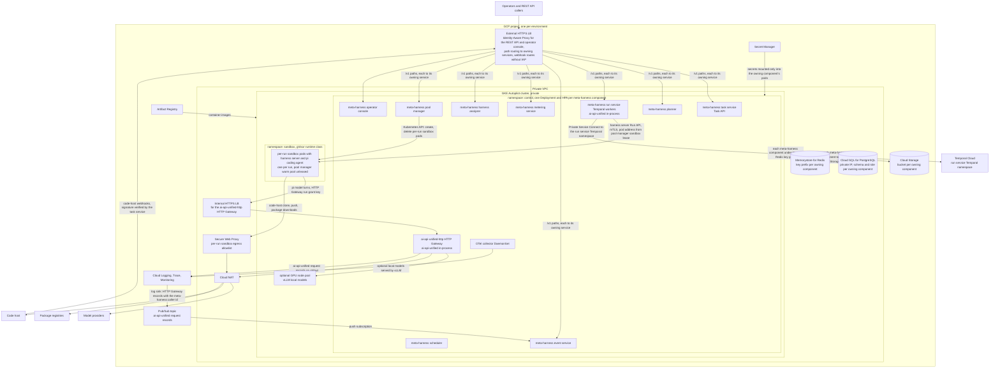

### Deployment without GKE

The deployment that exists runs the whole control plane on one Compute
Engine VM and the console's edge on Cloud Run. GKE and the pool manager
replace the VM behind the same meta-harness components when runs outgrow one
machine. The cloud is declared in Terraform, under `deploy/terraform`, as two
stacks with state in a Cloud Storage bucket.

| Component | Runs on | Notes |
|---|---|---|
| Edge: the console web app and `/v1` routing | Cloud Run, behind Firebase Hosting at `https://<console_home_site>.web.app`, `octofusion-ai` (`deploy/terraform/platform/variables.tf`). The deployment's first site, `console_site` in `deploy/environment.json`, and `octofusion` answer every path with a 301 to it, path and query kept | `deploy/edge.Dockerfile`. The edge signs operators in with Google itself (see REST API), checks the access list, then reaches the VM's private address over Direct VPC egress |
| Task service, planner, event service, meta-harness scheduler | The VM, as systemd units under the `mh` user | `deploy/vm/units`. Each listens on a private port that only the edge's subnet reaches |
| Postgres | The VM, in a Docker container, its data on the data disk (`/var/lib/meta-harness/postgres`) | `mh-postgres.service`. One copy on one disk; Cloud SQL replaces it |
| Temporal | The VM, the Temporal dev server with its history in one file | `mh-temporal.service`. A development server, one process, no replication. Temporal Cloud replaces it before runs that matter |
| Redis | The VM, the distribution package | The HTTP Gateway's run grants and per-run spend counters. The scheduler's locks and kill switch are Postgres rows |
| HTTP Gateway | The VM, from a checkout of ai-api-unified-http, reading its own `config/models.json`. Its guardrails are off, as that file ships | `mh-gateway.service`. Bound to every interface so the egress proxy container reaches it; no firewall rule admits its port from outside the VM. The meta-harness `models.json`, whose router names `harness` candidates, reaches the worker alone: the gateway's completions factory refuses a `harness` engine |
| Meta-harness run service worker, egress proxy, per-run sandboxes | The VM, with the Docker executor backend | `mh-worker.service`, `mh-egress.service`. Per-run sandboxes are containers on the VM. `MH_MAX_SANDBOXES` caps them at 8, the ceiling on the task policy's `max_parallel`. The VM, an `e2-standard-16` (16 vCPU, 64 GB), holds eight sandboxes at their profiles' 6 GB cap and 16 GB for everything else. Each run's workspace and git directory are under `/var/lib/meta-harness/runs` |
| Logs | The systemd journal, every `mh-*` unit's output. The Google Cloud Ops Agent (major version 2, `deploy/vm/ops-agent.yaml`), which the boot installs, ships it to Cloud Logging as `mh_journald`. A failed install leaves the logs in the journal and stops nothing. Every service logs through `meta_harness/logs.py`, which under systemd starts each line with its journal priority (`<4>` warning, `<3>` error). That makes a record's level its Cloud Logging severity. Without the prefix every line arrives as INFO. Failures are logged at WARNING or ERROR, each line naming `task <id> run <run id>`. The RunTask workflow logs a warning for a run that did not finish or a review run with no verdict. It logs one for a merge GitHub refused or a conflict, and for failed checks on a merge commit. It logs a task that ends `review_unresolved` or unreviewed as a warning, and one that ends `failed` as an error. The task service logs every move to `failed` (error), `review_unresolved` or `canceled` (warnings), whoever set it | The console's Admin menu reads them through `GET /v1/admin/logs`. The Logs page opens on warnings and above, and takes its search and range from its link (`?q=<task id>&minutes=1440`) |
| Secrets | Secret Manager, read at boot into `/etc/meta-harness/env` | Provider keys, the service key, the gateway key, the repo registry and each GitHub App's private key. 

The **platform** stack is what changes rarely. It holds the network, Cloud
NAT, the firewall rules, the VM's fixed address and its data disk. It also
holds the service accounts and every role they hold, the GitHub sign-in, the
secrets' containers, Artifact Registry and the console's access list. The
**release** stack is a commit: the VM at that commit, and the edge on Cloud
Run from the image built from it.

Every merge to main deploys itself, infrastructure included, so a task's
merged pull request is all it takes to change either stack.
`.github/workflows/deploy.yml` waits for main's five checks to pass at the
merged commit, then:

1. It plans the platform stack. No change applies nothing. A change is
   applied, unless `deploy/platform_guard.py` refuses the plan.
2. It builds the edge image and pushes it to Artifact Registry tagged with
   the commit.
3. It applies the release stack with the commit and the image. The release
   stack reads the platform stack's outputs, which is why the platform goes
   first. A pull request can add a platform output and use it in the release
   stack at once.
4. Once the VM reports the commit, it runs a smoke task through the deployed
   system (#204, `src/meta_harness/smoke.py`). It submits one small task
   through the Task API on the VM, as a caller would. The task writes a
   one-line file in a scratch repo on the VM. It is pinned to the first
   candidate of the router's first tier, with a $0.25 spend limit. The
   scheduler admits it whatever is running. The RunTask workflow runs it in a
   per-run sandbox, with its database, against the real HTTP Gateway, and it
   ends `closed`. Its type is `smoke`: only a service creates one, and it
   opens no pull request, gets no review and never holds for budget. The
   console's lists leave it out (`GET /v1/tasks?smoke=true` lists them). A
   task that does not end `closed` in ten minutes is tried once more, since
   one model call can fail by chance. Two failures fail the deploy, and its
   failure issue quotes what the smoke task said. While the kill switch is on
   or the scheduler drains, no task may start, and the smoke task is skipped.
   Tests and the zero-cost end-to-end check use fakes for the model, the code
   host and the VM. Only the smoke task shows whether a task runs on the
   deployment.

The guard refuses a plan that deletes or replaces what the deployment cannot
lose. That is the data disk, the network, a service account, the sign-in from
GitHub Actions, a secret and the image repository. It is also the console's
site, an enabled API, and the deploy account's own way in: its sign-in and its
access to the Terraform state. New resources, changes in place, and removed
grants and firewall rules apply. A refused plan fails the deploy before
anything changes, and its issue names the resources.

The workflow signs in as `mh-deploy-sa` through workload identity federation,
whose provider accepts only this repository's main branch. So GitHub holds no
Google Cloud key and a pull request's code never runs with cloud access.
Applying the platform stack takes roles that let the account change IAM,
secrets and the network. So the account can grant itself anything in the
project. What guards it is the path to main: the checks, the
review loop's review on another model, and the guard on the plan. No pull
request sees its plan before it merges, because planning needs cloud access
that a pull request must not have.

Some things stay outside a deploy. A secret's value is added by hand
(`gcloud secrets versions add`), since Terraform never sees one. A secret the
system can generate itself, as it does the session key, belongs in the stack.
A new project is set up once by hand (`make platform`), which is also
how a plan the guard refuses is applied. And a failed platform apply has no
rollback: the fix is the next merge.

A deploy updates the running VM in place. The release apply changes only
the VM's metadata (the commit, the startup script), so the VM keeps running.
The workflow then runs the startup script on it over IAP SSH, as the deploy
account through OS Login. The script runs inside a `systemd-run` unit so a
dropped connection can't stop it. The script checks the commit out and runs
`deploy/vm/boot.sh` in update mode:

- Postgres and Temporal keep running, and migrations apply beside the running
  services. The script runs `mh migrate` itself and never restarts the
  `mh-migrate` unit. Every API service requires that unit, so restarting it
  would stop them all at once.
- The sandbox images are rebuilt only when their sources changed.
- The egress proxy and the HTTP Gateway restart only when they changed,
  because a restart drops a running sandbox's model calls.
- The control-plane services restart one at a time, each answering
  `/health` before the next. A service gives its open requests five seconds on
  a stop, and systemd ends it after fifteen (`TimeoutStopSec`). So a
  connection a client keeps open, such as the console's live event stream,
  cannot hold a restart.

Running sandboxes are Docker containers that outlive the restart. The
interrupted run activity ends with `WorkerShutdown`. Its workflow waits for
the restarted worker and runs the activity again for the same run. The
activity re-attaches to the same container, so no running task is lost. A
workflow
used to take that failure as the run's own and fail the task for good. The edge
retries a request whose connection is refused for up to 20 seconds, so a
service's few seconds down don't reach the console. Old and new code run
side by side for those seconds, so migrations only add, and anything removed
goes in a later pull request.

The restarted worker also replays every running RunTask workflow's history
against the new workflow code. A change to which activities, timers or signals
a workflow runs, or their order, no longer matches a history recorded before
it. Temporal then retries that workflow task without end: the task neither
finishes nor fails. So a change like that goes behind
`workflow.patched("<change-id>")`. A later pull request removes the old branch
with `workflow.deprecate_patch` once no workflow started before the change is
still running. `tests/run_service/test_replay.py` replays recorded RunTask
histories (`tests/run_service/histories`, Task API tasks through the review
loop) against the current code on every pull request. So a change that would
break running workflows fails before it merges.

A failed update rolls back. Any step of an update can fail (a service that
does not answer `/health` within 60 seconds, a migration, a dependency
install). When one does, `rollback` in `deploy/vm/services.sh` checks out the
commit the update replaced and reinstalls its dependencies and units. It
restarts every service the update had restarted, one at a time with the same
health checks.
The services after the failed one never ran the new commit. Because
migrations only add, the previous code runs against the new schema. The
guest attribute reads `failed <commit>: rolled back to <previous>`, or
`failed <commit>: rollback failed, a service is down` when the previous
commit doesn't come back healthy either. The deploy fails, and opens an issue
labeled `meta-harness:operations` that names the commit, so a goal can fix
the change. CI checks a change before it merges. The rollback covers what only
shows on the VM, such as a migration against production data, a setting
checked at startup, or a missing secret. Without it, a merge that
broke the worker would leave nothing to run the fix.

A deploy whose commit failed one of main's checks never starts. It opens an
issue titled "blocked: a check failed on main" that names each failed check
and links its run. Nothing on Google Cloud changes. A deploy is a check run on
the merge commit, so the task whose pull request merged waits for it (Review
loop, the merge). A failed deploy also becomes that task's fix run, besides
the issue it opens.

Terraform replaces the VM only when its definition changes (boot image,
disks), and stops, resizes and starts it for a new machine type. The first
deploy to a project creates it. In each case the VM boots by itself, and the
workflow runs no update over SSH on top of that boot. Its startup script
mounts the data disk, which holds Postgres data, Temporal's history and run
workspaces. It then checks the commit out and runs `deploy/vm/boot.sh`, which
starts everything. Both paths
report `ok <commit>` or `failed <commit>` in a guest attribute, and the
workflow waits for it. `make deploy` runs the workflow by hand, and
`make deploy-status` reads the attribute. The VM has no public address; an
operator reaches it through IAP-tunneled SSH, only to read logs.

Against the GKE design, this deployment's Temporal dev server and Postgres
container are single copies on one disk. The sandbox host is the control-plane
host, and the VM's size bounds concurrent runs. A deploy that replaces or
restarts the VM takes the control plane down while the new VM boots. That is a
deploy that changes the VM's definition or machine type. Such a deploy drains
first: over IAP SSH, `deploy/vm/drain.sh on` sets the scheduler draining, so
no new task starts. The deploy waits until no task is `running`, up to the
longest harness profile's `max_minutes` plus ten. Past that it applies anyway
and
names the tasks it interrupted in the run's summary. The new VM's boot ends
the drain. After a
rollback, the VM's metadata still names the failed commit, so a reboot before
the fix deploys boots that commit, with no rollback. Cloud SQL and Temporal Cloud
are their own pull request after the point of entry, as Terraform resources
replacing the two containers.

### Compute

- One private, regional GKE Autopilot cluster.
- One Deployment per meta-harness component, each with a horizontal pod
  autoscaler. The components are the meta-harness task service, the planner,
  the meta-harness scheduler and the meta-harness run service Temporal
  workers. They are also the pool manager, the event service, the metering
  service, the harness analyzer, the operator console and the
  ai-api-unified-http HTTP Gateway. The
  meta-harness scheduler and the pool manager each run two replicas with
  leader election.
- One per-run sandbox pod per run, with the gVisor
  runtime class (GKE Sandbox). The pool manager creates and deletes these
  per-run sandbox pods through the Kubernetes API. The pool manager's warm
  pool is pre-created, unleased per-run sandbox pods. A default-deny
  NetworkPolicy on the `sandbox` namespace allows ingress only from the
  meta-harness run service and the pool manager on the harness server Run API
  port. It allows egress only to the HTTP Gateway's internal load balancer and
  the Secure Web Proxy.
- The meta-harness run service and the pool manager reach a per-run sandbox's
  harness server over mutual TLS. They use the pod address in the pool
  manager's sandbox lease record. No load balancer is in front of the per-run
  sandboxes, because each run talks to exactly one per-run sandbox pod.
- A GPU node pool runs vLLM behind the HTTP Gateway,
  as an `openai-compatible` ai-api-unified completions engine in the
  ai-api-unified `models.json` configuration.

### Managed services

| Service | Owner and use | Fails how |
|---|---|---|
| Cloud SQL for PostgreSQL | One regional high-availability Cloud SQL instance on a private IP. One schema and database role per owning meta-harness component, with IAM database authentication per component. The Cloud SQL instance has the capacity for the meta-harness event service, the heaviest writer. | Failover to the Cloud SQL standby takes about a minute. Meta-harness services retry, and event service producer clients buffer. Per-run sandboxes never touch Cloud SQL, so runs in progress keep working. New task admissions by the meta-harness scheduler and new sandbox leases from the pool manager wait. |
| Temporal Cloud | The meta-harness run service's Temporal namespace, reached over Private Service Connect. RunTask workflow history, timers and signals. | RunTask workflows stop advancing, but per-run sandboxes keep running and finish their work. When Temporal Cloud returns, meta-harness run service activities retry and re-attach to the harness server by `run_id` and `Last-Event-ID`. A run whose pool manager sandbox lease TTL expires during the outage is lost, and the meta-harness run service retries it as a new attempt. |
| Memorystore for Redis | Standard tier with a replica. One key prefix per owning component. The HTTP Gateway keeps HTTP Gateway run grants and HTTP Gateway per-run spend counters. The meta-harness scheduler keeps repo-area locks. The meta-harness run service keeps code-host API rate-limit token buckets. The event service keeps a commit notification fallback, unused while Postgres `NOTIFY` suffices. | Memorystore failover keeps the data. If Memorystore loses the HTTP Gateway's spend counters or run grants, the HTTP Gateway fails closed. The HTTP Gateway then rejects model turns for any run it cannot verify or meter. Those runs end, and the meta-harness run service retries them as new attempts. If Memorystore loses the meta-harness scheduler's repo-area locks, the scheduler stops admitting tasks. It admits again once it has rebuilt the locks from the meta-harness run service's active runs. |
| Cloud Storage | One bucket per owning component. The pool manager's Cloud Storage artifact bucket holds pi session directories under `harness_session_id` and per-run sandbox logs. The meta-harness run service's bucket holds run artifacts, and the event service's bucket holds event exports. | The pool manager's sandbox drain step retries artifact collection. A per-run sandbox stays in `draining` until the pool manager saves the per-run sandbox's artifacts to the pool manager's bucket or a limit passes. Follow-up tasks that need a saved pi session wait. |
| Artifact Registry | Every container image: the per-run sandbox harness image and one image per meta-harness control-plane component. | Pods cannot pull uncached images. Running meta-harness services and warm per-run sandboxes keep running, and image rollover pauses. |
| Secret Manager | Secret Manager mounts each secret only into its owning component's pods. Model provider API keys go to the HTTP Gateway, except the ai-api-unified router classifier's provider API key. The classifier's provider API key goes to the meta-harness run service and the planner. The meta-harness run service also receives an HTTP Gateway API key. The meta-harness run service run activity uses that HTTP Gateway API key to request and revoke HTTP Gateway run grants. | Secrets load into pods at pod start, so a Secret Manager outage blocks new pods only. |
| Cloud Logging log sink and Pub/Sub | The log sink publishes the HTTP Gateway's meta-harness request records to one Pub/Sub topic, and a push subscription delivers them to the event service. | Pub/Sub keeps an undelivered message for 7 days and retries the push, so an event service outage delays `gateway_request` events and loses none. |
| Cloud NAT and Secure Web Proxy | All egress from the GKE cluster. The Secure Web Proxy enforces the per-run sandbox egress allowlist. | Fails closed: per-run sandbox egress stops, runs fail on code-host clone or push, and the meta-harness run service retries them. No bypass route exists. |

### Network

- The GKE cluster is private in its own VPC, with Cloud NAT for
  egress.
- The Secure Web Proxy allows the HTTP Gateway's
  internal load balancer address, the code host and package registries, and
  nothing else. The `sandbox` namespace's default-deny NetworkPolicy enforces
  the same limit inside the GKE cluster.
- An internal HTTPS load balancer fronts the
  ai-api-unified-http HTTP Gateway.
- An external HTTPS load balancer with Identity-Aware Proxy fronts the
  operator console and the REST API. Its URL map sends the webhook paths to a
  backend without IAP, and Cloud Armor rate-limits each client.
- Each meta-harness component has one Kubernetes
  service account bound to one Google service account. IAM grants follow
  component ownership: a component's Google service account reaches only its
  own Cloud SQL database role, Cloud Storage buckets and Secret Manager
  secrets. Only the pool manager's service account can create or delete pods
  in the `sandbox` namespace. Per-run sandbox pods run under a service account
  with no Google Cloud permissions.
- Memorystore has no per-prefix IAM, so each owning
  component's Redis client wrapper enforces that component's key prefix.
- A run grant key is an application credential of the HTTP Gateway, with no
  Google Cloud permissions. The meta-harness run service run activity uses an
  HTTP Gateway API key to request and revoke run grants. That key reaches only
  the meta-harness run service pods, through Secret Manager.

### Observability

An OpenTelemetry collector DaemonSet sends traces to Cloud Trace and logs to
Cloud Logging. Cloud Monitoring holds the metrics that drive the horizontal pod
autoscalers and the alerts.

### Local development

Docker Compose runs Postgres, Redis, the Temporal dev server and every
meta-harness service. Per-run sandboxes use the Docker executor backend behind
the same pool manager executor interface, from the same images. A local egress
proxy enforces the same per-run sandbox egress allowlist. Each local per-run
sandbox is on its own internal Docker network, which has no route out. Docker
attaches the local egress proxy to each one. Docker publishes no
port from an internal network, so the meta-harness run service reaches each harness server
through the local egress proxy's control listener.

## Build plan

| Step | State | Where |
|---|---|---|
| pi model client extension: pi's model calls through the HTTP Gateway | built | `images/harness-pi/extension` |
| Harness server and the harness server Run API | built | `images/harness-pi/server` |
| Each run as a meta-harness run service Temporal workflow (the RunTask workflow), with re-attach to the harness server on retry and cancel | built | `samples/temporal-run-task` |
| HTTP Gateway run grants: model pin and spend limit per run | built | ai-api-unified-http 1.18.0, `samples/temporal-run-task` |
| Per-run sandbox: the harness server in a Docker container per run. The meta-harness run service run activity starts and removes it with the Docker executor backend | built for local development | `images/harness-pi/Dockerfile`, `samples/temporal-run-task` |
| Per-run sandbox egress allowlist: each per-run sandbox on its own internal Docker network. A local egress proxy lets it reach only the HTTP Gateway, the code host and package registries | built for local development | `samples/temporal-run-task/egress-proxy`, `make egress-check` |
| A zero-cost end-to-end check: the RunTask workflow against a fake HTTP Gateway that makes no model calls, on every pull request | built | `samples/temporal-run-task/e2e.sh`, `make e2e`, `.github/workflows/e2e.yml` |
| The sandbox runs this repo's checks (#203). On every pull request, `make image-checks` has pi's bash tool run the checks a task on this repo runs. Those are `uv sync`, ruff, the whole Python suite, and the console's install, typecheck and tests. Then `npm run brand` rebuilds the console's brand artwork, and the check fails if that changed a committed console file. They run in the built per-run sandbox image, on a clone of the checkout under test, behind the egress proxy. The run's database is beside it, and the HTTP Gateway is the fake one. It fails when the image or the sandbox cannot run them, and the deploy waits for it. On its first runs it found the sandbox started under the wrong name once it had a database. It found a database host name too long for a long task ref. It found every workflow test skipped in a sandbox, because `temporal.download`, where Temporal's test server comes from, was not on the egress allowlist | built | `samples/temporal-run-task/stack.sh` (`checks`), `src/meta_harness/run_service/fake_gateway.py` |
| Provider-neutral tool results: one tool-result shape the HTTP Gateway converts for each model provider | built | ai-api-unified-http 1.19.0, `images/harness-pi/extension` |
| The RunTask workflow's run loop over the ai-api-unified router's candidates, with a meta-harness run service `route` activity, escalation, pins and a task-wide spend limit | built | ai-api-unified 3.30.0 (`AiRouteClassifier`), `samples/temporal-run-task`, `make fallback-demo` |
| Repo work in a run: each run starts from a fresh clone of the task's repo, and pi's `bash` tool runs the acceptance checks. The meta-harness run service's Publish step commits pi's changes, pushes the branch and opens the pull request with `Closes <issue>`. The per-run sandbox holds no code-host credential | built for local development | `samples/temporal-run-task`, `make repo-demo`, `make run TICKET=owner/name#N` |
| `submit_review`, the review run's owned pi tool | built | `images/harness-pi/extension` |
| The clone's git directory outside the per-run sandbox mount, read-only inside it, so nothing pi writes runs on the host at Publish | built | `src/meta_harness/run_service/code_host.py`, `sandbox.py`, `tests/run_service` |
| Runs sized for real work: Python 3.12, uv and Poetry in the sandbox image. Profile limits, resources and bash allowlist. The run activity's timeout from the profile. Tier models and thinking levels | built | `images/harness-pi`, `config/`, `tests/run_service/test_workflow.py` |
| The operator console on Mantine: a sidebar shell, data tables and a Goals page. A Configuration view of router tiers, harness profiles and the repo registry, with versions, checked saves and rollback | built | `console/`, `src/meta_harness/config`, `tests/config` |

### Bootstrap pull requests

The bootstrap ends at the point of entry. There, an operator signs in to the
console web app in the cloud and creates a goal. The meta-harness turns the
goal's labeled issues into pull requests, with no process running on the
operator's machine. Nothing self-improving starts before that. The
meta-harness pull
requests merge one at a time, in this order. Each check joins the zero-cost
end-to-end check, so it runs on every later pull request without model calls.

1. `feat/control-plane-skeleton`, `feat/event-service`, `feat/task-service`,
   `feat/run-service` (merged). Then `make e2e` submits a task through the
   Task API. The task ends with a pull request on a test repo and every event
   in the event service.
2. `feat/github-app` (merged). Then a run clones a real repo that the GitHub
   App alone can reach, and opens its pull request as the app.
3. `feat/planner-goals`, `feat/admission`. Then a labeled issue in a test repo
   becomes a task and runs to a pull request, with no command naming the task.
4. `feat/console-web-app-goals`, `feat/console-web-app-runs`. Then an operator
   creates a goal in the browser and watches its runs live.
5. `feat/deploy-cloud` (merged). Then the cloud deployment exists: the edge
   behind IAP and the VM with every service.
6. `feat/real-runs` and `docs/agents-md` in ai-api-unified-http and
   meta-harness. Then a run on any of the three repos installs it, runs its
   tests and works within limits sized for the task. Each repo tells the run
   its own rules. After the deploy check, the point of entry works: a goal
   created in the cloud console runs its issues to pull requests.

With `auto_merge` off, each pull request waits for an operator to merge it,
so the point of entry needs no review loop. After it, `feat/review-loop`
(#85) and `feat/merge` (#86) merged, built by the meta-harness.

| Pull request | Builds | Check |
|---|---|---|
| `feat/control-plane-skeleton` | `src/meta_harness/`, the `mh` command line, Docker Compose with Postgres and the Temporal dev server, migrations per owning component | `make up && make migrate` on a clean checkout |
| `feat/event-service` | The `event` table, the schema registry, `append`, `read` and `tail`, and the client library with its outbox | `mh events tail` keeps printing in position order across an event service restart |
| `feat/task-service` | The `task` table and the Task API: create, read, look up by `external_ref`, cancel | Two `POST /v1/tasks` with one `external_ref` return one task |
| `feat/run-service` | The RunTask workflow, moved from `samples/temporal-run-task`, started from a task id and writing its rows and events | `make e2e` through the Task API |
| `feat/github-app` | A read-only installation token per run for the clone, and the app token for every code-host write | `make run REPO=owner/name` on a repo the GitHub App alone can reach |
| `feat/planner-goals` | The `goal` table, the Goals API, the `fix` modality, the GitHub adapter's `list_open`, `read` and `sweep`, and issues to tasks with `depends_on` | A labeled test issue becomes a task within one sweep |
| `feat/admission` | A loop that starts queued tasks' RunTask workflows. It checks global concurrency, repo-area locks, closed dependencies and the goal's budget. The locks are expiring rows until the meta-harness scheduler moves them to Redis | `make e2e-admission`: two tasks on one repo area run in turn |
| `feat/console-web-app-goals` | The first console web app: goal creation, the Overview and the Goal page, calling only the REST API. It refuses an identity outside the access list. Merged as server-rendered pages, then replaced by the React app | An operator creates a goal in the browser, and an account outside the access list gets 403 |
| `feat/console-web-app-runs` | The console web app in React and TypeScript (`console/`), and the local edge that serves it and routes `/v1` as the signed-in operator. Lists read ahead as you scroll. The Tasks page shows running tasks as a list or as terminal tiles 4, 16 or 32 up. Only the tiles on screen stream, over one server-sent-event stream. The Task page shows the live run and loads older events as you scroll up. Cancel and the kill switch, which the meta-harness scheduler performs | The tiles of running tasks stream their events as they happen, and scrolling moves the stream to the tiles in view |
| `feat/deploy-cloud` | One VM running every control-plane service, Postgres, the Temporal dev server, Redis and the HTTP Gateway on its own configuration. It also runs the worker and its per-run sandboxes. All are systemd units booted from Secret Manager. The edge on Cloud Run behind Identity-Aware Proxy with the IAP header check. The clone's git directory outside the sandbox mount (see Deployment without GKE) | `deploy/gcp.sh infra && deploy/gcp.sh edge`, then a goal created in the cloud console runs a labeled issue to a pull request, and a request without IAP credentials gets 401 |
| `feat/real-runs` | Python 3.12, uv and Poetry in the per-run sandbox image. Harness profiles sized for these repos, with resources and a bash allowlist. The run activity's timeout from the profile. Router tiers on Sonnet 5 and Opus 5.5, with each tier's thinking level sent on every turn. A $10.00 default task limit. An e2-standard-8 VM | `uv run pytest -q`, `npm test` in `images/harness-pi`, and `make e2e` in CI |
| `feat/terraform-deploy` | The cloud in Terraform: a platform stack and a release stack. CI applies them on every merge to main through workload identity federation. The VM replaced per commit with its state on a data disk. `make platform`, `make deploy`, `make deploy-status` | A merge to main deploys, and `make deploy-status` names the merged commit as what the VM booted |
| `feat/deploy-managed` | Cloud SQL for the control plane's tables, and Temporal Cloud for the run service namespace | `make deploy`, then the same goal check |
| `feat/code-host-webhooks` | The webhook endpoint: signature check, and check, merge and close deliveries as RunTask workflow signals | `make webhook-replay` |
| `feat/review-loop` | The review run with `submit_review`, the posted review, the fix run, and the round and budget limits (merged, #85) | `make e2e-review`: `changes`, a fix, then `clean` |
| `feat/merge` | The merge at the reviewed head SHA, `auto_merge`, the `ready` and `review_unresolved` ends, and merge conflicts as fix runs (merged, #86) | `make e2e-review` ends merged |
| `feat/takeover` | Take over, hand back and close, as audit events | `mh task take-over`, then `mh task hand-back` |
| `feat/planner-sync` | Issue webhooks, state labels and comments, blocked tasks, refused issues, the goal's status | A test issue gets `meta-harness:running`, then `meta-harness:pr-open` |
| `feat/console-web-app-inputs` | The Inputs page: queued issues by repo and by goal, with their states | A test issue moves from queued to merged in Inputs |
| `docs/agents-md` in ai-api-unified-http and meta-harness | `AGENTS.md` with the repo's test, lint and versioning rules | None |

An operator sets up what the meta-harness cannot:

- a Google Cloud project with billing, and, with `feat/deploy-managed`, a
  Temporal Cloud account;
- the GitHub App, installed on ai-api-unified, ai-api-unified-http and
  meta-harness, with its private key in Secret Manager;
- branch protection with required checks on the three repos;
- a spend limit on each model provider key the HTTP Gateway holds.

### Built by the meta-harness

Since `feat/deploy-cloud` merged, the rest of this design is filed as GitHub
issues, and `fix` goals turn them into pull requests. A goal takes one
label, so each issue has exactly one theme label, and a theme's issues
make sense as one goal:

| Label | Theme |
|---|---|
| `meta-harness:parallel` | A repo's tasks run side by side: the parallel limit, the merge queue, `Paths:` in issues, and code laid out so tasks edit different files |
| `meta-harness:operations` | Running the deployment: deploys, workflow changes under running tasks, recovery. A failed deploy files its issue here |
| `meta-harness:console` | The console's admin and user menus: roles, the configuration editors, repositories, logs, user settings |
| `meta-harness:goal-lifecycle` | A goal from saved to met: save and start, picking issues, each task's pull request, the goal's board, completing and reopening |
| `meta-harness:goal-planning` | A `feature` goal plans its own issues: the planning profile, the plan, and its approval |
| `meta-harness:console-ux` | The console as the place to follow and steer a task: the run timeline, diffs, reviews, steering, attempts, cost, the inbox |

An issue that two goals' labels match joins the first goal that sweeps it and
stays there. That is why an issue has one theme label. A `Depends on:` line
may name an issue under another label. The task then waits `blocked` until
that issue closes, so a goal on its label never finishes before the other
theme's goal has run. Such lines are kept few, and the themes run in
the table's order. `meta-harness:merge` holds the closed issues of the review
loop and the merge, and `meta-harness:planner-check` and
`meta-harness:deploy-check` hold the issues the checks run.

Each issue states its `## Acceptance checks`, the commands its run and its
review run. It also names the design sections its change makes untrue, which
its pull request updates.
