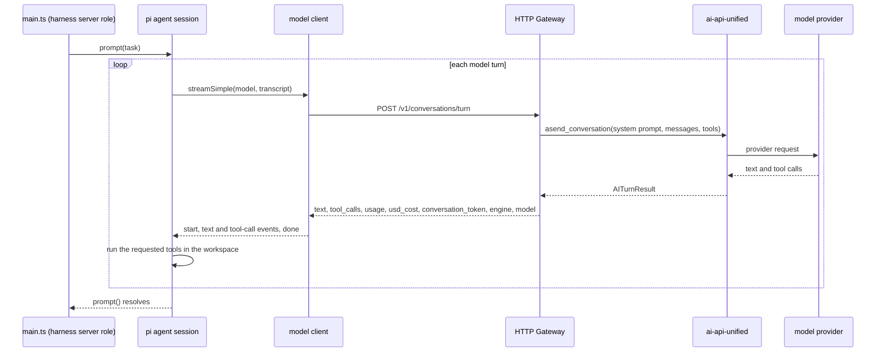

# pi model client sample

This sample runs pi in its own Node process through pi's TypeScript SDK, the
way the harness server will (section 8.2 of the technical design). pi plans
the work and runs the tools. Every model call pi makes goes through the
**model client**, the one provider pi can see. The model client sends each
turn to the HTTP Gateway (`ai-api-unified-http`), and ai-api-unified picks
and calls the real model.

It pins `@earendil-works/pi-coding-agent` and `@earendil-works/pi-ai` at
1.5.0. The pi APIs it uses come from the
[earendil-works/pi](https://github.com/earendil-works/pi) source at tag
`v1.5.0`: `docs/sdk.md`, `docs/custom-provider.md`, and the SDK examples.

## The call path



## Files

| File | Role |
|---|---|
| `src/main.ts` | Locks down pi's model layer, registers the model client, creates the session, runs one task, prints the trace |
| `src/model-client.ts` | The model client's `streamSimple`: builds the gateway request, maps the response to pi's events, usage and cost |
| `src/gateway-messages.ts` | Converts pi's transcript into the gateway's message list |

## What pi can reach

- `ModelRuntime.create()` gets an `InMemoryCredentialStore`, `modelsPath: null`
  and `allowModelNetwork: false`: no stored credentials, no `models.json`, no
  pi.dev catalog.
- pi's built-in providers still read keys such as `ANTHROPIC_API_KEY` from the
  process environment. The sandbox image holds no provider keys. To match
  that, `main.ts` removes provider key variables from its own environment
  before pi starts.
- `modelRuntime.registerProvider()` adds the model client: one model, zero
  prices, no `promptCache` lifetime, and `streamSimple` set to the model
  client. Under the SDK this is a direct call on the runtime, so the model
  client needs no extension file.
- At startup the sample calls `getAvailable()` and stops unless the model
  client's model is the only one pi can reach.
- `SettingsManager.inMemory` turns pi's retry and cache warming off, so the
  gateway's fallback chain is the only retry.
- `DefaultResourceLoader` loads no extensions, skills, prompt templates,
  themes or context files. pi keeps its own coding-agent system prompt.
- The tools are `read`, `write`, `edit` and `ls`, rooted in a new temporary
  directory.

## What the model client does each turn

1. Reads the system prompt and tools from pi's transcript with
   `getCurrentSystemPrompt` and `getCurrentTools`.
2. Builds the message list:
   - user text as plain text
   - each earlier assistant turn as its `conversation_token`
   - each tool result in the shape of the engine that asked for it
3. Calls `options.onPayload`, sends `POST /v1/conversations/turn` with
   `prompt_cache: {"retention": "extended", "key": <session id>}`, then calls
   `options.onResponse` and `options.onProviderStreamEvent`.
4. Emits `start`, the text events, a `toolcall_start` / `toolcall_end` pair
   per tool call, and one `done`. A failed or aborted request emits one
   `error`.
5. Sets usage from the gateway's token counts and `cost.total` from its
   `usd_cost`, marked `totalFromProvider`. The served model goes in
   `responseModel`.
6. Stores `<engine>:<conversation_token>` in the message's `responseId`. pi
   keeps that field in the transcript, so the next turn can replay the
   assistant turn and shape its tool results.

## Run it

You need nvm with Node 22.19 or later installed (pi 1.5.0 requires it), a
checkout of `ai-api-unified-http` with provider keys in its `.env`, and this
repo.

```bash
cd meta-harness/samples/pi-model-client
make run
```

`make run` takes these steps:

1. Switches to the Node version in `.nvmrc`.
2. Runs `npm ci` when `node_modules` is missing or older than the lockfile.
3. Starts the gateway, then waits for `/healthz` to answer. If a gateway
   already answers at `GATEWAY_URL`, it uses that one and starts nothing.
4. Prints the gateway and library versions from `/healthz`, then runs the
   sample.
5. Stops the gateway it started, including on Ctrl-C.

The gateway's output goes to `gateway.log` in this directory.

| Variable | Default |
|---|---|
| `SAMPLE_ENGINE`, `SAMPLE_MODEL` | `claude`, `claude-haiku-4-5`: the engine and model the request names |
| `GATEWAY_DIR` | `../../../aiapi/ai-api-unified-http`, the gateway checkout |
| `GATEWAY_PORT`, `GATEWAY_URL` | `8080`, `http://localhost:8080` |
| `GATEWAY_API_KEY` | `local-dev-key`, the gateway's local development key |
| `GATEWAY_WAIT_SECONDS` | `60` |

Set any of them on the command line:

```bash
make run SAMPLE_ENGINE=openai SAMPLE_MODEL=gpt-4o-mini
```

The task asks for one small text file, then reads it back, so a run costs
under a cent.

## What a run looks like

`make run` starts with these lines. The paths differ on your machine.

```text
[make] node v22.23.3
[make] starting the gateway from .../aiapi/ai-api-unified-http, log: .../samples/pi-model-client/gateway.log
[make] gateway: {"status":"ok","service_version":"1.17.0","api_version":"v1","library_version":"3.28.0"}
```

It ends with `[make] gateway stopped`. The sample's own output came from
ai-api-unified-http 1.17.0 with library 3.28.0, on 2026-11-02:

```text
[pi] models pi can reach: ai-api-unified/run-model
[pi] active tools: read, write, edit, ls
[pi] task: Create a file named hello.txt containing exactly one line: a short friendly greeting. Then read the file back and tell me what it says.
[pi] turn 1 starts
[model client] POST /v1/conversations/turn  requested=claude:claude-haiku-4-5  messages=1  tools=read,write,edit,ls
[ai-api-unified] served by claude:claude-haiku-4-5  fallback=false  finish=tool_use  tool_calls=write  tokens in=2059 out=176 cached=0  usd=0.002939  cache_hit=false
[pi] runs tool write {"path":"hello.txt","content":"Hello! Hope you're having a wonderful day!"}
[pi] tool write done: Successfully wrote to hello.txt
[pi] turn 2 starts
[model client] POST /v1/conversations/turn  requested=claude:claude-haiku-4-5  messages=3  tools=read,write,edit,ls
[ai-api-unified] served by claude:claude-haiku-4-5  fallback=false  finish=tool_use  tool_calls=read  tokens in=2257 out=61 cached=0  usd=0.002562  cache_hit=false
[pi] assistant text: Now let me read it back:
[pi] runs tool read {"path":"hello.txt"}
[pi] tool read done: Hello! Hope you're having a wonderful day!
[pi] turn 3 starts
[model client] POST /v1/conversations/turn  requested=claude:claude-haiku-4-5  messages=5  tools=read,write,edit,ls
[ai-api-unified] served by claude:claude-haiku-4-5  fallback=false  finish=complete  tool_calls=none  tokens in=2343 out=28 cached=0  usd=0.002483  cache_hit=false
[pi] assistant text: Perfect! The file has been created and contains the greeting: **"Hello! Hope you're having a wonderful day!"**
[workspace] files: hello.txt
[workspace] hello.txt: Hello! Hope you're having a wonderful day!
[run] model turns=3  failed=0  tokens in=6659 out=265  usd=0.007984
```

The same task with `SAMPLE_ENGINE=openai SAMPLE_MODEL=gpt-4o-mini` also
finished in 3 turns, for $0.000409, with 1,152 cached input tokens on turns 2
and 3.

## Findings

These came out of building and running the sample. Each one needs a change
outside this sample.

1. **The gateway takes tool results only in the answering engine's shape.**
   A tool result for Claude is a `tool_result` block in a user message. For
   OpenAI Chat Completions it is a `tool` role message, and for Gemini a
   `function_response` part. The library builds these with
   `build_tool_result_message`, but the gateway does not expose that, so
   `gateway-messages.ts` copies the library's shapes for each engine. Those
   copies must change by hand whenever the library changes a shape. The fix belongs in the gateway:
   accept one engine-neutral tool result (call id, tool name, result, error
   flag) and shape it with the answering client's
   `build_tool_result_message`.
2. **Gemini tool-use turns fail with a 500.** With `SAMPLE_ENGINE=google-gemini`
   and `gemini-2.5-flash`, the provider call succeeds and the provider bills it. Then
   the library's response cache fails to store the result:
   `UnicodeDecodeError` in `_serialize_result`
   (`middleware/response_cache.py`, `result.model_dump(mode="json")`). The
   cause is the turn's `thought_signature`, which the library kept as raw
   bytes in `raw_content`. ai-api-unified 3.29.1
   ([#111](https://github.com/davecthomas/ai-api-unified/pull/111)) stores it
   as base64 text, and its cache no longer raises on a result it cannot
   store. Gemini works in this sample once the gateway's library pin moves
   to 3.29.1. Until then, `/healthz`, printed at the start of `make run`,
   shows `library_version` 3.28.0.
3. **Once a tool call is in the history, a turn can fail over only within
   that provider.** The gateway's README says so: a provider's tool-call
   content is readable only by that provider's models. Each run therefore
   stays on one provider after its first tool call. The router can still
   change the model inside that provider.
4. **The gateway exposes neither the router nor run tokens yet.** The sample
   names an engine and model on each request (`SAMPLE_ENGINE`,
   `SAMPLE_MODEL`). In the full design the run token decides the model, and
   the model client sends no engine or model.
5. **Claude turns showed no cached input tokens.** The OpenAI run cached
   from turn 2. The cause is unknown. Each Claude prompt was about
   2,000 tokens.
6. **pi runs a turn's tool calls at the same time.** On 2026-11-03 Claude
   asked for `write` and `read` in one turn. pi started both together, and
   `read` failed with `ENOENT` before the file existed. The model retried
   the read on turn 2 and finished in 3 turns. Concurrent execution is pi's
   default (`toolExecution: "parallel"` in pi-agent-core).
   `toolExecution: "sequential"`, or `executionMode: "sequential"` on a tool,
   runs a turn's calls in order. The harness needs to pick one.
