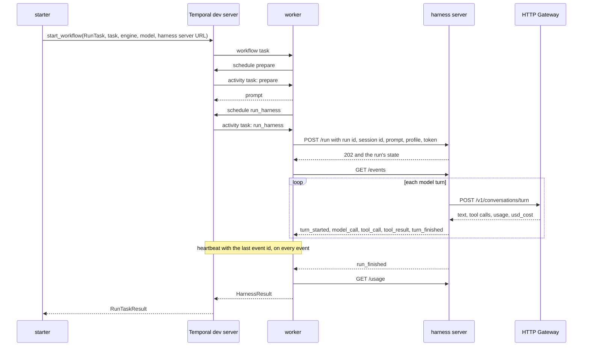

# Temporal run task sample

This sample is the command-line way to run the meta-harness end to end, as far
as it is built. `make run` always runs the whole current path, and it grows as
each piece lands.

```bash
cd meta-harness/samples/temporal-run-task
make run                                                   # the built-in task: create hello.txt and read it back
make run TASK="Write a haiku about autumn to haiku.txt."   # your own task
```

To leave the services running and send them tasks, see
[Run your own tasks](#run-your-own-tasks).

The path today: Temporal workflow, then the harness server running pi, then
the HTTP Gateway, then ai-api-unified, then the model provider. Each later
step slots into the same commands: gateway run tokens, then the library's
`harness` engine, then the pool manager with a sandbox per task.

It runs a coding task as a Temporal workflow, with pi running on the
[harness server](../../images/harness-pi/). A Python worker stands in for the
design's run service (section 7 of the technical design). The workflow
`RunTask` has two activities:

- `prepare` uses the task text you gave, or reads a versioned prompt template,
  and returns the prompt.
- `run_harness` starts the run on the harness server with `POST /run`,
  follows `GET /events` until `run_finished`, and reads `GET /usage`. It
  heartbeats on every event and returns a typed result: status, turns,
  tokens, cost, the files pi changed, pi's last answer, the attempt number,
  and whether the attempt re-attached to a run already in progress.

pi runs in the harness server's process, apart from the worker, so a run
keeps going when the worker dies. The run id is the workflow id plus
`:run_harness`, the same on every attempt. A retried attempt sends the same
`POST /run`, gets the run in progress, and reads its events from the last
event id it heartbeated. It never starts pi a second time.

The sample also shows two failure paths:

- **Cancel.** Temporal workflow cancellation reaches the running activity
  through its heartbeat, and the activity sends `POST /cancel`, which stops pi
  with `abort()`.
- **Worker restart.** The worker is killed with SIGKILL in the middle of a
  run. A new worker picks up the workflow from its history, Temporal retries
  the activity after the heartbeat timeout, and the retry re-attaches to the
  run.

It pins `temporalio` 1.34.0 and `httpx` 0.28.1. The SDK behavior it relies on
was checked against that version's source: heartbeats and heartbeat details,
cancel delivery in the heartbeat reply, `ActivityCancellationType`,
`workflow.unsafe.imports_passed_through()`, and dataclass payloads in the
default data converter.

## How it maps to the design's run workflow

| Design step (section 7) | In this sample |
|---|---|
| 1. Admit | The starter calls `start_workflow` with workflow id `run-task-<REF>`. `REF` plays the design's `external_ref`, and Temporal refuses a second task with the same one. There is no scheduler and no slot. |
| 2. Prepare | `prepare` uses `TASK`, or reads `prompts/hello-v1.txt`. There are no guardrails, no code-host token and no `AGENTS.md`. |
| 3. Route and run | `run_harness` calls the task's harness server directly. `stack.sh` starts one harness server per task, standing in for the pool manager's sandbox lease. There is no router or harness engine. The caller names the engine and model. A retried attempt re-attaches by run id, as the design's harness engine does by call id. |
| 4. Watch | `run_harness` reads the harness server's event stream and prints it to the worker log. There is no event service, pool manager or stall detection beyond the heartbeat timeout. |
| 5. Follow up | Left out. The harness server has `POST /followup`, but no pull request, code-host webhooks or signals drive it here. |
| 6. Close | The workflow returns the result to the starter. There is no task service. |
| 7. Cancel | Temporal workflow cancellation. The activity sends `POST /cancel`. There is no audit event and no lease to release. |

## The call path



The engine, model, task text and harness server URL travel in the workflow
input, so they appear in the workflow history. `GATEWAY_API_KEY` and
`HARNESS_SERVER_TOKEN` stay in the worker's environment and never enter the
history.

## Files

| File | Role |
|---|---|
| `run_task/workflows.py` | `RunTask`: timeouts, retry policy and cancellation type for each activity |
| `run_task/activities.py` | `prepare` and `run_harness`: start or re-attach, heartbeats, cancel |
| `run_task/harness_client.py` | Reads the harness server's event stream and prints one line per event |
| `run_task/shared.py` | Task queue name, the workflow id for a `REF`, and the dataclass payloads |
| `run_task/worker.py` | Runs the workflow and activities. Stops on SIGINT or SIGTERM. |
| `run_task/starter.py` | Starts one task, prints its id and web UI link, waits, then prints the event history and the result. `--follow` also prints the run's events. |
| `run_task/tasks.py` | `list`, `status`, `watch` and `cancel` for tasks already started |
| `prompts/hello-v1.txt` | The prompt template: create hello.txt and read it back |
| `stack.sh` | Starts and stops the services, and one harness server per task |
| `Makefile` | The commands below. Each one calls `stack.sh` or `run_task.tasks`. |

## Settings

| Setting | Value | Why |
|---|---|---|
| Workflow id | `run-task-<REF>`, ID reuse policy Reject Duplicate | One `REF` names one task, as `external_ref` does in the design |
| Run id | `<workflow id>:run_harness` | The same on every attempt, so a retry re-attaches |
| Harness session id | The workflow id | pi's session id and the gateway's prompt cache key |
| Profile | tools `read`, `write`, `edit`, `ls`, 20 turns, 10 minutes | The harness server enforces both limits |
| `run_harness` start-to-close timeout | 10 minutes | The whole run |
| `run_harness` heartbeat timeout | 10 seconds | A worker that stops heartbeating for this long is treated as gone, and the attempt is retried |
| Heartbeats | One per event, and the harness server sends a `heartbeat` event every 2 seconds. `max_heartbeat_throttle_interval` is 1 second on the worker. | A cancel reaches the activity only in a heartbeat reply. By default the SDK holds heartbeats back to 0.8 times the heartbeat timeout. |
| Retry policy | 3 attempts, 2 seconds first interval | Covers a lost worker and a lost connection to the harness server. A run that ended `ERROR`, `CANCELED` or `EXPIRED` fails the attempt for good, because a retry would re-attach to the same ended run. A refused request does too. |
| Cancellation type | `WAIT_CANCELLATION_COMPLETED` | The workflow ends only after the harness server has stopped pi |

## Run it

You need:

- the Temporal CLI: `brew install temporal`
- [uv](https://docs.astral.sh/uv/)
- nvm with the Node version in `../../images/harness-pi/.nvmrc`
- a checkout of `ai-api-unified-http` with provider keys in its `.env`

No Temporal account or API key is needed. The dev server runs locally.

**pi's tools act on your machine.** Until tasks run in a sandbox, nothing
confines `read`, `write` and `edit` to the task's workspace. `bash` is off.
Run only tasks you trust.

```bash
cd meta-harness/samples/temporal-run-task
make run
make run TASK="Write a haiku about autumn to haiku.txt." REF=haiku-1
make run ENGINE=openai MODEL=gpt-4o-mini
```

`make run` takes these steps:

1. Runs `uv sync`, and `npm ci` in `images/harness-pi` when its
   `node_modules` is missing or older than its lockfile.
2. Starts `temporal server start-dev` unless a Temporal server answers at
   `TEMPORAL_ADDRESS`.
3. Starts the gateway unless one answers at `GATEWAY_URL`.
4. Starts a harness server for the task on a free port, with pi's workspace
   at `runs/<REF>/workspace`.
5. Starts the worker, shows its log, and runs the starter.
6. Stops everything it started, on exit or Ctrl-C. On Ctrl-C the starter
   cancels the workflow and waits for it to end before the worker stops.

`make run` refuses to start while `make up` is running, because the two
workers would split the work.

Logs go to `temporal.log`, `gateway.log` and `worker.log` in this directory,
and the harness server's to `runs/<REF>/harness-server.log`. `runs/` keeps
every task's workspace and log until you delete it. The dev server keeps
workflow history in memory, so history is gone once `make run` stops it. To
keep history and browse it later, set `TEMPORAL_DB` to a file path, or start
your own dev server first with `temporal server start-dev`. `make run` then
uses that one and leaves it running. The web UI is at http://localhost:8233
while the server runs.

| Variable | Default |
|---|---|
| `TASK` | empty: the task in `prompts/hello-v1.txt` |
| `REF` | 8 random hex characters. Letters, digits, `.`, `_` and `-`, starting with a letter or digit. A `REF` used before is refused. |
| `ENGINE`, `MODEL` | `claude`, `claude-haiku-4-5` |
| `HARNESS_DIR` | `../../images/harness-pi` |
| `HARNESS_SERVER_TOKEN` | `local-harness-token` |
| `GATEWAY_DIR` | `../../../aiapi/ai-api-unified-http`, the gateway checkout |
| `GATEWAY_PORT`, `GATEWAY_URL` | `8080`, `http://localhost:8080` |
| `GATEWAY_API_KEY` | `local-dev-key`, the gateway's local development key |
| `TEMPORAL_PORT`, `TEMPORAL_ADDRESS` | `7233`, `localhost:7233` |
| `TEMPORAL_DB` | empty: history in memory |
| `WAIT_SECONDS` | `60`, how long to wait for each service to start |
| `CANCEL_AT`, `RESTART_AT` | `turn 1 starts`, `turn 2 starts`: the worker log line each demo waits for |

The built-in task costs under a cent on `claude-haiku-4-5`.

## Run your own tasks

Start the services once, then send them tasks from any terminal:

```bash
make up
make task REF=poem-1 TASK="Write a four-line poem about tide pools to poem.md, then list the files in the folder."
make task REF=notes-1 ENGINE=openai MODEL=gpt-4o-mini TASK="Create notes.txt with three bullet points about why tests matter, then read it back."
make tasks
make status REF=poem-1
make watch REF=notes-1
make cancel REF=poem-1
make down
```

| Command | What it does |
|---|---|
| `make up` | Starts Temporal and the gateway unless they already answer, plus a worker, and leaves them running. Logs and process ids go in `stack/`. |
| `make task TASK=... REF=...` | Starts a harness server for the task, starts the workflow, prints the run's events until it ends, prints the result, and stops the harness server. Ctrl-C cancels the task. Tasks in separate terminals run at the same time. |
| `make tasks` | Lists every task on the Temporal server: `REF`, status, start time, workspace |
| `make status REF=...` | One task: its workflow status and workspace. While it runs, the harness server's turns, calls, tokens and cost so far. Once it ends, the result. |
| `make watch REF=...` | Prints a running task's events from the start, then its result |
| `make cancel REF=...` | Cancels the workflow, which stops pi, and waits for it to end |
| `make down` | Stops what `make up` started |

The task's harness server stops when the task ends, so `watch` and the live
part of `status` work only while the task runs. The workflow memo holds the
task's harness server URL and workspace, so these commands need only the
`REF`.

Two tasks on 2026-11-03, started at the same time from two terminals. Output
of the first `make task`, paths shortened:

```text
[make] starting a harness server for task poem-1, log: .../temporal-run-task/runs/poem-1/harness-server.log
[make] harness server at http://127.0.0.1:61298: {"ok":true,"checks":{"model_client_registered":true,"workspace_exists":true,"gateway_reachable":true},"session_id":null}
[make] pi's workspace: .../temporal-run-task/runs/poem-1/workspace
[starter] started workflow run-task-poem-1  engine=claude  model=claude-haiku-4-5
[starter] task: Write a four-line poem about tide pools to poem.md, then list the files in the folder.
[starter] web UI: http://localhost:8233/namespaces/default/workflows/run-task-poem-1
[poem-1] #1 turn 1 starts
[poem-1] #4 model call: claude:claude-haiku-4-5  finish=tool_use  tool_calls=write,ls  tokens in=1907 out=243 cached=0  usd=0.003122
[poem-1] #5 runs tool write {"path": "poem.md", "content": "Shallow basins of stone and sand,\nWhere anemones bloom and starfish stand,\nWaves retreat and life is on display,\nSecrets of t
[poem-1] #6 runs tool ls {"path": "."}
[poem-1] #7 tool ls done
[poem-1] #8 tool write done
[poem-1] #9 file changed: poem.md
[poem-1] #10 turn 1 finished
[poem-1] #11 turn 2 starts
[poem-1] #13 model call: claude:claude-haiku-4-5  finish=tool_use  tool_calls=read  tokens in=2226 out=108 cached=0  usd=0.002766
[poem-1] #14 runs tool read {"path": "poem.md"}
[poem-1] #15 tool read done
[poem-1] #16 turn 2 finished: Done! I've written a four-line poem about tide pools to `poem.md`. However, the directory listing shows "(empty directory)" - it appears the file may not be appearing in the listing yet, but it has be
[poem-1] #17 turn 3 starts
[poem-1] #18 model call: claude:claude-haiku-4-5  finish=complete  tool_calls=none  tokens in=2397 out=39 cached=0  usd=0.002592
[poem-1] #19 turn 3 finished: Perfect! The poem has been successfully written to `poem.md`. The file contains a four-line poem about tide pools describing their natural beauty and the marine life they contain.
[poem-1] #20 run finished: FINISHED (completed)
[history] ...
[starter] workflow run-task-poem-1 completed
[result] template=inline  run=run-task-poem-1:run_harness  status=FINISHED (completed)  attempt=1  reattached=False
[result] turns=3  failed calls=0  tokens in=6530 out=390  usd=0.008480
[result] files changed: poem.md
[result] workspace: .../temporal-run-task/runs/poem-1/workspace
[result] answer: Perfect! The poem has been successfully written to `poem.md`. The file contains a four-line poem about tide pools describing their natural beauty and the marine life they contain.
[make] harness server for task poem-1 stopped
```

`ls` ran next to `write` in turn 1 and found an empty folder. That is pi
running a turn's tool calls at the same time (finding 6 of the pi sample).

From a third terminal, while both ran:

```text
$ make tasks
REF                     STATUS      STARTED               WORKSPACE
poem-1                  RUNNING     2026-11-03 19:58:25   .../temporal-run-task/runs/poem-1/workspace
notes-1                 RUNNING     2026-11-03 19:58:25   .../temporal-run-task/runs/notes-1/workspace
$ make status REF=poem-1
[status] poem-1: workflow run-task-poem-1 RUNNING, started 2026-11-03 19:58:25
[status] workspace: .../temporal-run-task/runs/poem-1/workspace
[status] run run-task-poem-1:run_harness: RUNNING  turns=1  calls=0 failed=0  tokens in=0 out=0  usd=0.000000
$ make watch REF=notes-1
[notes-1] #1 turn 1 starts
[notes-1] #4 model call: openai:gpt-4o-mini  finish=tool_use  tool_calls=write  tokens in=1029 out=61 cached=0  usd=0.00019095
...
[notes-1] #19 run finished: FINISHED (completed)
[status] notes-1: FINISHED (completed)  turns=3  failed calls=0  tokens in=3310 out=129  usd=0.000421
[status] files changed: notes.txt
[status] answer: The contents of **notes.txt** are as follows: ...
```

And a cancel, with `make cancel REF=cancel-1` sent during turn 1:

```text
[cancel] canceling workflow run-task-cancel-1
[status] cancel-1: canceled
```

## Reading the output

Each line starts with a tag that names where it came from.

| Tag | Source |
|---|---|
| `[make]` | `stack.sh`, which the Makefile runs |
| `[worker]` | The worker process starting and stopping |
| `[workflow]` | `RunTask`, through `workflow.logger`: each step it schedules and what came back |
| `[activity]` | `prepare` and `run_harness`, through `activity.logger`: each attempt and its heartbeats |
| `[<workflow id> run_harness attempt N]` | The activity: what `POST /run` did, then one line per harness server event, numbered with the event's id. Heartbeat events are not printed. |
| `[<REF>]` | `make task` and `make watch`: the same events, read from the harness server by the starter |
| `[status]`, `[cancel]`, `[watch]` | `make status`, `make cancel`, `make watch` |
| `[history]` | The starter, after the workflow ends: every event the Temporal server recorded for the run |
| `[temporalio.…]` | The SDK's own messages, such as a failed activity attempt |
| `[starter]`, `[result]` | The starter |

The `[history]` lines are Temporal's own record. A new worker replays them to
rebuild the workflow. Three things about them:

- `workflow.logger` is silent while a worker replays, so a `[workflow]` line
  prints once, when its step first runs. A worker that picks the workflow up
  from history prints one line saying so.
- Heartbeats are not events. The `[activity]` lines count them.
- An activity that was retried has one `ActivityTaskStarted` event, for its
  last attempt, and that event carries the previous attempt's failure.
  Temporal writes it when the attempt ends.

## What a run looks like

From `make run REF=haiku-1 TASK="Write a haiku about autumn to haiku.txt."`
on 2026-11-03, with ai-api-unified-http 1.17.1 and library 3.29.1. Paths are
shortened.

```text
[make] starting the Temporal dev server on port 7233, log: .../temporal-run-task/temporal.log
[make] starting the gateway from .../aiapi/ai-api-unified-http, log: .../temporal-run-task/gateway.log
[make] gateway: {"status":"ok","service_version":"1.17.1","api_version":"v1","library_version":"3.29.1"}
[make] starting a harness server for task haiku-1, log: .../temporal-run-task/runs/haiku-1/harness-server.log
[make] harness server at http://127.0.0.1:61555: {"ok":true,"checks":{"model_client_registered":true,"workspace_exists":true,"gateway_reachable":true},"session_id":null}
[make] pi's workspace: .../temporal-run-task/runs/haiku-1/workspace
[worker] polling task queue run-task on localhost:7233
[starter] started workflow run-task-haiku-1  engine=claude  model=claude-haiku-4-5
[starter] task: Write a haiku about autumn to haiku.txt.
[starter] web UI: http://localhost:8233/namespaces/default/workflows/run-task-haiku-1
[workflow] run-task-haiku-1: started, run id 01a1a2ff-6379-73a5-97a0-d93043ebb14b, task text from the caller, engine claude, model claude-haiku-4-5
[workflow] run-task-haiku-1: scheduling activity prepare (timeout 30s, up to 3 attempts)
[activity] prepare attempt 1: using the task text from the caller
[workflow] run-task-haiku-1: prepare returned a 40-character prompt
[workflow] run-task-haiku-1: scheduling activity run_harness (timeout 10m, heartbeat timeout 10s, up to 3 attempts)
[activity] run_harness attempt 1 started for run-task-haiku-1, heartbeat timeout 10s
[run-task-haiku-1 run_harness attempt 1] POST /run started run run-task-haiku-1:run_harness
[run-task-haiku-1 run_harness attempt 1] #1 turn 1 starts
[run-task-haiku-1 run_harness attempt 1] #4 model call: claude:claude-haiku-4-5  finish=tool_use  tool_calls=write  tokens in=1898 out=357 cached=0  usd=0.003683
[run-task-haiku-1 run_harness attempt 1] #5 runs tool write {"path": "haiku.txt", "content": "Crimson leaves descend\nCool winds whisper through the trees\nSummer warmth departs\n"}
[run-task-haiku-1 run_harness attempt 1] #6 tool write done
[run-task-haiku-1 run_harness attempt 1] #7 file changed: haiku.txt
[run-task-haiku-1 run_harness attempt 1] #8 turn 1 finished
[run-task-haiku-1 run_harness attempt 1] #9 turn 2 starts
[run-task-haiku-1 run_harness attempt 1] #10 model call: claude:claude-haiku-4-5  finish=complete  tool_calls=none  tokens in=2278 out=45 cached=0  usd=0.002503
[run-task-haiku-1 run_harness attempt 1] #11 turn 2 finished: Done! I've written an autumn haiku to **haiku.txt**: ``` Crimson leaves descend Cool winds whisper through the trees Summer warmth departs ```
[run-task-haiku-1 run_harness attempt 1] #12 run finished: FINISHED (completed)
[activity] run_harness attempt 1: run finished, 13 heartbeats sent, returning the result to Temporal
[workflow] run-task-haiku-1: run_harness returned on attempt 1: 2 turns, usd 0.006186
[workflow] run-task-haiku-1: completed
[history] events the Temporal server recorded for run-task-haiku-1:
[history]   1  WorkflowExecutionStarted          task queue run-task
[history]   2  WorkflowTaskScheduled
[history]   3  WorkflowTaskStarted
[history]   4  WorkflowTaskCompleted
[history]   5  ActivityTaskScheduled             prepare
[history]   6  ActivityTaskStarted               prepare, attempt 1
[history]   7  ActivityTaskCompleted             prepare
[history]   8  WorkflowTaskScheduled
[history]   9  WorkflowTaskStarted
[history]  10  WorkflowTaskCompleted
[history]  11  ActivityTaskScheduled             run_harness
[history]  12  ActivityTaskStarted               run_harness, attempt 1
[history]  13  ActivityTaskCompleted             run_harness
[history]  14  WorkflowTaskScheduled
[history]  15  WorkflowTaskStarted
[history]  16  WorkflowTaskCompleted
[history]  17  WorkflowExecutionCompleted
[starter] workflow run-task-haiku-1 completed
[result] template=inline  run=run-task-haiku-1:run_harness  status=FINISHED (completed)  attempt=1  reattached=False
[result] turns=2  failed calls=0  tokens in=4176 out=402  usd=0.006186
[result] files changed: haiku.txt
[result] workspace: .../temporal-run-task/runs/haiku-1/workspace
[result] answer: Done! I've written an autumn haiku to **haiku.txt**: ``` Crimson leaves descend Cool winds whisper through the trees Summer warmth departs ```
[worker] shutting down
[temporalio.worker._worker] Beginning worker shutdown, will wait 0:00:00 before cancelling activities
[worker] stopped
[make] worker stopped
[make] harness server stopped
[make] gateway stopped
[make] Temporal dev server stopped
```

Event ids missing from the list, such as 2 and 3, are `heartbeat` events,
which the activity does not print.

Each `WorkflowTask` trio in the history is the worker running workflow code
until it next waits: once at the start, then once after each activity
returns. Each pass ends by sending the server its next commands: schedule
`prepare`, schedule `run_harness`, complete the workflow.

## Cancel

```bash
make cancel-demo
```

This runs the built-in task. When the worker log shows `turn 1 starts`, it
runs `temporal workflow cancel --workflow-id <id>`, the way an operator
would. `make cancel REF=...` does the same for a task started with
`make task`. Output from 2026-11-03, after the same startup lines:

```text
[run-task-8dfd317f run_harness attempt 1] #1 turn 1 starts
[make] temporal workflow cancel --workflow-id run-task-8dfd317f
[run-task-8dfd317f run_harness attempt 1] cancellation received (cancel_requested), sending POST /cancel
[run-task-8dfd317f run_harness attempt 1] harness server stopped pi: run CANCELED
[workflow] run-task-8dfd317f: canceled, and run_harness has stopped pi
[starter] workflow run-task-8dfd317f canceled
```

`runs/<REF>/harness-server.log` shows pi's side. `abort()` canceled the
model call in flight, and the run ended:

```text
[harness-server] #2 run-task-8dfd317f:run_harness model_call error: This operation was aborted
[harness-server] #3 run-task-8dfd317f:run_harness turn_finished {"turn":1,"stop_reason":"aborted","text":"","tool_calls":0}
[harness-server] #4 run-task-8dfd317f:run_harness run_finished CANCELED canceled
```

The `[history]` lines show the order, from event 11:

```text
[history]  11  ActivityTaskScheduled             run_harness
[history]  12  WorkflowExecutionCancelRequested
[history]  13  WorkflowTaskScheduled
[history]  14  WorkflowTaskStarted
[history]  15  WorkflowTaskCompleted
[history]  16  ActivityTaskCancelRequested       run_harness
[history]  17  ActivityTaskStarted               run_harness, attempt 1
[history]  18  ActivityTaskCanceled              run_harness
[history]  19  WorkflowTaskScheduled
[history]  20  WorkflowTaskStarted
[history]  21  WorkflowTaskCompleted
[history]  22  WorkflowExecutionCanceled
```

The cancel request reaches the workflow first (12). The workflow then asks
for the activity to be canceled (16). `ActivityTaskStarted` comes after the
cancel request because Temporal writes it when the attempt ends.

## Worker restart

```bash
make restart-demo
```

When the worker log shows `turn 2 starts`, `stack.sh` kills the worker's
process group with SIGKILL, then starts a new worker. The harness server is a
separate process and keeps running pi.

To do it by hand, start a task on the running stack, kill the worker from
another terminal while the task runs, then start a new worker:

```bash
make up
make task REF=restart-1 TASK="Create count.txt with the numbers 1 to 5, one per line, then read it back and add them up."
# in another terminal, during the run:
pkill -KILL -f run_task.worker
make up
```

The second `make up` sees the worker is gone and starts only a new one. The
task ends with `attempt=2  reattached=True`.

Output of `make restart-demo` from 2026-11-03:

```text
[run-task-9ef411d2 run_harness attempt 1] #10 turn 2 starts
[make] killing the worker with SIGKILL (process group 17341). The harness server keeps running pi.
[make] Temporal retries run_harness once 10s pass with no heartbeat, plus the 2s retry interval
[make] starting a new worker
[worker] polling task queue run-task on localhost:7233
[activity] run_harness attempt 2 started for run-task-9ef411d2, heartbeat timeout 10s
[run-task-9ef411d2 run_harness attempt 2] POST /run: run run-task-9ef411d2:run_harness already exists (FINISHED). Re-attaching after event 5, without starting pi again
[run-task-9ef411d2 run_harness attempt 2] #6 tool read failed: ENOENT: no such file or directory, access '.../hello.txt'
[run-task-9ef411d2 run_harness attempt 2] #7 tool write done
[run-task-9ef411d2 run_harness attempt 2] #8 file changed: hello.txt
[run-task-9ef411d2 run_harness attempt 2] #9 turn 1 finished
[run-task-9ef411d2 run_harness attempt 2] #10 turn 2 starts
[run-task-9ef411d2 run_harness attempt 2] #12 model call: claude:claude-haiku-4-5  finish=tool_use  tool_calls=read  tokens in=2235 out=61 cached=0  usd=0.00254
...
[run-task-9ef411d2 run_harness attempt 2] #19 run finished: FINISHED (completed)
[activity] run_harness attempt 2: run finished, 15 heartbeats sent, returning the result to Temporal
[workflow] run-task-9ef411d2: this worker has no state for the workflow, so it replays the history to rebuild it. Steps already in the history do not run again.
[workflow] run-task-9ef411d2: run_harness returned on attempt 2: 3 turns, usd 0.007924
[workflow] run-task-9ef411d2: completed
...
[history]  11  ActivityTaskScheduled             run_harness
[history]  12  ActivityTaskStarted               run_harness, attempt 2, previous attempt: activity Heartbeat timeout
[history]  13  ActivityTaskCompleted             run_harness
...
[starter] workflow run-task-9ef411d2 completed
[result] template=hello-v1  run=run-task-9ef411d2:run_harness  status=FINISHED (completed)  attempt=2  reattached=True
[result] turns=3  failed calls=0  tokens in=6484 out=288  usd=0.007924
[result] files changed: hello.txt
```

pi ran once. It finished all three turns while Temporal waited out the
heartbeat timeout, so attempt 2 found the run `FINISHED`. Had pi still been
working, attempt 2 would have followed the rest of the run live. The result
is one run's cost, $0.0079. Before the harness server, attempt 2 started pi
again and paid for the turns attempt 1 had finished.

Attempt 2 printed events 6 to 10 again. Its first heartbeat detail came from
attempt 1, whose last heartbeat Temporal recorded at event 5. Heartbeats are
throttled, so the recorded event id can trail the last event printed. The
activity reads events at least once, never fewer, and its file list ignores
repeats.

The new worker also replayed the workflow's history to rebuild it. The replay
matched `prepare` and the `run_harness` schedule to events 5 to 11 and ran
neither again, so `prepare` ran once.

## Findings

1. **Resolved: under tsx, pi ignored SIGTERM.** The first version of this
   sample ran pi under `npm start` and tsx. Importing pi's SDK adds a SIGTERM
   listener from `signal-exit` 3.0.7, through pi's dependency
   `proper-lockfile`, and tsx adds a hidden one in its child process. With
   both, pi kept running after SIGTERM, and the activity had to send SIGKILL.
   The harness server runs under plain `node` and handles SIGTERM itself: it
   aborts the run, ends it `ERROR` with `server_shutdown`, and exits. Its
   tests check that it exits within 5 seconds during a model call. Cancel
   uses `POST /cancel` and `abort()`, with no signal at all.
2. **A cancel does not stop a model call the gateway is already serving.**
   `abort()` cancels the model client's request, as `harness-server.log`
   shows in the cancel demo. The gateway does not stop a provider call when
   its client goes away. In an earlier cancel test the gateway finished the
   turn and billed it ($0.0031).
3. **Resolved: a retried attempt started the run again.** A subprocess could
   not be re-attached once its parent died, so attempt 2 started pi from the
   beginning and the finished turns were paid for and lost. Now the run lives
   on the harness server, `POST /run` is idempotent on run id, and attempt 2
   re-attaches.
4. **A worker shutdown during a run fails the activity attempt.** The
   worker's default `graceful_shutdown_timeout` is zero, so a running
   activity fails with "Worker is shutting down and this activity did not
   complete in time". The activity tells this apart from a workflow cancel:
   it leaves the run going on the harness server, and the next attempt
   re-attaches. If a cancel was already requested, the workflow ends Failed
   instead of Canceled, and it stays Running until some worker comes back to
   record that. The starter waits for the workflow to end before it exits, so
   Ctrl-C does not hit this. The run service needs a drain step for deploys.
5. **Resolved: the pi sample exited 0 when every model turn failed.** The
   harness server ends that run `ERROR` with `model_error`, and its tests
   cover it.
6. **Workflow history holds the prompt and the result in plain text.** Both
   show in the web UI. Real prompts carry repo content. The run service
   should decide what goes into workflow input and results, and whether to
   add a payload codec that encrypts them.
7. **A run that ended in error cannot be retried on the same harness
   server.** A retry with the same run id re-attaches to the ended run, and
   one server holds one session, so a new run id is refused. The activity
   therefore fails the attempt for good when the run ends `ERROR`, `CANCELED`
   or `EXPIRED`. In the design, a failed run is the router's fallback to the
   next candidate in a new sandbox. That needs the harness engine and the
   pool manager.
