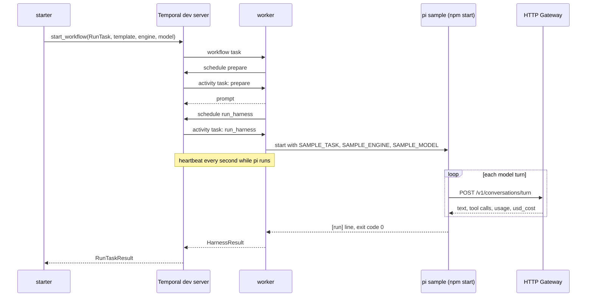

# Temporal run task sample

This sample runs the [pi model client sample](../pi-model-client/) as a
Temporal workflow. A Python worker stands in for the design's run service
(section 7 of the technical design). The workflow `RunTask` has two
activities:

- `prepare` reads a versioned prompt template and returns the prompt.
- `run_harness` starts the pi sample as a subprocess and waits for it to end.
  The subprocess stands in for the sandbox lease and the Run API. The
  activity heartbeats every second while pi runs, streams pi's output to the
  worker log, and returns a typed result: turns, failed turns, tokens, cost,
  the content of `hello.txt`, the exit code and the attempt number.

The sample also shows two failure paths:

- **Cancel.** Temporal workflow cancellation reaches the running activity
  through its heartbeat, and the activity stops pi.
- **Worker restart.** The worker is killed with SIGKILL in the middle of a
  run. A new worker picks up the workflow from its history, and Temporal
  retries the activity after the heartbeat timeout.

It pins `temporalio` 1.34.0. The SDK behavior it relies on was checked
against that version's source: heartbeats and heartbeat details, cancel
delivery in the heartbeat reply, `ActivityCancellationType`,
`workflow.unsafe.imports_passed_through()`, and dataclass payloads in the
default data converter.

## How it maps to the design's run workflow

| Design step (section 7) | In this sample |
|---|---|
| 1. Admit | The starter calls `start_workflow`. There is no scheduler and no slot. |
| 2. Prepare | `prepare` reads `prompts/hello-v1.txt`. There are no guardrails, no code-host token and no `AGENTS.md`. |
| 3. Route and run | `run_harness` runs pi as a subprocess. There is no router, harness engine or sandbox lease. The starter names the engine and model. A retried attempt starts a new pi run. The design re-attaches to the run in progress by call id. |
| 4. Watch | Left out. pi's output goes to the worker log. There is no event stream, event service, pool manager or stall detection beyond the heartbeat timeout. |
| 5. Follow up | Left out. No pull request, no code-host webhooks, no signals. |
| 6. Close | The workflow returns the result to the starter. There is no task service. |
| 7. Cancel | Temporal workflow cancellation. The activity stops pi. There is no audit event and no lease to release. |

## The call path



The engine, model and prompt travel in the workflow input, so they appear in
the workflow history. `GATEWAY_API_KEY` stays in the worker's environment
and never enters the history.

## Files

| File | Role |
|---|---|
| `run_task/workflows.py` | `RunTask`: timeouts, retry policy and cancellation type for each activity |
| `run_task/activities.py` | `prepare` and `run_harness`: the subprocess, heartbeats, stopping pi, parsing the result |
| `run_task/shared.py` | Task queue name and the dataclass payloads |
| `run_task/worker.py` | Runs the workflow and activities. Stops on SIGINT or SIGTERM. |
| `run_task/starter.py` | Starts one workflow, prints its id and web UI link, waits, then prints the event history and the result |
| `prompts/hello-v1.txt` | The prompt template: the pi sample's hello.txt task |
| `Makefile` | `make run`, `make cancel-demo`, `make restart-demo` |

The pi sample reads its prompt from `SAMPLE_TASK`, with the hello.txt task as
the default, so the workflow supplies the prompt.

## Settings

| Setting | Value | Why |
|---|---|---|
| `run_harness` start-to-close timeout | 10 minutes | The whole pi run |
| `run_harness` heartbeat timeout | 10 seconds | A worker that stops heartbeating for this long is treated as gone, and the attempt is retried |
| Heartbeat interval | 1 second, and `max_heartbeat_throttle_interval` 1 second on the worker | A cancel reaches the activity only in a heartbeat reply. By default the SDK holds heartbeats back to 0.8 times the heartbeat timeout. |
| Retry policy | 3 attempts, 2 seconds first interval, `HarnessConfigError` not retried | Covers a lost worker and a failed pi run. A missing gateway key fails at once. |
| Cancellation type | `WAIT_CANCELLATION_COMPLETED` | The workflow ends only after the activity has stopped pi |
| Stopping pi | SIGTERM to pi's process group, then SIGKILL after 2 seconds | pi runs in its own session, so npm, tsx and node stop together |

## Run it

You need:

- the Temporal CLI: `brew install temporal`
- [uv](https://docs.astral.sh/uv/)
- nvm with the Node version in `../pi-model-client/.nvmrc`
- a checkout of `ai-api-unified-http` with provider keys in its `.env`

No Temporal account or API key is needed. The dev server runs locally.

```bash
cd meta-harness/samples/temporal-run-task
make run
```

`make run` takes these steps:

1. Runs `uv sync`, and `npm ci` in the pi sample when its `node_modules` is
   missing or older than its lockfile.
2. Starts `temporal server start-dev` unless a Temporal server answers at
   `TEMPORAL_ADDRESS`.
3. Starts the gateway unless one answers at `GATEWAY_URL`.
4. Starts the worker, shows its log, and runs the starter.
5. Stops everything it started, on exit or Ctrl-C. On Ctrl-C the starter
   cancels the workflow and waits for it to end before the worker stops.

Logs go to `temporal.log`, `gateway.log` and `worker.log` in this directory.
The dev server keeps workflow history in memory, so history is gone once
`make run` stops it. To keep history and browse it later, set `TEMPORAL_DB`
to a file path, or start your own dev server first with
`temporal server start-dev`. `make run` then uses that one and leaves it
running. The web UI is at http://localhost:8233 while the server runs.

| Variable | Default |
|---|---|
| `SAMPLE_ENGINE`, `SAMPLE_MODEL` | `claude`, `claude-haiku-4-5` |
| `GATEWAY_DIR` | `../../../aiapi/ai-api-unified-http`, the gateway checkout |
| `GATEWAY_PORT`, `GATEWAY_URL` | `8080`, `http://localhost:8080` |
| `GATEWAY_API_KEY` | `local-dev-key`, the gateway's local development key |
| `TEMPORAL_PORT`, `TEMPORAL_ADDRESS` | `7233`, `localhost:7233` |
| `TEMPORAL_DB` | empty: history in memory |
| `WAIT_SECONDS` | `60`, how long to wait for each service to start |
| `CANCEL_AT`, `RESTART_AT` | `[pi] turn 1 starts`, `[pi] turn 2 starts`: the worker log line each demo waits for |

```bash
make run SAMPLE_ENGINE=openai SAMPLE_MODEL=gpt-4o-mini
```

A run costs under a cent on `claude-haiku-4-5`.

## Reading the output

Each line starts with a tag that names where it came from.

| Tag | Source |
|---|---|
| `[make]` | The Makefile |
| `[worker]` | The worker process starting and stopping |
| `[workflow]` | `RunTask`, through `workflow.logger`: each step it schedules and what came back |
| `[activity]` | `prepare` and `run_harness`, through `activity.logger`: each attempt and its heartbeats |
| `[run_harness attempt N]` | pi's own output, which the activity streams line by line |
| `[history]` | The starter, after the workflow ends: every event the Temporal server recorded for the run |
| `[temporalio.…]` | The SDK's own messages, such as a failed activity attempt |
| `[starter]`, `[result]` | The starter |

The `[history]` lines are Temporal's own record. A new worker replays them to
rebuild the workflow. Three things about them:

- `workflow.logger` is silent while a worker replays, so a `[workflow]` line
  prints once, when its step first runs. A worker that picks the workflow up
  from history prints one line saying so.
- Heartbeats are not events. The `[activity]` lines count them.
- An activity that was retried has one `ActivityTaskStarted` event, for its
  last attempt, and that event carries the previous attempt's failure.
  Temporal writes it when the attempt ends.

## What a run looks like

From `make run` on 2026-11-03, with ai-api-unified-http 1.17.1 and
library 3.29.1. Paths are shortened, and `...` marks lines left out.

```text
[make] starting the Temporal dev server on port 7233, log: .../samples/temporal-run-task/temporal.log
[make] starting the gateway from .../aiapi/ai-api-unified-http, log: .../samples/temporal-run-task/gateway.log
[make] gateway: {"status":"ok","service_version":"1.17.1","api_version":"v1","library_version":"3.29.1"}
[worker] polling task queue run-task on localhost:7233
[starter] started workflow run-task-0fd309bc  engine=claude  model=claude-haiku-4-5
[starter] web UI: http://localhost:8233/namespaces/default/workflows/run-task-0fd309bc
[workflow] run-task-0fd309bc: started, run id 01a1a259-fa17-79a0-a929-f854423bae7a, template hello-v1, engine claude, model claude-haiku-4-5
[workflow] run-task-0fd309bc: scheduling activity prepare (timeout 30s, up to 3 attempts)
[activity] prepare attempt 1: read the prompt from prompts/hello-v1.txt
[workflow] run-task-0fd309bc: prepare returned a 135-character prompt
[workflow] run-task-0fd309bc: scheduling activity run_harness (timeout 10m, heartbeat timeout 10s, up to 3 attempts)
[activity] run_harness attempt 1 started for run-task-0fd309bc, heartbeat timeout 10s
[run_harness attempt 1] started pi, process group 344
[activity] run_harness attempt 1: first heartbeat sent, then one every 1s while pi runs
[run_harness attempt 1] [pi] models pi can reach: ai-api-unified/run-model
[run_harness attempt 1] [pi] active tools: read, write, edit, ls
[run_harness attempt 1] [pi] task: Create a file named hello.txt containing exactly one line: a short friendly greeting. Then read the file back and tell me what it says.
[run_harness attempt 1] [pi] turn 1 starts
[run_harness attempt 1] [model client] POST /v1/conversations/turn  requested=claude:claude-haiku-4-5  messages=1  tools=read,write,edit,ls
[run_harness attempt 1] [ai-api-unified] served by claude:claude-haiku-4-5  fallback=false  finish=tool_use  tool_calls=write  tokens in=2061 out=160 cached=0  usd=0.002861  cache_hit=false
[run_harness attempt 1] [pi] runs tool write {"path":"hello.txt","content":"Hello! Hope you're having a great day!"}
[run_harness attempt 1] [pi] tool write done: Successfully wrote to hello.txt
[run_harness attempt 1] [pi] turn 2 starts
...
[run_harness attempt 1] [pi] turn 3 starts
...
[run_harness attempt 1] [workspace] files: hello.txt
[run_harness attempt 1] [workspace] hello.txt: Hello! Hope you're having a great day!
[run_harness attempt 1] [run] model turns=3  failed=0  tokens in=6633 out=247  usd=0.007868
[activity] run_harness attempt 1: pi exited 0 after 6 heartbeats, returning the result to Temporal
[workflow] run-task-0fd309bc: run_harness returned on attempt 1: 3 turns, usd 0.007868
[workflow] run-task-0fd309bc: completed
[history] events the Temporal server recorded for run-task-0fd309bc:
[history]   1  WorkflowExecutionStarted          task queue run-task
[history]   2  WorkflowTaskScheduled
[history]   3  WorkflowTaskStarted
[history]   4  WorkflowTaskCompleted
[history]   5  ActivityTaskScheduled             prepare
[history]   6  ActivityTaskStarted               prepare, attempt 1
[history]   7  ActivityTaskCompleted             prepare
[history]   8  WorkflowTaskScheduled
[history]   9  WorkflowTaskStarted
[history]  10  WorkflowTaskCompleted
[history]  11  ActivityTaskScheduled             run_harness
[history]  12  ActivityTaskStarted               run_harness, attempt 1
[history]  13  ActivityTaskCompleted             run_harness
[history]  14  WorkflowTaskScheduled
[history]  15  WorkflowTaskStarted
[history]  16  WorkflowTaskCompleted
[history]  17  WorkflowExecutionCompleted
[starter] workflow run-task-0fd309bc completed
[result] template=hello-v1  attempt=1  exit_code=0
[result] turns=3  failed=0  tokens in=6633 out=247  usd=0.007868
[result] hello.txt: Hello! Hope you're having a great day!
[worker] shutting down
[temporalio.worker._worker] Beginning worker shutdown, will wait 0:00:00 before cancelling activities
[worker] stopped
[make] worker stopped
[make] gateway stopped
[make] Temporal dev server stopped
```

Each `WorkflowTask` trio in the history is the worker running workflow code
until it next waits: once at the start, then once after each activity
returns. Each pass ends by sending the server its next commands: schedule
`prepare`, schedule `run_harness`, complete the workflow.

Some runs show `[pi] tool read failed: ENOENT` on turn 1. That is pi running
a turn's tool calls at the same time (finding 6 of the pi sample).

## Cancel

```bash
make cancel-demo
```

This runs the same task. When the worker log shows `[pi] turn 1 starts`, it
runs `temporal workflow cancel --workflow-id <id>`, the way an operator
would. Output from 2026-11-03, after the same startup lines:

```text
[run_harness attempt 1] [pi] turn 1 starts
[make] temporal workflow cancel --workflow-id run-task-2796a3b6
[run_harness attempt 1] cancellation received (cancel_requested), stopping pi
[run_harness attempt 1] pi stopped by SIGKILL, 2s after SIGTERM, exit code -9
[workflow] run-task-2796a3b6: canceled, and run_harness has stopped pi
[starter] workflow run-task-2796a3b6 canceled
```

The `[history]` lines show the order, from event 11:

```text
[history]  11  ActivityTaskScheduled             run_harness
[history]  12  WorkflowExecutionCancelRequested
[history]  13  WorkflowTaskScheduled
[history]  14  WorkflowTaskStarted
[history]  15  WorkflowTaskCompleted
[history]  16  ActivityTaskCancelRequested       run_harness
[history]  17  ActivityTaskStarted               run_harness, attempt 1
[history]  18  ActivityTaskCanceled              run_harness
[history]  19  WorkflowTaskScheduled
[history]  20  WorkflowTaskStarted
[history]  21  WorkflowTaskCompleted
[history]  22  WorkflowExecutionCanceled
```

The cancel request reaches the workflow first (12). The workflow then asks
for the activity to be canceled (16). `ActivityTaskStarted` comes after the
cancel request because Temporal writes it when the attempt ends.

The workflow ended about 3 seconds after the cancel request: up to 1 second
for the heartbeat reply, then the 2 second SIGTERM grace period.

## Worker restart

```bash
make restart-demo
```

When the worker log shows `[pi] turn 2 starts`, the Makefile kills the
worker's process group with SIGKILL, then starts a new worker. To do it by
hand, run `make run` with a Temporal dev server you started yourself, and in
another terminal run `pkill -KILL -f run_task.worker`, then
`uv run python -m run_task.worker` in this directory with `GATEWAY_URL` and
`GATEWAY_API_KEY` set.

Output from 2026-11-03:

```text
[run_harness attempt 1] [pi] turn 2 starts
[make] killing the worker with SIGKILL (process group 4738)
[make] Temporal retries run_harness once 10s pass with no heartbeat, plus the 2s retry interval
[make] starting a new worker
[worker] polling task queue run-task on localhost:7233
[activity] run_harness attempt 2 started for run-task-a78a0ca7, heartbeat timeout 10s
[run_harness attempt 2] previous attempt's pi (process group 4757) is gone
[run_harness attempt 2] started pi, process group 5190
[activity] run_harness attempt 2: first heartbeat sent, then one every 1s while pi runs
...
[run_harness attempt 2] [run] model turns=3  failed=0  tokens in=6970 out=433  usd=0.009135
[activity] run_harness attempt 2: pi exited 0 after 6 heartbeats, returning the result to Temporal
[workflow] run-task-a78a0ca7: this worker has no state for the workflow, so it replays the history to rebuild it. Steps already in the history do not run again.
[workflow] run-task-a78a0ca7: run_harness returned on attempt 2: 3 turns, usd 0.009135
[workflow] run-task-a78a0ca7: completed
[history] events the Temporal server recorded for run-task-a78a0ca7:
...
[history]   5  ActivityTaskScheduled             prepare
[history]   6  ActivityTaskStarted               prepare, attempt 1
[history]   7  ActivityTaskCompleted             prepare
...
[history]  11  ActivityTaskScheduled             run_harness
[history]  12  ActivityTaskStarted               run_harness, attempt 2, previous attempt: activity Heartbeat timeout
[history]  13  ActivityTaskCompleted             run_harness
...
[history]  17  WorkflowExecutionCompleted
[starter] workflow run-task-a78a0ca7 completed
[result] template=hello-v1  attempt=2  exit_code=0
[result] turns=3  failed=0  tokens in=6970 out=433  usd=0.009135
[result] hello.txt: Hello! Hope you're having a wonderful day! 🌟
```

The new worker ran attempt 2 of `run_harness` with no workflow state. When
the activity returned, the worker needed the workflow to decide its next
step, so it replayed the history. The replay matched `prepare` and the
`run_harness` schedule to events 5 to 11 and ran neither again. That is why
no `[workflow]` line repeats, and why `prepare` ran once. The history shows
one `run_harness` start, for attempt 2. That event carries attempt 1's
heartbeat timeout. Attempt 2 started about 16 seconds after attempt 1:
roughly 4 seconds of attempt 1, the 10 second heartbeat timeout, and the
2 second retry interval.

Each heartbeat carries pi's process group id. A retried attempt reads it from
the last heartbeat. If that pi is still running, the new attempt stops it
before it starts a new one. In the run above, attempt 1's pi had already
exited. A second test pointed the worker at a local port that accepts
connections and never answers, so pi was still waiting on its first model
call when the worker died. Attempt 2 printed
`previous attempt's pi is still running (process group 90426), stopping it`.

## Findings

1. **Under tsx, pi ignores SIGTERM.** Importing pi's SDK adds a SIGTERM
   listener from `signal-exit` 3.0.7, which comes in through pi's dependency
   `proper-lockfile`. tsx adds its own hidden SIGTERM listener in the child
   process. With both in place, a test script that imports pi and runs under
   `npm start` and tsx kept running after SIGTERM. Under plain `node`, the
   same import exits on SIGTERM with code 143. The exact interaction between
   the two listeners was not traced. In the first cancel test the activity
   waited 5 seconds after SIGTERM, and pi finished all its turns in that
   time. The activity now sends SIGKILL after 2 seconds. The harness server
   should run under plain `node`, or handle SIGTERM itself by calling
   `abort()` and exiting.
2. **A cancel does not stop a model call in flight.** In the cancel demo pi
   was killed during turn 1. The gateway still finished that turn and billed
   it ($0.0031). The gateway does not stop a provider call when its client
   goes away.
3. **A retried attempt starts the run again.** The design's harness engine
   re-attaches to the run in progress by call id. A subprocess cannot be
   re-attached once its parent dies, so attempt 2 started from the
   beginning. In the restart demo the two turns attempt 1 had finished were
   paid for and lost.
4. **A worker shutdown during a run fails the activity.** The worker's
   default `graceful_shutdown_timeout` is zero, so a running activity fails
   with "Worker is shutting down and this activity did not complete in
   time". Temporal retries it, unless a cancel was already requested. In
   that case the workflow ends Failed instead of Canceled, and it stays
   Running until some worker comes back to record that. The first version of
   the starter hit this on Ctrl-C, because `make` stopped the worker while
   the cancel was still in progress. The starter now waits for the workflow
   to end before it exits. The run service needs a drain step for deploys.
5. **The pi sample exits 0 when every model turn fails.** With the gateway
   unreachable it printed `[run] model turns=1  failed=1` and exited 0. The
   activity treats "every turn failed" as an error, so Temporal retries it.
6. **Workflow history holds the prompt and the result in plain text.** Both
   show in the web UI. Real prompts carry repo content. The run service
   should decide what goes into workflow input and results, and whether to
   add a payload codec that encrypts them.
