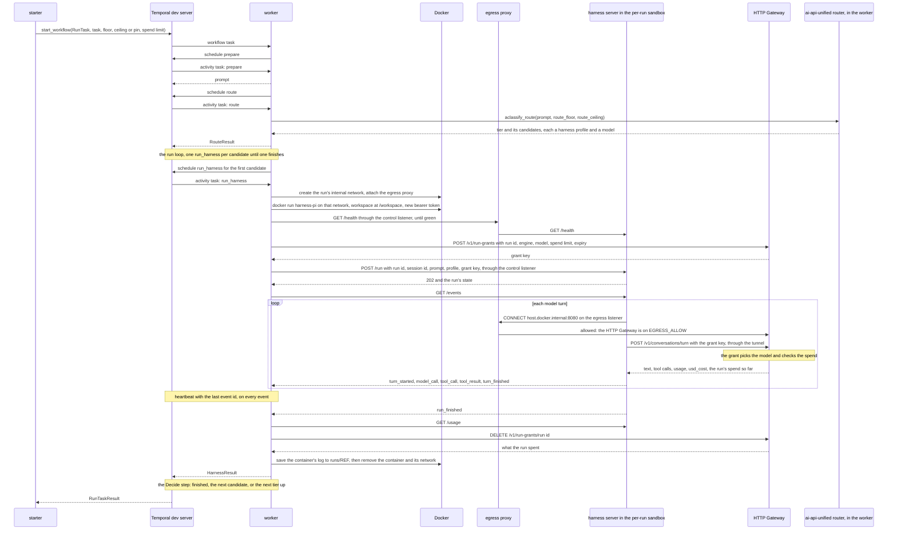

# Temporal run task sample

This sample is the command-line way to run the meta-harness end to end, as far
as it is built. `make run` always runs the whole current path, and it grows as
each piece lands.

```bash
cd meta-harness/samples/temporal-run-task
make run                                                   # the built-in task: create hello.txt and read it back
make run TASK="Write a haiku about autumn to haiku.txt."   # your own task
make fallback-demo                                         # the run loop: two candidates fail, the next tier finishes
make repo-demo                                             # a repo task: fresh clone, pi's change, a branch and a pull request
make run TICKET=owner/name#12                              # work a GitHub issue: its repo, text and checks, and a PR that closes it
make e2e                                                   # the zero-cost end-to-end check: no model calls
```

To leave the services running and send them tasks, see
[Run your own tasks](#run-your-own-tasks).

The path today: Temporal workflow, then the ai-api-unified router picking the
task's tier, then the RunTask workflow's run loop over that tier's candidates.
Each candidate run gets a per-run sandbox (a Docker container of its harness
profile image, on its own network) with the harness server running pi, then
the egress proxy, then the HTTP Gateway (ai-api-unified-http) on a run grant,
then ai-api-unified, then the model provider. The pool manager is the next
step that slots into the same commands.

A **run grant** is the HTTP Gateway's record of what one run may do: one
engine and model, a spend limit, and an expiry. The worker asks for one
before pi starts and passes only its **grant key** to the harness server.
pi's model calls carry the key, so pi never holds the gateway's API key,
cannot change models, and stops when the run reaches its spend limit
(`SPEND_LIMIT`, default $0.50, for all the task's runs together). The worker
revokes the grant when the run ends.

It runs a coding task as a Temporal workflow, with pi running on the
[harness server](../../images/harness-pi/) inside a per-run sandbox. A Python
worker stands in for the design's run service (section 7 of the technical
design). The workflow `RunTask` has five activities:

- `prepare` uses the task text you gave, or reads a versioned prompt template,
  and returns the prompt. It also checks a pinned pair (`PIN`).
- `route` is the design's run service `route` activity. It sends the prompt to
  the ai-api-unified router in classify-only mode (`AiRouteClassifier`,
  ai-api-unified 3.30.0), which picks a tier from `config/models.json` and
  returns the tier's candidates. Each candidate is a harness-profile-and-model
  pair, `harness:<harness profile>/<engine>:<model>`, and the harness profile
  comes from `config/harness_profiles.json`. The router's classifier call is
  the only model call `route` makes.
- `run_harness` is the design's run service run activity, for one
  candidate. It starts the
  run's per-run sandbox container, asks the HTTP Gateway for the run's grant,
  starts the run on the harness server in the container with `POST /run`,
  follows `GET /events` until `run_finished`, reads `GET /usage`, revokes the
  grant and removes the container. It
  heartbeats on every event and returns a typed result: status, turns,
  tokens, cost, the files pi changed, pi's last answer, the attempt number,
  and whether the attempt re-attached to a run already in progress. It
  returns a result for every run that ended, finished or not.
- `cleanup_run` revokes the run grant and removes the per-run sandbox of a
  run that `run_harness` gave up on, and reports what the grant counted.
- `publish` is the design's Publish step, for a repo task. It commits pi's
  changes to the branch `mh/<REF>`, pushes it and opens the pull request,
  labeled `ai:meta-harness`, with `Closes <ticket>` and pi's final summary.

**Repo tasks.** With `REPO` (`owner/name` on GitHub, or the path of a local
bare git repo) or `TICKET` (a GitHub issue, `owner/name#number`), the task
runs in a repo:

1. `prepare` reads the ticket, read-only, through the owner's GitHub App: its title and body
   become the task, and a `## Acceptance checks` list in the body becomes
   the checks (or `CHECKS`). It fills `src/meta_harness/run_service/prompts/repo-task-v1.txt`, which puts
   the task text between markers as data, tells pi to run each check with
   `bash`, and tells it not to commit or push.
2. `run_harness`'s Lease step clones the repo's default branch into the run's
   own workspace, `runs/<REF>/run-<n>/workspace`, on this machine, with a
   GitHub App installation token that can only read that repo. Each candidate
   starts from a fresh clone.
3. pi works in the clone inside the per-run sandbox and runs the checks.
4. `publish` commits, pushes and opens the pull request from this machine.
   For a local bare repo it pushes the branch there and writes the pull
   request to `runs/<REF>/pull-request.md`.

The per-run sandbox never holds a code-host credential (design principle 9).
Each git command gets its token through its own environment, so the clone's
`.git/config` holds a plain HTTPS remote and no token, and nothing pi runs can
push. GitHub repos need `MH_GITHUB_APPS` in the repo root's `.env` (see
`.env.example`). A finished run
that changed nothing fails the task.

The workflow's run loop (design section 6.3) runs one `run_harness` per
candidate, in order, and its Decide step reads how each run ended:

| The run | Decide |
|---|---|
| Ended `FINISHED` | The task completes. |
| Got no per-run sandbox, lost its harness server, or could not get a run grant (the HTTP Gateway unreachable); or ended `model_error`, `harness_error` or `server_shutdown` | The next candidate. When the tier has none left, the workflow routes again one tier up (`on_exhausted: escalate`), under `CEILING`. |
| Ended on a limit: `max_turns`, `max_minutes` or `spend_limit` | The task fails. Another candidate would spend the budget again. |
| Was refused: an unknown model, a bad pin, a bad request | The task fails. |

`PIN` runs one pair with no routing and no escalation. `SPEND_LIMIT` covers
all of a task's runs: each run's grant gets what the earlier runs left, a
failed run included. The router's classifier needs `OPENAI_API_KEY` in your
shell; without it, every task takes the default tier, `standard`.

pi runs in the per-run sandbox container, apart from the worker, so a run
keeps going when the worker dies. The run id is the workflow id plus
`:run-<n>`, where n counts the candidates the task has tried. The workflow
passes it to `run_harness`, so it is the same on every Temporal attempt of one
candidate, and the container is named after it. A retried attempt finds the same container, sends the same `POST /run`,
gets the run in progress, and reads its events from the last event id it
heartbeated. It never starts pi a second time. The retry asks for
the grant again with the same terms, and the HTTP Gateway adds a key to the
grant that is still live. The run keeps the key it started with.

The sample also shows four failure paths:

- **Cancel.** Temporal workflow cancellation reaches the running activity
  through its heartbeat, and the activity sends `POST /cancel`, which stops pi
  with `abort()`.
- **Worker restart.** The worker is killed with SIGKILL in the middle of a
  run. A new worker picks up the workflow from its history, Temporal retries
  the activity after the heartbeat timeout, and the retry re-attaches to the
  run.
- **Spend limit.** The run passes its grant's spend limit, the HTTP Gateway
  refuses the next turn with `402`, and the run ends `ERROR spend_limit`.
- **Fallback.** `make fallback-demo` uses the `fallback-demo` entry in
  `config/models.json`. Tier `standard`'s two candidates name the harness
  profile `pi-missing-image`, whose image does not exist, so neither gets a
  per-run sandbox. The workflow tries both, escalates to tier `complex`, and
  its candidate finishes the task.

It pins `temporalio` 1.34.0 and `httpx` 0.28.1. The SDK behavior it relies on
was checked against that version's source: heartbeats and heartbeat details,
cancel delivery in the heartbeat reply, `ActivityCancellationType`,
`workflow.unsafe.imports_passed_through()`, and dataclass payloads in the
default data converter.

## How it maps to the design's run workflow

| Design step (section 7) | In this sample |
|---|---|
| 1. Admit | The starter calls `start_workflow` with workflow id `run-task-<REF>`. `REF` plays the design's `external_ref`, and Temporal refuses a second task with the same one. There is no scheduler and no slot. |
| 2. Prepare | `prepare` uses `TASK`, or reads `src/meta_harness/run_service/prompts/hello-v1.txt`. There are no guardrails, no code-host token and no `AGENTS.md`. |
| 3. Route and run | `route` asks the ai-api-unified router for the tier and its candidates, and the workflow's run loop tries them (section 6.3). For each, `run_harness` runs the design's run activity steps. Lease: with no pool manager, it starts the run's per-run sandbox itself with the Docker executor backend (`src/meta_harness/run_service/sandbox.py`). Grant, Start, Wait and Collect follow. A retried attempt re-attaches by run id to the same container and the same run. There is no exploration share and no task policy file. |
| 4. Watch | `run_harness` reads the harness server's event stream and prints it to the worker log. There is no event service, pool manager or stall detection beyond the heartbeat timeout. |
| 5. Follow up | Left out. The harness server has `POST /followup`, but no pull request, code-host webhooks or signals drive it here. |
| 6. Close | The workflow returns the result to the starter. There is no task service. |
| 7. Cancel | Temporal workflow cancellation. The activity sends `POST /cancel`, revokes the run grant and removes the per-run sandbox. There is no audit event. |

## The call path



The pin or tier bounds, the spend limit and the task text travel in the
workflow input, and the route and each candidate in activity inputs, so they
appear in the workflow history. `GATEWAY_API_KEY` stays in the
worker's environment. Each per-run sandbox gets its own harness server bearer
token, which lives only in that container's environment, and the grant key
goes straight from the worker to the harness server. None of them enters the
history.

## Files

| File | Role |
|---|---|
| `src/meta_harness/run_service/workflows.py` | `RunTask`: the run loop and its Decide step, timeouts, retry policy and cancellation type for each activity, and the `current_run_id` query |
| `src/meta_harness/run_service/activities.py` | `prepare`, `route`, `run_harness` (lease the per-run sandbox, start or re-attach, heartbeats, cancel, release) and `cleanup_run` |
| `src/meta_harness/run_service/code_host.py` | Reads a ticket, clones the repo into a run's workspace, and publishes: commit, push, pull request, through `git` and the GitHub App on this machine, or a local bare repo |
| `src/meta_harness/run_service/prompts/repo-task-v1.txt` | The repo-task prompt template |
| `src/meta_harness/run_service/routing.py` | Reads harness profiles, splits a `harness:` candidate, checks every tier candidate when the worker starts, and holds the worker's `AiRouteClassifier` |
| `config/models.json` | The router's tiers, classifier and default tier, and the `zero-cost` and `fallback-demo` environments |
| `config/harness_profiles.json` | Harness profiles: image, tools, turn and minute limits |
| `src/meta_harness/run_service/sandbox.py` | The Docker executor backend: starts, finds and removes a run's per-run sandbox container and its network |
| `src/meta_harness/run_service/fake_gateway.py` | The fake HTTP Gateway: run grants and scripted model turns, with no model calls |
| `e2e.sh` | `make e2e`: the zero-cost end-to-end check, which CI runs on every pull request |
| `src/meta_harness/run_service/egress_check.py` | `make egress-check`: the network rules, checked from inside a throwaway per-run sandbox |
| `egress-proxy/` | The local egress proxy: `proxy.py` (Python standard library only) and its `Dockerfile` |
| `src/meta_harness/run_service/harness_client.py` | Reads the harness server's event stream and prints one line per event |
| `src/meta_harness/run_service/run_grants.py` | Issues, reads and revokes run grants on the HTTP Gateway |
| `src/meta_harness/run_service/shared.py` | Task queue name, the workflow id for a `REF`, and the dataclass payloads |
| `src/meta_harness/run_service/worker.py` | Runs the workflow and activities. Stops on SIGINT or SIGTERM. |
| `src/meta_harness/run_service/starter.py` | Starts one task, prints its id and web UI link, waits, then prints the event history and the result. `--follow` also prints the run's events. |
| `src/meta_harness/run_service/tasks.py` | `list`, `status`, `watch` and `cancel` for tasks already started |
| `src/meta_harness/run_service/prompts/hello-v1.txt` | The prompt template: create hello.txt and read it back |
| `stack.sh` | Builds the per-run sandbox and egress proxy images, starts and stops the services and the egress proxy, and removes leftover per-run sandbox containers and networks |
| `Makefile` | The commands below. Each one calls `stack.sh` or `meta_harness.run_service.tasks`. |

## Settings

| Setting | Value | Why |
|---|---|---|
| Workflow id | `run-task-<REF>`, ID reuse policy Reject Duplicate | One `REF` names one task, as `external_ref` does in the design |
| Run id | `<workflow id>:run-<n>`, n counting the candidates tried | The same on every attempt of one candidate, so a retry re-attaches |
| Harness session id | The run id, with `.` for `:` | Each candidate starts a new pi session. It is also the gateway's prompt cache key. |
| Per-run sandbox | Container `mh-sandbox-<run id>-<hash>` from `harness-pi:dev`: 2 CPUs, 4 GB, 512 processes, all capabilities dropped, no new privileges, run as your user id. The run's workspace, `runs/<REF>/run-<n>/workspace`, is mounted at `/workspace`. | pi's tools reach your machine only through the workspace. The container holds no provider key. |
| Per-run sandbox network | Its own internal Docker network, `mh-run-<run id>-<hash>`, with no route out and no other run on it. The egress proxy is attached to it. | The container's only way out is the egress proxy. One run cannot reach another. |
| Egress allowlist | `EGRESS_ALLOW`: the HTTP Gateway, GitHub, npm and PyPI | The design's per-run sandbox egress allowlist (sections 14 and 15) |
| Harness profile | From `config/harness_profiles.json`: `pi-lean` has tools `read`, `write`, `edit`, `ls`, `find`, `grep`, `bash`, 20 turns, 10 minutes; `pi-careful` 40 turns. An image of `null` means `HARNESS_IMAGE`. | The harness server enforces both limits |
| Run grant | the candidate's engine and model, what is left of `SPEND_LIMIT`, expiry the harness profile's minutes plus 5 | The HTTP Gateway enforces the model and the spend limit. The grace keeps the grant alive under a run still ending. |
| `run_harness` start-to-close timeout | 10 minutes | The whole run |
| `run_harness` heartbeat timeout | 10 seconds | A worker that stops heartbeating for this long is treated as gone, and the attempt is retried |
| Heartbeats | One per event, and the harness server sends a `heartbeat` event every 2 seconds. `max_heartbeat_throttle_interval` is 1 second on the worker. | A cancel reaches the activity only in a heartbeat reply. By default the SDK holds heartbeats back to 0.8 times the heartbeat timeout. |
| Retry policy | 3 attempts, 2 seconds first interval | Covers a lost worker and a lost connection to the harness server. A run that ended returns its result, and the Decide step reads it. A refused request fails the attempt for good. |
| Cancellation type | `WAIT_CANCELLATION_COMPLETED` | The workflow ends only after the harness server has stopped pi |

## Run it

You need:

- the Temporal CLI: `brew install temporal`
- Redis: `brew install redis`. The HTTP Gateway keeps run grants in it.
- [uv](https://docs.astral.sh/uv/)
- Docker Desktop, running. Each run's per-run sandbox is a container.
- a checkout of `ai-api-unified-http` 1.19.0 or later, with provider keys in
  its `.env`
- `OPENAI_API_KEY` in your shell, for the router's classifier (optional)

No Temporal account or API key is needed. The dev server runs locally.

**pi's tools act inside the per-run sandbox.** They reach your machine only
through the run's workspace, `runs/<REF>/run-<n>/workspace`, and the network only through the egress
proxy, which allows the HTTP Gateway, GitHub, npm and PyPI. See
[Egress allowlist](#egress-allowlist).

```bash
cd meta-harness/samples/temporal-run-task
make run
make run TASK="Write a haiku about autumn to haiku.txt." REF=haiku-1
make run FLOOR=complex
make run PIN=harness:pi-lean/openai:gpt-4o-mini
make run SPEND_LIMIT=0.05
```

`make run` takes these steps:

1. Checks that Docker is running, runs `uv sync`, and builds the per-run
   sandbox image `harness-pi:dev` from `images/harness-pi` and the egress
   proxy image `mh-egress-proxy:dev` from `egress-proxy/`. Docker's layer
   cache makes a rebuild with no changes take a second or two.
2. Starts `temporal server start-dev` unless a Temporal server answers at
   `TEMPORAL_ADDRESS`.
3. Starts Redis on port 6390 unless one answers at `REDIS_URL`. It keeps
   nothing on disk.
4. Starts the gateway with `HTTP_REDIS_URL` set, unless one answers at
   `GATEWAY_URL`, and checks that the gateway issues run grants. A gateway
   you started yourself without Redis is refused with a message.
5. Starts the egress proxy unless it is already running.
6. Starts the worker, shows its log, and runs the starter. The worker's
   `run_harness` starts the run's per-run sandbox on its own network, with
   pi's workspace at `runs/<REF>/run-<n>/workspace`, and removes both when the run
   ends.
7. Stops everything it started, on exit or Ctrl-C, and removes any per-run
   sandbox container or network the task left. On Ctrl-C the starter cancels the
   workflow and waits for it to end before the worker stops.

`make run` refuses to start while `make up` is running, because the two
workers would split the work.

Logs go to `temporal.log`, `redis.log`, `gateway.log` and `worker.log` in this directory,
the egress proxy's to `egress-proxy.log` when it stops, and the harness
server's to `runs/<REF>/run-<n>/harness-server.log`, one per run, saved from
the container before it is removed. `runs/` keeps
every task's workspace and log until you delete it. The dev server keeps
workflow history in memory, so history is gone once `make run` stops it. To
keep history and browse it later, set `TEMPORAL_DB` to a file path, or start
your own dev server first with `temporal server start-dev`. `make run` then
uses that one and leaves it running. The web UI is at http://localhost:8233
while the server runs.

| Variable | Default |
|---|---|
| `TASK` | empty: the task in `src/meta_harness/run_service/prompts/hello-v1.txt` |
| `REF` | 8 random hex characters. Letters, digits, `.`, `_` and `-`, starting with a letter or digit. A `REF` used before is refused. |
| `ROUTER_CONFIG` | `config/models.json`: the router's tiers and classifier |
| `MODELS_ENV` | empty: `ROUTER_CONFIG` as it is, or its `zero-cost` entry (no classifier call) with `GATEWAY=fake` |
| `FLOOR`, `CEILING` | empty: the lowest and highest tier the router may pick |
| `PIN` | empty. `harness:<profile>/<engine>:<model>` runs that pair, with no routing. |
| `REPO` | empty: an empty workspace. `owner/name` on GitHub, or a local bare repo's path, makes it a repo task. |
| `TICKET` | empty. `owner/name#number`: the GitHub issue's text and checks, its repo, and a pull request that closes it |
| `CHECKS` | empty: one acceptance check command, when the ticket names none |
| `SPEND_LIMIT` | `0.50`, in USD: the most the task's runs may spend on model calls, together |
| `HARNESS_DIR` | `../../images/harness-pi`, built into the per-run sandbox image |
| `HARNESS_IMAGE` | `harness-pi:dev` |
| `RUNS_DIR` | `runs` in this directory: under `runs/<REF>/run-<n>/`, each run's workspace and harness server log |
| `SANDBOX_GATEWAY_URL` | `http://host.docker.internal:8080`, the gateway as the egress proxy reaches it |
| `EGRESS_ALLOW` | `host.docker.internal:8080,github.com:443,*.github.com:443,*.githubusercontent.com:443,registry.npmjs.org:443,pypi.org:443,files.pythonhosted.org:443`: the `host:port` patterns a per-run sandbox may reach, `*` as a wildcard |
| `EGRESS_IMAGE` | `mh-egress-proxy:dev` |
| `GATEWAY` | `real`: ai-api-unified-http from `GATEWAY_DIR`. `fake`: `src/meta_harness/run_service/fake_gateway.py`, which makes no model calls and needs no Redis |
| `FAKE_GATEWAY_HOST`, `FAKE_TURN_SECONDS` | `127.0.0.1`, `2`: where the fake listens, and how long each scripted turn takes |
| `E2E_GATEWAY_PORT` | `8099`: the fake's port under `make e2e`, apart from a real gateway on 8080 |
| `GATEWAY_DIR` | `../../../aiapi/ai-api-unified-http`, the gateway checkout |
| `GATEWAY_PORT`, `GATEWAY_URL` | `8080`, `http://localhost:8080` |
| `GATEWAY_API_KEY` | `local-dev-key`, the gateway's local development key. The worker uses it to request and revoke run grants. |
| `REDIS_PORT`, `REDIS_URL` | `6390`, `redis://127.0.0.1:6390/0`, where the gateway keeps run grants |
| `TEMPORAL_PORT`, `TEMPORAL_ADDRESS` | `7233`, `localhost:7233` |
| `TEMPORAL_DB` | empty: history in memory |
| `WAIT_SECONDS` | `60`, how long to wait for each service to start |
| `CANCEL_AT`, `RESTART_AT` | `turn 1 starts`, `turn 2 starts`: the worker log line each demo waits for |

The built-in task costs under a cent on `claude-haiku-4-5`.

## Run your own tasks

Start the services once, then send them tasks from any terminal:

```bash
make up
make task REF=poem-3 TASK="Write a four-line poem about tide pools to poem.md, then list the files in the folder."
make task REF=notes-3 PIN=harness:pi-lean/openai:gpt-4o-mini TASK="Create notes.txt with three bullet points about why tests matter, then read it back."
make tasks
make status REF=poem-3
make watch REF=notes-3
make cancel REF=poem-3
make down
```

| Command | What it does |
|---|---|
| `make up` | Starts Temporal, Redis and the gateway unless they already answer, the egress proxy, and a worker, and leaves them running. Logs and process ids go in `stack/`. |
| `make task TASK=... REF=...` | Starts the workflow, prints each run's events from its per-run sandbox until the task ends, and prints the result. Ctrl-C cancels the task. Tasks in separate terminals run at the same time, each in its own container. |
| `make tasks` | Lists every task on the Temporal server: `REF`, status, start time, workspace |
| `make status REF=...` | One task: its workflow status and workspace. While it runs, the per-run sandbox's turns, calls, tokens and cost so far, and the run grant's spend against its limit. Once it ends, the result, with what the grant counted. |
| `make watch REF=...` | Prints a running task's events from the start, then its result |
| `make cancel REF=...` | Cancels the workflow, which stops pi, and waits for it to end |
| `make down` | Stops what `make up` started, removes the egress proxy, and removes any per-run sandbox container or network left behind |

Each run's per-run sandbox is removed when the run ends, so `watch` and the
live part of `status` work only while the task runs. These commands ask the
RunTask workflow which run it is on (its `current_run_id` query), find that
run's container by its run id, and reach it through the egress proxy's
control listener, so they need only the `REF`.

Two tasks on 2026-11-04, started at the same time: poem-3 on Claude and
notes-3 on OpenAI. They ran before the run loop and the per-run sandbox, so
the starter took `--engine` and `--model` and the run id ended `:run_harness`.
They ran on harness servers
`stack.sh` started on the host, so the lines that started and stopped those
servers are left out. Output of the first `make task`, paths shortened:

```text
[starter] started workflow run-task-poem-3  engine=claude  model=claude-haiku-4-5  spend limit=$0.50
[starter] task: Write a four-line poem about tide pools to poem.md, then list the files in the folder.
[starter] web UI: http://localhost:8233/namespaces/default/workflows/run-task-poem-3
[poem-3] #1 turn 1 starts
[poem-3] #3 model call: claude:claude-haiku-4-5  finish=tool_use  tool_calls=write,ls  tokens in=1907 out=249 cached=0  usd=0.003152
[poem-3] #4 runs tool write {"path": "poem.md", "content": "# Tide Pool\n\nCrystal waters hold the secret shore,\nWhere starfish cling and anemones pour,\nTiny worlds in rock and sand,\nNa
[poem-3] #5 runs tool ls {"path": "."}
[poem-3] #6 tool ls done
[poem-3] #7 tool write done
[poem-3] #8 file changed: poem.md
[poem-3] #9 turn 1 finished
[poem-3] #10 turn 2 starts
[poem-3] #12 model call: claude:claude-haiku-4-5  finish=tool_use  tool_calls=read  tokens in=2232 out=103 cached=0  usd=0.002747
[poem-3] #13 runs tool read {"path": "poem.md"}
[poem-3] #14 tool read done
[poem-3] #15 turn 2 finished: I've written a four-line poem about tide pools to `poem.md`. The folder appears to be empty in the listing, but that's because `poem.md` was just created. Let me verify the poem was written correctly:
[poem-3] #16 turn 3 starts
[poem-3] #17 model call: claude:claude-haiku-4-5  finish=complete  tool_calls=none  tokens in=2404 out=80 cached=0  usd=0.002804
[poem-3] #18 turn 3 finished: Perfect! I've created `poem.md` with a four-line poem about tide pools. The file is now in your workspace folder and contains: ``` # Tide Pool Crystal waters hold the secret shore, Where starfish clin
[poem-3] #19 run finished: FINISHED (completed)
[history] ...
[starter] workflow run-task-poem-3 completed
[result] template=inline  run=run-task-poem-3:run_harness  status=FINISHED (completed)  attempt=1  reattached=False
[result] turns=3  failed calls=0  tokens in=6543 out=432  usd=0.008703
[result] run grant: the HTTP Gateway counted $0.008703 of the $0.50 limit
[result] files changed: poem.md
[result] workspace: .../temporal-run-task/runs/poem-3/workspace
[result] answer: Perfect! I've created `poem.md` with a four-line poem about tide pools. The file is now in your workspace folder and contains: ``` # Tide Pool Crystal waters hold the secret shore, Where starfish cling and anemones pour, Tiny worlds in rock and sand, Nature's marvel close at hand. ```
```

`ls` ran next to `write` in turn 1 and found an empty folder. That is pi
running a turn's tool calls at the same time (finding 6 of the pi sample).

The grant lines are in the worker log, `stack/worker.log`:

```text
[run-task-poem-3 run_harness attempt 1] run grant issued for run-task-poem-3:run_harness: claude:claude-haiku-4-5, spend limit $0.50, expires 2026-11-04T14:43:29+00:00
[run-task-notes-3 run_harness attempt 1] run grant issued for run-task-notes-3:run_harness: openai:gpt-4o-mini, spend limit $0.50, expires 2026-11-04T14:43:29+00:00
[run-task-notes-3 run_harness attempt 1] run grant revoked: the HTTP Gateway counted $0.00041715 against it
[run-task-poem-3 run_harness attempt 1] run grant revoked: the HTTP Gateway counted $0.008703 against it
```

From a third terminal, while both ran:

```text
$ make tasks
REF                     STATUS      STARTED               WORKSPACE
poem-3                  RUNNING     2026-11-04 14:28:27   .../temporal-run-task/runs/poem-3/workspace
notes-3                 RUNNING     2026-11-04 14:28:27   .../temporal-run-task/runs/notes-3/workspace
$ make status REF=poem-3
[status] poem-3: workflow run-task-poem-3 RUNNING, started 2026-11-04 14:28:27
[status] workspace: .../temporal-run-task/runs/poem-3/workspace
[status] run run-task-poem-3:run_harness: RUNNING  turns=2  calls=1 failed=0  tokens in=1907 out=249  usd=0.003152
[status] run grant: claude:claude-haiku-4-5  spent $0.003152 of $0.50  expires 2026-11-04T14:43:29+00:00
$ make watch REF=notes-3
[notes-3] #1 turn 1 starts
[notes-3] #3 model call: openai:gpt-4o-mini  finish=tool_use  tool_calls=write  tokens in=1029 out=58 cached=0  usd=0.00018915
...
[notes-3] #17 run finished: FINISHED (completed)
[status] notes-3: FINISHED (completed)  turns=3  failed calls=0  tokens in=3301 out=126  usd=0.000417
[status] run grant: the HTTP Gateway counted $0.00041715 of the $0.50 limit
[status] files changed: notes.txt
[status] answer: The file `notes.txt` has been created with the following content: ...
```

And a cancel, with `make cancel REF=cancel-4` sent during turn 1:

```text
[cancel] canceling workflow run-task-cancel-4
[status] cancel-4: canceled
```

The worker log shows the cancel stopping pi and revoking the grant (before the
per-run sandbox, so there is no container line; see [Cancel](#cancel)):

```text
[run-task-cancel-4 run_harness attempt 1] cancellation received (cancel_requested), sending POST /cancel
[run-task-cancel-4 run_harness attempt 1] harness server stopped pi: run CANCELED
[run-task-cancel-4 run_harness attempt 1] run grant revoked: the HTTP Gateway counted $0 against it
```

## Reading the output

Each line starts with a tag that names where it came from.

| Tag | Source |
|---|---|
| `[make]` | `stack.sh`, which the Makefile runs |
| `[worker]` | The worker process starting and stopping |
| `[workflow]` | `RunTask`, through `workflow.logger`: each step it schedules and what came back |
| `[activity]` | `prepare` and `run_harness`, through `activity.logger`: each attempt and its heartbeats |
| `[<workflow id> run_harness attempt N]` | The activity: the run grant it got, what `POST /run` did, one line per harness server event, numbered with the event's id, and the grant's revocation. Heartbeat events are not printed. |
| `[<REF>]` | `make task` and `make watch`: the same events, read from the harness server by the starter |
| `[status]`, `[cancel]`, `[watch]` | `make status`, `make cancel`, `make watch` |
| `[history]` | The starter, after the workflow ends: every event the Temporal server recorded for the run |
| `[temporalio.…]` | The SDK's own messages, such as a failed activity attempt |
| `[starter]`, `[result]` | The starter |

The `[history]` lines are Temporal's own record. A new worker replays them to
rebuild the workflow. Three things about them:

- `workflow.logger` is silent while a worker replays, so a `[workflow]` line
  prints once, when its step first runs. A worker that picks the workflow up
  from history prints one line saying so.
- Heartbeats are not events. The `[activity]` lines count them.
- An activity that was retried has one `ActivityTaskStarted` event, for its
  last attempt, and that event carries the previous attempt's failure.
  Temporal writes it when the attempt ends.

## What a run looks like

From `make run REF=haiku-4 TASK="Write a haiku about autumn to haiku.txt."`
on 2026-11-04, with ai-api-unified-http 1.18.0 and library 3.29.1. Paths are
shortened.

```text
[make] building the per-run sandbox image harness-pi:dev from .../meta-harness/images/harness-pi
[make] starting the Temporal dev server on port 7233, log: .../temporal-run-task/temporal.log
[make] starting Redis on port 6390 for the gateway's run grants, log: .../temporal-run-task/redis.log
[make] starting the gateway from .../aiapi/ai-api-unified-http with run grants in redis://127.0.0.1:6390/0, log: .../temporal-run-task/gateway.log
[make] gateway: {"status":"ok","service_version":"1.18.0","api_version":"v1","library_version":"3.29.1"}
[make] starting the egress proxy. Per-run sandboxes may reach only: host.docker.internal:8080,github.com:443,*.github.com:443,*.githubusercontent.com:443,registry.npmjs.org:443,pypi.org:443,files.pythonhosted.org:443
[make] egress proxy control listener on 127.0.0.1:56948
[worker] polling task queue run-task on localhost:7233
[starter] started workflow run-task-haiku-4  engine=claude  model=claude-haiku-4-5  spend limit=$0.50
[starter] task: Write a haiku about autumn to haiku.txt.
[starter] web UI: http://localhost:8233/namespaces/default/workflows/run-task-haiku-4
[workflow] run-task-haiku-4: started, run id 01a1a7b5-20df-704a-bc69-fb57c352073f, task text from the caller, engine claude, model claude-haiku-4-5, spend limit $0.50
[workflow] run-task-haiku-4: scheduling activity prepare (timeout 30s, up to 3 attempts)
[activity] prepare attempt 1: using the task text from the caller
[workflow] run-task-haiku-4: prepare returned a 40-character prompt
[workflow] run-task-haiku-4: scheduling activity run_harness (timeout 10m, heartbeat timeout 10s, up to 3 attempts)
[activity] run_harness attempt 1 started for run-task-haiku-4, heartbeat timeout 10s
[run-task-haiku-4 run_harness attempt 1] per-run sandbox mh-sandbox-run-task-haiku-4-run-harness-d9a758fd started from harness-pi:dev on its own network mh-run-run-task-haiku-4-run-harness-d9a758fd, out only through the egress proxy. Workspace .../temporal-run-task/runs/haiku-4/workspace mounted at /workspace
[run-task-haiku-4 run_harness attempt 1] run grant issued for run-task-haiku-4:run_harness: claude:claude-haiku-4-5, spend limit $0.50, expires 2026-11-04T18:12:10+00:00
[run-task-haiku-4 run_harness attempt 1] POST /run started run run-task-haiku-4:run_harness
[run-task-haiku-4 run_harness attempt 1] #1 turn 1 starts
[run-task-haiku-4 run_harness attempt 1] #4 model call: claude:claude-haiku-4-5  finish=tool_use  tool_calls=write  tokens in=1796 out=386 cached=0  usd=0.003726
[run-task-haiku-4 run_harness attempt 1] #5 runs tool write {"path": "haiku.txt", "content": "Crimson leaves now fall\nCool winds whisper through the trees\nSummer warmth has fled"}
[run-task-haiku-4 run_harness attempt 1] #6 tool write done
[run-task-haiku-4 run_harness attempt 1] #7 file changed: haiku.txt
[run-task-haiku-4 run_harness attempt 1] #8 turn 1 finished
[run-task-haiku-4 run_harness attempt 1] #9 turn 2 starts
[run-task-haiku-4 run_harness attempt 1] #10 model call: claude:claude-haiku-4-5  finish=complete  tool_calls=none  tokens in=2205 out=45 cached=0  usd=0.00243
[run-task-haiku-4 run_harness attempt 1] #11 turn 2 finished: Done! I've written an autumn haiku to **haiku.txt**: ``` Crimson leaves now fall Cool winds whisper through the trees Summer warmth has fled ```
[run-task-haiku-4 run_harness attempt 1] #12 run finished: FINISHED (completed)
[run-task-haiku-4 run_harness attempt 1] run grant revoked: the HTTP Gateway counted $0.006156 against it
[run-task-haiku-4 run_harness attempt 1] per-run sandbox mh-sandbox-run-task-haiku-4-run-harness-d9a758fd and its network removed, harness server log: .../temporal-run-task/runs/haiku-4/harness-server.log
[activity] run_harness attempt 1: run finished, 13 heartbeats sent, returning the result to Temporal
[workflow] run-task-haiku-4: run_harness returned on attempt 1: 2 turns, usd 0.006156
[workflow] run-task-haiku-4: completed
[history] events the Temporal server recorded for run-task-haiku-4:
[history]   1  WorkflowExecutionStarted          task queue run-task
[history]   2  WorkflowTaskScheduled
[history]   3  WorkflowTaskStarted
[history]   4  WorkflowTaskCompleted
[history]   5  ActivityTaskScheduled             prepare
[history]   6  ActivityTaskStarted               prepare, attempt 1
[history]   7  ActivityTaskCompleted             prepare
[history]   8  WorkflowTaskScheduled
[history]   9  WorkflowTaskStarted
[history]  10  WorkflowTaskCompleted
[history]  11  ActivityTaskScheduled             run_harness
[history]  12  ActivityTaskStarted               run_harness, attempt 1
[history]  13  ActivityTaskCompleted             run_harness
[history]  14  WorkflowTaskScheduled
[history]  15  WorkflowTaskStarted
[history]  16  WorkflowTaskCompleted
[history]  17  WorkflowExecutionCompleted
[starter] workflow run-task-haiku-4 completed
[result] template=inline  run=run-task-haiku-4:run_harness  status=FINISHED (completed)  attempt=1  reattached=False
[result] turns=2  failed calls=0  tokens in=4001 out=431  usd=0.006156
[result] run grant: the HTTP Gateway counted $0.006156 of the $0.50 limit
[result] files changed: haiku.txt
[result] workspace: .../temporal-run-task/runs/haiku-4/workspace
[result] harness server log: .../temporal-run-task/runs/haiku-4/harness-server.log
[result] answer: Done! I've written an autumn haiku to **haiku.txt**: ``` Crimson leaves now fall Cool winds whisper through the trees Summer warmth has fled ```
[worker] shutting down
[temporalio.worker._worker] Beginning worker shutdown, will wait 0:00:00 before cancelling activities
[worker] stopped
[make] worker stopped
[make] egress proxy stopped, log: .../temporal-run-task/egress-proxy.log
[make] gateway stopped
[make] Redis stopped
[make] Temporal dev server stopped
```

The egress proxy's log for the same run, `egress-proxy.log`:

```text
[egress-proxy] egress listener on 0.0.0.0:3128, allowing host.docker.internal:8080, github.com:443, *.github.com:443, *.githubusercontent.com:443, registry.npmjs.org:443, pypi.org:443, files.pythonhosted.org:443
[egress-proxy] control listener on 172.18.0.2:8091, allowing mh-sandbox-*:8090
[egress-proxy] control fail  GET http://mh-sandbox-run-task-haiku-4-run-harness-d9a758fd:8090 from 172.18.0.1: [Errno 111] Connect call failed ('172.20.0.3', 8090)
[egress-proxy] egress allow CONNECT host.docker.internal:8080 from 172.20.0.3
```

The `control fail` line is the worker's first `/health` poll, sent before the
harness server was listening. pi's model calls all went through the one
tunnel to the HTTP Gateway.

Event ids missing from the list, such as 2 and 3, are `heartbeat` events,
which the activity does not print.

The HTTP Gateway's count for the grant ($0.006156) matches the harness
server's own sum of each turn's `usd_cost` ($0.006156). The two are counted
separately: the gateway in Redis, the harness server from its responses.

Each `WorkflowTask` trio in the history is the worker running workflow code
until it next waits: once at the start, then once after each activity
returns. Each pass ends by sending the server its next commands: schedule
`prepare`, schedule `run_harness`, complete the workflow.

## Cancel

```bash
make cancel-demo
```

This runs the built-in task. When the worker log shows `turn 1 starts`, it
runs `temporal workflow cancel --workflow-id <id>`, the way an operator
would. `make cancel REF=...` does the same for a task started with
`make task`. Output from 2026-11-04, after the same startup lines:

```text
[run-task-cancel-5 run_harness attempt 1] POST /run started run run-task-cancel-5:run_harness
[run-task-cancel-5 run_harness attempt 1] #1 turn 1 starts
[make] temporal workflow cancel --workflow-id run-task-cancel-5
[run-task-cancel-5 run_harness attempt 1] cancellation received (cancel_requested), sending POST /cancel
[run-task-cancel-5 run_harness attempt 1] harness server stopped pi: run CANCELED
[run-task-cancel-5 run_harness attempt 1] run grant revoked: the HTTP Gateway counted $0 against it
[run-task-cancel-5 run_harness attempt 1] per-run sandbox mh-sandbox-run-task-cancel-5-run-harness-6a4d4d26 and its network removed, harness server log: .../temporal-run-task/runs/cancel-5/harness-server.log
[workflow] run-task-cancel-5: canceled, and run_harness has stopped pi
[starter] workflow run-task-cancel-5 canceled
```

The grant counted $0, but turn 1 was billed: the gateway finished it after
the revoke (finding 2).

`runs/<REF>/harness-server.log` shows pi's side. In this run from
2026-11-03, `abort()` canceled the model call in flight, and the run ended:

```text
[harness-server] #2 run-task-cancel-3:run_harness model_call error: This operation was aborted
[harness-server] #3 run-task-cancel-3:run_harness turn_finished {"turn":1,"stop_reason":"aborted","text":"","tool_calls":0}
[harness-server] #4 run-task-cancel-3:run_harness run_finished CANCELED canceled
```

The `[history]` lines show the order, from event 11:

```text
[history]  11  ActivityTaskScheduled             run_harness
[history]  12  WorkflowExecutionCancelRequested
[history]  13  WorkflowTaskScheduled
[history]  14  WorkflowTaskStarted
[history]  15  WorkflowTaskCompleted
[history]  16  ActivityTaskCancelRequested       run_harness
[history]  17  ActivityTaskStarted               run_harness, attempt 1
[history]  18  ActivityTaskCanceled              run_harness
[history]  19  WorkflowTaskScheduled
[history]  20  WorkflowTaskStarted
[history]  21  WorkflowTaskCompleted
[history]  22  WorkflowExecutionCanceled
```

The cancel request reaches the workflow first (12). The workflow then asks
for the activity to be canceled (16). `ActivityTaskStarted` comes after the
cancel request because Temporal writes it when the attempt ends.

## Worker restart

```bash
make restart-demo
```

When the worker log shows `turn 2 starts`, `stack.sh` kills the worker's
process group with SIGKILL, then starts a new worker. pi keeps running in the
per-run sandbox container, which the worker does not own.

To do it by hand, start a task on the running stack, kill the worker from
another terminal while the task runs, then start a new worker:

```bash
make up
make task REF=restart-1 TASK="Create count.txt with the numbers 1 to 5, one per line, then read it back and add them up."
# in another terminal, during the run:
pkill -KILL -f meta_harness.run_service.worker
make up
```

The second `make up` sees the worker is gone and starts only a new one. The
task ends with `attempt=2  reattached=True`.

Output of `make restart-demo` from 2026-11-04, with the per-run sandbox and
the egress proxy:

```text
[run-task-restart-5 run_harness attempt 1] per-run sandbox mh-sandbox-run-task-restart-5-run-harness-18f50677 started from harness-pi:dev on its own network mh-run-run-task-restart-5-run-harness-18f50677, out only through the egress proxy. Workspace .../temporal-run-task/runs/restart-5/workspace mounted at /workspace
...
[make] killing the worker with SIGKILL (process group 38847). pi keeps running in the per-run sandbox.
[make] Temporal retries run_harness once 10s pass with no heartbeat, plus the 2s retry interval
[make] starting a new worker
[activity] run_harness attempt 2 started for run-task-restart-5, heartbeat timeout 10s
[run-task-restart-5 run_harness attempt 2] per-run sandbox mh-sandbox-run-task-restart-5-run-harness-18f50677 is still running from an earlier attempt
[run-task-restart-5 run_harness attempt 2] run grant for run-task-restart-5:run_harness is still live (spent $0.007105 of $0.50). The HTTP Gateway added a key to it
[run-task-restart-5 run_harness attempt 2] POST /run: run run-task-restart-5:run_harness already exists (FINISHED). Re-attaching after event 2, without starting pi again
...
[run-task-restart-5 run_harness attempt 2] #16 run finished: FINISHED (completed)
[run-task-restart-5 run_harness attempt 2] run grant revoked: the HTTP Gateway counted $0.007105 against it
[run-task-restart-5 run_harness attempt 2] per-run sandbox mh-sandbox-run-task-restart-5-run-harness-18f50677 and its network removed, harness server log: .../temporal-run-task/runs/restart-5/harness-server.log
[result] template=hello-v1  run=run-task-restart-5:run_harness  status=FINISHED (completed)  attempt=2  reattached=True
```

Attempt 2 found the container attempt 1 started, by its run id, and
re-attached to the run in it. The same demo from 2026-11-03, before the
per-run sandbox, with more of the output:

```text
[run-task-restart-3 run_harness attempt 1] run grant issued for run-task-restart-3:run_harness: claude:claude-haiku-4-5, spend limit $0.50, expires 2026-11-04T05:33:32+00:00
...
[run-task-restart-3 run_harness attempt 1] #10 turn 2 starts
[make] killing the worker with SIGKILL (process group 64425). The harness server keeps running pi.
[make] Temporal retries run_harness once 10s pass with no heartbeat, plus the 2s retry interval
[make] starting a new worker
[worker] polling task queue run-task on localhost:7233
[activity] run_harness attempt 2 started for run-task-restart-3, heartbeat timeout 10s
[run-task-restart-3 run_harness attempt 2] run grant for run-task-restart-3:run_harness is still live (spent $0.00796 of $0.50). The HTTP Gateway added a key to it
[run-task-restart-3 run_harness attempt 2] POST /run: run run-task-restart-3:run_harness already exists (FINISHED). Re-attaching after event 5, without starting pi again
[run-task-restart-3 run_harness attempt 2] #6 tool read failed: ENOENT: no such file or directory, access '.../runs/restart-3/workspace/hello.txt'
[run-task-restart-3 run_harness attempt 2] #7 tool write done
[run-task-restart-3 run_harness attempt 2] #8 file changed: hello.txt
[run-task-restart-3 run_harness attempt 2] #9 turn 1 finished
[run-task-restart-3 run_harness attempt 2] #10 turn 2 starts
[run-task-restart-3 run_harness attempt 2] #12 model call: claude:claude-haiku-4-5  finish=tool_use  tool_calls=read  tokens in=2230 out=61 cached=0  usd=0.002535
...
[run-task-restart-3 run_harness attempt 2] #19 run finished: FINISHED (completed)
[run-task-restart-3 run_harness attempt 2] run grant revoked: the HTTP Gateway counted $0.00796 against it
[activity] run_harness attempt 2: run finished, 15 heartbeats sent, returning the result to Temporal
[workflow] run-task-restart-3: this worker has no state for the workflow, so it replays the history to rebuild it. Steps already in the history do not run again.
[workflow] run-task-restart-3: run_harness returned on attempt 2: 3 turns, usd 0.007960
...
[history]  12  ActivityTaskStarted               run_harness, attempt 2, previous attempt: activity Heartbeat timeout
...
[result] template=hello-v1  run=run-task-restart-3:run_harness  status=FINISHED (completed)  attempt=2  reattached=True
[result] turns=3  failed calls=0  tokens in=6460 out=300  usd=0.007960
[result] run grant: the HTTP Gateway counted $0.00796 of the $0.50 limit
[result] files changed: hello.txt
```

pi ran once. It finished all three turns while Temporal waited out the
heartbeat timeout, so attempt 2 found the run `FINISHED`. Had pi still been
working, attempt 2 would have followed the rest of the run live. The result
is one run's cost, $0.0080. Before the harness server, attempt 2 started pi
again and paid for the turns attempt 1 had finished.

The killed worker never revoked the grant, because the run was still going.
Attempt 2 asked for it again with the same terms and got a new key for the
same grant, with the spend so far intact. The run kept the key it started
with, and attempt 2 revoked the grant once the run had ended.

Attempt 2 printed events 6 to 10 again. Its first heartbeat detail came from
attempt 1, whose last heartbeat Temporal recorded at event 5. Heartbeats are
throttled, so the recorded event id can trail the last event printed. The
activity reads events at least once, never fewer, and its file list ignores
repeats.

The new worker also replayed the workflow's history to rebuild it. The replay
matched `prepare` and the `run_harness` schedule to events 5 to 11 and ran
neither again, so `prepare` ran once.

## Spend limit

```bash
make spend-limit-demo
```

This runs the built-in task with `SPEND_LIMIT=0.001`. Turn 1 starts with
nothing spent, so the gateway serves it, and it costs more than the limit.
The gateway refuses turn 2 with `402 run_grant_spend_limit`, and the
harness server ends the run `ERROR spend_limit`. The demo checks that the
task failed for that reason. To set your own limit on any task, pass
`SPEND_LIMIT`, e.g. `make run SPEND_LIMIT=0.05`.

Output from 2026-11-03, after the same startup lines. It ran before the run
loop, when `run_harness` failed the activity for a run that ended unfinished;
now it returns the run's result and the workflow's Decide step fails the task:

```text
[starter] started workflow run-task-limit-2  engine=claude  model=claude-haiku-4-5  spend limit=$0.001
...
[run-task-limit-2 run_harness attempt 1] run grant issued for run-task-limit-2:run_harness: claude:claude-haiku-4-5, spend limit $0.001, expires 2026-11-04T01:00:50+00:00
[run-task-limit-2 run_harness attempt 1] POST /run started run run-task-limit-2:run_harness
[run-task-limit-2 run_harness attempt 1] #1 turn 1 starts
[run-task-limit-2 run_harness attempt 1] #4 model call: claude:claude-haiku-4-5  finish=tool_use  tool_calls=write,read  tokens in=1914 out=223 cached=0  usd=0.003029
[run-task-limit-2 run_harness attempt 1] #5 runs tool write {"path": "hello.txt", "content": "Hello! Hope you're having a wonderful day!"}
...
[run-task-limit-2 run_harness attempt 1] #10 turn 1 finished
[run-task-limit-2 run_harness attempt 1] #11 turn 2 starts
[run-task-limit-2 run_harness attempt 1] #12 model call failed: HTTP Gateway answered 402: "Run 'run-task-limit-2:run_harness' has spent $0.003029 of its $0.001 limit, so no further turns are allowed on this grant."
[run-task-limit-2 run_harness attempt 1] #13 turn 2 finished
[run-task-limit-2 run_harness attempt 1] #14 run finished: ERROR (spend_limit): HTTP Gateway answered 402: "Run 'run-task-limit-2:run_harness' has spent $0.003029 of its $0.001 limit, so no further turns are allowed on this grant."
[run-task-limit-2 run_harness attempt 1] run grant revoked: the HTTP Gateway counted $0.003029 against it
[workflow] run-task-limit-2: run_harness failed on its last attempt: HarnessRunFailed: run run-task-limit-2:run_harness ended ERROR (spend_limit): ...
...
[history]  13  ActivityTaskFailed                run_harness, run run-task-limit-2:run_harness ended ERROR (spend_limit): ...
...
[history]  17  WorkflowExecutionFailed
[starter] workflow run-task-limit-2 failed: Activity task failed
[make] the run stopped at its $0.001 spend limit, as expected
```

The limit is checked before each turn, and a turn's cost is known only after
it, so a run can pass its limit by the cost of the turn that crossed it. Here
turn 1 cost $0.003029 against a $0.001 limit. The Decide step treats a run
that ended on a limit as final, as it does `max_turns`, so the task fails
without trying another candidate: that candidate would spend the budget again.

## Fallback

```bash
make fallback-demo
```

This runs the built-in task on the `fallback-demo` entry of
`config/models.json`, which has no classifier, so the task takes the default
tier, `standard`. Both of `standard`'s candidates use the harness profile
`pi-missing-image`, whose image `harness-pi:no-such-image` does not exist.
Docker refuses each container at once (images are never pulled), so neither
run gets a per-run sandbox and neither spends anything. The workflow tries
both, escalates to `complex`, and `complex`'s one candidate finishes. The demo
checks that the workflow escalated.

Output from 2026-11-05 against ai-api-unified-http 1.19.0, lines shortened:

```text
[workflow] run-task-live-fallback-135345: routed to tier standard (default), candidates harness:pi-missing-image/claude:claude-haiku-4-5, harness:pi-missing-image/openai:gpt-4o-mini
[workflow] run-task-live-fallback-135345: run 1 on harness:pi-missing-image/claude:claude-haiku-4-5: run_harness failed (SandboxUnavailable): ... No such image: harness-pi:no-such-image, so the Decide step says next_candidate. Spent $0 of $0.50
[workflow] run-task-live-fallback-135345: run 2 on harness:pi-missing-image/openai:gpt-4o-mini: ... so the Decide step says next_candidate. Spent $0 of $0.50
[workflow] run-task-live-fallback-135345: tier standard has no candidates left, so the task escalates to complex
[workflow] run-task-live-fallback-135345: routed to tier complex (floor), candidates harness:pi-lean/claude:claude-haiku-4-5
[workflow] run-task-live-fallback-135345: run 3 on harness:pi-lean/claude:claude-haiku-4-5: ended FINISHED (completed), so the Decide step says finished. Spent $0.007687 of $0.50
[starter] workflow run-task-live-fallback-135345 completed
[result] route: tier=complex  method=floor  classifier usd=0
[result] run 1: harness:pi-missing-image/claude:claude-haiku-4-5 (tier standard)  next_candidate  spent $0  run_harness failed (SandboxUnavailable): ...
[result] run 2: harness:pi-missing-image/openai:gpt-4o-mini (tier standard)  next_candidate  spent $0  run_harness failed (SandboxUnavailable): ...
[result] run 3: harness:pi-lean/claude:claude-haiku-4-5 (tier complex)  finished  spent $0.007687  ended FINISHED (completed)
[result] task spent $0.007687 of its $0.50 limit
[make] the first tier's candidates failed without a per-run sandbox, and the next tier finished the task
```

The same day, `make run` with `OPENAI_API_KEY` set: the classifier
(`openai-decisions`, `gpt-6-luna`) put the built-in task in `standard` with
confidence 1.00 for $0.0000213, and the first candidate finished it in 3
turns for $0.007456. `make run PIN=harness:pi-lean/openai:gpt-4o-mini` skipped
the router and finished for $0.00048705.

## Repo task

```bash
make repo-demo
```

This makes a local bare repo with one commit, `runs/<REF>/origin.git`, and
runs a repo task in it: "Create hello.txt containing one short friendly
greeting.", with the acceptance check `test -s hello.txt`. The demo checks
that the branch `mh/<REF>` in the bare repo holds `hello.txt` and that
`runs/<REF>/pull-request.md` holds the pull request. `make e2e` runs the same
demo against the fake gateway.

Output from 2026-11-05 against ai-api-unified-http 1.19.0, lines shortened:

```text
[workflow] run-task-repo-live-143444: routed to tier standard (classifier, confidence 1.00), candidates harness:pi-lean/claude:claude-haiku-4-5, harness:pi-lean/openai:gpt-4o-mini
[run-task-repo-live-143444:run-1 attempt 1] cloned .../runs/repo-live-143444/origin.git (main) into .../runs/repo-live-143444/run-1/workspace
...
[run-task-repo-live-143444:run-1 attempt 1] #11 runs tool bash {"command": "test -s hello.txt && echo \"✓ Acceptance check passed: hello.txt exists and is non-empty\""}
[run-task-repo-live-143444:run-1 attempt 1] #12 tool bash done
...
[run-task-repo-live-143444:run-1 publish] hello.txt on branch mh/repo-live-143444 at 7a9797c10ee3, pull request opened: file://.../runs/repo-live-143444/pull-request.md
[result] run 1: harness:pi-lean/claude:claude-haiku-4-5 (tier standard)  finished  spent $0.013788  ended FINISHED (completed)
[result] branch mh/repo-live-143444 at 7a9797c10ee3 onto main: hello.txt
[make] branch mh/repo-live-143444 in .../origin.git holds hello.txt, and runs/repo-live-143444/pull-request.md holds the pull request
```

On GitHub, `make run REPO=owner/name TASK="..."` or `make run TICKET=owner/name#12`
does the same through the owner's GitHub App. The pull request comes from `mh/<REF>`, labeled
`ai:meta-harness`, and a ticket's pull request says `Closes owner/name#12`.

On 2026-11-05 a one-sentence docs task ran against `davecthomas/meta-harness`,
pinned to `harness:pi-lean/claude:claude-haiku-4-5`. pi added exactly the
sentence and ran its `grep -q` check with `bash`. The publish activity pushed
`mh/gh-live-150215` and opened meta-harness#21, labeled `ai:meta-harness`,
with pi's summary, checks and assumptions in the body. It was closed unmerged,
as a test. It cost $0.0887691: pi read the 1,000-line README several times,
208k input tokens over 10 turns.
The harness-pi image has Node and git, so checks that need Python need a
harness profile image with it.

## Egress allowlist

```bash
make egress-check
```

This checks the per-run sandbox's network rules with no model call. It
starts Redis, the HTTP Gateway and the egress proxy, then a throwaway per-run
sandbox the way `run_harness` does, and checks from inside it. Output from
2026-11-04:

```text
[make] starting the egress proxy. Per-run sandboxes may reach only: host.docker.internal:8080,github.com:443,*.github.com:443,*.githubusercontent.com:443,registry.npmjs.org:443,pypi.org:443,files.pythonhosted.org:443
[make] egress proxy control listener on 127.0.0.1:57151
[egress-check] starting a throwaway per-run sandbox for egress-check-7273c7:check
[egress-check] PASS the worker reached the harness server's /health through the control listener http://127.0.0.1:57151
[egress-check] PASS the HTTP Gateway through the egress proxy: http://host.docker.internal:8080/healthz answered 200
[egress-check] PASS https://example.com through the egress proxy: the proxy answered 403 (curl exit 56)
[egress-check] PASS https://example.com bypassing the proxy: curl exit 6, no route out
[egress-check] PASS the control listener http://172.18.0.2:8091 from inside: curl exit 7, out of reach
[egress-check] removed mh-sandbox-egress-check-7273c7-check-be81372d and its network
[egress-check] all checks passed
```

And the proxy's log, which records every decision on the egress listener:

```text
[egress-proxy] egress allow CONNECT host.docker.internal:8080 from 172.20.0.3
[egress-proxy] egress allow GET http://host.docker.internal:8080/healthz from 172.20.0.3
[egress-proxy] egress deny  CONNECT example.com:443 from 172.20.0.3: not on the allowlist
```

How it fits together:

- Each per-run sandbox is on its own internal Docker network, which has no
  route out. A per-run sandbox cannot reach another.
- The egress proxy (`egress-proxy/proxy.py`) is attached to each run's
  network and to its own ordinary network, `mh-egress-net`. Its **egress
  listener**, on port 3128, lets a per-run sandbox reach only `EGRESS_ALLOW`
  and answers anything else with 403.
- Docker publishes no port from an internal network, so the worker reaches
  each harness server through the proxy's **control listener**. It is
  published on your 127.0.0.1 and allows only `mh-sandbox-*:8090`. It listens
  on `mh-egress-net` only, so a per-run sandbox cannot reach it.
- The container sets `HTTP_PROXY` and `HTTPS_PROXY` to the egress listener,
  so `curl`, `git`, `npm` and the harness server's own calls go through it.
  Anything that ignores them has no route out.

To let a per-run sandbox reach another host, add it to `EGRESS_ALLOW`, e.g.
`make run EGRESS_ALLOW="host.docker.internal:8080,example.org:443"`. The
proxy reads the allowlist when it starts, so restart a running `make up`
first.

## Zero-cost end-to-end check

```bash
make e2e
```

This runs the whole current path against a fake HTTP Gateway
(`src/meta_harness/run_service/fake_gateway.py`), which makes no model calls, so it needs no
provider keys and costs nothing. CI runs it on every pull request
(`.github/workflows/e2e.yml`), along with the harness server's tests.

The fake answers the same paths with the same JSON fields as
ai-api-unified-http 1.19.0: `/healthz`, the run grant endpoints, and
`/v1/conversations/turn`. Its scripted run asks pi to write `hello.txt`, then
answers that it is done. It counts a tool result only in the HTTP Gateway's
one shape for every engine, and answers 400 to a malformed one, so the check
fails if pi sends an engine's own shape. Each turn takes 2 seconds and costs $0.002, so the
cancel and restart demos have time to act and the spend-limit demo trips on
turn 2. The fake refuses to start when a real gateway answers on its port.

`e2e.sh` runs each step with its output in `e2e-logs/<step>.log`. The fake
gateway's runs use the `zero-cost` entry of `config/models.json`, which turns
the router's classifier off, so routing makes no model call either. Output
from 2026-11-05, in under two minutes:

```text
[e2e] run ...
[e2e] PASS run: the task finished and hello.txt holds "Hello from the fake HTTP Gateway."
[e2e] cancel ...
[e2e] PASS cancel: POST /cancel stopped pi and the workflow ended canceled
[e2e] restart ...
[e2e] PASS restart: attempt 2 found the same per-run sandbox and re-attached
[e2e] spend-limit ...
[e2e] PASS spend-limit: the run stopped at its $0.001 spend limit
[e2e] repo ...
[e2e] PASS repo: the run's change is on branch mh/e2e-20261105143512-repo in the bare repo, with its pull request record
[e2e] fallback ...
[e2e] PASS fallback: both standard candidates failed to start, and the escalated complex candidate finished
[e2e] egress ...
[e2e] PASS egress: every per-run sandbox network rule held
[e2e] PASS cleanup: no per-run sandbox container or network left
[e2e] all steps passed, with no model calls. Logs: .../temporal-run-task/e2e-logs
```

Every other command takes `GATEWAY=fake` too, e.g.
`make run GATEWAY=fake GATEWAY_PORT=8099`, to try the sample with no keys.

## Findings

1. **Resolved: under tsx, pi ignored SIGTERM.** The first version of this
   sample ran pi under `npm start` and tsx. Importing pi's SDK adds a SIGTERM
   listener from `signal-exit` 3.0.7, through pi's dependency
   `proper-lockfile`, and tsx adds a hidden one in its child process. With
   both, pi kept running after SIGTERM, and the activity had to send SIGKILL.
   The harness server runs under plain `node` and handles SIGTERM itself: it
   aborts the run, ends it `ERROR` with `server_shutdown`, and exits. Its
   tests check that it exits within 5 seconds during a model call. Cancel
   uses `POST /cancel` and `abort()`, with no signal at all.
2. **A cancel does not stop a model call the gateway is already serving.**
   `abort()` cancels the model client's request, as `harness-server.log`
   shows in the cancel demo. The gateway does not stop a provider call when
   its client goes away. In an earlier cancel test the gateway finished the
   turn and billed it ($0.0031). With run grants, that late turn also lands
   after the worker revoked the grant, so the revoke's count misses it: the
   cancel demo's grant counted $0 while the gateway's cost log recorded the
   turn. The cost event still carries the run's `run_id` tag, so the cost
   record is complete.
3. **Resolved: a retried attempt started the run again.** A subprocess could
   not be re-attached once its parent died, so attempt 2 started pi from the
   beginning and the finished turns were paid for and lost. Now the run lives
   on the harness server, `POST /run` is idempotent on run id, and attempt 2
   re-attaches.
4. **A worker shutdown during a run fails the activity attempt.** The
   worker's default `graceful_shutdown_timeout` is zero, so a running
   activity fails with "Worker is shutting down and this activity did not
   complete in time". The activity tells this apart from a workflow cancel:
   it leaves the run going on the harness server, and the next attempt
   re-attaches. If a cancel was already requested, the workflow ends Failed
   instead of Canceled, and it stays Running until some worker comes back to
   record that. The starter waits for the workflow to end before it exits, so
   Ctrl-C does not hit this. The run service needs a drain step for deploys.
5. **Resolved: the pi sample exited 0 when every model turn failed.** The
   harness server ends that run `ERROR` with `model_error`, and its tests
   cover it.
6. **Workflow history holds the prompt and the result in plain text.** Both
   show in the web UI. Real prompts carry repo content. The run service
   should decide what goes into workflow input and results, and whether to
   add a payload codec that encrypts them.
7. **A run that ended in error cannot be retried on the same harness
   server.** A retry with the same run id re-attaches to the ended run, and
   one server holds one session, so a new run id is refused. The activity
   therefore fails the attempt for good when the run ends `ERROR`, `CANCELED`
   or `EXPIRED`, and removes the per-run sandbox. In the design, a failed run
   moves the RunTask workflow's run loop to the next tier candidate, in a new
   per-run sandbox (section 6.3).
8. **The egress proxy reaches the gateway at `host.docker.internal`.** On
   Docker Desktop for Mac that name reaches services bound to the Mac's
   127.0.0.1, so the gateway needs no change. On Linux, `--add-host
   host.docker.internal:host-gateway` reaches the host's bridge address, so
   the gateway must listen there too, or `SANDBOX_GATEWAY_URL` must name an
   address the proxy can reach.
9. **An attempt that fails on a retryable error can leave its container
   running.** The next attempt re-attaches to it. When the last attempt
   fails that way, nothing re-attaches, so `make run`, `make task` and
   `make down` remove the task's leftover containers by their
   `meta-harness.ref` and `meta-harness.sample` labels. In the design, the
   pool manager lease TTL does this (section 8.4).
10. **Loading pi's SDK turns off Node's proxy support.** Node 22 sends `fetch`
    through `HTTP_PROXY` when `NODE_USE_ENV_PROXY=1`. Loading pi's SDK
    replaces that dispatcher with undici's plain one, and `fetch` then
    resolves hosts directly. In a per-run sandbox, that failed with
    `EAI_AGAIN`: there is no DNS route out. pi's own command-line entry point
    installs a proxy-aware dispatcher; the SDK does not. The harness server
    now does the same at startup (`images/harness-pi/server/proxy.ts`). The
    internal network is what made this visible: on an ordinary network the
    model calls would have gone around the proxy unnoticed.
11. **Docker publishes no port from an internal network.** The worker reaches
    each harness server through the proxy's control listener instead. In the
    design, the run service reaches the pod address directly over mutual TLS
    (section 15).
12. **Local per-run sandboxes are capped by Docker's network address pools.**
    Each run has its own network, and Docker Desktop's default pools hold
    about 30. That limits how many runs can be in progress at once on one
    machine, which is more than local development needs.
13. **Gemini's parallel tool calls share one id.** Gemini function calls
    carry no id, so ai-api-unified sets each call's id to the tool's name.
    Two `write` calls in one turn both have the id `write`. The harness
    server matched a call's start to its end by id, so it lost one of the
    two `file_changed` events. It now queues the calls under each id, and
    reports every changed file. The model calls were unaffected: Gemini
    matches function responses to calls by name and order.
14. **pi's `grep` and `find` tools need ripgrep and fd.** pi looks for `rg`
    and `fd` (or `fdfind`) and downloads them when they are missing. The
    per-run sandbox's egress allowlist blocks the download, so the first
    GitHub repo task's `grep` call failed with "ripgrep (rg) is not available
    and could not be downloaded", and pi fell back to `grep` through `bash`.
    The harness-pi image now installs `ripgrep` and `fd-find`.
15. **A long repo task is expensive on a small model.** The same live task
    read a large README whole on several turns, so its input tokens grew to
    208k and its cost to $0.089, about six times the hello task. pi's `read`
    tool takes an offset and a limit, and the repo-task prompt could ask pi
    to read only what it needs. Harness profiles and prompts are where that
    belongs (section 4 of the technical design).
